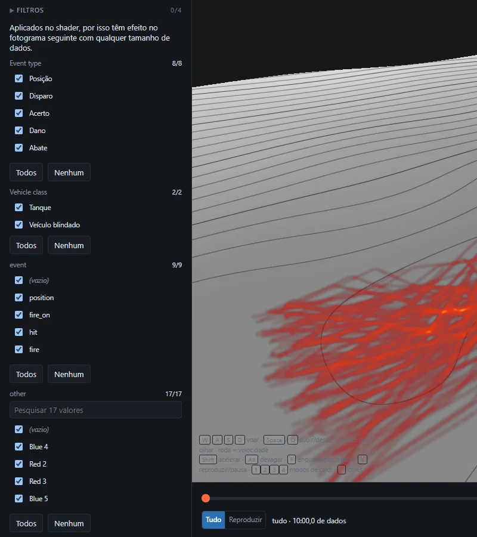
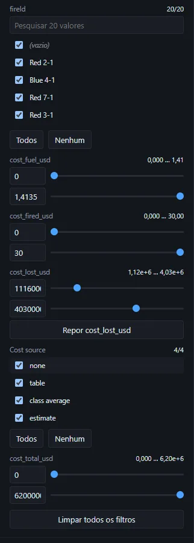

# Filtros

Os **Filtros** escondem as linhas que não lhe interessam, como uma classe de veículo ou um tipo de evento, e a imagem atualiza-se de imediato. O painel lista as colunas guardadas na carga em *Guardar para filtragem* ([Mapeamento de colunas](column-mapping.md)), mais *Ficheiro de origem* quando se carregaram vários ficheiros.

## Experimentar {#try-it}

1. Carregue um conjunto de dados e abra **Filtros** na barra lateral.
2. Em **Classe de veículo**, desmarque *Tanque*. A imagem muda de imediato.
3. Prima **Limpar todos os filtros** para desfazer.

As primeiras linhas são as colunas do próprio visualizador (abaixo). As linhas seguintes vêm do seu ficheiro.

## Colunas que o visualizador acrescenta {#columns-the-viewer-adds}

Na carga o visualizador deduz quatro colunas suas e lista-as **primeiro**, com nomes e valores no seu idioma, para que o mesmo filtro funcione para qualquer jogo e fonte de dados:

| Coluna | Valores | Deduzida a partir de |
|---|---|---|
| **Tipo de evento** | 23 tipos: Posição, Disparo, Lançamento (míssil, foguete, bomba), Impacto, Falha (arma terminou perto de nenhum alvo), Explosão, Dano, Abate, Morte, Destruído, Queda, Ejeção / salto de emergência, Nascimento, Desaparecimento, Descolagem, Aterragem, Contacto com o solo, Paragem no solo, Rearmamento / reabastecimento, Captura / objetivo, Isco, Mensagem, Outro | uma coluna chamada `event`, `events`, `event_type` ou `event_name`; as palavras próprias de cada jogo (`shot`, `burst`, `fired`, `struck`, `flare`, `plant` ...) são mapeadas para estes tipos. Tabela completa: [Tipos e classes de evento](ref-event-types.md). |
| **Jogador ou IA** | Jogador, IA | uma coluna `ai`, `is_ai`, `bot` ou `actor`; senão `is_player` / `human`; senão um identificador de conta (`user_id`, `steam_id`; vazio ou 0 é IA); para gravações Tacview, se o objeto tem piloto |
| **Classe de veículo** | 17 classes: Caça, Avião de ataque, Bombardeiro, Outro avião, Helicóptero, Tanque, Veículo blindado, Defesa antiaérea, Artilharia, Camião / carro, Navio, Submarino, Infantaria, Arma, Isco, Estrutura, Outro | o nome do veículo ou da unidade (comparado com o [catálogo de figuras](figures.md)) e colunas de tipo |
| **Classe do alvo** | as mesmas classes | o veículo da outra parte (`other_vehicle`, `target_vehicle`, `victim_type` ...) |

Só se listam os tipos que ocorrem. As colunas de valor (`cost_*`, `earn_*`, `net_*` e *Fonte do custo*, ver [Ponderação de valores](value-weighting.md)) podem ser filtradas como qualquer coluna numérica: por exemplo, desmarque *estimativa* em *Fonte do custo* para ficar só com linhas com preço.

Uma lista de categorias com mais de 12 valores ganha uma caixa de pesquisa (*Procurar n valores*) e um botão **Só estes** que permite exatamente os valores que correspondem.

Que colunas podem ser filtradas é decidido na carga, porque têm de ser lidas nesse momento. Sem nenhuma coluna guardada, o painel diz isso e aponta para *Guardar para filtragem*.

## Colunas numéricas (intervalo) {#numeric-columns-range}

| Parte | Significado |
|---|---|
| Nome, e `mín ... máx` | A coluna, e o intervalo atual (o intervalo completo da coluna enquanto não há filtro). |
| Primeira linha: caixa numérica e controlo deslizante | O limite inferior. Arrastar o controlo acima do limite superior empurra o limite superior com ele. |
| Segunda linha: caixa numérica e controlo deslizante | O limite superior. Arrastar abaixo do limite inferior também o empurra. |
| **Repor *coluna*** | Remove este filtro. |

Os controlos deslizantes cobrem o mínimo a máximo da coluna em 1000 passos; as caixas numéricas aceitam qualquer valor. Uma linha passa quando o seu valor está dentro do intervalo, incluindo os dois extremos. Valores grandes mostram-se em notação exponencial (`1,23e6`).

## Colunas de categoria {#category-columns}

| Parte | Significado |
|---|---|
| Nome, e `permitidos/total` | A coluna, e quantos dos seus valores são permitidos. |
| Lista de valores | Uma caixa de seleção por valor; um valor vazio aparece como *(vazio)*. |
| **Todos** / **Nenhum** | Permitir todos os valores / nenhum valor. |

Permitir todos os valores remove o filtro.

## Regras {#rules}

- **Quatro filtros de cada vez.** O cabeçalho mostra `ativos/4`. Um quinto filtro não é aplicado, e o painel diz isso. Uma seleção em [Entidades](entities.md) (ou o foco de jogador do separador Partida) usa um dos quatro também. Um filtro que cobre a coluna inteira não usa nenhum.
- **Uma coluna de categorias tem no máximo 4096 valores**; uma mais larga não é guardada na carga.
- **Os filtros combinam-se com E**, e com a visibilidade das equipas, a divisão por diferença, a janela de tempo, o recorte por distância e o [corte](slice.md).
- **Mudar um filtro reinicia a acumulação e volta a medir a exposição** alguns fotogramas depois, porque filtrar pode mudar muito a densidade ([Cor e exposição](colour-and-exposure.md#auto-exposure)).
- **Limpar todos os filtros** remove todos os filtros de coluna. A visibilidade das equipas e as seleções de jogadores definidas noutro sítio mantêm-se.
- Os filtros de coluna mudam os modos de calor. Não mudam as figuras da [repetição com figuras](box-replay.md), que seguem a visibilidade das equipas e a seleção de Entidades. A seleção de Entidades muda ambos.
- No [calor em linhas](line-heat.md) um filtro é testado na linha onde cada segmento *termina*.
- A cada conjunto de dados novo, todos os filtros são limpos.

## Para programadores {#for-developers}

**Ranhuras.** Cada filtro ativo ocupa uma das quatro ranhuras da GPU ([`MAX_FILTER_SLOTS`](https://github.com/Holdi601/3DHeat/blob/main/src/render/types.ts)), uma textura de 4 bytes por linha. As ranhuras são dadas aos filtros pela ordem em que foram alterados pela última vez ([`filterSlots`](https://github.com/Holdi601/3DHeat/blob/main/src/render/filterTables.ts), partilhada pelo shader e pelos dois painéis). Acima de quatro, aparece um erro que diz *Só os primeiros 4 filtros são aplicados. Limpe um - os restantes são ignorados, não combinados em silêncio*, e os nomes dos filtros extra leem-se como *coluna (não aplicado)*. Os filtros correm linha a linha no shader de vértices, por isso mudar um limiar não precisa de nova leitura nem de novo envio.

**Filtros que o painel não mostra.** Existem mais dois tipos no estado da aplicação ([`FilterSpec`](https://github.com/Holdi601/3DHeat/blob/main/src/state/types.ts)):

- um filtro de **grupos**, definido pelo separador Partida quando foca um lado. Oculta os outros grupos em todos os modos, incluindo uma divisão por diferença sobre uma coluna.
- um filtro de **pessoas**, definido pelo painel [Entidades](entities.md) e pelo separador Partida quando foca um jogador. Restringe a repetição com figuras e os modos de calor. No calor é um filtro de categoria sobre os identificadores de pessoa e ocupa uma das quatro ranhuras. A sua máscara guarda 65 536 identificadores ([`FILTER_MASK_CAPACITY`](https://github.com/Holdi601/3DHeat/blob/main/src/render/types.ts)); uma pessoa além disso não é desenhada no calor enquanto o filtro estiver ativo, mesmo que esteja selecionada. A repetição com figuras continua a mostrá-la.
