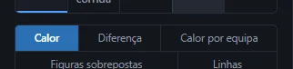
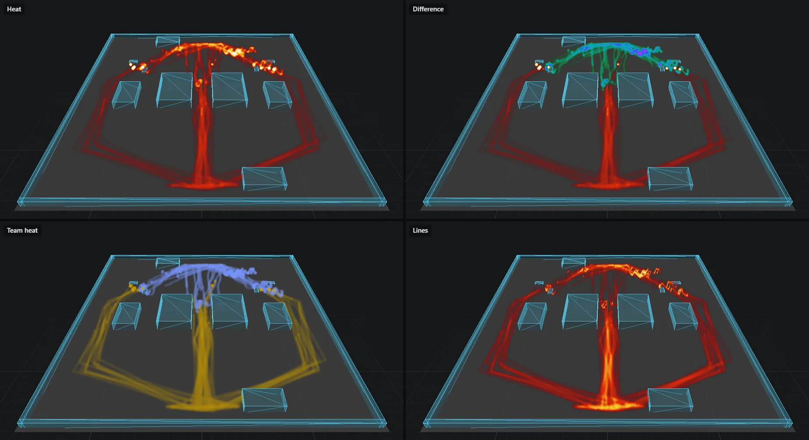

# Modos de calor

Cada ponto acrescenta um pequeno brilho, os brilhos acumulam-se, e a acumulação é pintada com cores. Os modos são cinco maneiras de a pintar, e cada um responde a uma pergunta.

A barra de modos no topo da barra lateral do separador Mapa de calor escolhe a forma como o [conjunto de dados](glossary.md) é desenhado. As teclas 1-4 escolhem Calor, Diferença, Calor por equipa e Linhas. A sobreposição de figuras não tem tecla.

| Modo | Pergunta a que responde |
|---|---|
| **Calor** | Onde aconteceu, e quanto? |
| **Diferença** | Qual dos lados fez mais? |
| **Calor por equipa** | De quem foi? |
| **Linhas** | Por onde andaram as pessoas? |
| **Figuras sobrepostas** | Quem esteve onde, e quando? |

| Modo (rótulo na barra) | Tecla | O que desenha | Precisa de |
|---|---|---|---|
| **Calor** | 1 | Densidade aditiva: cada linha visível acrescenta um sprite radial virado para a câmara. [Calor](heat.md) | um conjunto de dados |
| **Diferença** | 2 | Densidade com sinal: uma população soma, outra subtrai. [Diferença](difference.md) | dois lados: pelo menos dois grupos, ou uma divisão sobre uma coluna guardada |
| **Calor por equipa** | 3 | Densidade colorida por grupo: uma tonalidade por grupo, misturada onde os grupos se sobrepõem. [Calor por equipa](team-heat.md) | uma coluna de grupo |
| **Figuras sobrepostas** | - | Uma figura (ou caixa) por pessoa, a mover-se ao longo da linha temporal: a repetição. [Sobreposição de figuras](box-replay.md), [Repetição da partida](match-replay.md) | uma coluna de pessoa |
| **Linhas** | 4 | Calor em linhas: uma linha de cada amostra de uma pessoa até à seguinte, com o calor a diminuir para os lados. [Calor em linhas](line-heat.md) | uma coluna de pessoa e uma de tempo |

Um modo que os dados não suportam fica a cinzento, e a sua dica explica o motivo, por exemplo *Indisponível - o modo Diferença precisa de dois grupos ou de uma coluna guardada para dividir; estes dados têm um só grupo.* Quando um novo conjunto de dados não suporta o modo atual, a vista passa para **Calor**.

As teclas 1-4 são verificadas contra os dados da mesma forma: uma tecla de um modo a cinzento não faz nada.

## Que painéis mostra cada modo {#which-panels-each-mode-shows}

| Painel | Calor | Diferença | Calor por equipa | Figuras sobrepostas | Linhas |
|---|---|---|---|---|---|
| Percursos ([calor em linhas](line-heat.md)) | | | | | sim |
| Forma do calor (com **Seguir a vista** e **Mesma densidade com qualquer zoom**), Cores do calor, limites de píxeis do sprite, Profundidade, Recorte por distância | sim | sim | sim | | sim |
| Direção ([calor direcional](directional-heat.md)), Valor ([ponderação de valores](value-weighting.md)) | sim | sim | sim | | sim |
| Visualizador de equipas ([sobreposição de figuras](box-replay.md)) | | | | sim | |
| Divisão por diferença ([diferença](difference.md)) | | sim | | | |
| [Equipas](teams-list.md), [Entidades](entities.md), [Filtros](filters.md), Fundo / nível, [Corte](slice.md), [Medir](measure.md), Percurso da câmara e renderização, Desempenho, Câmara e cena | sim | sim | sim | sim | sim |

## O que partilham todos os modos de calor {#what-every-heat-mode-shares}

Os quatro modos de calor (tudo menos a sobreposição de figuras) são a mesma máquina com entradas diferentes ([`engine.ts`](https://github.com/Holdi601/3DHeat/blob/main/src/render/engine.ts)):

1. **Quais as linhas.** A janela da [linha temporal](timeline.md) escolhe um intervalo contínuo de linhas ordenadas por tempo; os [filtros](filters.md), a visibilidade dos grupos, a divisão por diferença, o [recorte por distância](depth-and-culling.md#distance-culling) e o [corte](slice.md) decidem, linha a linha, no shader de vértices, se e com que força cada uma contribui.
2. **Splatting.** Cada linha que contribui é desenhada como um sprite (ou, no modo Linhas, como um segmento) num **alvo de calor** de vírgula flutuante, somando o seu valor da rampa. Quando há mais linhas do que uma imagem consegue suportar, desenha-se uma amostra estratificada das linhas, ponderada para compensar. Ver [Amostragem e orçamentos](sampling-and-budgets.md).
3. **Acumulação.** Enquanto nada muda, as imagens são fundidas até que cada linha tenha contribuído exatamente uma vez. Ver [Acumulação](accumulation.md).
4. **Composição.** O valor acumulado em cada píxel é dividido pelo **ponto de saturação**, moldado pela **resposta à densidade**, elevado pelo **calor mínimo** e procurado na **rampa de cores**, cujo alfa mistura o resultado com a cena. Ver [Cor e exposição](colour-and-exposure.md).

Tudo o que está no passo 4 é aplicado no momento da composição, por isso arrastar esses controlos nunca reinicia a acumulação; o que está nos passos 1-2 reinicia-a.

## Páginas desta secção {#pages-in-this-section}

- [Calor](heat.md) - o modo de calor simples, e a visão geral dos seus painéis
  - [Forma do sprite](sprite-shape.md) - raio, intensidades, decaimento, o editor de curvas, limites de píxeis, achatamento
  - [Cor e exposição](colour-and-exposure.md) - editor da rampa, ponto de saturação, exposição automática, calor mínimo, resposta à densidade
  - [Profundidade e culling](depth-and-culling.md) - oclusão pelo nível, ocultar atrás do terreno, recorte por distância
- [Diferença](difference.md) - a divisão por diferença
- [Calor por equipa](team-heat.md)
- [Calor em linhas](line-heat.md) - percursos
- [Sobreposição de figuras](box-replay.md) - o modo de repetição (o ficheiro ainda se chama box replay)
- [Calor direcional](directional-heat.md)
- [Ponderação de valores](value-weighting.md)
