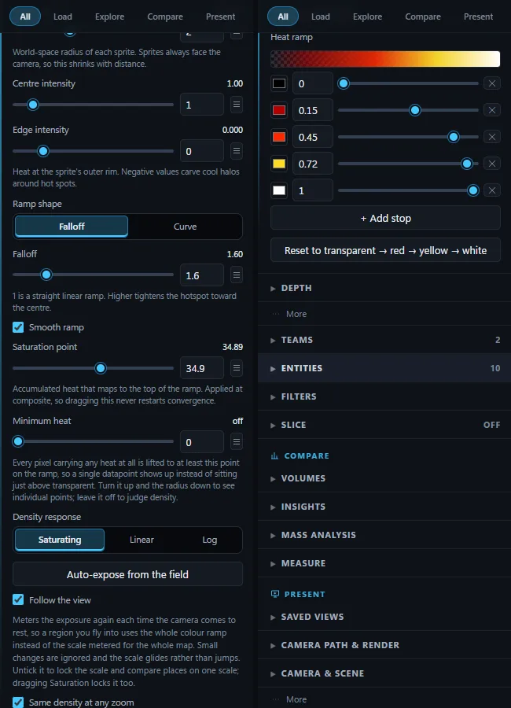

# Calor

O calor pinta os sítios onde aconteceram muitas coisas: vermelho onde aconteceu um pouco, branco-incandescente onde aconteceu muito. Responde a "onde é que isto acontece, e quanto".

**Calor** (tecla 1) é o modo por omissão. Cada [linha](glossary.md) visível contribui com um [sprite](glossary.md) redondo virado para a câmara; os sprites que se sobrepõem somam-se num buffer de vírgula flutuante; a soma passa por uma rampa de cores - por omissão transparente → vermelho → amarelo → branco - e é desenhada sobre a cena.

A imagem mostra o calor de uma ronda de atirador num nível com edifícios: os pontos quentes estão nas salas e nas escadas, não só no chão.

## Como usar {#how-to-use-it}

1. Carregue dados e prima `1` (ou escolha **Calor** na barra de modos).
2. Se tudo estiver branco ou em branco, prima **Exposição automática a partir do campo** na secção **Forma do calor**.
3. Altere o **Raio do sprite** até os pontos vizinhos se fundirem em faixas: mais pequeno mostra manchas isoladas, mais grande mostra áreas.
4. Abra **Cores do calor** para mudar as cores, ou **Profundidade** para deixar que colinas e paredes escondam o calor atrás delas.

Os mesmos painéis dão forma à [Diferença](difference.md), ao [Calor por equipa](team-heat.md) e ao [Calor em linhas](line-heat.md); diferem no que se soma (com sinal, colorido, ou ao longo de linhas), não na forma como o fazem.

## Os painéis e as suas predefinições {#the-panels-and-their-defaults}

Cada controlo abaixo corresponde a um parâmetro do shader, por isso alterá-lo só custa um redesenho. Os controlos deslizantes têm uma caixa para escrever o valor ao lado e uma pega de arrastar (a pequena patilha à direita: arraste para cima ou para baixo, mais longe é mais rápido, Shift para ajuste fino); quando a barra de um controlo deslizante termina antes de um limite real, a pega pode ir além dele até ao *teto de ajuste* indicado aqui. Os valores marcados *ao carregar* são recalculados para cada novo conjunto de dados.

### Forma do calor (aberta) {#heat-shape-open}

| Controlo | Predefinição | Intervalo (teto de ajuste) | Detalhes |
|---|---|---|---|
| **Raio do sprite** | 6 m; ao carregar extensão / 120 | 0,05-2000 m, logarítmico (50 000) | [Forma do sprite](sprite-shape.md#sprite-radius) |
| **Intensidade no centro** | 1 | 0-10 (1000) | [Forma do sprite](sprite-shape.md#centre-and-edge-intensity) |
| **Intensidade na borda** | 0 | -2-10 (1000) | [Forma do sprite](sprite-shape.md#centre-and-edge-intensity) |
| **Forma da rampa** | *Decaimento* | *Decaimento* / *Curva* | [Forma do sprite](sprite-shape.md#ramp-shape-falloff-or-curve) |
| **Decaimento** (só com Decaimento) | 1,6 | 0,1-8 (64) | [Forma do sprite](sprite-shape.md#falloff) |
| **Rampa suave** (só com Decaimento) | ligado | | [Forma do sprite](sprite-shape.md#falloff) |
| Editor de curvas (só com Curva) | predefinição *Suave* | | [Forma do sprite](sprite-shape.md#the-curve-editor) |
| **Ponto de saturação** | 24; ao carregar uma estimativa, depois medido | 0,1-4000, logarítmico (10 000 000) | [Cor e exposição](colour-and-exposure.md#saturation-point) |
| **Calor mínimo** | desligado (0) | 0-100% | [Cor e exposição](colour-and-exposure.md#minimum-heat) |
| **Resposta à densidade** | *Saturante* | *Saturante* / *Linear* / *Logarítmica* | [Cor e exposição](colour-and-exposure.md#density-response) |
| **Exposição automática a partir do campo** | | botão | [Cor e exposição](colour-and-exposure.md#auto-exposure) |
| **Seguir a vista** | ligado | | Volta a medir a exposição sempre que a câmara para, para que uma região onde entra use toda a rampa de cores. Pequenas alterações são ignoradas e a escala desliza suavemente. Desmarque, ou arraste o **Ponto de saturação**, para fixar a escala e comparar sítios numa só escala. [Cor e exposição](colour-and-exposure.md#follow-the-view) |
| **Mesma densidade com qualquer zoom** | ligado | | Uma cor significa o mesmo número de linhas por área de chão, esteja mais ou menos perto. Um sprite que os limites de píxeis aumentam (ao longe) ou diminuem (de perto) mantém o calor que o seu tamanho real acrescentaria, por isso uma imagem exposta de longe não se apaga ao entrar nela. Desligado, um sprite limitado soma todo o seu peso no tamanho limitado. [Forma do sprite](sprite-shape.md#pixel-clamps) |
| **Achatar no plano do chão** | desligado | | [Forma do sprite](sprite-shape.md#flatten-onto-ground-plane) |

### Cores do calor (fechada) {#heat-colours-closed}

| Controlo | Predefinição | Detalhes |
|---|---|---|
| Amostras de grupo e **Separação de cor** (só Calor por equipa) | 1,4 | [Calor por equipa](team-heat.md) |
| Editor de **Rampa de calor** (*Positivo (equipas aditivas)* na Diferença, *Rampa de opacidade* no Calor por equipa) | transparente → vermelho → amarelo → branco | [Cor e exposição](colour-and-exposure.md#the-ramp-editor) |
| **Repor para transparente → vermelho → amarelo → branco** | | |
| Rampa **Negativo (equipas subtrativas)** (só Diferença) | transparente → verde → azul → roxo | [Diferença](difference.md#colours) |

### Limites de píxeis do sprite (fechada) {#sprite-pixel-clamps-closed}

| Controlo | Predefinição | Intervalo (teto de ajuste) | Detalhes |
|---|---|---|---|
| **Raio mínimo em píxeis** | 1 px | 0-16 (512) | [Forma do sprite](sprite-shape.md#pixel-clamps) |
| **Raio máximo em píxeis** | 96 px | 2-1024, logarítmico (8192) | [Forma do sprite](sprite-shape.md#pixel-clamps) |

### Profundidade (aberta) {#depth-open}

| Controlo | Predefinição | Detalhes |
|---|---|---|
| **Ocultar atrás do terreno** | ligado | [Profundidade e culling](depth-and-culling.md#hide-behind-terrain) |
| **Oculto atrás da geometria** | 0,8 (*80% mais escuro*) | [Profundidade e culling](depth-and-culling.md#hidden-behind-geometry) |

### Recorte por distância (fechada) {#distance-culling-closed}

| Controlo | Predefinição | Intervalo (teto de ajuste) | Detalhes |
|---|---|---|---|
| **Perto** | desligado (0) | 0,5-5000 m, logarítmico, fundo da barra = desligado (200 000) | [Profundidade e culling](depth-and-culling.md#distance-culling) |
| **Longe** | desligado (0) | 1-200 000 m, logarítmico, fundo = desligado (10 000 000) | [Profundidade e culling](depth-and-culling.md#distance-culling) |
| **Cortar num plano** | ligado | | [Profundidade e culling](depth-and-culling.md#distance-culling) |
| **Cortar também o nível** | ligado | | [Profundidade e culling](depth-and-culling.md#distance-culling) |

Teclas: `[` e `]` aproximam e afastam o limite distante, `\` alterna-o ([Profundidade e culling](depth-and-culling.md#keyboard)).

### Direção e Valor {#direction-and-value}

Mais duas secções ficam por baixo de Forma do calor. **Direção** desenha cada linha como uma cunha e acrescenta setas: ver [Calor direcional](directional-heat.md). **Valor** pondera o calor pelo que cada linha custou ou rendeu: ver [Ponderação de valores](value-weighting.md).

## O que fica guardado {#what-is-saved}

As definições de calor acima não ficam guardadas entre sessões: recarregar a página repõe as predefinições. Ficam guardadas no navegador duas coisas: a última velocidade de reprodução (`heat3d.speed`, ver [Linha temporal](timeline.md)) e as definições das figuras distantes da [sobreposição de figuras](box-replay.md) (estilo do símbolo, tamanho, marcas de impacto, etc.). Ficam também o idioma, os [eixos do mundo invertidos](camera.md#invert-world-axis), os nomes de carros que o separador de corridas memorizou e a [biblioteca de níveis](level-library.md). A lista completa está em [Definições guardadas](ref-settings-storage.md).
