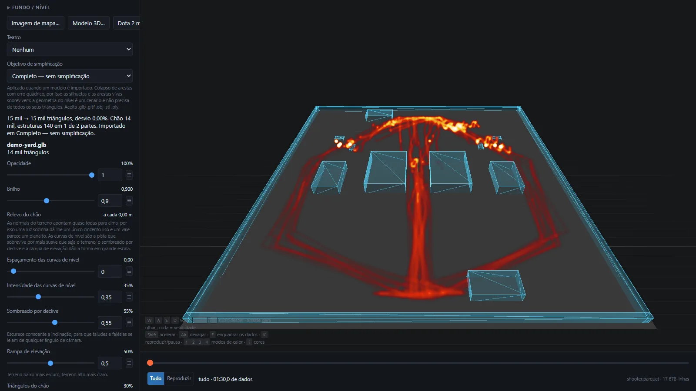
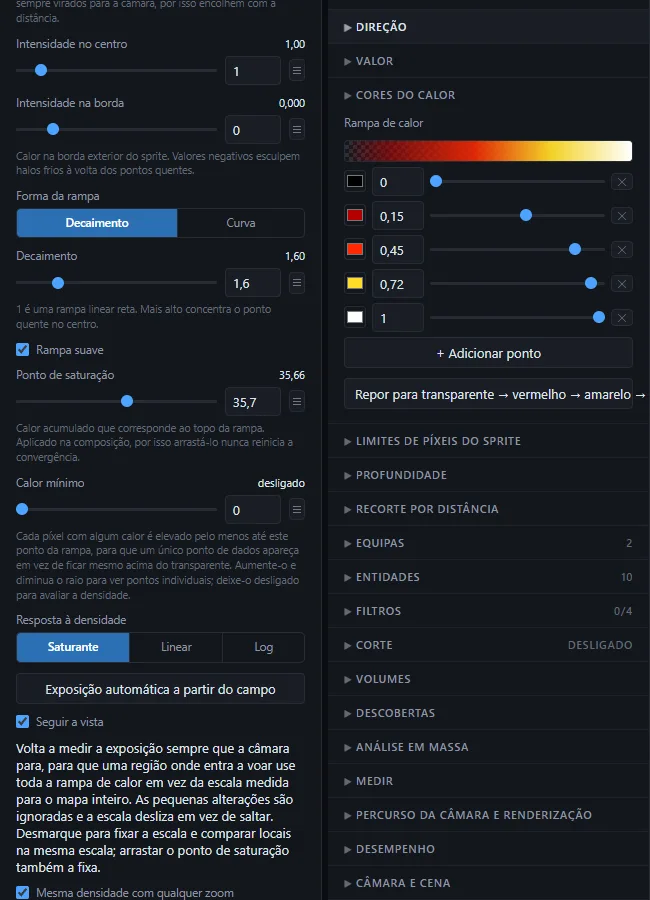

# Calor

O calor pinta os sítios onde aconteceram muitas coisas: vermelho onde aconteceu um pouco, branco-quente onde aconteceu muito. Responde a "onde é que isto acontece, e quanto".

**Calor** (tecla 1) é o modo predefinido. Cada [linha](glossary.md) visível contribui com um [sprite](glossary.md) redondo virado para a câmara; os sprites sobrepostos somam-se num buffer de vírgula flutuante; a soma passa por uma rampa de cores - por predefinição transparente → vermelho → amarelo → branco - e é desenhada sobre a cena.

A imagem mostra o calor de uma ronda de tiro num nível com edifícios: os pontos quentes ficam nas salas e nas escadas, e não só no chão.

## Como usar {#how-to-use-it}

1. Carregue dados e carregue em `1` (ou escolha **Calor** na barra de modos).
2. Se tudo estiver branco ou em branco, carregue em **Exposição automática a partir do campo** na secção **Forma do calor**.
3. Mude o **Raio do sprite** até os pontos vizinhos se fundirem em faixas: menor mostra manchas isoladas, maior mostra áreas.
4. Abra **Cores do calor** para mudar as cores, ou **Profundidade** para deixar colinas e muros esconderem o calor atrás deles.

Os mesmos painéis moldam a [Diferença](difference.md), o [Calor por equipa](team-heat.md) e o [Calor em linhas](line-heat.md); diferem no que se acrescenta (com sinal, com cor, ou ao longo de linhas), não no modo como o fazem.

## Os painéis e as suas predefinições {#the-panels-and-their-defaults}

Cada controlo é explicado na sua própria página; a coluna Detalhes liga a ela. Os cursores têm uma caixa escrita ao lado e um manípulo de arrastar (a pequena pega à direita: arrastar para cima ou para baixo, mais longe é mais depressa, Shift para ajuste fino); quando a pista de um cursor acaba antes de um limite real, o manípulo pode ir além dela até ao *teto do cursor* indicado aqui. Os valores marcados *ao carregar* são recalculados para cada novo conjunto de dados.

### Forma do calor (aberta) {#heat-shape-open}

| Controlo | Predefinição | Intervalo (teto do cursor) | Detalhes |
|---|---|---|---|
| **Raio do sprite** | 6 m; ao carregar extensão / 120 | 0,05-2000 m, logarítmico (50 000) | [Forma do sprite](sprite-shape.md#sprite-radius) |
| **Intensidade no centro** | 1 | 0-10 (1000) | [Forma do sprite](sprite-shape.md#centre-and-edge-intensity) |
| **Intensidade na borda** | 0 | -2-10 (1000) | [Forma do sprite](sprite-shape.md#centre-and-edge-intensity) |
| **Forma da rampa** | *Decaimento* | *Decaimento* / *Curva* | [Forma do sprite](sprite-shape.md#ramp-shape-falloff-or-curve) |
| **Decaimento** (só em Decaimento) | 1,6 | 0,1-8 (64) | [Forma do sprite](sprite-shape.md#falloff) |
| **Rampa suave** (só em Decaimento) | ligado | | [Forma do sprite](sprite-shape.md#falloff) |
| Editor de curvas (só em Curva) | predefinição *Suave* | | [Forma do sprite](sprite-shape.md#the-curve-editor) |
| **Ponto de saturação** | 24; ao carregar uma estimativa, depois medido | 0,1-4000, logarítmico (10 000 000) | [Cor e exposição](colour-and-exposure.md#saturation-point) |
| **Calor mínimo** | desligado (0) | 0-100% | [Cor e exposição](colour-and-exposure.md#minimum-heat) |
| **Resposta à densidade** | *Saturante* | *Saturante* / *Linear* / *Log* | [Cor e exposição](colour-and-exposure.md#density-response) |
| **Exposição automática a partir do campo** | | botão | [Cor e exposição](colour-and-exposure.md#auto-exposure) |
| **Seguir a vista** | ligado | | Volta a medir a exposição sempre que a câmara para, para que uma região onde entra a voar use a rampa de cores inteira. As pequenas alterações são ignoradas e a escala desliza. Desmarque-o, ou arraste o **Ponto de saturação**, para fixar a escala e comparar sítios na mesma escala. [Cor e exposição](colour-and-exposure.md#follow-the-view) |
| **Mesma densidade com qualquer zoom** | ligado | | Uma cor significa o mesmo número de linhas por área de chão, por mais perto que esteja. Um sprite que os limites de píxeis aumentam (ao longe) ou diminuem (de perto) mantém o calor que o seu tamanho real acrescentaria, por isso uma imagem exposta de longe não desaparece à medida que voa para dentro. Desligado, um sprite limitado acrescenta o seu peso total ao tamanho limitado. [Forma do sprite](sprite-shape.md#pixel-clamps) |
| **Achatar no plano do chão** | desligado | | [Forma do sprite](sprite-shape.md#flatten-onto-ground-plane) |

### Cores do calor (fechada) {#heat-colours-closed}

| Controlo | Predefinição | Detalhes |
|---|---|---|
| Amostras de grupo e **Separação de cor** (só Calor por equipa) | 1,4 | [Calor por equipa](team-heat.md) |
| Editor da **Rampa de calor** (*Positivo (equipas aditivas)* em Diferença, *Rampa de opacidade* em Calor por equipa) | transparente → vermelho → amarelo → branco | [Cor e exposição](colour-and-exposure.md#the-ramp-editor) |
| **Repor para transparente → vermelho → amarelo → branco** | | |
| Rampa **Negativo (equipas subtrativas)** (só em Diferença) | transparente → verde → azul → roxo | [Diferença](difference.md#colours) |

### Limites de píxeis do sprite (fechada) {#sprite-pixel-clamps-closed}

| Controlo | Predefinição | Intervalo (teto do cursor) | Detalhes |
|---|---|---|---|
| **Raio mínimo em píxeis** | 1 px | 0-16 (512) | [Forma do sprite](sprite-shape.md#pixel-clamps) |
| **Raio máximo em píxeis** | 96 px | 2-1024, logarítmico (8192) | [Forma do sprite](sprite-shape.md#pixel-clamps) |

### Profundidade (aberta) {#depth-open}

| Controlo | Predefinição | Detalhes |
|---|---|---|
| **Ocultar atrás do terreno** | ligado | [Profundidade e recorte](depth-and-culling.md#hide-behind-terrain) |
| **Oculto atrás da geometria** | 0,8 (*80% mais escuro*) | [Profundidade e recorte](depth-and-culling.md#hidden-behind-geometry) |

### Recorte por distância (fechada) {#distance-culling-closed}

| Controlo | Predefinição | Intervalo (teto do cursor) | Detalhes |
|---|---|---|---|
| **Perto** | desligado (0) | 0,5-5000 m, logarítmico; fundo da pista = desligado (200 000) | [Profundidade e recorte](depth-and-culling.md#distance-culling) |
| **Longe** | desligado (0) | 1-200 000 m, logarítmico; fundo = desligado (10 000 000) | [Profundidade e recorte](depth-and-culling.md#distance-culling) |
| **Cortar num plano** | ligado | | [Profundidade e recorte](depth-and-culling.md#distance-culling) |
| **Cortar também o nível** | ligado | | [Profundidade e recorte](depth-and-culling.md#distance-culling) |

Teclas: `[` e `]` puxam e empurram o limite longínquo, `\` alterna-o ([Profundidade e recorte](depth-and-culling.md#keyboard)).

### Direção e Valor {#direction-and-value}

Duas secções a mais ficam por baixo da Forma do calor. **Direção** desenha cada linha como uma cunha e acrescenta setas: veja [Calor direcional](directional-heat.md). **Valor** pesa o calor pelo que cada linha custou ou rendeu: veja [Ponderação de valores](value-weighting.md).

## O que fica guardado {#what-is-saved}

As definições de calor acima não são guardadas entre sessões: recarregar a página repõe as predefinições. Duas coisas ficam guardadas no navegador: a última velocidade de reprodução (`heat3d.speed`, veja [Linha temporal](timeline.md)) e as definições das figuras distantes da [sobreposição de figuras](box-replay.md) (estilo dos símbolos, tamanho, marcas de acerto e assim por diante). Também ficam o idioma, os [eixos do mundo invertidos](camera.md#invert-world-axis), os nomes de carros lembrados do separador de corrida e a [biblioteca de níveis](level-library.md). A lista completa está em [Definições guardadas](ref-settings-storage.md).
