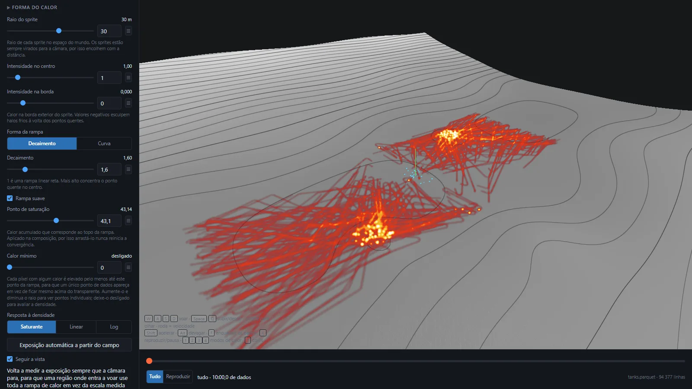
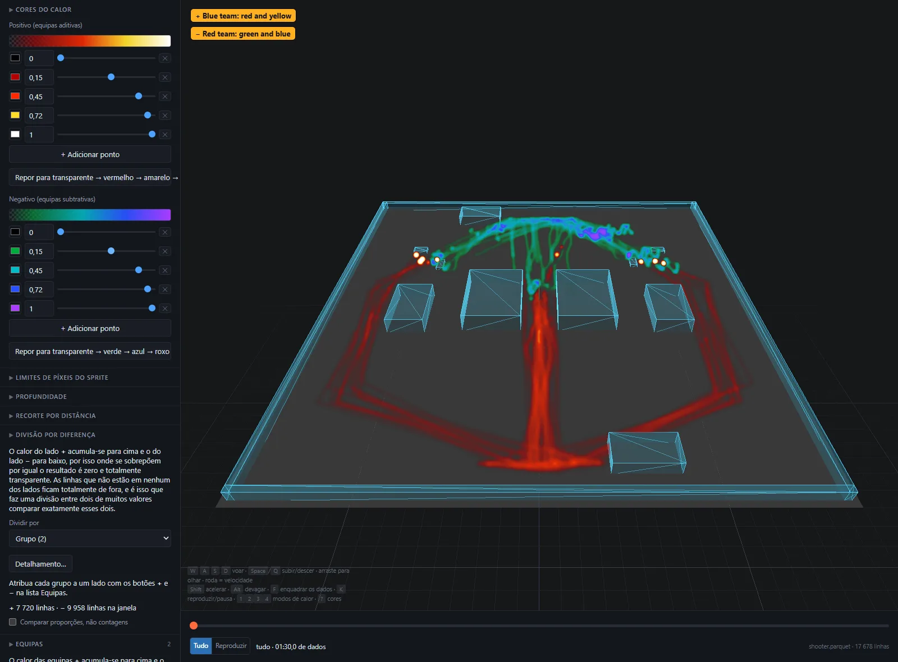
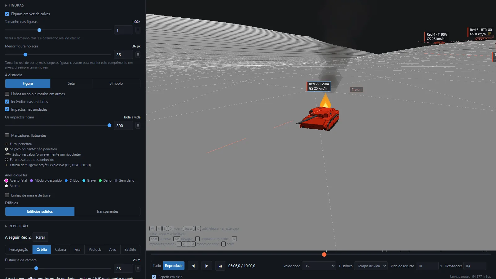
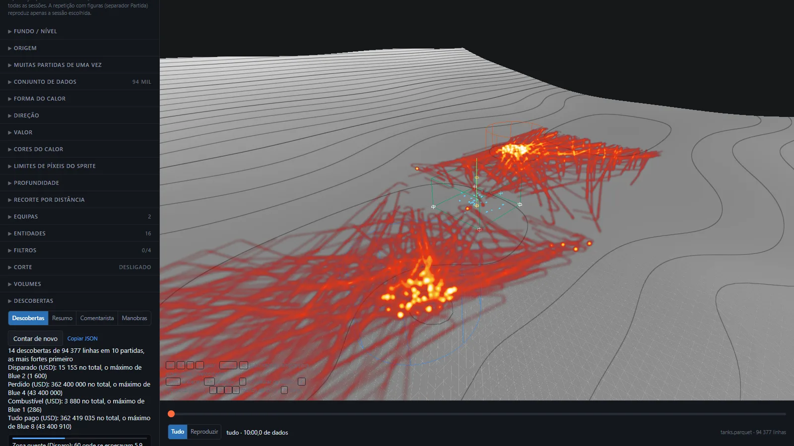
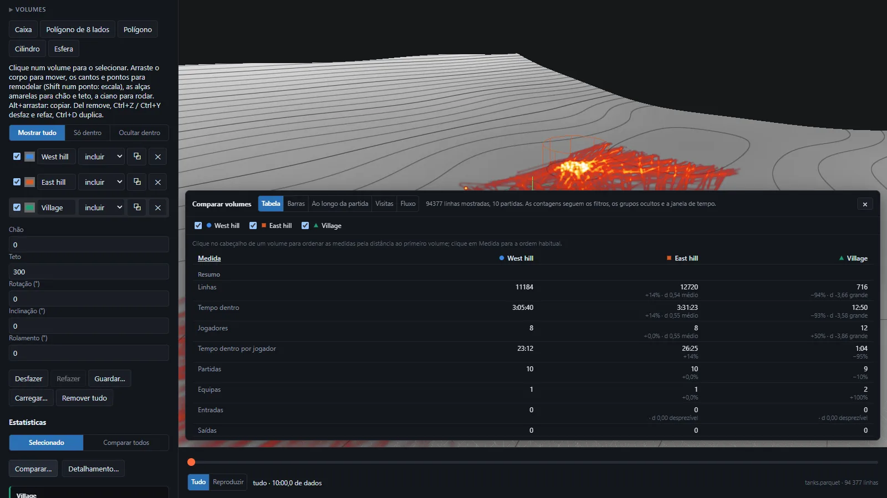
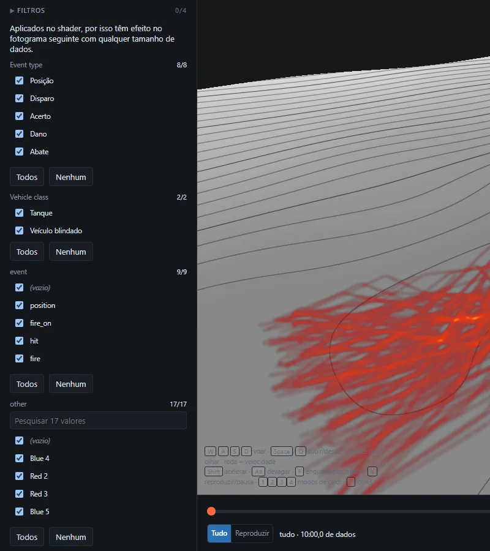
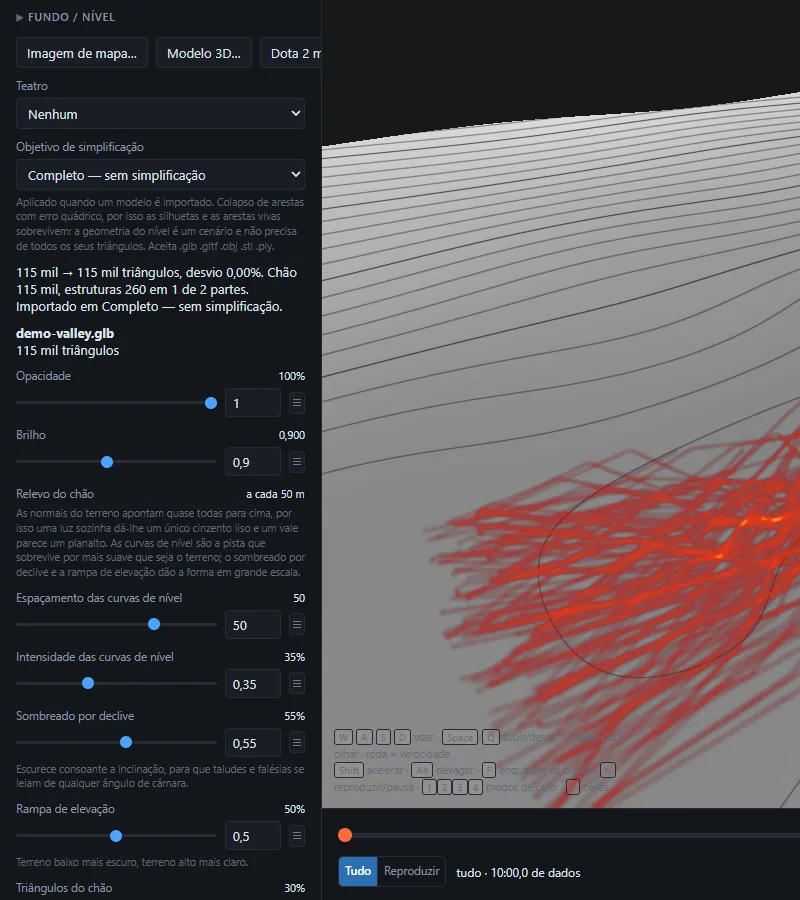

# 3DHeat

O 3DHeat mostra onde as coisas aconteceram num jogo: por onde andaram os jogadores, onde lutaram e onde caíram. Mostra isto como cores brilhantes através das quais pode voar, ou como pequenas figuras 3D que repetem a partida.

Carregue posições (CSV, Parquet, gravações Tacview, repetições convertidas, um único ficheiro, uma pasta ou milhares de partidas) e veja-as como um **mapa de calor por onde pode voar**, como **figuras que repetem a partida**, como linhas ao longo dos percursos que as pessoas seguiram, ou como uma população contra outra. Encontra sozinho o que se destaca, e funciona inteiramente no seu navegador: não se envia nada para lado nenhum. O 3DHeat e todas as suas ferramentas são gratuitos e de código aberto sob a [licença MIT](https://github.com/Holdi601/3DHeat/blob/main/LICENSE).



**Novo por aqui?** Crie os [dados de demonstração](demo-data.md) e siga os seus sete passos. Todas as imagens deste site foram tiradas com eles.

## O que faz {#what-it-does}

| | |
|---|---|
|  | **[Modos de calor](heat-modes.md)** - calor, [diferença](difference.md) (vermelho onde um lado teve mais, azul-esverdeado onde teve mais o outro), [calor por equipa](team-heat.md), [calor em linhas](line-heat.md); [calor direcional](directional-heat.md) com cunhas, campos de setas e gráficos polares; calor [ponderado pelo valor](value-weighting.md): quanto custam as armas, os veículos e o combustível. |
|  | **[Repetição da partida](match-replay.md)** - cada unidade como a [figura](figures.md) do que é, símbolos NATO ou russos à distância, mísseis e traçadores, marcas de impactos, destroços, incêndios, torres, objetivos, câmaras ao estilo Tacview e visualização tática; [muitas partidas de uma vez](many-matches.md). |
|  | **[Descobertas](insights.md)** - posições fortes, terreno mortal, armadilhas de nascimento, gargalos e jogadores em destaque, encontrados e ordenados com as provas; um resumo escrito, opcionalmente feito por uma IA à sua escolha; um comentador para uma partida; a [lente de conhecimento](knowledge.md). |
|  | **[Volumes](volumes.md)** - desenhe caixas, prismas, cilindros e esferas, filtre por eles, conte o que acontece dentro, exporte e compare lugares lado a lado; [detalhamento](breakdown.md) de quem e o que se sai melhor num lugar. |
|  | **[Filtros](filters.md)** - por tipo de evento, jogador ou IA, classe de veículo, valor, qualquer coluna, na placa gráfica com qualquer tamanho de dados. |
|  | **[Níveis](levels.md)** - imagens de mapa, níveis 3D feitos com as [ferramentas de dados](#related-repositories), simplificação, o [cenário do mundo](world-backdrop.md) com terreno real para dados de voo. |

Também: o separador [Análise de corrida](race-analysis.md) para voltas de jogos de corrida, o separador [Partida](match-analysis.md) para resumos de Counter-Strike 2, o [Quadro tático](tactics-board.md) para planos sobre um nível, a [análise de impactos](hit-analysis.md) por veículo, a [análise em massa](mass-analysis.md) de milhares de partidas, [percursos de câmara e vídeo](camera-path-and-video.md), [40 idiomas](languages.md), [unidades métricas ou imperiais](settings.md).

## Os separadores {#the-tabs}

Os separadores ficam no topo da barra lateral, por baixo do nome, das unidades e do menu de idioma.

| Separador | Para que serve |
|---|---|
| **Mapa de calor** | Qualquer tabela de posições: os modos de calor, a sobreposição de figuras, filtros, volumes, descobertas, níveis, medição e vídeo. |
| **Análise de corrida** | Duas ou mais voltas de um mesmo percurso: onde se perde tempo, porquê e o que mudar. |
| **Partida** | A repetição com figuras de uma partida, e os resumos de partidas de Counter-Strike 2. |
| **Tática** | Planos sobre um nível: figuras, percursos, utilitários lançados, áreas e notas, em passos que se reproduzem. |
| **Veículos** | Onde foi atingida cada unidade, por quem e com quê. |

## Instalar e executar {#install-and-run}

O 3DHeat é gratuito para usar, alterar e partilhar (licença MIT), e o mesmo se aplica a todas as ferramentas listadas em [Repositórios relacionados](#related-repositories).

### Windows, o modo fácil {#windows-the-easy-way}

A raiz do repositório tem três ficheiros de lote.

| Ficheiro | O que faz |
|---|---|
| `start.bat` | Inicia o visualizador. Encontra o Node.js mesmo quando não está no `PATH` (procura em `%ProgramFiles%\nodejs`, `%ProgramFiles(x86)%\nodejs` e `%LOCALAPPDATA%\Programs\nodejs`), e quando o Node.js não existe oferece-se para instalar a versão LTS com `winget install -e --id OpenJS.NodeJS.LTS`. Na primeira execução pergunta antes de transferir as dependências (cerca de 300 MB para `node_modules\` dentro da pasta, nada à escala do sistema). Recusa-se a arrancar quando algo já escuta na porta 5273, e indica o `restart.bat`. Quando a pasta é um checkout do git sem alterações locais e existe uma versão mais recente, pergunta se deve atualizar (Y/N; sem resposta em 60 s mantém esta versão; ver [Atualizações](updates.md)). Depois executa o servidor de desenvolvimento em `http://127.0.0.1:5273/` e abre o navegador. **A janela é o servidor**: deixe-a aberta; feche-a ou prima Ctrl+C para parar. |
| `restart.bat` | Executa `stop.bat quiet` e depois `start.bat`. Só é preciso depois de alterar `vite.config.ts`, de acrescentar uma dependência, ou quando o servidor fica bloqueado - as alterações ao código são recarregadas automaticamente. |
| `stop.bat` | Para o que estiver a escutar na porta 5273, pelo identificador do processo encontrado com `netstat`, nunca pelo nome da imagem, para que outros processos Node.js da máquina fiquem em paz. Espera cerca de dois segundos até o socket ser libertado. Com o argumento `quiet` não pausa no fim. |

### Manualmente (qualquer sistema) {#by-hand-any-os}


```bash
git clone --recursive https://github.com/Holdi601/3DHeat.git
cd 3DHeat
npm install
npm run dev      # http://127.0.0.1:5273
```

A pasta `exporters/` contém as ferramentas de dados separadas como submódulos do git, cada uma o seu próprio repositório; depois de um clone simples execute `git submodule update --init`. O visualizador em si não precisa delas para funcionar. `exporters/ext/` contém os conversores opcionais (War Thunder, World of Tanks, World of Warships, repetições do Squad; mapas do DCS e do IL-2), mantidos à parte para que um problema com um deles não afete os outros.

Nenhum dado de jogo vem com nada disto: os níveis, mapas e gravações são feitos na sua própria máquina com as ferramentas, a partir de jogos que possui.

### Scripts do npm {#npm-scripts}

| Script | O que executa |
|---|---|
| `npm run dev` | O servidor de desenvolvimento Vite na porta 5273, ligado a `127.0.0.1`. |
| `npm run build` | Verificação de tipos (`tsc --noEmit`) e um pacote de produção em `dist/`. |
| `npm run preview` | Serve o pacote de produção. |
| `npm run typecheck` | Só a verificação de tipos. |
| `npm test` / `npm run test:watch` | Testes unitários e de integração (vitest). |
| `npm run smoke` | Usa a aplicação real num Chromium sem interface e verifica se a tela tem píxeis coloridos com dados; as capturas vão para `tools/.smoke/`. Espera que o servidor de desenvolvimento esteja em execução. |
| `npm run smoke:f16` | O mesmo conjunto com `?heat=f16`, forçando o caminho de acumulação em half-float (ver [Acumulação em half-float](half-float-accumulation.md)). |
| `npm run bench` | Teste de desempenho da ingestão; escreve `tools/.smoke/ingest-bench.json`. |
| `npm run test:heavy` | Testes que precisam de ficheiros grandes de dados reais; ignoram-se sozinhos quando os ficheiros não existem. |
| `npm run inspect -- <file.parquet>` | Mostra o esquema de um ficheiro Parquet e algumas linhas (`tools/inspect-parquet.mjs`). |

### O que o servidor de desenvolvimento acrescenta {#what-the-dev-server-adds}

O visualizador é uma página web estática, mas o servidor de desenvolvimento (ver `vite.config.ts`) acrescenta duas rotas locais que uma publicação estática de `dist/` não tem:

- `/__host/memory` indica a RAM instalada e livre da máquina e, quando consegue lê-la, a memória da placa gráfica (a partir do `nvidia-smi`, ou no Windows a partir da entrada do adaptador de vídeo no registo). É isto que permite aos [orçamentos de memória](memory-and-budgets.md) usar números reais em vez dos palpites limitados do navegador.
- `/__heat3d/update` verifica se o checkout está atrasado e pode atualizá-lo com avanço rápido ([Atualizações](updates.md)).

O servidor liga-se apenas a `127.0.0.1`, pelo que nenhuma destas rotas é acessível pela rede. Abra-o como `http://127.0.0.1:5273`: `localhost` pode resolver para o loopback IPv6 `::1`, onde não escuta ninguém. Não envia cabeçalhos de isolamento de origem cruzada (COOP/COEP): nada no visualizador usa `SharedArrayBuffer`, e os workers passam os seus dados por transferência, o que não precisa deles.

## Requisitos do navegador e da placa gráfica {#browser-and-gpu-requirements}

- **Um navegador com WebGPU ou WebGL2.** O WebGPU é tentado primeiro (o Chrome e o Edge têm-no); sem ele usa-se o backend WebGL2. O WebGL2 tem de oferecer `EXT_color_buffer_float` (renderizar para texturas de vírgula flutuante), senão o visualizador mostra «Não é possível inicializar o renderizador.» Ver [Os dois motores](backends.md). O visualizador é desenvolvido e testado no Chromium; os outros navegadores não foram verificados.
- **Aceleração por hardware ativada.** Quando o navegador desenha pela CPU (SwiftShader, llvmpipe, o Microsoft Basic Render Driver e similares), uma faixa vermelha no topo da barra lateral indica-o e diz como resolver. Ver [Deteção de renderização por software](software-rendering.md).
- **Uma placa gráfica dedicada ajuda, mas não é obrigatória.** Os dois motores pedem o adaptador de alto desempenho. A quantidade de dados que cabe na GPU é um orçamento que pode ver e alterar ([Memória e orçamentos](memory-and-budgets.md)).
- **Funcionalidades opcionais** usam outras APIs do navegador: a renderização de vídeo precisa do `VideoEncoder` do WebCodecs com VP9 ou VP8 ([Percurso da câmara e vídeo](camera-path-and-video.md)); a simplificação de malhas dos níveis precisa de WebAssembly; largar pastas usa a API File and Directory Entries; a biblioteca de níveis usa IndexedDB; os comandos usam a API Gamepad.

## Mapa da documentação {#documentation-map}

**Começar**: [Dados de demonstração](demo-data.md) · [Carregar dados](getting-data-in.md) ([carregar ficheiros](loading-files.md), [mapeamento de colunas](column-mapping.md), [eixos, unidades e tempo](axes-units-and-time.md), [sessões, pessoas e grupos](sessions-persons-groups.md), [Tacview](tacview-acmi.md), [conversores](converters.md), [.3dheat](container.md), [memória e orçamentos](memory-and-budgets.md))

**Ver**: [Modos de calor](heat-modes.md) ([calor](heat.md), [forma do sprite](sprite-shape.md), [cor e exposição](colour-and-exposure.md), [profundidade e culling](depth-and-culling.md), [diferença](difference.md), [calor por equipa](team-heat.md), [calor em linhas](line-heat.md), [caixa de repetição](box-replay.md), [calor direcional](directional-heat.md), [ponderação de valores](value-weighting.md)) · [Linha temporal](timeline.md) · [Níveis](levels.md) ([imagens de mapa](map-images.md), [níveis 3D](model-levels.md), [aspeto](level-appearance.md), [biblioteca](level-library.md), [cenário do mundo](world-backdrop.md), [as suas fontes](world-backdrop-sources.md)) · [Câmara](camera.md) ([comando](gamepad.md), [teclas](keyboard-reference.md)) · [Percurso da câmara e vídeo](camera-path-and-video.md)

**Analisar**: [Filtros e ferramentas](filters-and-tools.md) ([filtros](filters.md), [equipas](teams-list.md), [entidades](entities.md), [corte](slice.md), [medir](measure.md), [volumes](volumes.md), [detalhamento](breakdown.md)) · [Descobertas](insights.md) ([lente de conhecimento](knowledge.md)) · [Análise em massa](mass-analysis.md)

**Repetição**: [Repetição da partida](match-replay.md) · [Muitas partidas de uma vez](many-matches.md) · [Figuras](figures.md) ([na sobreposição de figuras](figure-replay.md), [créditos](figure-credits.md)) · [Paridade com o Tacview](tacview-parity.md) · [Análise de impactos](hit-analysis.md)

**Outros separadores**: [Análise de corrida](race-analysis.md) ([o método](race-analytics.md), [outros jogos](other-games.md)) · [Análise de partida](match-analysis.md) · [Quadro tático](tactics-board.md) ([velocidades](tactics-speeds.md))

**O visualizador**: [Glossário](glossary.md) · [Definições, unidades e teclas](settings.md) · [Idiomas](languages.md) · [Atualizações](updates.md) · [Detalhes da renderização](rendering-internals.md) ([motores](backends.md), [acumulação](accumulation.md), [amostragem e orçamentos](sampling-and-budgets.md), [half-float](half-float-accumulation.md), [memória da GPU](gpu-memory.md), [renderização por software](software-rendering.md), [desempenho e estatísticas](performance-and-stats.md)) · [Formatos de dados](data-formats.md) · [Referência](reference.md) · [Manutenção da documentação](maintaining.md)

## Repositórios relacionados {#related-repositories}

O visualizador lê dados; estas ferramentas criam-nos. Cada uma é um repositório público próprio (MIT) com a sua própria documentação. Nenhuma inclui dados de jogos: os níveis, mapas e gravações são feitos na sua própria máquina, a partir de jogos que possui.

| Repositório | O que faz | Útil para |
|---|---|---|
| [3DHeat-GameFiles](https://github.com/Holdi601/3DHeat-GameFiles) | Lê percursos e níveis dos arquivos que os jogos distribuem (Forza Horizon, BeamNG, Assetto Corsa Rally; leitores de Unreal, Unity, Frostbite e Source 2) em glTF | um nível 3D por baixo do seu calor ou da sua repetição |
| [3DHeat-GameCapture](https://github.com/Holdi601/3DHeat-GameCapture) | Grava a telemetria das voltas a partir das interfaces que os jogos de corrida publicam, e reconstrói níveis a partir de vídeo de jogo | voltas para a Análise de corrida; um nível onde não se conseguem ler ficheiros |
| [3DHeat-UnrealExporter](https://github.com/Holdi601/3DHeat-UnrealExporter) | Plugin do Unreal Editor que exporta um nível como um único ficheiro glTF | níveis dos seus próprios projetos Unreal |
| [3DHeat-CS2](https://github.com/Holdi601/3DHeat-CS2) | Demos de Counter-Strike 2 em tabelas de mapa de calor e resumos de partidas; mapas de CS2 em geometria | calor de CS2, repetições e o separador Partida |
| [3DHeat-Watcher](https://github.com/Holdi601/3DHeat-Watcher) | Regista o seu jogo em segundo plano a partir do que os jogos publicam: telemetria, integrações de estado de jogo, registos, repetições | as suas próprias estatísticas sem fazer nada à mão |
| [3DHeat-Ext-WarThunder](https://github.com/Holdi601/3DHeat-Ext-WarThunder) | Repetições de War Thunder (`.wrpl`) em tabelas: trajetos aéreos e terrestres, disparos, impactos, abates, torres, objetivos | repetições de War Thunder, marcas de impactos e descobertas |
| [3DHeat-Ext-WoT](https://github.com/Holdi601/3DHeat-Ext-WoT) | Repetições de World of Tanks em tabelas: a posição de cada veículo, mortes e abates | calor e repetições de World of Tanks |
| [3DHeat-Ext-WoWs](https://github.com/Holdi601/3DHeat-Ext-WoWs) | Repetições de World of Warships em tabelas: a posição de cada navio e os afundamentos | calor e repetições de World of Warships |
| [3DHeat-Ext-Squad](https://github.com/Holdi601/3DHeat-Ext-Squad) | Demos de servidores de Squad em tabelas: a posição, equipa e esquadra de cada jogador | calor e repetições de Squad |
| [3DHeat-Ext-DCS](https://github.com/Holdi601/3DHeat-Ext-DCS) | Terrenos do DCS World da sua própria instalação para níveis: solo, estradas, cidades, aeródromos, campos, água | DCS e gravações Tacview sobre o seu terreno real |
| [3DHeat-Ext-IL2](https://github.com/Holdi601/3DHeat-Ext-IL2) | Mapas do IL-2 Great Battles em níveis | gravações do IL-2 sobre o seu mapa |

## Estrutura do código, em resumo {#source-layout-briefly}

| Pasta | Conteúdo |
|---|---|
| [`src/data/`](https://github.com/Holdi601/3DHeat/tree/main/src/data) | Seleção de ficheiros, ingestão de CSV e Parquet, mapeamento automático, validação, modelo de memória, construtor de conjuntos de dados, leitura de modelos, classificação, simplificação, biblioteca de níveis |
| [`src/render/`](https://github.com/Holdi601/3DHeat/tree/main/src/render) | O ciclo de imagem (`engine.ts`), amostragem, os dois motores, câmara, comando, medição, percurso da câmara, gravação de vídeo |
| [`src/state/`](https://github.com/Holdi601/3DHeat/tree/main/src/state) | O estado da aplicação (`store.ts`) com todas as predefinições, os tipos de domínio (`types.ts`), a curva do sprite |
| [`src/ui/`](https://github.com/Holdi601/3DHeat/tree/main/src/ui) | Os painéis da barra lateral, a linha temporal, as sobreposições |
| [`src/race/`](https://github.com/Holdi601/3DHeat/tree/main/src/race), [`src/match/`](https://github.com/Holdi601/3DHeat/tree/main/src/match) | Os separadores Análise de corrida e Partida |
| [`src/i18n/`](https://github.com/Holdi601/3DHeat/tree/main/src/i18n) | Traduções |
| [`src/insights/`](https://github.com/Holdi601/3DHeat/tree/main/src/insights) | Descobertas: detetores, resumo, comentador, fornecedores de IA, a lente de conhecimento |
| [`src/mass/`](https://github.com/Holdi601/3DHeat/tree/main/src/mass) | Análise em massa de muitas partidas |
| [`src/volumes/`](https://github.com/Holdi601/3DHeat/tree/main/src/volumes) | Volumes, as suas estatísticas, exportação e comparação |
| [`src/breakdown/`](https://github.com/Holdi601/3DHeat/tree/main/src/breakdown) | Detalhamento e fatores |
| [`src/overlay/`](https://github.com/Holdi601/3DHeat/tree/main/src/overlay) | A sobreposição de muitas partidas |
| [`src/figures/`](https://github.com/Holdi601/3DHeat/tree/main/src/figures) | O catálogo de figuras e o seu construtor |
| [`src/vehicle/`](https://github.com/Holdi601/3DHeat/tree/main/src/vehicle) | Análise de impactos (separador Veículos) |
| [`src/tactics/`](https://github.com/Holdi601/3DHeat/tree/main/src/tactics) | O quadro tático |
| [`src/world/`](https://github.com/Holdi601/3DHeat/tree/main/src/world) | O cenário do mundo |
| [`src/units/`](https://github.com/Holdi601/3DHeat/tree/main/src/units) | Unidades de medida |
