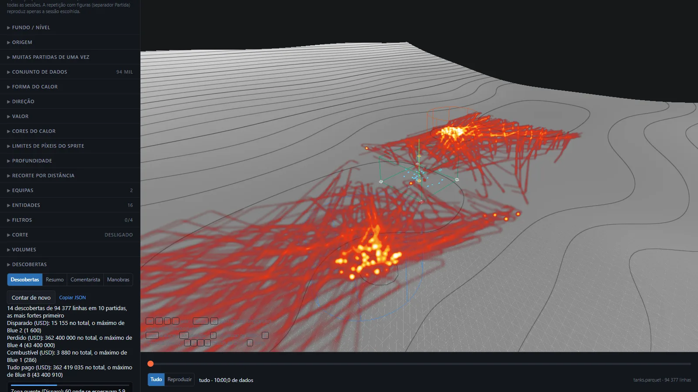
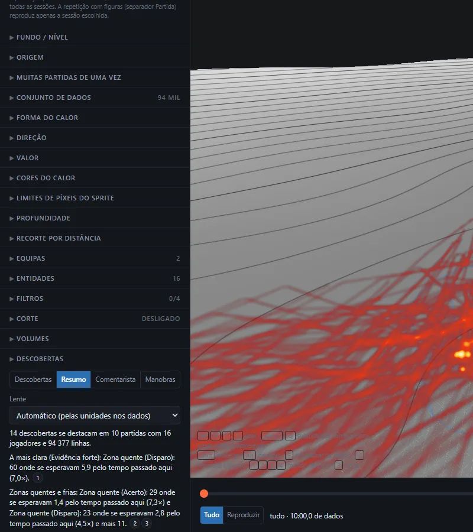
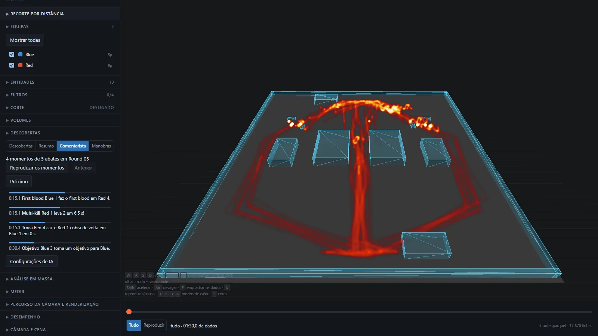

# Descobertas

**Descobertas** procura nos dados carregados o que se destaca - posições fortes, terreno mortal, armadilhas de nascimento, pontos de estrangulamento, jogadores muito acima dos seus pares - e diz-lho, o mais forte primeiro, com as provas. Use-o para perceber num minuto onde uma partida foi ganha ou perdida. Pode depois escrever um resumo, e numa única repetição pode funcionar como comentador que salta para os grandes momentos.

Tudo é contado no seu navegador. Nada sai do seu computador a não ser que ligue uma IA externa (ver [IA externa](#external-ai)).

A secção **Descobertas** está na barra lateral dos separadores Mapa de calor e Partida. Tem três separadores: **Descobertas**, **Resumo** e **Comentarista**.

## Descobertas {#findings}

1. Carregue dados e abra **Descobertas**. Prima **Encontrar descobertas** ("A contar... n%" mostra o progresso).
2. Leia a lista. Cada descoberta tem uma barra de força, uma frase, a qualidade das provas (*Provas fortes*, *Provas boas* ou *Algumas provas*), o detetor que a encontrou, e a classe de veículo quando isso importa.
3. **Clique numa descoberta**: o visualizador aplica os seus filtros, leva a câmara ao sítio e salta para o tempo, e abre os detalhes: o efeito com o seu intervalo de 95%, os valores de p e q, as provas contadas, e **Volume aqui**, que desenha um [volume](volumes.md) à volta do sítio.
4. **Restaurar filtros** repõe os seus filtros. **Copiar JSON** copia o relatório completo.

A contagem usa os filtros atuais, os grupos ocultos e a partida escolhida em todo o intervalo de tempo. Quando depois mudar os filtros, uma nota avisa-o; prima **Contar de novo**.

As linhas no topo da lista (por exemplo os totais de dinheiro) resumem o conjunto de dados inteiro antes das descobertas.

### Os detetores {#the-detectors}

| Detetor | O que encontra | Necessita nos dados |
|---|---|---|
| **Posições de poder** | Sítios com probabilidades de abate-morte muito melhores que o resto do mapa, e *terreno seguro* onde morrem poucos pelo tempo passado | eventos de abate e morte |
| **Zonas quentes e frias** | Sítios onde um tipo de evento (disparos, impactos, capturas ...) acontece muito mais ou menos do que o tempo ali passado prevê | uma coluna de eventos |
| **Terreno aberto e cobertura** | Mortes a descoberto contra geometria do nível próxima, e lentidão contra movimento rápido | mortes; um nível 3D para a parte da geometria |
| **Spawns** | Spawns fortes, armadilhas de spawn, spawns seguros, tempo até ao primeiro contacto | tempo e pessoas |
| **Classe por local** | Uma classe de veículo, ou jogadores contra IA, a sair-se muito melhor ou pior numa área | abates mais uma classe de veículo ou uma coluna jogador/IA |
| **Jogadores** | Jogadores que matam ou morrem muito mais ou menos que outros da mesma classe | pessoas e abates |
| **Gargalos e flancos** | Pontos de estrangulamento (muito mais travessias do que o terreno em volta) e rotas de flanco (pouco usadas, mas que levam a abates) | pessoas |
| **Valor** | *Terreno caro* e *Terreno rentável* | [colunas de valor](value-weighting.md) |
| **O que decidiu as rondas** | O que separou as rondas ganhas das perdidas, e os jogadores que mais probabilidade de vitória acrescentaram ou custaram (ver [Quem ganhou](#who-won-what-decided-the-rounds)) | rondas, abates e mortes, e as [colunas de resultado](data-formats.md#outcome-columns) (`won`) |

Os detetores que não conseguem correr nos dados aparecem no fundo da lista com o motivo.

### Como as descobertas são ordenadas {#how-findings-are-ranked}

Cada sítio ou grupo é testado contra o resto do mapa (testes binomiais exatos ou de taxa). A taxa de falsas descobertas é mantida em 5% (Benjamini-Hochberg). O acaso pode parecer um padrão; isto mantém os falsos alarmes baixos: entre as descobertas mostradas, espera-se no máximo cerca de uma em vinte por acaso. Efeitos com poucos eventos são puxados para "nenhum efeito" antes de se ordenar. São listadas no máximo 60 descobertas, e cada detetor fica com algumas posições no topo.

### Quem ganhou: o que decidiu as rondas {#who-won-what-decided-the-rounds}

Onde os dados dizem quem ganhou cada ronda (a [coluna de resultado](data-formats.md#outcome-columns) `won`: CS2, Rainbow Six Siege, War Thunder ...), o resultado é o tema das Descobertas. Para cada lado, divide as rondas pelo que aconteceu nelas e compara as taxas de vitória:

| Fator | As rondas do lado com ele | ... e sem ele |
|---|---|---|
| Duelo de abertura | fez o primeiro abate | morreu primeiro |
| Compra | a sua compra foi melhor do que a do outro lado | pior |
| Primeira morte trocada | a sua primeira morte foi trocada em 5 s | não trocada |
| Plant | plantou | sem plant |
| Utilitários | mais granadas do que na sua ronda habitual | menos |
| Contacto cedo | o primeiro duelo veio antes do tempo mediano da partida | mais tarde |
| Um lugar mantido | um jogador ficou no lugar 5 s ou mais | ninguém |
| Um lugar alcançado cedo | um jogador chegou lá nos primeiros 25 s (a rota) | ninguém |

Cada comparação é uma diferença de duas taxas de vitória com o seu intervalo de 95% (Newcombe), o p exato de Fisher e um q sobre todos os fatores testados (Benjamini-Hochberg). Um braço com menos de 8 rondas é marcado com *poucas rondas*. Os que ficam abaixo da taxa de falsas descobertas de 5% tornam-se descobertas; as mais fortes ficam acima das dos outros detetores (uma descoberta de resultado pesa 1,35 vezes uma com o mesmo efeito e as mesmas provas).

Um exemplo inventado com 40 rondas:

> **T** ganhou 79% das 19 rondas em que manteve **Mid**, contra 24% de 21 sem ele (55 pontos, 95% de 26 a 74) - q 0,004.

Também segue a **probabilidade de vitória** da ronda - a hipótese que cada lado tinha em cada momento, a partir dos jogadores vivos, do plant e do relógio: ajustada às rondas quando há 30 ou mais, senão um modelo prévio fixo (e o texto diz qual). Daí vêm os **pontos de viragem** (os abates e plants que mais mexeram na hipótese) e a **probabilidade de vitória acrescentada** de cada jogador: os abates e plants que fez contam a seu favor, as suas mortes contra, em rondas ao longo da partida, uma ronda em média com o seu intervalo, testada contra zero. Os lugares recebem o mesmo balanço: que lado ganhou mais nos duelos travados lá.

Os dados precisam de rondas, abates e mortes com ambos os lados, e da coluna `won`; lugares com nome (`place`) para os lugares mantidos, uma coluna `buy` para a compra.

## Resumo {#debrief}

O separador **Resumo** escreve as descobertas num texto curto: uma abertura, a descoberta mais clara, uma para táticas, uma para equilíbrio, depois - onde os dados dizem quem ganhou - o que decidiu as rondas, as restantes agrupadas por detetor, e quantas assentam em provas mais fracas.

O que decidiu as rondas vem em quatro parágrafos: o resultado e de onde vêm as probabilidades de vitória; os fatores mais fortes com os seus números, intervalo e q (quando nenhum passa a taxa de falsas descobertas, o texto diz *nada disto é ainda certo*, e mesmo assim nomeia o mais forte); os três maiores pontos de viragem; e os jogadores que mais probabilidade de vitória acrescentaram e custaram, com os lugares que mais ganharam. Um exemplo inventado:

> T ganhou 23 e CT ganhou 17 de 40 rondas com resultado conhecido (T: 58%, 95% de 42% a 72%). As probabilidades de vitória vêm de um modelo ajustado a estas rondas.
>
> O que separou as rondas ganhas das perdidas: T ganhou 79% das 19 rondas em que manteve Mid, contra 24% de 21 sem ele (55 pontos, 95% de 26 a 74) (q 0,004), ...
>
> Pontos de viragem: ronda 17 aos 48 s, um abate de CT em B site mudou a sua hipótese de 31% para 58%, e ficou com a ronda, ...

Cada parágrafo tem botões numerados que mostram as suas descobertas. **Copiar texto** copia-o.

O narrador incorporado funciona offline, no seu idioma. O seletor **Lente** acima dele (ver [A lente de conhecimento](knowledge.md)) decide que literatura os parágrafos citam.

### IA externa {#external-ai}

**Configurações de IA** permite que um modelo de IA à sua escolha escreva o resumo:

| Definição | Significado |
|---|---|
| **Provedor** | Anthropic (Claude), OpenAI (ChatGPT), OpenRouter, Ollama (local), LM Studio (local), servidor llama.cpp (local), ou qualquer endpoint compatível com OpenAI |
| **URL base**, **Modelo** | Preenchidos pelo provedor; **Listar modelos** pergunta ao servidor |
| **Chave de API** | Enviada apenas para o URL base. Nunca registada, nunca guardada em vistas, exportações ou ficheiros `.3dheat`. A maioria dos servidores locais não precisa de nenhuma. |
| **Lembrar a chave neste navegador** | Desligado por omissão: a chave é esquecida quando a página fecha |
| **Usar uma IA externa** | Desligado por omissão |
| **Enviar nomes dos jogadores** | Desligado por omissão: os jogadores são enviados como P1, P2 ... |

Depois escreva uma pergunta opcional e prima **Escrever com IA**. Só as descobertas e os seus números são enviados - nunca as linhas dos seus dados. A resposta chega em fluxo; as descobertas citadas tornam-se botões. Onde os dados dizem quem ganhou, pede-se ao modelo que comece pelo que decidiu as rondas, com o intervalo e o q de cada número, e que diga quando um fator assenta em poucas rondas ou as probabilidades de vitória vêm do modelo prévio.

## Comentarista {#caster}

Para **uma partida** (escolha uma se houver várias carregadas), o **Comentarista** encontra os momentos que valem a pena ver: primeiro sangue, multi-abates, trocas, clutches, viragens de objetivos, reviravoltas, jogadores em destaque, tiros longos e **pontos de viragem** - os abates que mais mexeram na hipótese de um lado ganhar a ronda (pelos jogadores ainda vivos de cada lado, em rondas sem reaparecimento).

Onde os dados dizem quem ganhou cada ronda, cada momento di-lo: *«A Anna abate o Ben: a hipótese de T ganhar a ronda passa de 38% para 62% - e ficam com a ronda.»* Um momento do lado que acabou por ganhar conta mais quando o comentarista escolhe quais manter, e uma reviravolta conta-se em rondas ganhas.

- Clique num momento: a vista passa para a repetição, salta para pouco antes, voa até lá e segue o jogador.
- **Reproduzir os momentos** reproduz cada um até ao fim e avança; **Anterior** / **Próximo** percorrem-nos.
- Com uma IA externa ligada, **Comentários da IA** escreve um comentário a partir da lista de momentos (tipos, tempos, nomes ou pseudónimos, equipas, classes, distâncias).

Precisa de pessoas e de eventos de abate/morte (ou captura); uma coluna `other`/`victim` torna possíveis as trocas e os tiros longos.

## A lente de conhecimento {#knowledge-lens}

Uma descoberta pode ser lida através de uma **lente** de conhecimento estabelecido: doutrina militar, combate aéreo e naval, operações urbanas, design de jogos e desporto eletrónico (ou *Auto*, escolhida pelas unidades dos dados). Uma descoberta aberta mostra então a entrada de **doutrina e literatura** mais próxima e um **paralelo histórico**, com referências, e **Métricas da lente** calcula medidas dessa literatura sobre os dados (ajustes de Lanchester, rácios de troca, rácios de forças, campos de tiro, terreno-chave, trocas, iniciativa). O resumo e o pedido à IA incluem-nas. Tudo sobre isto: [A lente de conhecimento](knowledge.md).

As métricas da lente também medem como os jogadores se comportam como multidão e como grupo - alinhamento e aglomeração, condução de rotas, faixas e trilhos, concentração, líderes e seguidores, retardatários, o ponto de rutura sob perdas, risco depois de uma vida perdida, sequências, concordância nas compras e a resposta ao fogo recebido - cada uma contra o seu próprio modelo nulo: [Comportamento coletivo](collective-behaviour.md).

## Dados que fazem as descobertas funcionar {#data-that-makes-insights-work}

- posições com **tempo**, uma coluna de **pessoa** e uma de **equipa**;
- uma coluna de **evento** com abates e mortes (`kill`, `death`), e outros (`hit`, `fire`, `capture` ...);
- uma coluna de **outra parte** (`other`, `victim`) para trocas e direções;
- uma coluna de **veículo** ou **tipo** para as classes; uma coluna `ai` para jogadores contra IA;
- uma coluna de **sessão** / **partida** / **ronda** quando há várias partidas.

Os [dados de demonstração](demo-data.md) têm todas elas.
