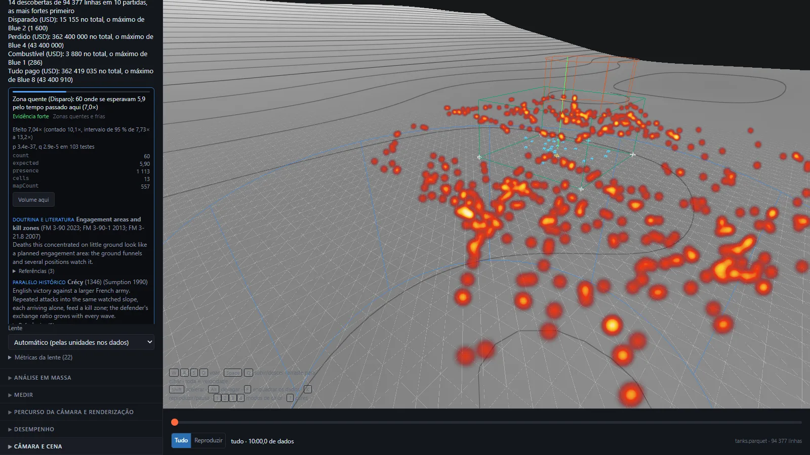

# A lente de conhecimento

Quando [Descobertas](insights.md) encontra algo, esta parte explica-o com ideias da história militar, do design de jogos e da análise desportiva, e indica o livro ou o artigo de onde vem. Use-a para perceber *porque* um padrão importa, e não apenas que existe.

## Experimente {#try-it}

1. Carregue dados e abra **Descobertas**, depois prima **Encontrar descobertas**.
2. Clique numa descoberta para a abrir.
3. Leia **Doutrina e literatura** e **Paralelo histórico**; as referências completas ficam dobradas por baixo.
4. Mude a **Lente** (por exemplo, para *Doutrina militar*) para ler a mesma descoberta através de outro corpo de literatura.

## Como funciona {#how-it-works}

O painel Descobertas julga as suas descobertas como um analista profissional as julgaria: através da doutrina militar e da investigação operacional, de combates históricos, e da literatura de design de jogos, de design de níveis e de análise de dados. Faz isto offline, a partir de uma base de conhecimento selecionada no visualizador, e entrega o mesmo material a um modelo externo quando este escreve o resumo.

## O que o painel mostra {#what-the-panel-shows}

- **Lente** escolhe o corpo de literatura através do qual as descobertas são lidas: *Automática* (escolhida pelos tipos de unidades nos dados: aeronaves, navios, veículos terrestres, infantaria), *Doutrina militar*, *Combate aéreo*, *Naval*, *Urbana*, *Design de jogos e equilíbrio*, *Esports*. As entradas fora da lente escolhida ficam de fora.
- Cada descoberta aberta mostra a sua entrada mais próxima de **doutrina e literatura** e o seu **paralelo histórico** mais próximo, com as referências completas dobradas por baixo.
- **Métricas da lente** lista as medidas da investigação operacional calculadas sobre as mesmas linhas (abaixo), cada uma com o que significa e a sua literatura.
- O **Resumo** acrescenta linhas para as principais descobertas e para as métricas da lente: "Doutrina e literatura: ..." e "Paralelo histórico: ...", cada uma com citações autor-ano e as referências dobradas por baixo.
- **Escrever com IA** envia as entradas mais relevantes (resumo, lição, as descobertas a que se ligam, referências completas) com o relatório, e pede ao modelo que as cite pelo id - `{concept.lanchester-square}` - e que não use outras fontes.

As etiquetas estão traduzidas; o conhecimento em si está em inglês.

## Métricas da lente {#lens-metrics}

Calculadas no trabalhador de descobertas, na mesma passagem pelas linhas que os detetores (`src/insights/lensMetrics.ts`). Cada uma fica de fora quando os dados não a conseguem suportar.

| Métrica | O que mede | Precisa de |
|---|---|---|
| Ajuste de Lanchester | As perdas de cada lado por 20 s, regredidas sobre as forças vivas de ambos os lados (Poisson, erros de quase-verossimilhança); os expoentes da força inimiga e da própria, testados contra a lei do quadrado (fogo dirigido) e a lei linear (fogo de área) | tempo, equipas, mortes e abates |
| Razão de troca | Mortes por morte, por lado e por sítio; a parte das mortes no terreno mais letal que detém 5% do tempo passado, contra a parte que o acaso dá com esse número de mortes; Gini das mortes contra o tempo; I de Moran das taxas de morte | mortes e abates |
| Razão de força local | Unidades amigas e inimigas vivas dentro do alcance de combate de cada morte (alcance definido pelos dados: o dobro da distância mediana ao inimigo mais próximo); a parte das mortes pelo lado localmente superior, e o seu excesso sobre o que o número sozinho prevê | tempo, equipas, pessoas |
| Campos de tiro | Visibilidade dos locais onde mais se morre, numa superfície de obstrução 2,5D (geometria do nível até à altura de uma parede, ou o chão percorrido), contra o local médio, e a correlação de ordem entre a vista e a parte das mortes | posições; um nível carregado torna-a mais precisa; não para o ar |
| Estado de energia | Energia específica (altura mais a altura que a velocidade podia comprar) dos atacantes e das vítimas aéreas, comparadas pela estatística de Mann-Whitney | classes de aeronaves, tempo, altitude |
| Terreno-chave | Com que frequência cada sítio está entre os três locais de mais mortes de uma partida | várias partidas |
| Apoio mútuo (trocas) | Mortes respondidas por um abate de um companheiro dentro do alcance de combate e em 5 s | tempo, equipas |
| Primeiro golpe | Confrontos - mortes agrupadas por partida, por 20 s de calma e por três alcances de combate - ganhos pelo lado que marcou primeiro | tempo, equipas |
| Modelo de salva | A equação de salva de Hughes ajustada a períodos de 20 s de navios em contacto: navios postos fora de combate por navio atacante, e salvos por navio defensor; um ajuste de Lanchester só sobre navios | classes de navios, tempo, equipas |
| Eficácia de combate | Abates por unidade-hora em ação de cada lado e a razão entre os dois maiores (um valor de eficácia de combate no sentido de Dupuy) com o seu intervalo de 95%, e a parte de abates de cada lado com números locais iguais | tempo, equipas |
| Alcances de combate | Distância ao inimigo mais próximo nos abates, nos lançamentos e no primeiro tiro de cada vida (deteção até ao combate), por tipo de unidade | tempo, equipas; lançamentos onde os dados os têm |
| Cadeia de morte | Segundos desde o último lançamento do atacante até ao abate, e desde o seu primeiro tiro do combate até ao abate | tempo; lançamentos ou eventos de tiro |
| Concentração ou dispersão | Em cada período de 20 s, a dispersão dos dois maiores lados e a parte dos abates tomada pelo mais compacto | tempo, equipas |
| Surtidas | Por lado: surtidas (descolagens, ou aparecimentos de aeronaves), aterragens, aeronaves perdidas e abates por aeronaves; taxa de perda e abates por surtida | classes de aeronaves; descolagens ou aparecimentos |

Os dados com rondas acrescentam as medidas de esports e de combate aproximado - probabilidade de vitória numa ronda, valor das ações, duelos de abertura, trocas, atacante contra defensor, pontaria, fogo cruzado, utilitários, vantagem de homens, reviravoltas, preparações, pós-plantio, funis fatais e impacto do jogador: veja [Combate aproximado e rondas](close-quarters.md).

As trajetórias e as equipas acrescentam as medidas de comportamento coletivo da ciência das multidões, do movimento coletivo, da economia comportamental e da psicologia militar - alinhamento e rodopio, condução de rotas, faixas e trilhos, aglomeração, líderes e seguidores, retardatários, o ponto de rutura, risco depois de perdas, sequências, acordo e supressão de compras, cada uma contra o seu próprio modelo nulo: veja [Comportamento coletivo](collective-behaviour.md).

Armas, engodos e edifícios não são contados como unidades. Quando os dados das armas indicam a unidade que as lança (uma coluna `Shooter` ou `Launcher`, como têm os dados derivados do Tacview), o lançamento é atribuído a essa unidade, pelo seu nome ou pelo seu id de objeto.

## Como as descobertas encontram a literatura {#how-findings-meet-the-literature}

As entradas e as descobertas encontram-se através de uma **taxonomia de padrões** (`src/insights/knowledge/patterns.ts`): concentração, superioridade local, fogo dirigido e de área, estrangulamentos, zonas de morte, campos de tiro, contraencosta, flanqueamento, apoio mútuo, vantagem de energia, pressão de nascimento, equilíbrio e assim por diante. Cada tipo de detetor e cada métrica da lente indica que padrões os seus números mostram (`src/insights/lens.ts`); cada entrada de conhecimento indica a que padrões se refere, com um peso. A relevância de uma entrada para uma descoberta é a sobreposição ponderada, ajustada pelo grau em que o domínio da entrada (terra, ar, mar, urbano) se ajusta aos dados e pela força da própria descoberta. A justificação mostrada são os números da descoberta numa frase, seguidos da lição da entrada.

## Catálogo {#catalogue}

Cada padrão, conceito, método, caso histórico, princípio de design e estudo, com a bibliografia: veja o [Catálogo de conhecimento](knowledge-catalogue.md).

## Para programadores {#for-developers}

### Acrescentar entradas {#adding-entries}

1. Escolha o ficheiro pelo tipo: `concepts.ts` e `concepts-more.ts`, `methods.ts`, `cases.ts`, `cases-land.ts`, `cases-air-sea.ts`, `cases-esports.ts`, `design.ts` (princípios de design) ou `studies.ts` em `src/insights/knowledge/`.
2. Dê-lhe um id novo `<tipo>.<slug>` (nunca reutilize um), as suas lentes, domínios, e os padrões a que se refere com pesos de 0 a 1. Acrescente um padrão a `patterns.ts` só quando uma descoberta o puder mostrar, e mapeie-o a partir de uma descoberta ou métrica em `lens.ts`.
3. Escreva o resumo e a lição **com as suas próprias palavras**. Citações só de obras de domínio público (`pd: true` na referência), e curtas.
4. Cite: acrescente qualquer obra nova a `refs.ts` com autores, ano, título e editora (revista com volume e páginas); um URL ou DOI quando haja um registo público.
5. Execute `npx vitest run src/insights/lens.test.ts` (ids únicos, padrões conhecidos, referências que resolvem, citações de domínio público, casos com data e resultado) e `node tools/knowledge-doc.mjs` para atualizar o [catálogo](knowledge-catalogue.md).
