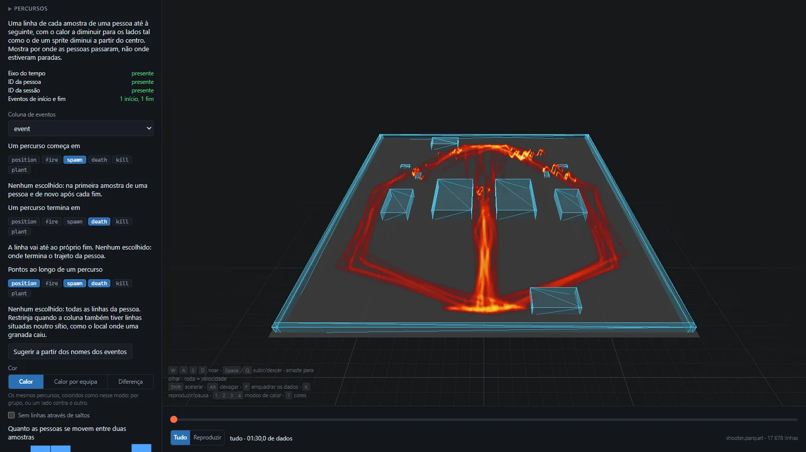

# Calor em linhas

O calor mostra onde as pessoas estavam. Linhas mostra os trajetos que percorreram.

**Linhas** (tecla 4) é o calor em linhas: uma linha de cada amostra de uma [pessoa](glossary.md) até à seguinte, espalhada com a mesma queda que um [sprite](glossary.md) tem - através da linha em vez de em torno de um ponto. Mostra por onde as pessoas *foram*, e não onde estiveram paradas: um corredor percorrido uma só vez fica tão visível como uma sala onde alguém se escondeu, e as amostras esparsas de um jogador rápido juntam-se num percurso contínuo em vez de um rasto pontilhado. Precisa de uma coluna de pessoa e de uma coluna de tempo.

## Como usar {#how-to-use-it}

1. Prima `4` (ou escolha **Linhas** na barra de modos).
2. Abra **Percursos** e veja a lista de verificação a verde: o eixo do tempo e o ID da pessoa têm de estar presentes.
3. Prima **Sugerir a partir dos nomes dos eventos** para preencher onde os percursos começam e acabam.
4. Leia a linha de estatísticas: "N percursos, M deles a chegar a um fim".
5. Se as linhas saltarem através do mapa, ajuste o **Passo mais longo** (veja [O limite de saltos](#the-jump-limit)).

Uma linha só faz sentido entre um início e um fim, por isso o painel **Percursos** diz o que delimita um percurso. Tudo o que vem a partir de [As regras de um percurso](#the-rules-of-a-route) são pormenores que pode saltar.

## O painel Percursos {#the-routes-panel}

Mostrado por cima dos painéis de calor no modo Linhas.

### O que os dados têm {#what-the-data-has}

Uma lista de verificação, a verde quando está presente, a âmbar quando não está:

| Linha | Estados |
|---|---|
| **Eixo do tempo** | *presente* / *em falta - necessário* |
| **ID da pessoa** | *presente* / *em falta - necessário* |
| **ID da sessão** | *presente* / *nenhum - todas as linhas são uma só sessão* |
| **Eventos de início e fim** | *N inícios, M fins* / *nenhum escolhido - trajetos inteiros* (a verde só com uma coluna de eventos e pelo menos um início e um fim) |

### Controlos {#controls}

| Controlo | Significado |
|---|---|
| **Coluna de eventos** | Uma coluna de categoria cujos valores são eventos (surgimento, morte, posição, ...). *Nenhuma - trajetos inteiros*: o trajeto de cada pessoa em cada sessão é um percurso, interrompido onde o trajeto tem uma falha. Só são oferecidas as colunas guardadas para filtragem ao carregar. |
| **Um percurso começa em** | Valores de evento que iniciam um percurso (surgimento, renascimento, implantação). Nenhum escolhido: um percurso começa na primeira amostra de uma pessoa, e outra vez depois de cada fim. |
| **Um percurso termina em** | Valores de evento que terminam um percurso (morte, extração, teletransporte). A linha vai até à própria linha do fim. Nenhum escolhido: um percurso acaba onde acaba o trajeto da pessoa. |
| **Pontos ao longo de um percurso** | Valores de evento cujas linhas ficam ao longo do percurso. Nenhum escolhido: todas as linhas da pessoa. Restrinja-o quando a coluna também tem linhas colocadas noutro sítio, como onde caiu uma granada. |
| **Sugerir a partir dos nomes dos eventos** | Preenche as três listas com os nomes dos valores (abaixo). |
| **Cor** | *Calor*, *Calor por equipa* ou *Diferença*. Os mesmos percursos na cor desse modo: cada grupo na sua tonalidade, ou um lado contra o outro, com a lista de grupos, a divisão e as rampas a funcionarem como nesses modos. Por omissão, *Calor*. O calor por equipa e a diferença precisam de uma coluna de grupo. |
| **Sem linhas através de saltos** / **Passo mais longo** | A amostra seguinte de uma pessoa mais longe do que isto é um renascimento, um teletransporte ou uma queda, e não um sítio por onde passou, por isso nenhuma linha une os dois. Preenchido ao carregar quando os dados mostram uma falha clara (abaixo), e desligado quando não mostram. Funciona com ou sem coluna de eventos. |
| Linha de estatísticas | `N percursos, M deles a chegar a um fim, K segmentos`, atualizada algumas vezes por segundo. |

Cada lista é uma linha de chips de alternância, um por valor, o mais frequente primeiro; passar o rato sobre um chip mostra o seu número de linhas. São oferecidos no máximo 120 valores (*mais N valores não mostrados*).

Escolher outra coluna de eventos aplica a sugestão quando ela escolhe essa mesma coluna, e começa com listas vazias caso contrário.

### A sugestão {#the-suggestion}

Em cada carregamento, e em **Sugerir a partir dos nomes dos eventos** ([`suggestLineSettings`](https://github.com/Holdi601/3DHeat/blob/main/src/data/lines.ts)):

- **Coluna de eventos:** a primeira coluna de categoria mantida com o nome `event`, `eventname` ou `eventtype`; senão `kind`, `type` ou `action`; senão qualquer uma que contenha *event*, *kind*, *action* ou *type*.
- **Inícios:** valores que contenham *spawn, deploy, join, enter, start, begin, respawn, revive, land/landed/landing, drop* - a não ser que também contenham uma palavra de fim.
- **Fins:** valores que contenham *death, died, dead, kill/killed, eliminat…, extract, evac, teleport, leave, left, disconnect, quit, exit, end, finish, downed* - exceto os valores `kill` e `kills` (uma morte é algo que quem mata faz, e não o fim do seu percurso).
- **Pontos:** valores que sejam exatamente *position, location, player location, move, movement, tick, sample* ou *pos*; quando algum é encontrado, os inícios e os fins também são acrescentados aos pontos. Quando nenhum é encontrado, os pontos ficam vazios (todas as linhas).

### O limite de saltos {#the-jump-limit}

Onde as pessoas saltam, os comprimentos dos passos dividem-se em dois grupos com quase nada entre eles: o que uma pessoa percorre entre duas amostras, e a largura do mapa. Ao carregar ([`suggestMaxJump`](https://github.com/Holdi601/3DHeat/blob/main/src/data/lines.ts)), os passos são contados por cada duplicação do seu comprimento ao quadrado, até 16 milhões deles, e o limite fica a meio do primeiro intervalo acima da mediana que tenha pelo menos uma duplicação de comprimento de largura, que tenha menos de 0,02% dos passos por intervalo, e que tenha passos para além dele. Sem um intervalo assim, nada é cortado, porque não haveria como distinguir um salto de um carro rápido; ligar o limite à mão começa então em um décimo da diagonal dos dados.

O gráfico por cima do limite mostra o comprimento real dos passos, com uma linha no limite: as barras à direita dele não são desenhadas. Os dois eixos são logarítmicos, porque os saltos podem ser a centésima parte dos passos e mil vezes mais longos. Passe o rato sobre uma barra para ver o seu intervalo e a sua parte; clique no gráfico para pôr o limite ali. Por baixo, a parte dos passos acima do limite.

## As regras de um percurso {#the-rules-of-a-route}

As linhas são percorridas por ordem de tempo, por pessoa ([`buildLines`](https://github.com/Holdi601/3DHeat/blob/main/src/data/lines.ts)):

1. As linhas de um [nome partilhado](sessions-persons-groups.md#names-worn-by-several-things-at-once) são ignoradas por completo.
2. Com pontos escolhidos, uma linha que não é nem início, nem fim, nem ponto é ignorada.
3. As linhas são seguidas por pessoa e por sessão, por isso uma pessoa cujas sessões se intercalam no tempo tem um percurso em cada uma. Um percurso é fechado quando a linha anterior não teve sucessora (o seu [tempo de vida](sessions-persons-groups.md#person) é "nenhum") - um percurso nunca atravessa a fronteira de uma sessão nem uma falha que o carregamento decidiu não ter amostra seguinte. A que percurso pertence uma linha é calculado uma vez e guardado, 4 bytes por linha, por isso mudar o passo mais longo não repete essa parte.
4. Uma linha de **início** fecha qualquer percurso aberto e abre ali um novo.
5. Com inícios escolhidos, uma linha fora de um percurso é ignorada. Sem inícios, qualquer linha que não seja de fim e esteja fora de um percurso abre um.
6. Qualquer outra linha dentro de um percurso acrescenta um **segmento** desde a linha anterior do percurso até esta.
7. Uma linha de **fim** que prolonga um percurso fecha-o depois do seu segmento; esse percurso conta como *a chegar a um fim*.
8. Um passo mais longo do que o **Passo mais longo** fecha o percurso onde estava, e um novo começa na extremidade distante, a não ser que essa linha seja um fim. Não é desenhada nenhuma linha através dele, e a linha de estatísticas conta-o.

Cada segmento é guardado na sua linha de *fim*, por isso os segmentos ficam por ordem de tempo, e a janela da [linha do tempo](timeline.md), o amostrador, os [filtros](filters.md), a visibilidade dos grupos e o sinal da diferença funcionam com eles como com os pontos. Um filtro aplica-se, portanto, à linha onde um segmento acaba.

## Reprodução {#playback}

No modo **Tudo** cada percurso é desenhado inteiro. No modo **Reproduzir** cada pessoa é um ponto que se move entre as suas amostras, desenhando o seu percurso atrás de si:

- um segmento que começa depois da cabeça de reprodução não é desenhado;
- o segmento em que a pessoa está a meio é desenhado até à sua posição interpolada, com uma tampa de fim na cabeça;
- o calor desvanece-se na **cauda**: com o histórico *Cumulativo* a cauda é ilimitada e todo o percurso até ali fica; com *Janela* desvanece-se até nada ao longo da *Duração* (por omissão 30 s). Com *Tempo de vida* a cauda é também a *Duração*, e no modo Linhas a linha do tempo mostra a caixa *Duração* também para esse histórico (no lugar de *Vida de reserva* e *Desvanecer*, que o calor em linhas não usa).

Ao reproduzir, cada imagem é desenhada inteira em vez de acumulada, porque as cabeças se movem em cada imagem e uma média móvel espalharia cada uma num risco.

## Para programadores {#for-developers}

### Memória {#memory}

Os percursos são construídos na thread principal quando se entra no modo Linhas (ou quando as definições de percurso mudam) e libertados quando se sai: 5 bytes por linha em memória e 8 bytes por linha na GPU (a posição inicial de cada segmento, quantizada a 16 bits por eixo dentro da caixa envolvente dos dados, e as suas flags).

### Como uma linha é desenhada {#how-a-line-is-drawn}

Ambos os motores desenham cada segmento a partir da sua linha de fim como **18 vértices** ([`lineHeatVs`](https://github.com/Holdi601/3DHeat/blob/main/src/render/webgl2/shaders.ts) e o seu gémeo WGSL):

- A meia-largura em cada extremidade é o [raio do sprite](sprite-shape.md#sprite-radius) à distância dessa extremidade, com os limites em píxeis aplicados. Uma linha mais estreita que 2,5 px é desenhada com 2,5 px de largura e o seu calor reduzido na mesma proporção, para que as linhas finas nem desapareçam nem fiquem mais brilhantes.
- O calor cai **através** da linha com a mesma rampa de um sprite - queda ou curva, intensidade no centro e na borda.
- As tampas redondas são desenhadas **apenas** onde um percurso começa ou acaba, para que as junções entre segmentos consecutivos não se transformem num colar de pérolas.
- A geometria é construída no espaço do ecrã e interpolada linearmente aí, por isso a queda fica centrada na linha, seja qual for a profundidade por onde passa. Um segmento que atravessa o plano próximo é cortado aí, em vez de ser descartado.

O calor de pontos e o calor em linhas depositam quantidades muito diferentes de calor por linha, por isso a saturação é medida de novo quando se alterna entre um e outro ([Cor e exposição](colour-and-exposure.md#auto-exposure)).
