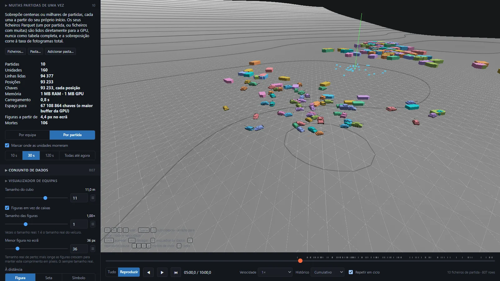

# Muitas partidas de uma vez

**Muitas partidas de uma vez** reproduz muitas partidas umas por cima das outras, para ver onde costumam andar os jogadores de cada partida. Use-a para comparar centenas ou milhares de partidas numa só imagem.

Cada partida começa no seu próprio início e as suas unidades movem-se como figuras. Os ficheiros vão diretamente para a placa gráfica e não se constrói nenhuma tabela completa, por isso reproduz-se com fluidez onde uma carga normal ficaria sem memória.

## Como usar {#how-to-use-it}

1. Abra **Muitas partidas de uma vez** na barra lateral do Mapa de calor.
2. Prima **Ficheiros…** (escolha muitos ficheiros), **Pasta…** (uma pasta e as suas subpastas) ou **Adicionar pasta…** (acrescentar ao que está carregado).
3. O visualizador passa para a sobreposição de figuras e começa no início. Prima **Reproduzir**.

Cada ficheiro é uma partida (ou contém várias). Funcionam os ficheiros Parquet e os contentores [`.3dheat`](container.md). Um ficheiro precisa de uma coluna de posição, de tempo e de unidade; as colunas de nome, tipo e lado são guardadas. Os outros ficheiros, e os ficheiros laterais dos conversores (voo, mensagens, eventos, chat, objetivos), são ignorados. Para uma tabela normal, veja [Carregar dados](getting-data-in.md).

## Definições {#settings}

| Definição | O que faz |
|---|---|
| **Por equipa** / **Por partida** | Colorir por lado, ou uma cor por partida. |
| **Marcar onde as unidades morreram** | Uma marca onde cada unidade morreu, durante 10 s, 30 s, 120 s, ou todas as até agora. |

O painel mostra quantas partidas, unidades, linhas e posições foram lidas, a memória usada e o tempo de carga. *Espaço para* é quantas mais posições a placa gráfica ainda aguentaria. *Figuras a partir de* é o tamanho no ecrã abaixo do qual uma unidade é desenhada como um pequeno dardo em vez da sua figura.

O aspeto das figuras usa os mesmos controlos da [repetição da partida](match-replay.md#figures): **Tamanho das figuras**, **Menor figura no ecrã** e **À distância**.

## Sugestões {#tips}

- Quando tudo não couber na memória, as posições são rarefeitas (só se guarda uma posição a cada poucos metros) e o painel di-lo.
- Os modos de calor também funcionam com os dados da sobreposição.
- Para estatísticas sobre milhares de partidas sem as desenhar, veja [Análise em massa](mass-analysis.md).
