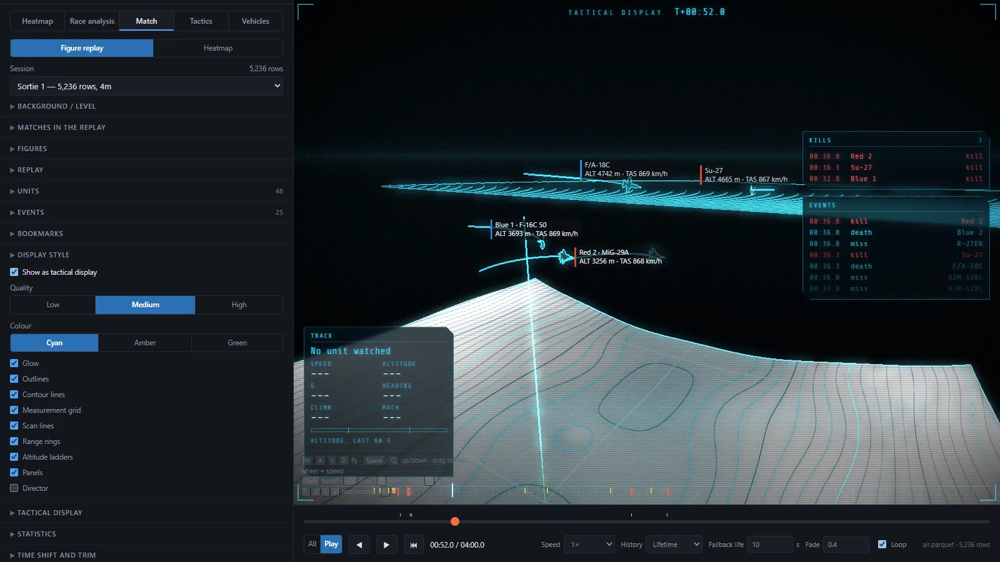

# Repetição da partida

A repetição é um filme da partida com cada jogador desenhado como aquilo que conduzia. Use-a para voltar a ver um combate, seguir uma unidade e perceber quem atingiu quem.

Disparos, impactos, incêndios e destroços são desenhados nas unidades e nos objetivos do nível. Câmaras, etiquetas e uma visualização tática ajudam a ler o combate. Conhece o Tacview? [Paridade com o Tacview](tacview-parity.md) mostra onde está cada uma das suas ferramentas.

## Iniciar uma repetição {#start-a-replay}

1. Carregue uma gravação com **Origem → Ficheiros…** ou arrastando-a para o painel Origem (qualquer tabela com uma coluna de **pessoa** e uma de **tempo**, um ficheiro Tacview, uma repetição convertida, uma partida [`.3dheat`](container.md)). Ver [Carregar dados](getting-data-in.md).
2. Abra o separador **Partida** e escolha **Repetição com figuras**, ou escolha **Figuras sobrepostas** na barra de modos do separador Mapa de calor.
3. Em **Partidas na repetição** escolha uma partida, todas de uma vez, ou várias.
4. Prima **Reproduzir** na linha temporal (ou `K`). Arraste a linha temporal para saltar.

As figuras substituem as caixas para cada unidade cujo nome ou tipo é conhecido (ver [Figuras](figures.md)). Os dados sem coluna de nome ou tipo são desenhados como soldados.

## Figuras {#figures}

| Definição (secção **Figuras**) | Predefinição | O que faz |
|---|---|---|
| **Figuras em vez de caixas** | ligado | Desligado desenha caixas simples. |
| **Tamanho das figuras** (vezes o tamanho real) | 1 | 1 é o tamanho real; de 0,25 a 20 vezes (escala logarítmica). Maior ajuda à distância. |
| **Menor figura no ecrã** | 36 px | As figuras distantes crescem para se manterem com este tamanho, de 0 a 200 px; 0 mantém o tamanho real. |
| **À distância**: Figura, Seta, Símbolo | Figura | O que se torna uma unidade distante. |
| **Símbolos** | NATO (APP-6) | NATO (APP-6), sinais táticos russos, ícones do **Mapa de jogo**, ou **Só formas (seguro para daltónicos)**. |
| **Tamanho do símbolo**, **O meu lado**, **Hostil / Neutro**, **Traços de rumo** | 28 px (12 a 64), automático, hostil, ligado | Como são os símbolos e qual o lado amigo. |
| **Linhas verticais** | ligado | Uma linha de cada unidade diretamente para o chão, para que as alturas se leiam em 3D. |
| **Linhas ao solo e rótulos em armas** | desligado | Linhas para o chão e etiquetas em mísseis e bombas. |
| **Incêndios nas unidades** | ligado | Chamas desde o momento em que uma unidade pega fogo até ser apagada. |
| **Impactos nas unidades** | ligado | Marcas onde os disparos atingiram (abaixo). **Os impactos ficam**: de 1 a 300 segundos, ou **Toda a vida**. **Marcadores flutuantes**: marcas desenhadas acima da superfície. |
| **Linhas de mira e de torre** | desligado | Tracejadas: para onde o jogador olha; contínuas: para onde aponta a arma. |
| **Edifícios** | sólidos | Edifícios sólidos ou transparentes, quando o nível os pinta. |

### Símbolos à distância {#symbols-at-a-distance}

Quando uma unidade ficaria menor que a **Menor figura no ecrã**, pode tornar-se num símbolo que continua legível. A forma indica o tipo (por exemplo uma caixa arredondada com uma marca de lagarta para um blindado); a cor indica o lado. Abra o menu **Símbolos** para mudar o estilo.

### Marcas de impacto, destroços e incêndios {#hit-marks-wrecks-and-fires}

- As **marcas de impacto** ficam na superfície que o disparo atingiu, à escala da figura. O aspeto indica o que aconteceu: um buraco (atravessou), um salpico brilhante (não atravessou), um sulco (ricocheteou), uma estrela de fuligem (projétil explosivo). Um anel colorido diz o que fez: disparo mortal, módulo destruído, crítico, grave, dano, sem dano, impacto. Passe o rato sobre uma marca para ver o nome do projétil.
- Uma unidade destruída é desenhada **carbonizada** como destroço desde a morte até renascer ou ser removida; o seu símbolo fica riscado.
- Os **incêndios** ardem numa unidade desde o momento em que pega fogo até ser apagada.
- As **torres** rodam para onde os dados dizem que aponta a arma (ou, sem isso, para onde olha o jogador).

### Armas, iscos e traçadores {#weapons-decoys-and-tracers}

Com **Armas, disparos e acertos** ligado (secção Visualizador de equipas): mísseis, foguetes, bombas e torpedos voam como figuras próprias com um rasto de fumo; balas e projéteis são traçadores; impactos e explosões iluminam-se. Um traçador desenhado **tracejado** foi deduzido de um impacto, porque os dados não tinham o disparo. Sinalizadores e palha são desenhados como iscos; ficam escondidos da lista de unidades a não ser que *Iscos e projéteis* esteja marcado.

## Câmaras {#cameras}

Clique numa unidade ou na sua etiqueta para a **seguir**; a secção **Repetição** oferece **Perseguição**, **Órbita**, **Cabina** (com um visor frontal, `H`), **Fixa**, **Padlock**, **Alvo** e **Satélite**. `V` percorre-as, **Distância da câmara** define a distância. Esc para.

- **Vista de duas unidades**: escolha um **Alvo** (ou Ctrl/Alt-clique numa unidade) para a ver a partir da que está a seguir; **Trocar** troca-as.
- **Medida**: Shift-clique em duas unidades para o rumo, a distância e a diferença de altura entre elas.
- **Mapa 2D** (`M`): vista de canto ou completa, com rastos e nomes.
- **Marcadores** (`B`): guarda o momento e a câmara; os abates, mortes e marcas da própria gravação também aparecem listados.
- **Eventos**: todos os eventos por ordem de tempo; um clique salta até lá. `Page Up` / `Page Down` saltam entre eventos; **Pausar no evento** para em cada um.

## Visualização tática {#tactical-display}

A secção **Visualização tática** desenha, para nenhuma unidade, as selecionadas, todas, ou um tipo (aeronaves, terrestres, navios, armas): vetores de velocidade e o caminho à frente, linhas de nariz e de sustentação, cones de radar, bloqueios, ligações de dados, zonas e linhas de combate, linhas de visão, para onde olham os jogadores (cones de visão), a pontaria das torres e a câmara gravada.

### Estilo de visualização {#display-style}

`T` (ou o botão **Mostrar como ecrã tático**) muda o aspeto para um estilo de ecrã de radar: brilho, contornos, curvas de nível, uma grelha de medição, linhas de varrimento, anéis de alcance, escalas de altitude, painéis com abates e eventos, e um **Realizador** que move a câmara para os eventos por si próprio.

## Objetivos {#objectives}

Quando uma partida traz os seus objetivos, a secção **Objetivos** desenha-os no nível: zonas de captura (com dono e progresso da captura), spawns, aeródromos, áreas e alvos de bombardeamento, cada camada pode ser ligada ou desligada, com etiquetas. Vêem-se através do chão. Com vários modos de jogo carregados, **Modo** filtra as partidas por modo. Os objetivos vêm do ficheiro de partida de um conversor junto à gravação ou dentro de um contentor [`.3dheat`](container.md).

## Etiquetas e estatísticas {#labels-and-statistics}

- **Etiquetas**: regras por tipo (**Selecionadas**, **Aeronaves**, **Terrestres**, **Navios**, **Armas**, **IA**): mostrar ou não, quais os valores, e uma **Prioridade** para quem fica com o espaço quando as etiquetas se sobrepõem. **Manter as etiquetas afastadas** move uma etiqueta para o lado da sua unidade quando taparia outra, e deixa-a de fora onde não há espaço. **Tamanho das etiquetas** vai de 60 a 250 %. **Voltar a nome, veículo, altitude e velocidade** repõe as regras.
  - As unidades terrestres começam com nome, veículo e velocidade.
  - As aeronaves começam com nome, veículo, altitude e velocidade.
  - Os navios começam com nome, veículo, velocidade e rumo.
  - Passe o rato sobre uma unidade para ver todos os valores que tem.
- **Estatísticas**: por equipa e por unidade: abates, mortes, disparos, impactos, taxa de acerto, descolagens, aterragens, tempo no ar, velocidade máxima, altura e G, distância. Exportação em CSV.
- **Gráficos**: os valores de uma unidade ao longo do tempo, duas unidades comparadas, ou um valor contra outro.

## Muitas partidas de uma vez {#many-matches-at-once}

Para sobrepor centenas ou milhares de partidas, veja [Muitas partidas de uma vez](many-matches.md). Detalhes das figuras (fumo, fogo, outros efeitos temporizados): [Figuras na sobreposição de figuras](figure-replay.md). Lista de funcionalidades Tacview: [Paridade com o Tacview](tacview-parity.md), uma página filha desta.
