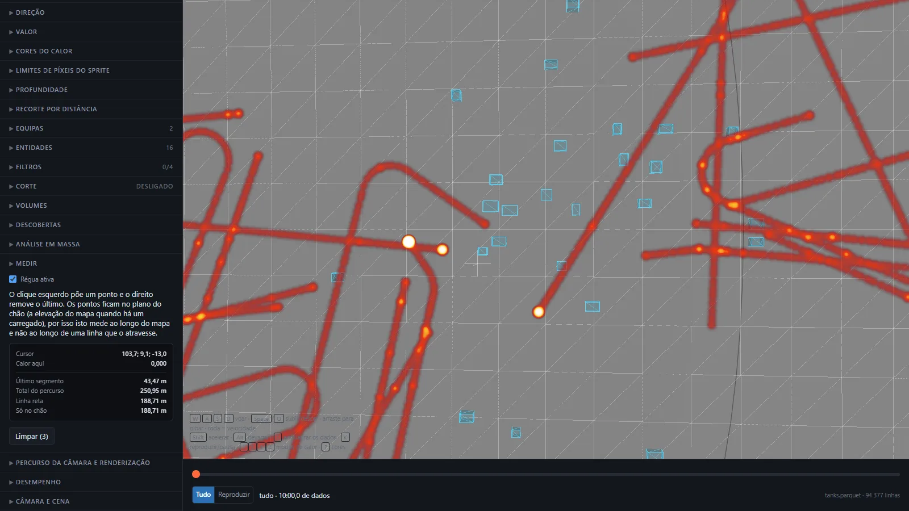

# Medida

A **Medida** transforma o rato numa régua e diz-lhe o movimento que há no ponto sob o cursor. Use-a para descobrir a que distância estão dois lugares, ou quanto tráfego tem um ponto.

## Experimente {#try-it}

1. Abra **Medida** na barra lateral e marque **Régua ativa**.
2. Clique com o botão esquerdo em três lugares do mapa. Cada clique põe um ponto.
3. Leia **Total do percurso** (o comprimento do percurso inteiro) e **Último segmento** (o último troço).
4. Clique com o botão direito para remover o último ponto, ou prima **Limpar (3)** para remover todos.

| Ação | Efeito |
|---|---|
| Clique esquerdo | Põe um ponto onde o cursor encontra o plano do chão. Um clique que se moveu mais de 4 píxeis entre carregar e largar é um arrastar da câmara, não um ponto. |
| Clique direito | Remove o último ponto. |
| Mover | A posição do cursor e o calor sob ele atualizam-se ao vivo. |

A câmara continua a funcionar com a régua ligada: arrastar ainda olha à volta, as teclas ainda voam. Com a régua ligada ela recebe todos os cliques, por isso [escolher com clique](camera.md#click-to-pick) fica à espera de ser desligada.

**O plano do chão** é a elevação da [imagem do mapa](map-images.md) quando uma imagem de mapa está carregada; caso contrário, é o Y mais baixo do conjunto de dados (0 sem ela). Os pontos caem nele, por isso a régua mede através do mapa, não ao longo de uma linha que o atravessa. Com um nível 3D, o plano continua a ser o Y mais baixo do conjunto de dados, não a superfície do nível - para um ponto na superfície real, desligue a régua e clique nele ([escolher com clique](camera.md#click-to-pick)), o que lê as coordenadas a partir dos próprios triângulos do nível.

## Leituras {#readouts}

| Linha | Significado |
|---|---|
| **Cursor** | X, Y, Z do mundo do ponto sob o cursor, no plano. |
| **Calor aqui** | Quanto calor há no píxel do cursor. Um número maior significa mais tráfego nesse ponto. É o valor que a rampa de cor recebe antes de o ponto de saturação o dividir, por isso pode compará-lo com o [Ponto de saturação](colour-and-exposure.md#saturation-point). |
| **Último segmento** | Distância do último ponto ao cursor (ou entre os dois últimos pontos). |
| **Total do percurso** | Comprimento da polilinha que passa por todos os pontos e pelo cursor. |
| **Linha reta** | Distância 3D do primeiro ponto ao cursor (ou ao último ponto). |
| **Só no chão** | O mesmo, só em X e Z. |
| **Limpar (N)** | Remove todos os pontos. |

As distâncias são mostradas em centímetros abaixo de 1 unidade, em metros abaixo de 1 000, em quilómetros acima - assumindo que uma unidade do mundo é um metro ([Eixos, unidades e tempo](axes-units-and-time.md#unit-scale)). As coordenadas são coordenadas do mundo, também quando um eixo está [invertido para exibição](camera.md#invert-world-axis).

Os pontos e a linha entre eles são desenhados como uma sobreposição na vista, dimensionada pelo espaçamento da grelha. Os pontos da régua não são guardados nas vistas; mantêm-se quando carrega outros dados.

## Para programadores {#for-developers}

O **Calor aqui** é lido da GPU no máximo a cada 120 ms, porque uma leitura de um só píxel bloqueia o pipeline. Usa o mesmo caminho que `engine.readHeatProbe()`: dividido pelo ganho com que o fotograma foi escrito, por isso, no caminho de acumulação em meia precisão (`?heat=f16`), está nas mesmas unidades que num alvo de 32 bits ([Acumulação em meia precisão](half-float-accumulation.md)).
