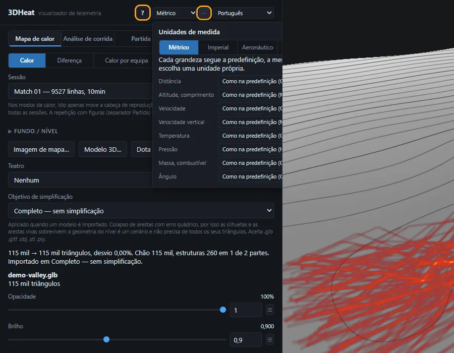
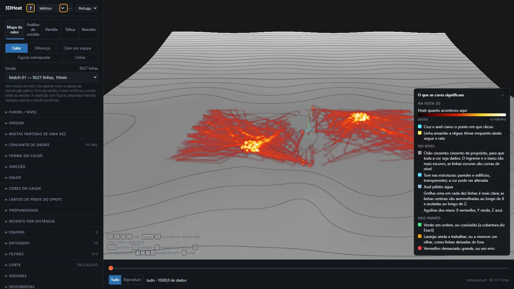
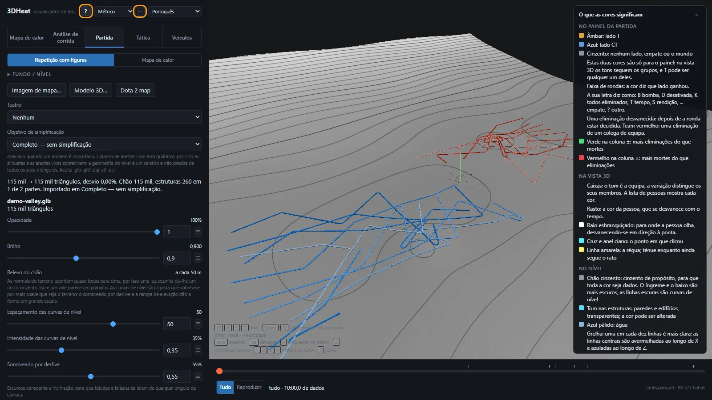

# Definições, unidades e teclas

Os pequenos controlos no topo da barra lateral mudam a forma como o visualizador lhe fala: o idioma, as unidades (metros ou pés, km/h ou nós) e um modo de ajuda que explica as cores. As suas escolhas ficam guardadas no navegador.

## O cabeçalho {#the-header}

No topo da barra lateral:

| Controlo | O que faz |
|---|---|
| **?** | Modo de ajuda: o que significa cada cor (também `?` ou `F1`) |
| Menu **Unidades** | Métrico, Imperial, Aeronáutico ou Náutico |
| Botão **...** ao lado de **Unidades** | Abre "Escolher uma unidade para cada grandeza": uma lista pendente por grandeza |
| Menu **Idioma** | O idioma do visualizador: [40 idiomas](languages.md), ou o do navegador |

Os números que escreve numa caixa podem usar ponto ou vírgula (`0.35` ou `0,35`). O visualizador lê ambos e mostra os números da forma como o idioma do visualizador os escreve.

## Unidades {#units}

1. Escolha uma predefinição no menu **Unidades**. Todas as grandezas mudam em conjunto.
2. Para mudar só uma grandeza, clique no botão **...** ao lado dela e escolha uma unidade para essa grandeza. O menu passa então a mostrar um `*` depois da predefinição.
3. Uma grandeza que não definiu segue a predefinição. Escolha "Como na predefinição" para voltar atrás.

| Grandeza | Métrico (omissão) | Imperial | Aeronáutico | Náutico |
|---|---|---|---|---|
| Distância | km | mi | NM | NM |
| Altitude, comprimento | m | ft | ft | m |
| Velocidade | km/h | mph | kt | kt |
| Velocidade vertical | m/s | ft/min | ft/min | m/s |
| Temperatura | °C | °F | °C | °C |
| Pressão | hPa | inHg | hPa | hPa |
| Massa, combustível | kg, l | lb, gal | lb, gal | t, m³ |
| Ângulo | graus | graus | graus | graus |

Outras unidades que pode escolher para uma grandeza: distância km, mi, NM; velocidade km/h, m/s, kt, mph; velocidade vertical m/s, ft/min, m/min; temperatura °C, °F, K; pressão hPa, inHg, mmHg, psi; massa kg, lb, t; ângulo graus ou mil NATO (6400 num círculo). As unidades são as mesmas em todo o visualizador: etiquetas, cartões, gráficos, estatísticas.

## Modo de ajuda {#help-mode}

Prima `?` ou `F1`, ou clique no botão **?**. Mostra *O que as cores significam*: legendas para a vista 3D, as rampas de calor, as cores das equipas, as cores do nível, as cores de estado dos painéis, o painel da partida e a vista de corrida. Fica ligado até o desligar. No separador Partida, explica também as cores do painel da partida.

## O que o navegador guarda {#what-the-browser-remembers}

Estas definições ficam guardadas no seu navegador entre visitas (nada é enviado para lado nenhum):

- o idioma, as unidades e o modo de ajuda;
- as definições de figura, símbolo, etiqueta, câmara e visualização tática do replay;
- a velocidade de reprodução e o espelhamento;
- marcadores por gravação, volumes por conjunto de dados, camadas de objetivos;
- as definições de IA externa (a chave só se marcar *Lembrar*).

As definições de calor, os filtros e o modo começam do zero em cada carregamento. A lista completa, gerada automaticamente: [Definições guardadas](ref-settings-storage.md).

## Teclas que o visualizador mantém do navegador {#keys-the-viewer-keeps-from-the-browser}

Uma sessão com muitos dados demora a carregar, por isso o visualizador impede que o navegador a deite fora por engano:

- `Ctrl`/`Cmd` + letras que imprimiriam, guardariam, abririam, recarregariam, fechariam ou abririam novas janelas não fazem nada fora das caixas de texto; `F1`, `F3`, `F5`, `F6` e `F7` não fazem nada.
- Fechar ou recarregar o separador com dados ou um nível carregados pede confirmação primeiro.
- Em ecrã inteiro, o visualizador bloqueia as teclas que usa (W, T, N, S, R, P, Q, Esc), para que o navegador não as tome.

A lista exata: [Teclas do navegador](ref-browser-keys.md). Todas as teclas próprias do visualizador: [Referência de teclado e rato](keyboard-reference.md).
