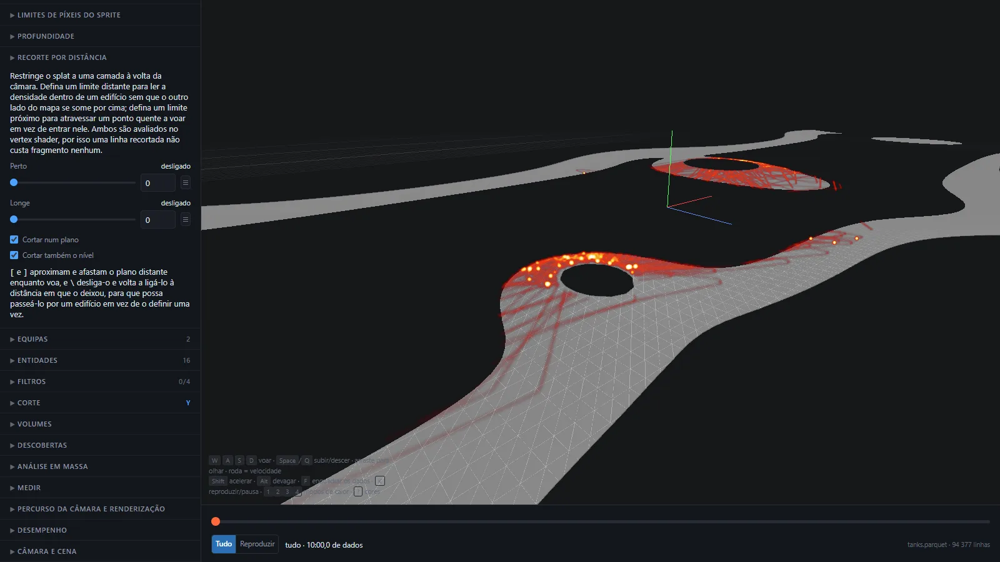

# Corte

O **Corte** corta o mundo como uma fatia de bolo, para que possa ver o interior dos edifícios. Use-o quando as paredes escondem o calor interessante, por exemplo para ver um piso de um edifício.

## Experimente {#try-it}

1. Carregue um nível e alguns dados, e abra **Corte**.
2. Marque **Cortar o mundo**. O eixo é **Altura**.
3. Arraste **Posição** para cima e para baixo: a laje move-se pelo nível.
4. Deixe **Espessura** fina para uma planta, ou larga para "tudo abaixo daqui".
5. Mantenha **Fora da fatia** em 0 para remover o resto, ou suba-o para manter um traço ténue.



A laje corta a **geometria do nível e os pontos de dados em conjunto** - cortar só o nível deixaria o calor a flutuar onde estava o seu edifício. É o contrário da [oclusão por profundidade](depth-and-culling.md): quando o nível esconde corretamente o que está atrás de si, o interior de um edifício também fica escondido. O painel aparece quando há algo para cortar (um conjunto de dados ou um nível 3D); o cabeçalho mostra o eixo quando está ligado, e *off* caso contrário.

```
vista lateral     Posição = onde está a laje
 ----------       Espessura = a altura da laje
 | piso 3  |
 |=========|  <--- laje (mantida)
 | piso 2  |  <--- fora: removido (ou ténue)
 | piso 1  |
 ----------
```

## Controlos {#controls}

| Controlo | Omissão | Significado |
|---|---|---|
| **Cortar o mundo** | desligado | Liga a laje. Enquanto a posição estiver ainda no seu valor inicial 0 e a espessura no seu valor inicial 500, ligar move-as para o meio do eixo e para 15% da sua extensão. |
| Eixo | **Altura** | *Altura* (Y), *X* ou *Z*. Mudar o eixo move a laje para o meio do novo eixo. |
| **Posição** | o meio | Centro da laje, em unidades do mundo, ao longo da extensão do eixo (passos de 500). |
| **Espessura** | 15% da extensão | De 1/500 da extensão ao dobro da extensão, em passos logarítmicos. Mostra *além do mundo* quando chega à largura da extensão: um lado passa então para além do mundo e fica um corte simples em vez de uma laje. |
| **Fora da fatia** | 0, *removido* | Quanto do que está fora continua visível, de 0 a 100%. Um traço ténue do que foi cortado é muitas vezes mais fácil de ler do que removê-lo por completo. |
| **Cortar também os pontos de dados** | ligado | Desligado deixa o calor inteiro, por isso se vê através do corte - útil para ver o que está acima e abaixo da laje. |

A extensão de um eixo é a do nível 3D quando um está carregado, caso contrário a do conjunto de dados.

O Corte é independente do [recorte por distância](depth-and-culling.md#distance-culling), que corta ao longo da direção da vista em vez de um eixo do mundo; os dois combinam-se. Qualquer alteração a uma definição de corte reinicia a acumulação do calor.

## Para programadores {#for-developers}

A laje é testada na posição no mundo de cada linha no shader de vértices: uma linha fora dela tem a sua contribuição multiplicada pelo valor *Fora*, por isso, com 0, é rejeitada antes de se desenhar qualquer fragmento. Os shaders do nível aplicam o mesmo teste a cada fragmento do chão, das estruturas e da água.
