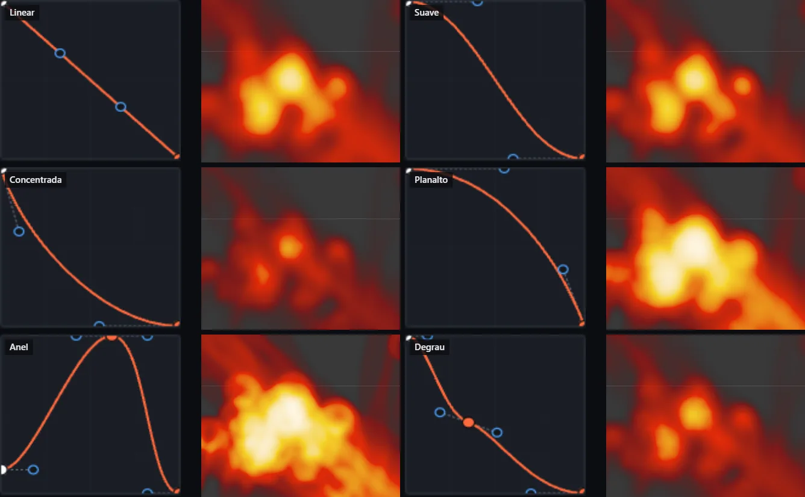

# Forma do sprite

Cada linha é desenhada como um sprite redondo que está sempre virado para a câmara. O seu tamanho e o perfil desde o centro até à borda - a **rampa** - decidem se um ponto quente se lê como um ponto apertado, uma nuvem suave, um disco ou um anel. Estes controlos estão nas secções **Forma do calor** e **Limites de píxeis do sprite** da barra lateral, e aplicam-se ao [Calor](heat.md), à [Diferença](difference.md), ao [Calor por equipa](team-heat.md) e, como meia-largura de uma linha, ao [Calor em linhas](line-heat.md).

Mudar qualquer um deles reinicia a acumulação (o campo tem de ser redesenhado com a nova forma).

Pense em cada ponto como uma mancha suave de luz. Uma mancha pequena mostra manchas isoladas; uma mancha grande funde os vizinhos numa nuvem. A forma decide como suave é a borda.



## Raio do sprite {#sprite-radius}

O raio do sprite em **unidades do mundo** (rotuladas em metros). Predefinição 6, e em cada arranque a extensão horizontal dos dados / 120 - grande o suficiente para que as amostras vizinhas ao longo de um percurso se fundam numa faixa e não se leiam como um fio. Cursor logarítmico de 0,05 a 2000; o manípulo chega a 50 000.


As coisas distantes parecem mais pequenas, por isso um sprite encolhe no ecrã com a distância. Na projeção paralela tem o mesmo tamanho em todo o lado, o que é parte da razão pela qual a vista paralela é a certa para comparar pontos quentes ([Câmara e controlos](camera.md#projection)).

## Limites de píxeis {#pixel-clamps}

Os **Limites de píxeis do sprite** (fechados por predefinição) limitam o raio no ecrã depois da conversão acima.

| Controlo | Predefinição | Intervalo (cursor) | Porquê |
|---|---|---|---|
| **Raio mínimo em píxeis** | 1 px | 0-16 (512) | Impede que os dados distantes desapareçam abaixo de um píxel. |
| **Raio máximo em píxeis** | 96 px | 2-1024, logarítmico (8192) | A proteção contra excesso de desenho. Um sprite que cobre N píxeis custa N operações de mistura, por isso um raio sem limite perto da câmara é o que transforma um fotograma rápido num lento. Acima da altura da janela de visualização deixa de limitar seja o que for. |

**Mesma densidade com qualquer zoom** (na secção Forma do calor, ligado por predefinição) funciona com os limites. Um sprite que um limite torna maior (ao longe) ou menor (de perto) mantém o calor que o seu tamanho real acrescentaria, por isso uma cor significa o mesmo número de linhas por área de chão, com qualquer zoom. Desligado, um sprite limitado acrescenta o seu peso total ao tamanho limitado, e a imagem muda à medida que voa para dentro.

## Intensidade no centro e na borda {#centre-and-edge-intensity}

O calor que um sprite acrescenta no seu centro exato (**Intensidade no centro**, predefinido 1, 0-10, cursor 1000) e na sua borda (**Intensidade na borda**, predefinido 0, -2-10, cursor 1000). O valor da rampa *t* (1 no centro, 0 na borda, moldado pelo decaimento ou pela curva abaixo) faz a mistura entre os dois (a fórmula está em [Para programadores](#for-developers)).

Uma **intensidade na borda negativa** faz a borda subtrair, o que escava um halo frio à volta de cada ponto quente e afia os agrupamentos uns contra os outros. A visibilidade inclui a [oclusão](depth-and-culling.md) e o [corte](slice.md); o desvanecimento é o desvanecimento da [Vida](timeline.md#history); o sinal é ±1 na [Diferença](difference.md).

## Forma da rampa: Decaimento ou Curva {#ramp-shape-falloff-or-curve}

A **Forma da rampa** alterna entre duas formas de moldar *t* ao longo do sprite. Com *d* a distância do centro (0) até à borda (1):

### Decaimento {#falloff}

Mostrado quando *Decaimento* está selecionado (a predefinição).

- **Decaimento** (predefinido 1,6, 0,1-8, cursor 64): `t = (1 - d) ^ decaimento`. 1 é uma rampa linear reta; mais alto puxa o calor para o centro e aperta o ponto quente; abaixo de 1 achata-o num disco.
- **Rampa suave** (predefinido ligado): aplica uma curva em S (smoothstep) a *t*, para que o sprite se desvaneça na borda em vez de acabar numa aresta visível.

### O editor de curvas {#the-curve-editor}

Mostrado quando *Curva* está selecionada. Um corte transversal literal de um sprite: distância do centro através (*centro* à esquerda, *borda* à direita), calor para cima. A curva é uma Bézier cúbica por partes, passando por pontos de controlo, cada um com duas alças.

| Ação | Efeito |
|---|---|
| Duplo clique no gráfico | Acrescenta um ponto nessa distância (mantido entre 0,02 e 0,98), sobre a curva e com o declive da curva ali, por isso acrescentá-lo não muda nada até o arrastar. |
| Arrastar um ponto | Move-o. As alturas são mantidas entre 0 e 1. |
| Arrastar um pequeno círculo | Dobra o segmento ao lado dele (move essa alça). |
| Alt+clique ou clique direito num ponto | Remove-o. Os dois extremos não podem ser removidos. |
| Um botão de predefinição | Substitui a curva pela predefinição. |

Os extremos ficam fixos no centro e na borda; a altura deles continua a ser sua.

**Predefinições** ([`curve.ts`](https://github.com/Holdi601/3DHeat/blob/main/src/state/curve.ts)):

| Predefinição | Forma | Para que serve |
|---|---|---|
| **Linear** | Reta de 1 a 0 | Igual ao *Decaimento* 1 com a *Rampa suave* desligada. |
| **Suave** | Curva em S | A curva predefinida; o que a *Rampa suave* dá com decaimento 1. |
| **Concentrada** | Um núcleo íngreme, uma saia longa e ténue | Dados esparsos. |
| **Planalto** | Plano, depois uma descida rápida | Lê-se como um disco e não como uma mancha. |
| **Anel** | 0,15 no centro, 1 a 62% do raio, 0 na borda | Um sprite oco: mostra onde os percursos passam e não onde param. |
| **Degrau** | Decaimento em duas etapas, 0,45 aos 35% | Separa um núcleo denso do que o rodeia. |

## Achatar no plano do chão {#flatten-onto-ground-plane}

O **Achatar no plano do chão** (predefinido desligado) ignora a altura de cada linha e desenha todo o calor a uma só altura - o Y mais baixo dos dados - o clássico mapa de calor 2D. Com ele ligado, a oclusão por profundidade e o *Ocultar atrás do terreno* ficam desligados (cada ponto ficaria exatamente sobre a superfície contra a qual é testado), e a secção Profundidade diz isso.

## Para programadores {#for-developers}

### Fórmulas {#formulas}

Raio no ecrã em píxeis: `raio × P[1][1] / w × altura da janela / 2`, onde `P` é a matriz de projeção e `w` é a profundidade de vista do ponto.

O calor que um sprite acrescenta:

```
heat added = mix(edge, centre, t) × sample weight × sign × fade × visibility
```

### A curva {#the-curve}

As alças são limitadas horizontalmente ao seu próprio segmento, por isso a curva é sempre uma função da distância: arrastar uma alça para bem além do ponto seguinte achata-a contra ele em vez de dobrar a curva para trás, o que faria o resultado depender de qual raiz um solucionador tivesse encontrado.

### Como a curva é desenhada {#how-the-curve-is-drawn}

A curva é gravada numa tabela de 256 entradas sempre que muda, carregada como textura de vírgula flutuante de 16 bits, e amostrada por fragmento com filtragem linear e um recuo de meio texel para que os dois extremos fiquem exatos. Resolver uma Bézier para x exige iteração, que não tem lugar no sombreador mais quente do programa, e uma leitura de tabela também é mais barata do que o `pow()` que o decaimento usa. 16 bits e não 8 porque 8 bits mostra bandas assim que milhares de sprites se somam; a vírgula flutuante de meia precisão de 16 bits é filtrável no WebGL2 base, enquanto a de 32 bits precisa de uma extensão.
