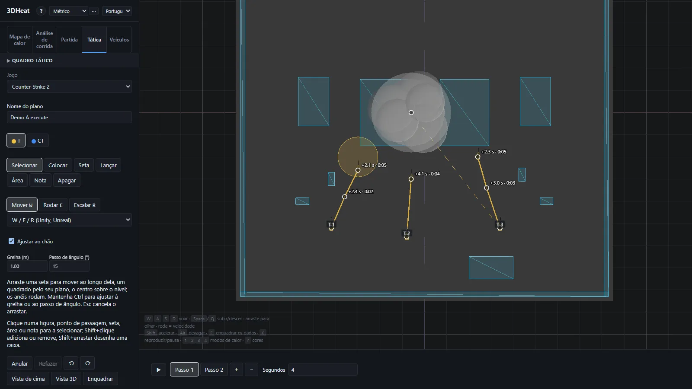

# Quadro tático

O separador **Tática** é uma prancheta para um plano de equipa: colocam-se figuras pequenas num mapa, desenham-se setas para onde vão, e prime-se reproduzir para ver acontecer. Use-o para planear uma ronda ou um ataque antes de jogar. Partilha a tela, a câmara e o [nível](levels.md) com os outros separadores e mais nada; um plano não são dados e não desenha calor.

## O seu primeiro plano {#your-first-plan}

1. Abra o separador **Tática**. Escolha o **Jogo** (por exemplo Counter-Strike 2) e, para Valorant, prima **Carregar mapas do Valorant** e escolha um **Mapa**. Ou carregue primeiro um [nível](levels.md).
2. Escolha um **Lado** (define a cor) e prima **Vista de cima**.
3. Escolha **Lugar**, escolha uma figura em **Figuras** (use **Procurar figuras** para a encontrar) e clique no mapa. Coloque duas ou três.
4. Escolha **Seta**, clique numa figura, clique ao longo do caminho que deve seguir, e prima **Enter** para terminar a seta.
5. Prima **+** por baixo da vista para acrescentar o passo 2. Cada figura começa onde a sua seta acabou. Desenhe mais setas aí.
6. Prima **▶** (ou `K`) para reproduzir o plano desde o passo mostrado até ao fim.
7. Dê um nome ao plano em **Nome do plano** e prima **Guardar**.

## Começar um plano {#starting-a-plan}

| Controlo | O que faz |
|---|---|
| **Jogo** | Escolhe os lados e as figuras que a paleta oferece: Counter-Strike 2 (T, CT; jogadores e utilitários), Valorant (Ataque, Defesa; jogadores e habilidades genéricas), Battlefield, Squad, Arma (infantaria, veículos terrestres, aeronaves, barcos), DCS / War Thunder / IL-2 (jatos, aviões de hélice, helicópteros, defesa antiaérea, terrestres, navios, armas) e Outro. Um plano que já tem figuras mantém os seus lados quando o jogo muda. |
| **Nome do plano** | O nome sob o qual o plano é guardado. |
| **Mapa**, **Carregar mapas do Valorant** | Com Valorant escolhido: **Carregar mapas do Valorant** obtém a lista de mapas de [valorant-api.com](https://valorant-api.com); **Mapa** depois coloca a miniatura do mapa escolhido como nível, enquadrada de cima. A imagem é obtida quando é escolhida e nunca é distribuída. O aviso da Riot é mostrado enquanto estiver no ecrã (ver abaixo). |
| **Lado** | O lado a que pertence a próxima figura, seta ou área; toma a cor do lado. |

Sem nível, o quadro é o plano de chão liso. Carregue um nível em **Nível** para planear sobre um mapa real: um mapa de CS2 exportado com a ferramenta de CS2, um nível da biblioteca, ou uma imagem de mapa.

## Ferramentas {#tools}

| Ferramenta | Clique | Notas |
|---|---|---|
| **Selecionar** | Uma figura, um ponto de passagem, uma seta, uma área ou uma nota seleciona-a. | Shift+clique acrescenta ou remove; Shift+arrastar desenha uma caixa à volta do que acrescentar. A seleção recebe um manipulador de transformação (ver abaixo); `Delete` ou `Backspace` remove-a. `M` move a figura selecionada para o próximo clique. |
| **Lugar** | Coloca a figura escolhida. | Uma figura é escolhida na paleta **Figuras** (com **Procurar figuras**). Sem nada selecionado, `R` roda a próxima figura 15° antes de ser colocada (`Shift+R` no sentido contrário). |
| **Seta** | Cada clique acrescenta um ponto; Enter, duplo clique ou clique direito termina, Esc descarta. | **Deslocar**, **Atacar** (cabeça mais larga) ou **Vigiar** (uma linha fina à altura dos olhos). Uma seta começada numa figura é o percurso dessa figura neste passo: reproduzida, a figura percorre-o, e o passo seguinte começa onde ele terminou. |
| **Lançar** | O lançador, depois onde cai. | Um arco tracejado entre um e outro, e o utilitário escolhido (fumo, flash, molotov, ...) aparece onde cai e fica desse passo em diante. |
| **Área** | O centro, depois a borda. | Um disco na cor do lado. |
| **Nota** | Onde fica a nota; pede o seu texto. | Mostrada como um alfinete, e o seu texto por cima. |
| **Apagar** | Uma figura, seta, área ou nota. | Remove-a deste passo em diante; no seu primeiro passo, remove-a. |

**Anular** e **Refazer** (`Ctrl+Z`; `Ctrl+Y` ou `Ctrl+Shift+Z`) percorrem cada alteração. Uma linha sob o plano mostra quantas figuras, setas e passos tem. **Vista de cima** olha diretamente para baixo (ortográfica), **Vista 3D** volta à perspetiva, **Fotograma** ajusta o plano, ou o nível quando o plano está vazio.

**Tamanho das figuras** escala todas as figuras do quadro; 1× é o tamanho real, que vista de muito alto são uns píxeis para uma pessoa.

## Mover, rodar e escalar {#moving-turning-and-scaling}

Tudo no quadro pode ser movido como num editor 3D: figuras, utilitários, marcadores, pontos de passagem isolados e setas inteiras, áreas e notas. O que está selecionado recebe um manipulador no seu centro:

| Modo | Teclas | Pegas |
|---|---|---|
| **Mover** | W (ou G) | Uma seta por eixo (X vermelho, Y verde e para cima, Z azul) move ao longo dele; um quadrado move no seu plano; o centro move sobre o nível sob o cursor. |
| **Rodar** | E (ou R) | Um anel por eixo gira em torno dele. Os anéis de uma figura isolada são a sua própria guinada, inclinação e rolamento; um grupo gira em torno dos eixos do mundo, a partir do seu centro. |
| **Escalar** | R (ou S) | Espalha ou junta a seleção a partir do seu centro, ao longo de um eixo ou em todos os sentidos; o raio de uma área cresce com ele. |

As **Chaves** alternam entre W / E / R (Unity, Unreal) e G / R / S (Blender); as teclas escolhem o modo só quando algo está selecionado, e fazem voar a câmara no resto. Assim, `R` significa **Escalar** com as teclas W / E / R e **Rodar** com as teclas G / R / S quando algo está selecionado, e roda a próxima figura a colocar quando nada está. Todas as teclas do quadro estão listadas na [referência de teclado](keyboard-reference.md#tactics-board). Mantenha **Ctrl** ao arrastar para encaixar um movimento na **Grelha** (metros) ou uma rotação no **Passo de ângulo**. **Ajustar ao chão** (ligado por omissão) põe as pessoas, veículos, marcadores, pontos de passagem e áreas movidos na superfície do nível; aeronaves e helicópteros mantêm a altura, e um arrasto ao longo da seta Y nunca encaixa. Arrastar uma pega nunca move a câmara. **Esc** cancela um arrasto, e cada alteração é um passo de Anular.

Os pontos de passagem aparecem como pontos nas setas do passo mostrado: clique num para o selecionar, arraste-o para o mover, Delete para o retirar. A secção **Selecionadas** mostra o lugar da seleção em metros, a guinada, inclinação e rolamento de uma figura em graus e o raio de uma área, cada um para escrever.

## Cronometragem {#timing}

O percurso de uma figura é cronometrado: cada segmento demora o seu comprimento sobre o nível - amostrado na superfície a cada dois metros, por isso uma colina ou uma escadaria entre dois pontos conta - à velocidade do **modo** de movimento dessa figura nesse jogo, mais qualquer **espera** num ponto de passagem. A infantaria rasteja, agacha-se, anda (silenciosa), corre ou sprinta; os veículos e barcos andam devagar, com cautela, normalmente ou apressados; as aeronaves e helicópteros voam devagar, em cruzeiro, em velocidade de combate ou no máximo. Um modo que o jogo não tem (o CS2 não tem sprint) toma o mais próximo que tenha. A forma como uma inclinação abranda depende do jogo: no CS2 e no Valorant só conta a distância horizontal, como nos jogos; os simuladores militares abrandam a infantaria em subida (função de caminhada de Tobler) e os veículos por inclinação.

As velocidades vêm de tabelas por jogo com as suas fontes (ver [Velocidades de movimento](tactics-speeds.md)): CS2 pela arma empunhada, a partir das definições de armas do jogo; Valorant por arma; Battlefield, Squad, Arma e os jogos aéreos pelo tipo e classe de veículo. **Move-se como** escolhe o perfil de uma figura (uma arma, um tipo de veículo); **Própria (m/s)** substitui qualquer modo para essa figura. Os modos têm os nomes que o quadro mostra: *Rastejar*, *Agachado*, *Andar (silencioso)*, *Correr*, *Sprint*; *Cautela*, *Normal*, *Apressado*; *Lento*, *Cruzeiro*, *Combate*, *Máximo*.

Cada ponto de passagem mostra o tempo desde o último e o tempo desde o início do plano ("+3,9 s · 0:12"). O percurso da figura selecionada lista cada segmento com o seu modo, comprimento e tempo, a espera e a chegada. **Chegadas** em **Cronometragem** põe cada figura com percurso numa só linha de tempo, a primeira chegada no topo. Com **Reproduzir em tempo real** (ligado por omissão) um passo dura até chegar o percurso mais lento e cada figura move-se à sua própria velocidade; **Segundos** é então o comprimento mínimo do passo. **Unidades do nível por metro** indica em que unidade está o nível: 39,37 para mapas de CS2 (unidades do jogo), 1 para mapas em metros.

## Comparar com dados de partidas {#compare-with-match-data}

**Carregar ficheiros de partida…** lê as tabelas de partidas de CS2 do mapa (os ficheiros Parquet da ferramenta de CS2, quantos quiser; só as colunas necessárias, em segundo plano); **Usar dados carregados** toma os dados carregados no visualizador. Depois:

- **Chegada mais cedo no mapa** colore o mapa pelo tempo desde o início da ronda em que um jogador chegou pela primeira vez a cada sítio - o botão **Mais rápido** mostra o mais rápido em todas as rondas, **Típico (mediana)** a ronda do meio - verde no início, vermelho no fim, para um lado ou para ambos. Mostra o que é possível e quando.
- O percurso selecionado é comparado com o que os jogadores conseguiram desde o seu início (ou desde o início da ronda) até ao seu fim, cada fim um disco do raio definido: "Mais rápido observado 14,2 s, p10 15,0 s, mediana 18,3 s em 41 execuções; o seu plano 15,1 s".
- As velocidades a que os jogadores realmente se moveram - correr, andar, agachar, a partir das colunas de andar e de agachar das tabelas - em m/s.

## Passos {#steps}

A barra por baixo da vista guarda os passos. Um plano começa com um; **+** acrescenta um, e cada figura começa nele onde o seu percurso no último passo terminou; **−** remove o mostrado. **Segundos** é quanto tempo demora o passo mostrado quando é reproduzido. **▶** (K) reproduz desde o passo mostrado até ao fim: as figuras com percurso percorrem-no, as figuras movidas para um novo lugar no passo seguinte deslizam para lá, as restantes ficam paradas. Enquanto um passo está mostrado, o lugar de cada figura no passo seguinte é desenhado como um fantasma ténue, e as setas do último passo aparecem levemente por baixo das deste.

## Guardar {#saving}

A secção **Ficheiro** tem **Guardar**, **Abrir** e **Limpar**. **Guardar** escreve o plano como `<nome>.h3dplan.json` (JSON simples: lados, passos, figuras com um lugar por passo, setas, áreas, notas); **Abrir** lê um de volta. Um ficheiro de outra versão, ou que não seja um plano, é recusado com o motivo. **Limpar** esvazia o plano; Anular devolve-o.

## Figuras {#figures}

Cada figura é construída pelo próprio visualizador: formas simples até ao tamanho publicado de um tipo, com as características que a distinguem das vizinhas - as rodas e a torre de um tanque, os canhões, mísseis e radares de um veículo de defesa antiaérea, a planta da asa, a cauda e os motores de uma aeronave, os rotores e as asas curtas de um helicóptero. Nada é tirado de um jogo. Um desenho que um jogo inventou é mostrado como a figura genérica da sua classe. Ver [Figuras](figures.md#which-figure-a-unit-gets) para saber como os dados encontram a sua figura.

## Aviso da Riot {#riots-notice}

Os mapas de Valorant são mostrados ao abrigo da política "Legal Jibber Jabber" da Riot Games, que permite que projetos comunitários gratuitos os usem e pede este aviso sempre que aparecem: *3DHeat foi criado ao abrigo da política "Legal Jibber Jabber" da Riot Games, usando recursos propriedade da Riot Games. A Riot Games não apoia nem patrocina este projeto.* As habilidades no quadro são formas genéricas, não a arte da Riot.
