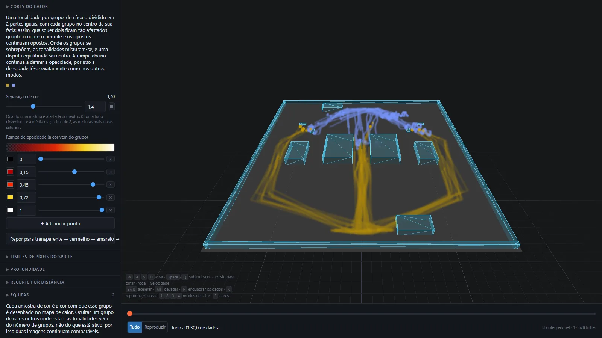

# Calor por equipa

O calor por equipa mostra onde esteve cada equipa, cada uma na sua cor. Onde as equipas se sobrepõem, as cores misturam-se.

O **Calor por equipa** (tecla 3) é o campo de densidade do [Calor](heat.md) com cada [grupo](glossary.md) com a sua própria tonalidade. Onde os grupos se sobrepõem, as tonalidades misturam-se; uma disputa equilibrada sai neutra. A opacidade continua a transportar a densidade exatamente como nos outros modos, por isso a imagem responde a *quanto* e a *de quem* ao mesmo tempo. Precisa de uma coluna de grupo.

Não é a [sobreposição de figuras](box-replay.md): essa desenha uma figura por pessoa; isto é um campo de calor colorido pela mesma coluna.

## Como usar {#how-to-use-it}

1. Prima `3` (ou escolha **Calor por equipa** na barra de modos).
2. Abra **Cores do calor**. As amostras mostram a cor de cada grupo; passe o rato sobre uma amostra para ver o nome da equipa.
3. Se tudo parecer cinzento, aumente a **Separação de cor**.
4. Desmarque um grupo na [Lista de equipas](teams-list.md) para o retirar; as outras cores ficam onde estavam.

## Controlos {#controls}

Na secção **Cores do calor**:

| Controlo | Omissão | Significado |
|---|---|---|
| Amostras | | A cor de cada grupo, para os primeiros 12 grupos, depois *+N mais*. Passe o rato por cima para ver o nome do grupo e a cor. |
| **Separação de cor** | 1.4 | Até onde uma mistura é afastada do neutro, de 0 a 4. Com 0 tudo fica cinzento; com 1 é a média verdadeira; acima de cerca de 2, as misturas mais brilhantes saem do intervalo visível e são limitadas canal a canal, o que desloca a sua tonalidade. |
| **Rampa de opacidade (a cor vem do grupo)** | a rampa de calor predefinida | Só o **alfa** da rampa é usado aqui: transparente onde não há nada, opaco no topo. As suas cores são ignoradas. |

Um grupo cujo nome significa "sem grupo" (`0`, vazio, `none`, `unknown`, `null` ou `-1`) é desenhado a cinzento.

Todos os outros controlos de calor - forma, saturação, resposta, calor mínimo, profundidade, recorte - funcionam como em [Calor](heat.md).

A [Lista de equipas](teams-list.md) mostra a cor de calor por equipa de cada grupo como a sua amostra neste modo. Ocultar um grupo deixa a cor de todos os outros grupos onde estava: as tonalidades vêm do número total de grupos, não do que está ligado, por isso duas imagens continuam comparáveis.

## Para programadores {#for-developers}

### A paleta {#the-palette}

De [`colors.ts`](https://github.com/Holdi601/3DHeat/blob/main/src/render/colors.ts):

- As cores vivem no plano de cor **Oklab** com luminosidade fixa (0,7) e croma fixo (0,115), por isso todos os grupos têm o mesmo brilho e um grupo vermelho não parece mais quente do que um azul.
- Com *n* grupos, o círculo de tonalidades é dividido em *n* partes iguais, e o grupo *i* fica com o **centro** da sua parte, `(i + 0,5) / n` de uma volta. Quaisquer dois grupos estão tão afastados quanto a contagem permite, e os opostos continuam opostos, seja qual for a contagem.
- São usadas no máximo **16** tonalidades distintas. Com mais grupos, os ids são colocados por divisões sucessivas (ids com bits invertidos: 0, ½, ¼, ¾, ⅛, …) para que ids vizinhos não partilhem uma tonalidade; os grupos além de 16 partilham-nas necessariamente.
- Um grupo cujo nome significa "sem grupo" - `0`, vazio, `none`, `unknown`, `null` ou `-1`, sem distinguir maiúsculas - é desenhado a **cinzento neutro** em vez de ocupar uma fatia do círculo. Só o primeiro desses nomes na lista de grupos é tratado assim.

A separação por omissão é 1,4 e não 1, porque, com 1, uma mistura de cinco tonalidades igualmente espaçadas *é* cinzento: correto e ilegível. Um pouco acima de 1 mantém os empates honestos e torna visível uma divisão de 60/40.

### Como funciona {#how-it-works}

O alvo de calor tem quatro canais neste modo. Cada sprite soma a sua densidade *v* ao primeiro canal e *v* × as coordenadas Oklab *a* e *b* do grupo ao segundo e terceiro. Na composição, a mistura de cada píxel é a média ponderada pela densidade: *a* = G / R, *b* = B / R, multiplicada pela separação de cor e convertida para sRGB à luminosidade da paleta. Dividir pela densidade acumulada mantém a tonalidade independente da quantidade de dados, e é por isso que todos os controlos de densidade continuam a atuar só sobre a opacidade.

O alvo de quatro canais custa quatro vezes a memória da GPU do alvo de calor de um canal, à mesma resolução.
