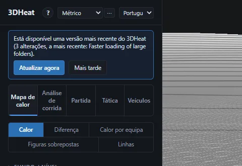

# Atualizações

O visualizador avisa quando existe uma versão mais recente, e só se atualiza quando diz que sim. Nada é alterado no seu computador sem a sua resposta.

## Atualizar o visualizador {#update-the-viewer}

1. **Na página.** Quando existe uma versão mais recente, aparece uma caixa por baixo do nome no topo da barra lateral: "Está disponível uma versão mais recente do 3DHeat". Clique em **Atualizar agora**. A página recarrega-se sozinha quando terminar. **Mais tarde** esconde a caixa até recarregar a página.
2. **Se disser para executar restart.bat**, feche a janela do servidor (a janela preta que o `start.bat` abriu) e faça duplo clique em `restart.bat`.
3. **Quando inicia o visualizador.** O `start.bat` também verifica. Se existe uma versão mais recente, pergunta **Atualizar agora? [S/N]**. Prima `S` para atualizar. Prima `N`, ou espere 60 segundos sem responder, para iniciar a versão que tem.



Uma cópia com alterações suas nunca é atualizada por si; a caixa só diz que
uma atualização está à espera, e pede para fazer commit ou stash das suas
alterações e executar `git pull`. Uma cópia que não foi instalada com git (um
ficheiro zip, por exemplo) não mostra nada.

Como funciona a verificação, passo a passo:

```
página ---(após 4 s, depois a cada 6 h)---> servidor de desenvolvimento ---> git fetch
   atrás?  não -> não se mostra nada
           sim -> alterações ou commits seus?  sim -> só avisa
                                               não -> [Atualizar agora] -> git pull
                                                      -> recarregar, ou "execute restart.bat"
```

## As regras de segurança {#the-safety-rules}

- **Só avanço rápido** (`git pull --ff-only`): uma atualização nunca funde,
  reaplica nem reescreve nada.
- **Sem alterações locais**: uma cópia com alterações não guardadas em
  ficheiros controlados (`git status --porcelain --untracked-files=no` não
  vazio) nunca é atualizada automaticamente - o trabalho de alguém não é para
  uma atualização o substituir. Só é avisada de que uma atualização está à
  espera. Os ficheiros não controlados (dados, exportações) não contam como
  alterações.
- **Sem commits locais**: uma cópia com commits que o upstream não tem
  ("divergiu") não é atualizada - um avanço rápido não a pode levar até lá, e
  a fusão fica para o `git pull` feito à mão. A página e o `start.bat` dizem
  isso com as mesmas palavras, e o `start.bat` inicia a versão que lá estiver.
- **Só a partir da própria página**: o pedido de atualização do servidor de
  desenvolvimento tem de levar um cabeçalho próprio e, quando o navegador
  envia um `Origin`, vir do próprio servidor (abaixo).
- Só uma cópia git com um ramo upstream é atualizada; qualquer outra coisa
  (uma cópia sem `.git`, sem git instalado, uma compilação estática) fica
  como está e não diz nada.

## O que faz o start.bat {#what-startbat-does}

O `start.bat` (faça duplo clique; a janela é o servidor) faz, por ordem:

1. Encontra o Node.js - no `PATH`, senão em `%ProgramFiles%\nodejs`,
   `%ProgramFiles(x86)%\nodejs` ou `%LOCALAPPDATA%\Programs\nodejs` - e
   oferece instalá-lo com `winget install -e --id OpenJS.NodeJS.LTS` quando
   falta (pergunta, S/N; depois disso é preciso reabrir a janela para o
   Windows ler o novo `PATH`).
2. **Atualizações**, quando o git está instalado e a pasta tem `.git`:
   - `git fetch --quiet` (sem rede ou sem upstream: ignorado em silêncio);
   - conta `git rev-list --count HEAD..@{u}`; nada atrás: não diz nada;
   - alterações locais: "Está disponível uma versão mais recente do 3DHeat (N alterações), mas esta cópia tem alterações locais, por isso não é atualizada. Faça commit ou stash delas e depois execute git pull." - e inicia a versão que lá estiver;
   - commits próprios (`git rev-list --count @{u}..HEAD` diferente de 0): "Está disponível uma versão mais recente do 3DHeat (N alterações), mas esta cópia tem commits próprios que a versão mais recente não tem, por isso não é atualizada. Atualize-a com git pull." - e inicia a versão que lá estiver;
   - caso contrário, "Está disponível uma versão mais recente do 3DHeat (N alterações)." e a pergunta **Atualizar agora? [S/N]**. `N`, ou nenhuma resposta durante 60 segundos, escreve "Não atualizado; a iniciar a versão que tem." e inicia a versão que lá estiver. Com `S`: "A atualizar...", indica se `package.json` ou `package-lock.json` mudam, executa `git pull --ff-only` (se mesmo assim falhar - a rede, por exemplo: "A atualização não se concluiu; a iniciar a versão que tem."), depois `git submodule update --init` (as ferramentas fixadas, veja [Manter a documentação](maintaining.md#the-tools-under-exporters)), depois `npm install` quando os ficheiros de pacote mudaram e `node_modules` existe, e "Atualizado."
3. Recusa iniciar um segundo servidor: quando algo já escuta na porta **5273**, diz isso e aponta para `restart.bat` / `stop.bat`.
4. Na primeira execução (sem `node_modules`), pergunta antes de descarregar as dependências (cerca de 300 MB para `node_modules\`, nada à escala do sistema).
5. Inicia o servidor de desenvolvimento em `127.0.0.1:5273` (`--strictPort`) e abre o navegador quando estiver pronto.

O `restart.bat` para o servidor (pela porta) e volta a executar o `start.bat`, por isso faz a mesma pergunta. O `stop.bat` só para o servidor.


## Para programadores {#for-developers}

### Enquanto corre: a rota de atualização {#while-it-runs-the-update-route}

O servidor de desenvolvimento (plugin do Vite `heat3d-self-update` em `vite.config.ts`) serve `/__heat3d/update`. Existe só no servidor de desenvolvimento - não numa compilação estática nem no `vite preview`.

**`GET /__heat3d/update`** responde se a cópia está atrás:

```json
{ "checkout": true, "upstream": "origin/main", "behind": 3, "ahead": 0, "dirty": false, "latest": "o assunto do commit mais recente" }
```

- `checkout: false` quando a pasta não é uma cópia git;
- executa `git fetch --quiet` **no máximo a cada 30 minutos** (os pedidos entretanto respondem com o que foi buscado da última vez);
- `behind` / `ahead` vêm de `git rev-list --count HEAD..@{u}` / `@{u}..HEAD`, `dirty` de `git status --porcelain --untracked-files=no`, `latest` é o assunto do commit mais recente do upstream;
- sem ramo upstream, `upstream: null` e `behind: 0`.

**`POST /__heat3d/update/apply`** atualiza a cópia:

1. Recusado com `403 { ok: false, reason: "forbidden" }` a não ser que o pedido tenha o cabeçalho `X-Heat3d-Update: 1` e, quando traz um `Origin`, o host dessa origem seja o `Host` do pedido. Um formulário de outro site não pode enviar um cabeçalho próprio sem um pré-voo CORS, que este servidor nunca concede.
2. Nada a fazer (não é uma cópia git, sem upstream, não está atrás): `{ ok: true, updated: false }`.
3. Alterações locais: `{ ok: false, reason: "dirty" }`; commits locais: `{ ok: false, reason: "diverged" }`.
4. Caso contrário: indica os ficheiros que mudam (`git diff --name-only HEAD @{u}`), executa `git pull --ff-only` (tempo limite de 2 min), `git submodule update --init` (falha ignorada), `npm install` quando `package.json` ou `package-lock.json` mudaram (tempo limite de 15 min), e responde `{ ok: true, updated: true, restart }` - `restart` diz porque é que o servidor em execução não pode apanhar a atualização: `"dependencies"` quando foram reinstaladas, `"config"` quando só um ficheiro `vite.config` mudou, `false` quando nada precisa de reinício.
5. Um comando git ou npm que falha responde `{ ok: false, reason: "<o erro, até 300 caracteres>" }`.

As respostas são JSON com `Cache-Control: no-store`. O servidor escuta só em
`127.0.0.1`, por isso a rota não é acessível a partir da rede.

### O aviso na página {#the-notice-in-the-page}

`UpdateBanner`, por baixo do nome no topo da barra lateral:

- Pergunta à rota **4 segundos** depois de a página carregar (não nos primeiros segundos: a página tem um conjunto de dados para carregar e uma GPU para iniciar) e de novo **a cada 6 horas** enquanto a página estiver aberta.
- Não mostra **nada** quando não há essa rota (uma compilação estática), a pasta não é uma cópia git, ou nada é mais recente - um aviso em cada arranque é um que as pessoas aprendem a ignorar.
- Atrás, sem alterações locais: "Está disponível uma versão mais recente do 3DHeat (N alterações, a mais recente: <assunto>)." com **Atualizar agora** e **Mais tarde** (*Mais tarde* esconde até a página ser recarregada).
- Atrás, com alterações locais: a mesma frase e "Esta cópia tem alterações locais, por isso não é atualizada automaticamente; faça commit ou stash delas e depois execute git pull." - sem botão.
- **Atualizar agora** envia um pedido a `/apply` ("A atualizar..."). Depois:
  - "Atualizado. A página recarrega-se." - e recarrega 1,5 s depois (o servidor já serve os ficheiros novos);
  - quando as dependências foram reinstaladas: "Atualizado. As suas dependências mudaram: feche a janela do servidor e execute **restart.bat** para terminar.";
  - quando só as definições do servidor mudaram: "Atualizado. As definições do servidor mudaram: feche a janela do servidor e execute **restart.bat** para terminar.";
  - afinal nada a trazer (`updated: false` - a cópia foi atualizada entretanto, pelo `start.bat` por exemplo): "Nada a atualizar: esta cópia já é a versão mais recente." - e sem recarregar;
  - recusado: a frase de *alterações locais*, ou "Esta cópia tem commits próprios que a versão mais recente não tem; atualize-a com git pull.", ou "A atualização não se concluiu: <motivo>".
