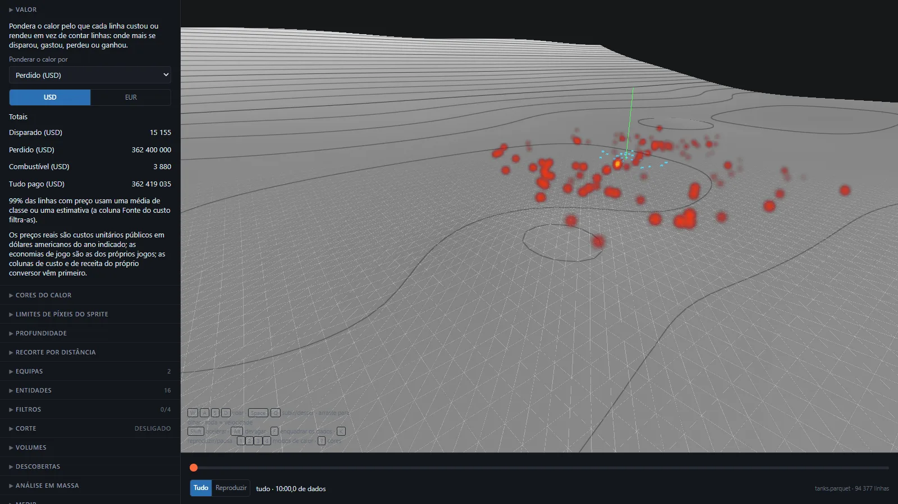

# Ponderação por valor

Cada disparo, munição, veículo perdido e litro de combustível tem um preço. O visualizador calcula quanto custou ou rendeu cada linha e pode ponderar o calor por ele, para que o mapa mostre **para onde foi o dinheiro** em vez de onde estão as linhas.

## Como usar {#how-to-use-it}

1. Carregue dados com eventos (disparos, abates, mortes) e nomes de veículos ou armas.
2. Abra **Valor** na barra lateral do Calor.
3. Escolha **Ponderar o calor por**, por exemplo *Perdido (USD)*. O calor passa a somar o preço de cada linha em vez de 1.
4. Leia **Totais**: a soma de cada coluna de valor para o que está mostrado (os filtros e a janela temporal aplicam-se).
5. Quando os preços são dinheiro real, aparece um comutador **USD / EUR**.

Escolha a primeira entrada vazia do menu para voltar a contar linhas.

## O que pode ser ponderado {#what-can-be-weighed}

As colunas de valor são somadas no carregamento, uma por tipo e moeda:

| Tipo | Linhas em que cai | Como é avaliado |
|---|---|---|
| **Disparado** | disparos e lançamentos | a arma, senão uma média para o tipo de munição |
| **Gasto** | compras, aparecimentos | colunas de dinheiro do jogo (por exemplo, o menu de compra de um jogo de tiro) |
| **Perdido** | mortes, destruídos | o veículo próprio, senão a média da sua classe |
| **Destruído** | abates | o veículo alvo |
| **Dano causado** | acertos | uma parte do valor do alvo |
| **Combustível** | posições | combustível gasto, de uma coluna de combustível ou estimado pela classe e pelo tempo |
| **Tudo pago** | | disparado + gasto + perdido + combustível |
| **Ganho** | recompensas | as colunas de recompensa do próprio jogo (`earn_…`) |
| **Líquido** | | ganho menos pago; desenhado como calor com sinal (rampa positiva onde se ganhou mais, negativa onde se pagou mais) |

Os nomes das colunas são `cost_<tipo>_<moeda>`, `earn_<moeda>` e `net_<moeda>`. Um conversor que conhece a moeda própria do jogo (por exemplo, um conversor de replays que escreve em créditos do jogo) tem prioridade sobre as tabelas de preços incorporadas.

## As tabelas de preços {#the-price-tables}

| Tabela | Moeda |
|---|---|
| Militar real: mísseis, bombas, munições, contramedidas, aeronaves, helicópteros, veículos terrestres, navios, combustível | USD (EUR = USD × 0,92, o `EUR_PER_USD` fixo em [`cost.ts`](https://github.com/Holdi601/3DHeat/blob/main/src/data/cost.ts); não é uma taxa em tempo real) |
| Menus de compra de jogos de tiro e recompensas de abates | os créditos do jogo |
| Jogos de tanques e navios | os créditos do jogo |
| Jogos de estratégia (vários recursos) | uma coluna por recurso mais uma combinada |
| Jogos de guerra | pontos |

O jogo é reconhecido a partir dos nomes nos dados. Os preços reais vêm de fontes públicas (documentos orçamentais, enciclopédias) ou estão marcados como estimativas; não são ajustados pela inflação. A lista gerada das tabelas está em [Tabelas de valor](ref-value-tables.md).

## Estimativas {#estimates}

A coluna extra de categoria **Origem do custo** indica como cada linha foi avaliada: `table`, `class average`, `estimate` ou `none`. A secção Valor mostra que parte das linhas avaliadas são médias ou estimativas. Para manter só as linhas com preço exato, desmarque *estimate* e *class average* em **Origem do custo** nos [Filtros](filters.md).

## Onde mais aparece o valor {#where-else-value-shows}

- [Análises](insights.md): os achados *Terreno dispendioso* e *Terreno rentável*.
- [Repartição](breakdown.md): dinheiro ganho, perdido e líquido por equipa, jogador ou arma.
- [Volumes](volumes.md): colunas de valor nas estatísticas e na comparação.
