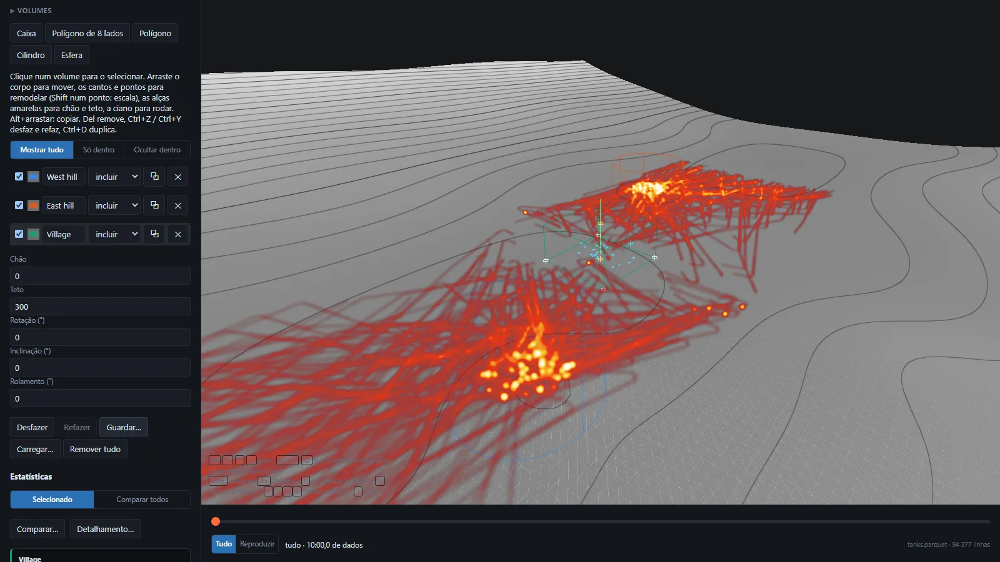
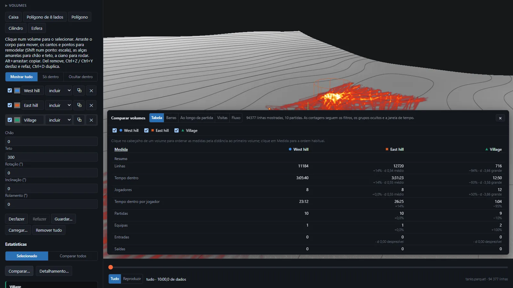
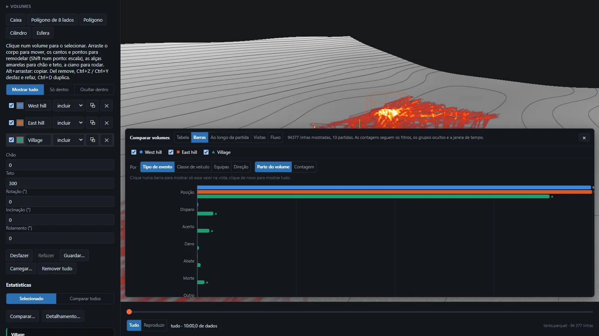

# Volumes e comparação

Um **volume** é uma caixa invisível (ou um cilindro, ou uma esfera) que se desenha à volta de um sítio, para perguntar: o que aconteceu aqui dentro? Use-o para contar abates numa ponte, para comparar duas colinas, ou para mostrar só a atividade numa área.

```
 vista de cima            Desenhe uma forma ->  o visualizador conta
 +------------+           o que está dentro:
 |   ( A )    |            linhas, jogadores, abates, tempo ...
 |        [B] |           Compare A com B, lado a lado.
 +------------+
```



Os volumes medem o que acontece dentro deles, filtram a vista para eles, exportam as suas linhas e podem ser comparados lado a lado. Veja também o [glossário](glossary.md) para linha, pessoa e partida.

## Desenhar um volume {#draw-a-volume}

1. Abra **Volumes** na barra lateral.
2. Escolha uma ferramenta e desenhe na vista 3D ou no mapa 2D. O chão e o teto partem dos dados por baixo. Esc cancela.
3. Clique no volume para o selecionar; aparecem as suas **Estatísticas**.

| Ferramenta | Como desenhar |
|---|---|
| **Caixa** | Arraste um retângulo (Shift: um quadrado). Um clique coloca uma caixa predefinida. |
| **n-gon** | Arraste a partir do centro (Shift mantém-no regular). *Cantos* define n, de 3 a 64 (predefinição 8, pelo que o botão mostra **8-gon**). |
| **Polígono** | Clique nos cantos; feche com duplo clique, Enter ou um clique no primeiro canto. Backspace remove o último canto. |
| **Cilindro** | Arraste o raio. |
| **Esfera** | Arraste o raio; assenta no chão. |

## Editar {#edit}

- Clique num volume para o selecionar. Arraste o corpo para o mover, os cantos para o remodelar (Shift num canto escala).
- As pegas **amarelas** definem o chão e o teto, a pega **ciano** roda-o.
- Alt+arrastar copia, Del remove, Ctrl+Z / Ctrl+Y desfazem e refazem, Ctrl+D duplica. **Remover tudo** apaga todos os volumes.
- Valores exatos: Chão, Teto, Rotação / Inclinação / Rolamento (caixas), Raio (esferas, cilindros).

Cada linha de volume tem uma caixa de mostrar, uma cor, um nome, **incluir** ou **excluir**, duplicar e apagar. Os volumes são guardados no navegador para cada conjunto de dados, e **Guardar...** / **Carregar...** escrevem e leem um ficheiro `volumes.json`.

## Filtrar a vista {#filter-the-view}

| Filtro | Efeito |
|---|---|
| **Mostrar todas** (predefinição) | Os volumes apenas medem. |
| **Só dentro** | O calor, a repetição e a [análise de impactos](hit-analysis.md) desenham só o que está dentro dos volumes incluídos e fora dos excluídos. |
| **Ocultar dentro** | O oposto. |

O filtro da GPU aceita até 8 volumes com 64 pontos de contorno no total; um "!" assinala um volume além disso. As estatísticas e a exportação continuam a contá-lo.

## Estatísticas {#statistics}

A área de **Estatísticas** segue os filtros, a janela de tempo e os grupos ocultos. *Selecionado* mostra o volume selecionado, *Comparar todas* põe todos os volumes lado a lado. Mostra:

- **Linhas dentro (mostradas)** e **Linhas dentro (todos os dados)**, **Jogadores**, **Equipas**, **Partidas**, **Tempo dentro**, **Entradas / saídas**, **Calor máximo**, **Calor médio**, **Volume / área** e um histograma **Quando**;
- **Taxa de vitória**, quando os dados dizem quem ganhou ([colunas de resultado](data-formats.md#outcome-columns)): das rondas com um jogador dentro, contando a ronda de cada jogador uma vez, a parte que o seu lado ganhou, atraída 4 rondas para a taxa sobre tudo o que é mostrado, como faz o [detalhamento](breakdown.md), com as rondas ganhas e jogadas e essa taxa global;
- por coluna: categorias com **Lift** (proporção dentro dividida pela proporção em todos os dados mostrados), e números com intervalo, mediana e percentis 5-95.

**Estatísticas como CSV / JSON** guarda-as. **Exportar os dados de dentro** escreve as linhas de dentro em CSV ou Parquet (*Só as linhas mostradas* ligado por omissão), um volume ou todos, com uma coluna a dizer a que volume pertence cada linha.

## Comparar volumes {#compare-volumes}

Com dois ou mais volumes visíveis, prima **Comparar...**.

1. Desenhe três volumes, por exemplo Colina oeste, Colina leste e Aldeia.
2. Prima **Comparar...** em Estatísticas.
3. Em **Tabela**, leia a diferença de cada valor em relação ao primeiro volume.
4. Mude para **Barras** para ver as proporções em barras.



| Vista | Mostra |
|---|---|
| **Tabela** | Linhas, tempo dentro, jogadores, partidas, equipas, entradas, saídas, visitas, duração das visitas, abates, mortes, abates por morte, abates por minuto, tempo por jogador, colunas de valor; agrupadas por eventos, classe de veículo, jogador ou IA, equipa e direção. Cada valor mostra a sua diferença face ao primeiro volume e um tamanho de efeito (desprezável, pequeno, médio, grande). Clique no cabeçalho de um volume para ordenar pela distância ao primeiro. |
| **Barras** | Contagens ou proporções por evento, classe, ator, equipa ou direção. Clique numa barra para filtrar a vista por ela. |
| **Ao longo da partida** | Um gráfico por volume ao longo dos minutos da partida: presença, linhas ou abates. Clique para saltar até lá. |
| **Visitas** | Gráficos de caixa e de violino da duração das visitas (escala logarítmica). |
| **Fluxo** | Para onde vão os trajetos depois de sair de cada volume: uma matriz de transições ou fitas de fluxo. |



## Sugestões {#tips}

- Comece de uma descoberta: em [Descobertas](insights.md), **Volume aqui** acrescenta um cilindro à volta do sítio da descoberta.
- **Detalhamento...** abre o [Detalhamento](breakdown.md) para o volume selecionado: quem e o que se sai melhor lá dentro.
- O [calor direcional](directional-heat.md) pode representar graficamente as direções dentro do volume selecionado.
- O [separador Veículos](hit-analysis.md#restrict-to-an-area) usa os mesmos volumes como filtro de área.
