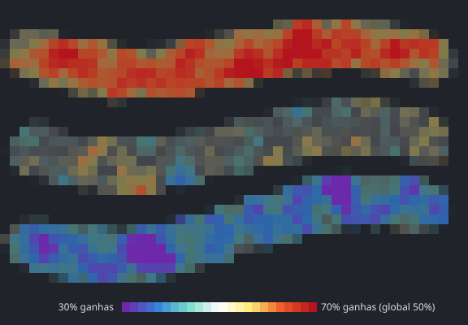

# Taxa de vitória: com que frequência um lugar, um percurso ou uma jogada ganha

Onde um jogador se coloca, que caminho segue, onde atira as suas granadas, e com que frequência o seu lado ganha depois a ronda. O **mapa de taxa de vitória** colore cada lugar pela parte das linhas aí que pertencem a rondas ganhas pelo lado da linha. Compara-a com a parte sobre tudo o que é mostrado: quente onde é maior, frio onde é menor, nada onde é igual.

*A imagem mostra dados inventados: três percursos num nível vazio, com 68%, 50% e 33% das suas linhas em rondas ganhas.*

Precisa de dados que digam quem ganhou: as [colunas de resultado](data-formats.md#outcome-columns) (`won`, `matchWon`, `roundEndReason`). Os conversores de CS2 e War Thunder escrevem-nas; qualquer ficheiro as pode ter.

## Experimente {#try-it}

1. Carregue partidas com uma coluna de resultado e prima `2` (**Diferença**).
2. Em **Divisão por diferença**, prima **Taxa de vitória por ronda** (ou **Taxa de vitória por partida**). Isto coloca as rondas ganhas em **+** e as perdidas em **−**, e muda o painel para **Parte de +**.
3. Leia as cores. O painel indica a parte global: *No total, 52,0% de 1 200 000 linhas estão em +.*
4. Restrinja com os [filtros](filters.md): um lado (T ou CT), um tipo de evento (*Posição* para onde as pessoas estavam, *Disparo* ou *Lançamento* para de onde dispararam ou atiraram), uma compra, um mapa.

Um lugar quente com linhas de *Posição* é um lugar cujos ocupantes costumavam ganhar a ronda. Com linhas de *Abate*, é um lugar onde os abates feitos levaram a rondas ganhas.

## As definições {#the-settings}

| Definição | O que faz | Predefinição |
|---|---|---|
| **Diferença** / **Parte de +** | a própria diferença, ou a parte do lado + entre as linhas de ambos os lados | Diferença |
| **Cor plena a** | a que distância acima ou abaixo da parte global um lugar é mostrado com cor plena, em pontos | ± 20 pontos |
| **Mínimo de linhas para colorir um lugar** | um lugar com menos linhas não é colorido; aparece gradualmente a partir de metade disso | 12 |
| **Atração para a parte global (linhas)** | cada lugar começa com este número de linhas na parte global, para que um lugar com 3 linhas, todas ganhas, não apareça com 100% | 12 |

As três atuam sobre a imagem pronta: arrastá-las nunca reinicia a acumulação.

A parte vale para qualquer divisão, não só para vitórias: *Parte de +* com uma divisão por lado mostra onde os T eram a maior parte da presença, e com uma divisão pelos ficheiros de dois mapas, onde as linhas de um ficheiro superam as do outro.

## Linhas, não rondas {#rows-not-rounds}

O mapa conta linhas. Um jogador que fica vinte segundos num sítio acrescenta uma linha em cada amostra, todas de uma só ronda. Por isso, a prova num lugar são as linhas perto dele, não as rondas. É por isso que o mínimo e a atração estão em linhas, e que são maiores do que o valor de uma ronda.

Para as próprias rondas:

- **[Detalhamento](breakdown.md)** sobre um ponto, a vista ou um volume: *Vitórias %* conta a ronda de cada jogador uma vez, atraída da mesma forma para a taxa global do lugar (4 rondas).
- Estatísticas dos **[Volumes](volumes.md)**: *Taxa de vitória*, as rondas com um jogador dentro do volume, cada uma uma vez, atraídas para a taxa sobre tudo o que é mostrado, com as contagens.

## Filtros de resultado {#outcome-filters}

O painel [Filtros](filters.md) lista as colunas de resultado logo a seguir às colunas próprias do visualizador: **Resultado da ronda** e **Resultado da partida** (*Qualquer*, *Ganha*, *Perdida*) e **Como a ronda terminou** (Eliminação, Bomba explodiu, Bomba desarmada, Tempo esgotado, Rendição, Empate, Objetivo, Zonas mantidas, Tickets perdidos, Todos os veículos perdidos), na língua do visualizador.

## Para programadores {#for-developers}

A passagem de calor escreve três somas no alvo de quatro canais que o calor por equipa usa: o calor `R = Σ|v|`, o calor do lado + `P` e `S = Σ v²/w`, em que `w` é o peso da passagem (peso de amostragem vezes ganho de fotograma). A composição lê a parte `P/R` (uma média ponderada pelo núcleo) e as linhas em que assenta, `n = R²/S` (o tamanho efetivo da amostra de Kish). Atrai a parte para a global, `p = (n·P/R + m·r0)/(n + m)`, e colore `p - r0` sobre o intervalo com os gradientes da diferença.

`n` elimina qualquer fator comum às linhas de um píxel: o ganho de fotograma, o peso de amostragem, o peso de área de um sprite limitado. Assim, a imagem é a mesma em qualquer zoom e densidade de amostragem, e os fotogramas de uma em cada k linhas juntam-se ao todo sem que as cores saltem. A parte global vem das contagens por lado da CPU, com precisão de décimas de ponto percentual; nada é lido de volta da GPU. O cálculo e as suas verificações: [`render/rateMap.ts`](https://github.com/Holdi601/3DHeat/blob/main/src/render/rateMap.ts) e o seu teste.

Custa o mesmo que o calor por equipa: o alvo de quatro canais quadruplica a largura de banda de mistura da passagem de calor, só enquanto *Parte de +* está ligado.
