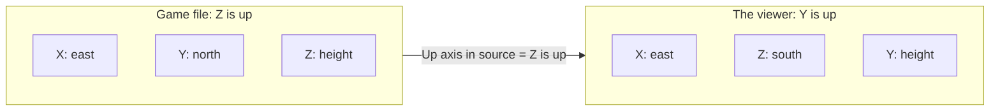

# Axe, unități și timp

Jocurile și hărțile nu se pun de acord în privința direcției în sus, a lungimii unei unități sau a felului în care se scrie timpul. Această pagină arată cele trei setări care fac ca datele tale să stea drept, la scara corectă și să se redea în felul corect.

Dacă harta ta stă ca un perete în loc să stea culcată ca o podea, comută **Axa verticală în sursă**.

Cu **Axa verticală în sursă** greșită, harta stă ca un perete; cu cea corectă, stă culcată ca o podea.

## Lumea în care desenează vizualizatorul {#the-world-the-viewer-draws-in}

Lumea vizualizatorului este **cu Y în sus**: X și Z sunt planul solului, Y este înălțimea. Majoritatea motoarelor de joc sunt **cu Z în sus**: pentru ele X și Y sunt solul, iar Z este înălțimea. Unele motoare sunt și oglindite (cu mâna stângă). Maparea spune cum să transformi axele fișierului în cele ale vizualizatorului. (Tehnic, vizualizatorul este cu mâna dreaptă, convenția three.js.)

### Axa verticală {#up-axis}

**Axa verticală în sursă** din [Maparea coloanelor](column-mapping.md):

| Setare | Fișierul (x, y, z) devine lumea (X, Y, Z) |
|---|---|
| *Z este în sus (majoritatea motoarelor de joc)* - implicit | (x, **z**, **y**): Z din fișier devine înălțimea, iar Y din fișier devine Z al lumii |
| *Y este în sus (convenția grafică)* | (x, y, z) neschimbate |

Pentru datele cu Z în sus, cele trei tablouri sunt redenumite în loc să fie copiate ([`remapAxesInPlace`](https://github.com/Holdi601/3DHeat/blob/main/src/data/ingest.ts)), ceea ce economisește sute de megaocteți la încărcările mari. Ghicirea se face din eșantion: care dintre coloanele Y și Z are dispersia mai mică, aceea este sus.

### Inversări {#flips}

**Inversează X**, **Inversează Y**, **Inversează Z** neagă axa *fișierului* cu numele respectiv, înainte de redenumire - deci, cu Z în sus, *Inversează Y* neagă ceea ce ajunge să fie Z-ul lumii. O inversare schimbă datele încărcate: coordonatele arătate de [rigla](measure.md), felia și poziția camerei sunt cele inversate.

Ca să desenezi o lume oglindită în sensul corect **fără** să schimbi datele, folosește în schimb **Cameră și scenă → Inversează axa lumii** ([Camera](camera.md#invert-world-axis)). Aceasta este alegerea mai bună pentru jocurile a căror lume este cu mâna stângă, pentru că orice coordonată arătată de instrumente rămâne a jocului.

### Scara unităților {#unit-scale}

**Scara unităților** înmulțește fiecare poziție. *1 (m)* pune 1, *0,01 (cm→m)* pune 0,01 (unitățile Unreal Engine sunt centimetri, deci folosește 0,01; unitățile motorului Source sunt țoli, deci folosește 0,0254; niciuna nu este metri), iar caseta acceptă orice valoare. Un 0 scris sau o valoare care nu este număr este înlocuită cu 1.

Vizualizatorul etichetează distanțele în metri (raza sprite-ului, limitele de eliminare, rigla, viteza de zbor), ceea ce este adevărat doar când unitatea de lume scalată este un metru. Nimic nu se strică dacă nu este; etichetele doar citesc „m” pentru orice este unitatea.

## Timpul {#time}

### Unități de timp {#time-units}

Regulă orientativă: valorile precum 17000000000 (zece cifre sau mai multe) sunt un timestamp Unix; valorile precum 0, 0,25, 0,5 sunt secunde de la început.

| Unitatea de timp (eticheta din meniu) | Se citește ca | Ora de ceas afișată |
|---|---|---|
| *Secunde (relativ)* | valoare × 1 s | nu |
| *Milisecunde (relativ)* | valoare × 0,001 s | nu |
| *Microsecunde (relativ)* | valoare × 10^-6 s | nu |
| *Nanosecunde (relativ)* | valoare × 10^-9 s | nu |
| *Timestamp Unix (s)* | secunde de la 1970-01-01 UTC | da |
| *Timestamp Unix (ms)* | milisecunde de la 1970-01-01 UTC | da |
| *Șir de dată ISO-8601* | text precum `2026-03-14T18:02:11.250Z`, analizat cu `Date.parse` al browserului | da |

Cu o unitate absolută (ultimele trei), setul de date păstrează momentul de ceas al celui mai devreme rând, iar cronologia arată ora UTC curentă (`HH:MM:SSZ`) lângă cursor.

**Coloanele Parquet `TIMESTAMP` și `DATE`** se decodează în momente reale, deci setarea lor de unitate este ignorată, iar panoul o spune. O coloană `DATE` este o zi întreagă: fiecare rând al unei zile are același moment, iar redarea sare câte o zi, lucru pe care panoul îl avertizează.

**Șirurile ISO-8601 funcționează atât în CSV, cât și în Parquet.** O coloană de timp de tip text cu unitatea ISO este analizată o dată pentru fiecare șir distinct; dacă niciunul nu se analizează, încărcarea eșuează cu *Nu există timestamp-uri ISO-8601 care să poată fi analizate în coloana de timp mapată.* - iar maparea refuză deja să pornească atunci când niciuna dintre valorile eșantionate nu se analizează. O coloană `TIMESTAMP` Parquet este citită ca timestamp, indiferent de unitatea setată, iar o coloană numerică Parquet cu unitatea ISO este citită ca milisecunde Unix. O coloană de timp de tip text cu o unitate numerică este refuzată înainte de încărcare: fiecare valoare ar fi citită ca NaN.

### Cum este stocat timpul {#how-time-is-stored}

În timp ce fișierele sunt îmbinate, timpurile sunt secunde pe 64 de biți, deci o epocă absolută își păstrează detaliul sub-secundă. Când toate fișierele sunt înăuntru, cel mai devreme timp din toată selecția devine 0, iar fiecare rând stochează secunde pe 32 de biți de la acel punct. Un float pe 32 de biți are 24 de biți de mantisă: intervale de până la aproximativ o zi și jumătate se rezolvă mai bine de 1/100 s, iar intervale de o jumătate de an, până la aproximativ o secundă. Un rând al cărui timp lipsește sau nu este număr este pus la 0, adică la început.

Rândurile sunt apoi sortate după timp, ceea ce face cronologia ieftină: o fereastră de timp se găsește cu două căutări binare (vezi [Eșantionare și bugete](sampling-and-budgets.md)).

### Timp scurs față de ora de ceas {#elapsed-time-versus-wall-clock}

O coloană de timp precum `match_time` sau `round_time` numără de la începutul fiecărui meci. Alegând-o, fiecare meci ajunge pe o singură axă comună - bună pentru compararea a ce se întâmplă în minutul 3 al fiecărui meci - iar panoul o subliniază. O coloană cu ora de ceas arată meciurile în ordinea în care s-au petrecut cu adevărat, suprapunându-se acolo unde s-au suprapus.

## Direcția privirii {#look-direction}

Direcția privirii este folosită doar de [reluarea în cuburi](box-replay.md) (razele din fiecare cub). Este stocată ca două unghiuri, girația și tangajul, în radiani.

- **Coloanele girație / tangaj** sunt citite așa cum sunt, convertite din grade când este ales *Grade*. Nu sunt ajustate pentru axa verticală sau pentru inversări.
- **Coloanele de vector de direcție** trec prin aceeași redenumire și inversări ca pozițiile, apoi devin girație = atan2(x, -z) și tangaj = atan2(y, √(x² + z²)) în axele lumii, astfel încât raza indică unde este orientat cubul și într-o lume cu sursă oglindită.

Dacă coloanele girație / tangaj ies cu direcția greșită după o inversare, un vector de direcție sau unghiuri ajustate, remedierea este aceea.
