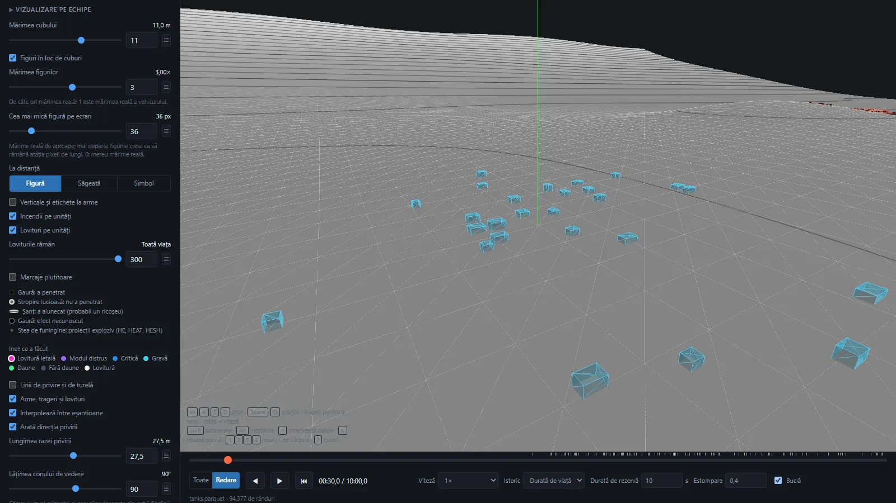

# Figuri suprapuse (reluarea în cuburi)

Un mic film: câte o figură pentru fiecare persoană, care se mișcă pe măsură ce trece timpul, cu o urmă în spate.

Modul se numește **Figuri suprapuse** în bara de moduri. Această pagină se numea înainte „reluarea în cuburi”, pentru că înainte de figuri fiecare persoană era un cub; „reluarea cu figuri” și „reluarea în cuburi” înseamnă același lucru. **Figuri suprapuse** nu are tastă cu număr: alege-l din bara de moduri. Desenează câte o figură (sau un cub) pentru fiecare [persoană](glossary.md), care se mișcă de-a lungul [cronologiei](timeline.md), cu raze de privire și urme opționale. Este redare, nu densitate: *cine unde era, când*. Are nevoie de o coloană cu persoane; fără o coloană de timp, fiecare eșantion este desenat deodată.

## Cum se folosește {#how-to-use-it}

1. Încarcă date cu o coloană de persoană și o coloană de timp.
2. Alege **Figuri suprapuse** în bara de moduri.
3. Comută cronologia pe **Redare** și apasă redare (`K`).
4. Deschide **Vizualizare pe echipe** ca să schimbi **Lungimea urmei**, mărimea figurilor sau razele de privire.

În acest mod nu se desenează căldură, iar bugetul adaptiv de sprite-uri este inactiv.

Implicit, fiecare persoană este desenată ca figura a ceea ce este, nu ca un cub - vezi [Figuri](figures.md) pentru ce figură primește o unitate și [Reluarea meciului](match-replay.md) pentru etichete, camera de urmărire, măsurarea între două unități și lista de evenimente.

## Panoul Vizualizare pe echipe {#the-team-viewer-panel}

Afișat în locul panourilor de căldură în acest mod.

| Comandă | Implicit | Interval (cursor) | Înțeles |
|---|---|---|---|
| **Figuri în loc de cuburi** | pornit | | Fiecare persoană ca figura a ceea ce este: un soldat pe jos, tancul sau aeronava pe care le numesc datele. Ce nu spun datele rămâne cub. |
| **Mărimea figurilor** | 1× | | 1× este mărimea reală. |
| **Cea mai mică figură pe ecran** | 36 px | 0 = mereu mărimea reală | Mărimea reală de aproape; figurile mai departe cresc ca să rămână atât de lungi în pixeli. |
| **Arme, trageri și lovituri** | pornit | | Arme în zbor cu fum, trasoare, impacturi, lovituri și uciderile. Trasoarele deduse dintr-o lovitură sunt punctate. |
| **Mărimea cubului** | mărimea entității, sau extensia / 500, la încărcare | 0,05-200 m, logaritmic (5000) | Lungimea muchiei fiecărui cub. Vezi [mărimea entității](sessions-persons-groups.md#entity-size). |
| **Interpolează între eșantioane** | pornit | | Între două eșantioane ale aceleiași persoane din aceeași sesiune, plasează cubul proporțional între ele. Niciodată peste o limită de sesiune. |
| **Arată direcția privirii** | pornit | | O rază de la fiecare cub pe direcția privirii persoanei (are nevoie de [coloanele de privire](axes-units-and-time.md#look-direction)). |
| **Lungimea razei privirii** | mărimea entității × 4, sau extensia / 200, la încărcare | 0,5-500 m, logaritmic (20.000) | Arătată cât timp direcția privirii este pornită. |
| **Lungimea urmei** | 8 s | 0-300 s (86.400); 0 = oprit | Secunde de istorie desenate în spatele fiecărei persoane. |
| **Desenează fiecare eșantion brut** | oprit | | Un cub pentru fiecare eșantion stocat din fereastră, în loc de un cub interpolat pe persoană. Submonitorizat ca să rămână interactiv. |

Indiciile din panou explică faptul că interpolarea și urmele unesc eșantioanele doar în cadrul unei sesiuni și, când încărcarea are [nume comune](sessions-persons-groups.md#names-worn-by-several-things-at-once), câte nume sunt desenate ca eșantioane singulare.

## Sesiunea redată {#the-session-being-played}

Cu o coloană de sesiune, selectorul **Sesiune** din partea de sus a barei laterale ([Sesiuni](sessions-persons-groups.md#the-session-picker)) decide ce meci este redat. Cel mai activ este ales la încărcare. Doar rândurile acelei sesiuni devin cuburi și urme, iar cronologia rulează pe intervalul acelei sesiuni, nu pe cel al întregului set de date. *Toate sesiunile* redă toate sesiunile deodată, fără a uni niciodată eșantioanele între sesiuni.

## Ce se desenează și când {#what-is-drawn-when}

Din [`TrackCursor`](https://github.com/Holdi601/3DHeat/blob/main/src/data/tracks.ts):

**Cuburi live** (modul Redare, eșantioane brute oprite). Pentru fiecare persoană vizibilă, ultimul eșantion al ei la sau înainte de cursor:

- Dacă persoana are un eșantion următor, acesta este în aceeași sesiune, iar numele nu este comun, cubul este plasat între cele două eșantioane proporțional cu timpul, cu girația interpolată pe drumul cel mai scurt și tangajul liniar (când *Interpolează* este pornit).
- Altfel, cubul rămâne la ultimul eșantion pentru **Durata de rezervă** a cronologiei (implicit 10 s) și apoi este scos, ca jucătorii eliminați să nu rămână.

**Modul Toate** ignoră cursorul și desenează fiecare eșantion din interval ca un cub.

**Eșantioanele brute** desenează un cub pentru fiecare eșantion stocat din fereastră: *Intervalul* cu istoria *Fereastră*, altfel tot ce este până la cursor. Cel mult 65.536 de cuburi; cu mai multe eșantioane, fiecare al *k*-lea este desenat.

**Urmele** (când lungimea urmei este peste 0 și eșantioanele brute nu sunt desenate): o linie între fiecare pereche de eșantioane consecutive ale unei persoane din ultimele *lungimea urmei* secunde până la cursor, care se estompează de la opacitate 80% la transparent odată cu vârsta. O urmă se oprește la o schimbare de sesiune și nu este desenată pentru numele comune. Cel mult 131.072 de vârfuri; cu mai multe, rândurile sunt sărite uniform.

**Cine este vizibil:** o persoană este ascunsă când grupul ei este debifat în [lista Echipelor](teams-list.md) (grupul ei fiind cel al primului ei rând), când un filtru de grup o exclude sau când panoul [Entități](entities.md) are o selecție care nu o include. [Filtrele](filters.md) de coloană nu se aplică cuburilor.

## Culori {#colours}

O familie de nuanțe pentru fiecare grup și o nuanță pentru fiecare membru, astfel încât o privire arată de a cărei parte este cineva ([`teamMemberColor`](https://github.com/Holdi601/3DHeat/blob/main/src/render/colors.ts)). Nuanțele grupurilor se succed printr-o listă fixă de zece - albastru, roșu, verde, chihlimbar, violet, cyan, magenta, lime, portocaliu, indigo - iar membrii unui grup sunt împrăștiați între luminozitatea 42-76% și saturația 90-65%.

## Note {#notes}

- Suprapunerea de figuri își reconstruiește figurile doar când se schimbă ceva; un cadru inactiv redesenează ultimele.
- Rândul *Cuburi* din [suprapunerea cu statistici](performance-and-stats.md) numără cuburile de pe ecran.
- Suprapunerea de figuri desenează în aceeași scenă ca nivelul, deci [adâncimea de câmp](camera.md#depth-of-field) estompează cuburile, dar niciodată căldura.
