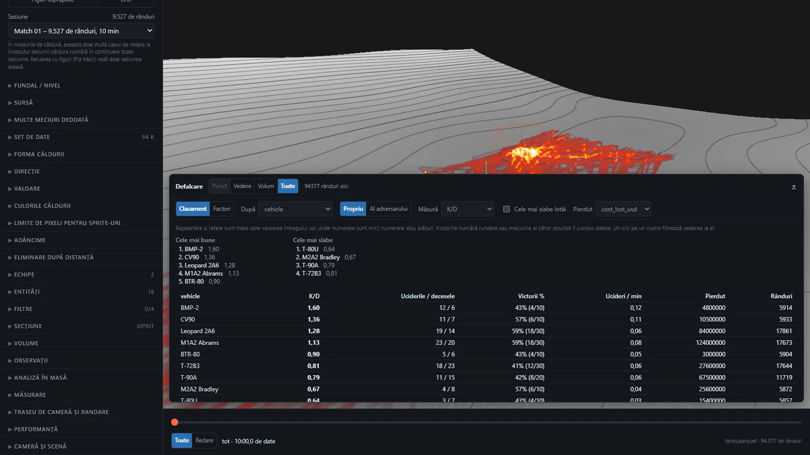
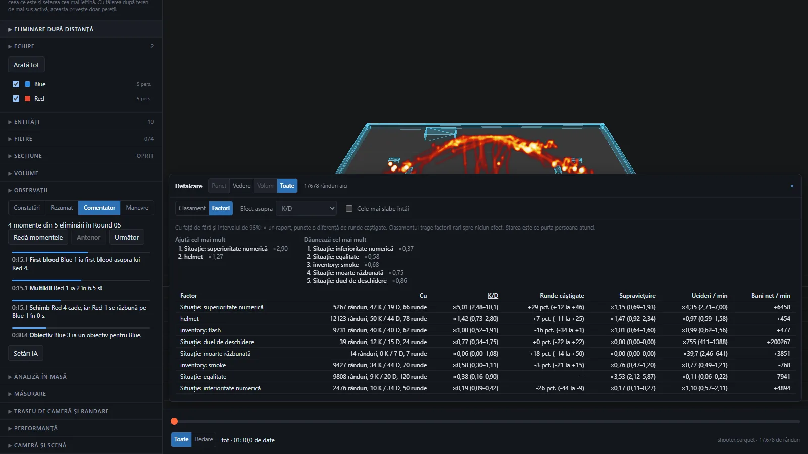

# Defalcare: cine și ce face cel mai bine, unde

**Defalcarea** răspunde la o singură întrebare: în acest loc, care vehicul, jucător sau armă se descurcă cel mai bine? Folosește-o ca să găsești tancul care câștigă la pod sau ca să vezi dacă purtatul unei căști ajută cu adevărat.

Clasează ce se întâmplă într-un loc (un punct ales, vederea, un volum sau tot ce este afișat) după orice categorie și măsoară fiecare factor de stare cu și fără.

## Încearcă {#try-it}

1. Încarcă un meci cu uciderile și morțile și deschide **Volume**.
2. Desenează un volum în jurul locului care te interesează și selectează-l.
3. Apasă **Defalcare...** sub Statistici.
4. Sub **După**, alege *Vehicul*, și alege măsura *K/D* (uciderile la moarte).
5. Citește lista, cele mai bune întâi. Apasă **Cele mai slabe întâi** ca s-o întorci. Dă clic pe un nume ca să filtrezi vederea după el; dă clic din nou ca să-l lași.

## Deschide-o {#open-it}

| De unde | Regiunea cu care pornește |
| --- | --- |
| **Defalcare...** din [Volume](volumes.md) (Statistici) | volumul selectat |
| **Defalcare aici** de pe cartonașul de selecție, după un clic pe un punct | o sferă în jurul acelui punct (**Rază**, implicit 3% din mărimea datelor) |
| panoul de împărțire **Diferență** | vederea |

Antetul schimbă regiunea: **Punct**, **Vedere** (ce a văzut camera la ultima numărătoare; **Numără din nou** după ce ai mutat), **Volum** (alege unul) sau **Toate**. Numără în fundal; linia de stare spune câte rânduri sunt în regiune.

## Clasament {#ranking}

Alege după ce să clasezi și o măsură:

| Măsură | Ce este |
| --- | --- |
| A, B | rânduri pe fiecare parte a hărții de diferență, împărțite cum le împarte căldura |
| A / B, A - B, A / (A + B) | cele două straturi unul față de altul |
| K/D | uciderile față de morți |
| Victorii % | runde (sau meciuri) câștigate, acolo unde datele spun cine a câștigat |
| Uciderii / min | uciderile pe minut prezente (golurile eșantioanelor de mișcare) |
| Câștigat, Pierdut, Bani net | sume ale coloanelor `earn_*` și `cost_*`; un selector alege moneda |

Uciderile, morțile, prezența, victoriile și banii numără fiecare rând pe care îl arată vederea în loc, pe oricare parte a împărțirii sau pe niciuna.

Rapoartele și ratele sunt trase spre valoarea întregului loc acolo unde numărătorile sunt mici, astfel încât 2 uciderile într-o singură viață nu ajung în vârful listei. Numărătorile sunt arătate alături.

Poți clasa după grupuri, jucători și meciuri, după orice coloană de categorie (un vehicul, o armă, o parte, un tip de cumpărare, un agent sau un set de echipament), după orice coloană numerică în intervale (armură, valoarea unui echipament), după **clasa** unei coloane de arme (pușcă, lunetă, pistol-mitralieră, pistol...) și după câte piese de **utilitate** conține o coloană de listă, cum este `inventory`.

**Propriu** clasează după valoarea proprie a rândului. **Al adversarului** clasează după valoarea celeilalte părți: arma victimei la o ucidere, arma ucigașului la o moarte (are nevoie de o coloană `other` / `victim` care le numește).

## Starea la momentul respectiv {#state-at-the-time}

Valoarea unui rând este a lui, cu excepția cazului în care rândul nu înregistrează nimic (un rând de eveniment fără echipament) sau este o moarte (a cărei coloană de armă poate numi arma ucigașului); atunci este ce purta ultima oară aceeași persoană mai devreme în meci.

## Factori: cu față de fără {#factors-with-against-without}

Treci de la **Clasament** la **Factori**, alege **Efect asupra** și citește *Ajută cel mai mult* și *Dăunează cel mai mult*:

Efectul fiecărui factor asupra K/D, a rundelor câștigate, a supraviețuirii (minute pe moarte), a uciderilor pe minut și a banilor net pe minut, cu un interval de 95%: rapoartele ca x, rundele câștigate ca diferență de puncte. Clasamentul trage fiecare estimare spre lipsa efectului după propria incertitudine, deci un factor rar are nevoie de un efect clar ca să urce sus; intervalul arătat este cel netras.

Datele cu runde adaugă **situațiile** de luptă de la distanță mică ([Lupta de aproape și rundele](close-quarters.md)), calculate o dată pentru un set de date: *orbit* (rândul `state_flashed`, sau un flash inamic la 15 m în ultimele 3 s), *moarte răzbunată*, *duel de deschidere* și *om în plus*, *numere egale* sau *om în minus* (jucătorii vii de pe partea rândului față de inamic). O moarte intră în situația în care se afla victima chiar înainte.

Cel mult 256 de factori sunt măsurați într-o singură trecere.

## Pentru dezvoltatori {#for-developers}

### Tragerea valorilor mici {#pulling-small-samples}

Valoarea de clasament este `(n + m*r0) / (d + m)`: `n` și `d` sunt numărătorile, `r0` raportul întregului loc, iar `m` greutatea acelei valori a priori.

### Pentru autorii de convertoare: numirea coloanelor de factori {#for-converter-authors-naming-factor-columns}

Un convertor adaugă un factor numindu-i coloana:

| Coloană | Factor |
| --- | --- |
| `state_<nume>` număr | activ cât timp nu este zero (`state_scoped`, `state_suppressor`) |
| `state_<nume>` categorie | un factor pentru fiecare valoare (`state_ammo` = AP, HE...) |
| `active_<nume>` | la fel, pentru ceva pornit sau folosit recent: o abilitate, un ultimate, un gadget, un buff (`active_ult`, `active_stim`) |
| coloană de listă (`inventory`, `loadout`, `perks`, `abilities`, `attachments`, `modules`, `buffs`, `debuffs`, `upgrades`, sau un nume `state_`/`active_` care se termină în `s`) | un factor pentru fiecare element al unei valori `a\|b\|c` |
| indicatoare de echipament deja comune (`helmet`, `defuser`, `armor`, `scoped`, `airborne`, `duck`, `flashed`...) | activ cât timp nu este zero |
| `ammoType`, `shellType`, `ammoName` | runda trasă ultima oară |

Rezultate: o coloană `won` cu 0/1 (partea rândului a câștigat runda sau meciul) și o coloană `round`. Bani: `earn_<monedă>` și `cost_<fel>_<monedă>`; un venit doar pe fel (`earn_round_cs2`, recompensele exacte de rundă ale unui convertor) înlocuiește doar venitul modelului de cost de acel fel (`round` acoperă și plantările și dezamorsările), iar modelul prețuiește restul.

Maparea încarcă singură aceste coloane, alături de lista proprie a fișierului: fiecare `state_*`, `active_*`, `won`, `round` și coloană de listă, cu excepția celor pe care statisticile unui fișier Parquet le arată cu o singură valoare pe tot parcursul (fiecare coloană încărcată costă 4 octeți pe rând).
