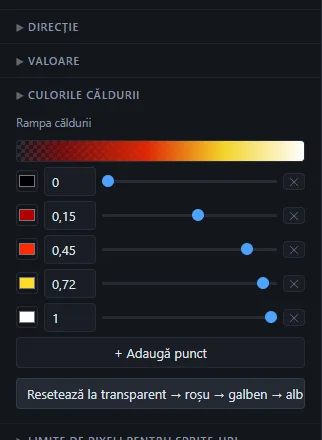

# Culoare și expunere

Aceste comenzi decid ce cantitate de căldură primește ce culoare. **Punctul de saturație** arată cât de multă căldură contează ca alb-încins.

## Remedieri rapide {#quick-fixes}

- Totul este alb: mărește **Punctul de saturație** sau apasă **Expunere automată din câmp**.
- Nu se vede nimic: micșorează **Punctul de saturație** sau apasă **Expunere automată din câmp**.
- Se văd doar câteva puncte izolate: mărește **Căldura minimă**.

Fiecare comandă de pe această pagină acționează atunci când căldura este transformată într-o culoare, deci tragerea oricăreia dintre ele redesenează imediat și **nu repornește niciodată acumularea**.

## Punctul de saturație {#saturation-point}

**Punctul de saturație** (secțiunea Forma căldurii): căldura acumulată care corespunde vârfului rampei de culori (cu răspunsul *Liniar*; vezi mai jos pentru celelalte). Cursor logaritmic 0,1-4000, iar mânerul poate fi tras până la 10.000.000, pentru că soiul de căldură acumulată crește odată cu numărul de rânduri. Implicit 24; la fiecare încărcare se folosește mai întâi o **estimare analitică**, apoi se **măsoară** din imagine.

A-l greși înseamnă diferența dintre o hartă termică și un ecran gol (sau alb), iar nu poate fi dedus sigur: telemetria se grupează atât de tare - un punct de apariție, o ușă, o trecătoare - încât raportul dintre densitatea de vârf și cea medie variază cu un ordin de mărime între seturile de date și între unghiurile camerei.

## Expunerea automată {#auto-exposure}

**Expunere automată din câmp** măsoară câmpul pe cadrul pe care shader-ul l-a produs efectiv. Ignoră pixelii goi, ia percentila 98 a celor luminați și o pune la 85% din drumul până la punctul de saturație, astfel încât vârful rampei rămâne rezervat pentru vârfurile reale.

Panoul afișează apoi *măsurat X% din cadru; percentila 98 R plasată aproape de vârful rampei*. Cu răspunsul *Saturant*, o valoare aflată la 85% din punctul de saturație ajunge la aproximativ 69% din rampă, nu la 85%.

Rulează și **automat**:

- după 8 cadre randate de la încărcarea unui set de date;
- după 8 cadre de la schimbarea [filtrelor](filters.md) (filtrarea fiecărei poziții până la o sută de evenimente schimbă densitatea cu ordine de mărime);
- după 8 cadre de la trecerea între căldura pe puncte și [căldura pe linii](line-heat.md) sau de la schimbarea rutelor desenate de căldura pe linii, pentru că o linie depune mult mai puțină căldură pe eșantion decât un sprite.

Când nu este nimic luminat, rularea automată lasă saturația neschimbată; butonul revine la estimarea analitică și afișează *nimic luminat de măsurat - s-a folosit estimarea analitică*.

### Urmărește vederea {#follow-the-view}

**Urmărește vederea** (secțiunea Forma căldurii, implicit activat) măsoară din nou de fiecare dată când camera ajunge în repaus, astfel încât o regiune în care zbori folosește toată rampa de culori, în loc de scara măsurată pentru întreaga hartă. Schimbările mici sunt ignorate, iar scara alunecă în loc să sară. Rulează în cele patru moduri de căldură, nu în suprapunerea de figuri.

Debifeaz-o ca să blochezi scara și să compari locuri pe aceeași scară. Trăgând manual de **Punctul de saturație** se blochează și ea.

## Răspunsul la densitate {#density-response}

**Răspunsul la densitate** - cum se mapează *k* (căldură / saturație) pe rampă:

| Răspuns | Formulă | Folosire |
|---|---|---|
| **Saturant** (implicit) | t = 1 - e^(-k) | Se apropie asimptotic de vârful rampei, cum fac sprite-urile translucide suprapuse. Nimic nu se taie până la alb plat, ceea ce face din el implicitul sigur pentru date necunoscute. |
| **Liniar** | t = k | Singura mapare în care culoare egală înseamnă număr egal. Folosește-o ca să compari două seturi de date sau două ferestre de timp. |
| **Log** | t = log₂(1 + 7k) / 3 | Comprimă o coadă lungă, astfel încât un singur punct fierbinte extrem să nu mai aplatizeze totul la baza rampei. Ridică zonele rare. |

## Căldura minimă {#minimum-heat}

**Căldura minimă** (implicit oprită, 0-100%): fiecare pixel care poartă orice căldură este ridicat cel puțin până la acest punct al rampei. Mărește-o și micșorează raza sprite-ului ca să vezi *unde s-a întâmplat ceva vreodată* - punctele de date izolate devin clar vizibile, în loc să stea chiar peste transparent. Lasă-o oprită când judeci densitatea, pentru că aplatizează, prin design, baza rampei. Pragul (k > 0,0001) păstrează pixelii cu adevărat goi goi.

## Editorul de rampă {#the-ramp-editor}

În secțiunea **Culorile căldurii**. Eticheta spune la ce servește rampa: *Rampa căldurii* în Căldură și Linii, *Pozitiv (echipe aditive)* în Diferență, *Rampă de opacitate (culoarea vine de la grup)* în [Căldura pe echipe](team-heat.md), unde se folosește doar canalul alfa.



Bara de sus previzualizează rampa. Sub ea, câte un rând pentru fiecare punct de control:

| Parte | Înțeles |
|---|---|
| Mostra de culoare | Culoarea punctului (selectorul de culori al browserului). |
| Număr | Poziția punctului pe rampă, de la 0 la 1 (0 = fără căldură). |
| Cursor | Opacitatea punctului, 0-100%. |
| ✕ | Șterge punctul; este dezactivat când au mai rămas doar două. |

**+ Adaugă punct** adaugă un punct la jumătatea distanței dintre ultimele două, cu culoarea și opacitatea ultimului punct. **Resetează la transparent → roșu → galben → alb** restabilește implicitul.

Punctele pot fi date în orice ordine; sunt sortate la construirea rampei. **Alfa** este ceea ce amestecă căldura peste scenă, de aceea capătul zero al rampei implicite este complet transparent.

### Rampele implicite {#the-default-ramps}

| Poziție | Pozitiv (Căldură, Linii, Diferență +) | Negativ (Diferență −) |
|---|---|---|
| 0,00 | negru, alfa 0 | negru, alfa 0 |
| 0,15 | rgb(180, 0, 0), alfa 0,55 | rgb(0, 170, 60), alfa 0,55 |
| 0,45 | rgb(255, 40, 0), alfa 0,85 | rgb(0, 190, 200), alfa 0,85 |
| 0,72 | rgb(255, 220, 40), alfa 0,95 | rgb(40, 80, 255), alfa 0,95 |
| 1,00 | alb, alfa 1 | rgb(170, 60, 255), alfa 1 |

## În timp ce camera se mișcă {#while-the-camera-moves}

Când camera se mișcă, acumularea repornește la fiecare cadru. Cu **Desenează fiecare rând în fiecare cadru** activat (implicit), fiecare cadru în mișcare rămâne exact; dezactivat, un cadru în mișcare arată o estimare prin eșantionare - ciorchini mai luminoși, scalați după pondere - care converge spre imaginea reală, mai netedă, când te oprești. Acest lucru este normal; vezi [Acumularea](accumulation.md).

## Pentru dezvoltatori {#for-developers}

### Pasul de compunere {#the-composite-pass}

După ce căldura a fost acumulată, valoarea fiecărui pixel este transformată într-o culoare într-un singur pas de compunere ([`COMPOSITE_FS`](https://github.com/Holdi601/3DHeat/blob/main/src/render/webgl2/shaders.ts)). Pașii sunt:

```
k = |heat| / saturation point
t = response(k)                         clamped to 0..1
if minimum heat > 0 and k > 0.0001:  t = minimum + (1 - minimum) × t
colour, alpha = ramp(t)                  (the negative ramp when heat < 0, Difference only)
pixel = mix(scene, colour, alpha)
```

### Estimarea analitică {#the-analytic-estimate}

**Estimarea analitică** ([`estimateSaturation`](https://github.com/Holdi601/3DHeat/blob/main/src/data/calibrate.ts)) presupune că rândurile se întind pe amprenta X-Z a datelor: căldura medie = rânduri × (π r² / aria amprentei) × 1/3 × intensitatea din centru (1/3 fiind media discului pentru o rampă liniară), înmulțit cu un raport presupus de vârf față de medie de 25, limitat la 0,1-1.000.000. Trebuie doar să fie corectă în limita unui ordin de mărime.

### Măsurarea {#metering}

[`exposure.ts`](https://github.com/Holdi601/3DHeat/blob/main/src/render/exposure.ts):

1. ținta de căldură este citită înapoi din GPU, eșantionată la cel mult 40.000 de valori;
2. pixelii goi (căldură ≤ 0,0001) sunt eliminați - cea mai mare parte a unui câmp de căldură este goală, iar mediarea lor ar subexpune totul, așa cum un exposimetru îndreptat spre un fundal negru ar subexpune scena;
3. percentila 98 a pixelilor luminați este referința;
4. punctul de saturație devine referința / 0,85, astfel încât referința stă la 85% din drumul până la punctul de saturație, iar vârful rampei rămâne rezervat pentru vârfurile reale.

### Tabela de culori {#the-colour-table}

Rampa este coaptă într-un tabel RGBA de 256 × 2 (rampa pozitivă pe primul rând, cea negativă pe al doilea) ([`buildColorLut`](https://github.com/Holdi601/3DHeat/blob/main/src/render/colors.ts)). Culorile sunt interpolate în lumină liniară și stocate ca sRGB; opacitatea este interpolată liniar.
