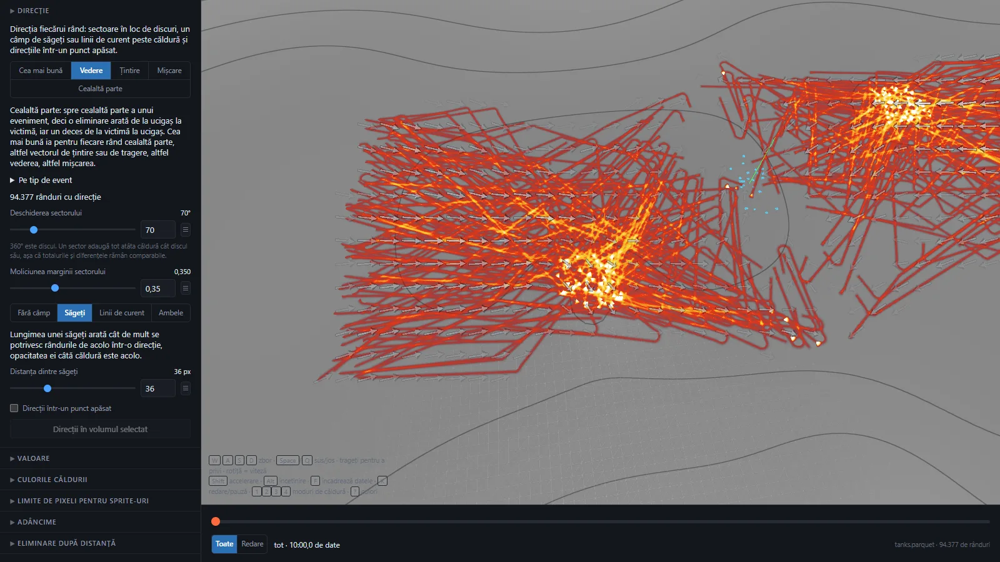

# Căldură direcțională

Căldura simplă spune **unde** se întâmplă lucrurile. Căldura direcțională spune și **încotro**: în ce direcție se uitau oamenii, țintau, se mișcau sau unde era cealaltă parte a unei lupte.

Un sprite normal este un disc întreg (360 de grade). Cu o **Deschidere a sectorului** de 70 de grade, același sprite devine un sector îngust, care arată direcția în care era orientat rândul, și adaugă aceeași căldură totală.

## Cum se folosește {#how-to-use-it}

1. Încarcă date care au o direcție în ele (vezi [Ce dă unui rând o direcție](#what-gives-a-row-a-direction)).
2. Alege **Căldură**, **Diferență** sau **Căldura pe echipe** în bara de moduri.
3. Deschide secțiunea **Direcție** din bara laterală.
4. Alege o **sursă** (ce direcție să folosească), apoi pornește desenul:
   - coboară **Deschiderea sectorului** sub 360° ca să desenezi fiecare rând ca un sector care arată pe unde merge, în loc de disc;
   - alege un **Câmp** ca să desenezi săgeți sau linii de curent peste căldură;
   - bifează **Direcții într-un punct apăsat** și dă clic pe căldură ca să obții o diagramă polară a acelui punct.

Linia de stare spune câte rânduri au o direcție din sursa aleasă.

## Setări {#settings}

| Setare | Implicit | Ce face |
|---|---|---|
| Sursa: **Cele mai bune**, **Vedere**, **Țintire**, **Mișcare**, **Cealaltă parte** | Cele mai bune | Ce direcție primește fiecare rând. *Cele mai bune* ia, pentru fiecare rând, cealaltă parte, altfel țintirea, altfel vederea, altfel mișcarea. |
| **După tipul de eveniment** | ca mai sus | O sursă diferită pentru fiecare tip de eveniment, de exemplu *Cealaltă parte* pentru uciderii și *Vedere* pentru poziții. Apare când datele au o coloană de eveniment cu cel mult 40 de valori. |
| **Deschiderea sectorului** | 360° | 360° este discul normal (oprit). Mai mic înseamnă un sector mai îngust. Un sector adaugă atâta căldură cât discul său, deci totalurile și diferențele rămân comparabile. |
| **Moliciunea marginii sectorului** | 0,35 | 0 este un sector cu margine ascuțită, 1 un evantai moale. |
| **Câmp**: Fără câmp, Săgeți, Linii de curent, Ambele | Fără câmp | Săgeți: lungimea unei săgeți arată cât de mult sunt de acord rândurile de acolo asupra unei direcții, opacitatea ei cât de multă căldură este acolo. Săgețile apar doar unde este căldură. |
| **Distanța dintre săgeți** | 28 px | Distanța dintre săgeți pe ecran. |
| **Animă liniile de curent** | pornit | Liniile de curent curg cât timp este pornit. |
| **Direcții într-un punct apăsat** | oprit | Dă clic pe căldură ca să vezi direcțiile de acolo (mai jos). |
| **Direcții în volumul selectat** | | Aceeași diagramă pentru tot ce se află înăuntrul [volumului](volumes.md) selectat. |

## Diagrama polară a unui punct {#the-polar-chart-at-a-spot}

Cu **Direcții într-un punct apăsat** pornit, dă clic pe căldură. Rândurile apropiate de acel punct (în 1,5 raze de sprite) sunt adunate într-o rozetă cu 24 de felii de 15°:

- petale **portocalii**: direcțiile de ieșire (unde arată rândurile);
- petale **albastre**: direcțiile de intrare (de unde au venit);
- **aria** unei petale crește cu numărul ei; o săgeată arată direcția principală;
- liniile de sub diagramă dau direcția principală, cât de puternic sunt de acord rândurile (R, de la 0 la 1), împrăștierea în grade și numărul de rânduri.

0° este sus pe diagramă, adică -Z al lumii (nordul, pentru înregistrările Tacview). Punctul este marcat și în vederea 3D, cu o săgeată și un inel.

## Ce dă unui rând o direcție {#what-gives-a-row-a-direction}

| Sursă | Are nevoie de în date |
|---|---|
| Vedere | o coloană de girație (mapată ca direcție a privirii): `yaw`, `heading`, `azimuth`, `view_yaw`, `rot_z` |
| Țintire | perechi de numere precum `aim_x`/`aim_y`, `shot_x`/`shot_y`, `fire_x`/`fire_y`, `hit_dir_x`/`hit_dir_y` (cu un `…_z` opțional) |
| Mișcare | nimic în plus: pasul de la eșantionul anterior al aceleiași persoane (cel mult cu 10 s mai devreme, aceeași sesiune) |
| Cealaltă parte | o coloană care numește cealaltă parte a unui eveniment (`other`, `victim`, `target`, `killer`, `attacker`, `shooter`, `other_player` ...), ale cărei valori sunt nume de persoane; o ucidere arată de la ucigaș la victimă, o moarte de la victimă la ucigaș |

## Sfaturi {#tips}

- Sectoarele au nevoie de o oarecare mărime pe ecran; sub câțiva pixeli sunt desenate din nou ca discuri.
- Folosește *Cealaltă parte* pe rândurile de ucidere ca să vezi **de unde** au fost câștigate luptele, și *Vedere* pe rândurile de poziție ca să vezi **unde se uită oamenii**.
- Cu **Diferență**, sectoarele celor două părți arată în propriile lor direcții, deci liniile de foc disputate ies în evidență.
