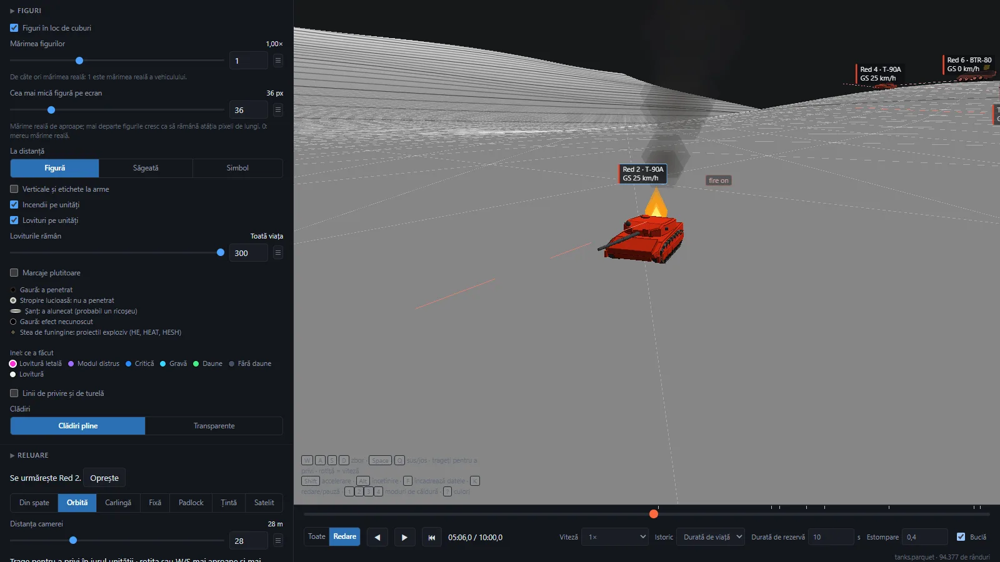

# Figuri

O **figură** este un model 3D mic a ceea ce este de fapt o unitate: un tanc, un avion de luptă, o navă, un soldat. [Redarea](match-replay.md) desenează fiecare unitate ca figura ei, la mărime reală, în loc de o casetă simplă.

Există aproximativ 2.000 de vehicule, aeronave, nave, arme și soldați cu nume, toate construite de vizualizator însuși.

## Ce este în catalog {#what-is-in-the-catalogue}

| Domeniu | Exemple |
|---|---|
| Oameni | soldat în picioare, ghemuit, întins; lunetist, antitanc, medic, echipaj |
| Sol | tancuri, vehicule de luptă pentru infanterie, apărare antiaeriană, artilerie, camioane și mașini, trenuri și tramvaie |
| Aer | avioane de vânătoare, avioane de atac, bombardiere, transporturi, elicoptere, de la biplane până la avioane moderne |
| Mare | nave de luptă pe clase, portavioane, submarine, bărci, nave comerciale |
| Arme | rachete, rachete propulsate, bombe, torpile, fuzeie și capcane radar |
| Marcaje | fumigene, grenade cu flacără și cu foc, bombe amplasate, steaguri, puncte de apariție, puncte de traseu |
| Luptă apropiată | soldați cu veste port-plăci, cu pușcă de asalt, pistol-mitralieră, pușcă cu alice, pușcă de precizie (DMR), mitralieră ușoară, pistol sau scut; drone, camere, sârmă ghimpată, scuturi, ranforsări de perete, baricade, încărcături de spargere, capcane, ferestre, grenade, dezamorsatorul |

## Cum sunt făcute figurile {#how-the-figures-are-made}

- **Construite din dimensiuni publicate.** Majoritatea figurilor sunt făcute de constructorul de figuri al vizualizatorului din numere publice: lungime, lățime, înălțime, roți de drum, turelă și tun, aripi și coadă. Forma lor este apoi ajustată după fotografii publice, desene și dimensiuni publicate. Nu se folosesc modelele niciunui joc.
- **Modele gratuite.** Câteva figuri folosesc modele 3D gratuite (CC0 sau CC BY) acolo unde sunt mai fidele, uneori combinate cu caroseria construită. Autorii lucrărilor CC BY sunt menționați la [Mențiuni pentru figuri](figure-credits.md); lucrările CC0 nu cer mențiune și nu sunt listate acolo.
- Fiecare figură are o versiune completă, una grosieră și una de la distanță (niveluri de detaliu, LOD), ca să poată fi desenate mii deodată.

## Ce figură primește o unitate {#which-figure-a-unit-gets}

Vizualizatorul se uită la coloanele proprii ale datelor:

1. **Nume** - coloanele numite *Name*, *Vehicle*, *Unit*, *Unit type*, *Model*, *Aircraft*, *Plane*, *Tank*, *Ship*, *Craft*, *Loadout*, *Kit* sau *Figure* - sunt potrivite cu catalogul: exact, prin aproximativ 4.000 de aliasuri (id-uri de unități ale mai multor jocuri), prin cel mai lung început cunoscut (`F-16C_50` este F-16C) sau prin cel mai scurt nume de figură care începe cu el.
2. Un nume a cărui figură nu se potrivește cu **tipul** unității nu este folosit (un camion numit *Typhoon* nu este avionul de vânătoare).
3. **Tipurile** - coloanele numite *Type*, *Class*, *Kind*, *Category*, *Icon*, *Role* sau *Domain* - dau o figură de clasă: etichetele Tacview (`Air+FixedWing`, `Ground+Heavy+Armor+Vehicle+Tank`, `Sea+Watercraft+Warship`, `Weapon+Missile`), pictogramele de hartă sau cuvinte simple (tank, elicopter, infanterie).
4. Datele fără niciunul dintre ele sunt date despre oameni: toată lumea este soldat.

Deci cel mai ușor mod de a obține figurile corecte este o coloană `vehicle` cu numele reale, sau o coloană `type` cu etichete Tacview.

**Unitatea mea apare ca o casetă sau ca un soldat.** Adaugă o coloană `vehicle` cu numele real, sau o coloană `type` cu o etichetă Tacview. Treci cu cursorul peste unitate ca să vezi ce nume a fost potrivit. Datele care au asemenea coloane, dar nu spun nimic despre o unitate, o lasă casetă; datele fără niciuna sunt desenate ca soldați.

## Figuri pentru lupta apropiată (Rainbow Six Siege) {#close-quarters-figures-rainbow-six-siege}

Tabelele scrise ca cele ale cititorului de reluări Rainbow Six Siege (coloanele `operator`, `pawn`, `primaryClass`, `side`) primesc figuri proprii:

- **Jucătorii** sunt operatorul lor. Fiecare dintre cei 78 de operatori are o figură proprie, înaltă de circa 1,8 m, în hainele lui: două sau trei culori pentru geacă, pantaloni și echipament, după aspectul lor public obișnuit (negru, oliv, kaki, gri urban, alb, bleumarin, cu echipament roșu, portocaliu sau turcoaz). Și cu formele lor proprii, cu o treime mai mari decât în realitate acolo unde trebuie să se vadă de sus: acoperământul capului (căști, o vizieră sau o cască grea, șepci, căciuli, berete, o pălărie boonie lată sau o căciulă de blană, glugi, eșarfe, păr), fața (ochelari de protecție, o mască de gaze, ochelari, o mască, o barbă, ochelari cu trei lentile), o constituție ușoară, medie sau grea (cei grei sunt lați, cu plăci mari pe umeri și un guler), o haină lungă sau un costum, un costum ghillie, ce poartă pe spate (un ciocan, încărcături, drone, canistre, un rezervor de combustibil, un tub de lansator, o arbaletă, panouri, un bruiaj, un scut) sau pe braț (un lansator, un braț de metal), scutul lor propriu (unul înalt, un scut antirevoltă, unul cu lumini) și o culoare de accent pe umeri. Țin clasa armei lor principale. Un operator pe care vizualizatorul nu îl cunoaște este un soldat simplu cu vestă port-plăci, în culoarea echipei.
- **Tabăra** se vede separat de haine: un inel pe sol sub fiecare operator, **chihlimbariu pentru atac, cyan pal pentru apărare**, cu culoarea echipei în interior, și banderole pe braț și pe cap în aceeași culoare. O coloană `stance` (în picioare, ghemuit, culcat) le dă poziția; fără ea stau în picioare.
- **Deosebiți la distanța de reluare:** randați la 48 de pixeli înălțime, de sus și din trei sferturi, oricare doi operatori din aceeași tabără diferă printr-o diferență clară de culoare sau printr-o formă diferită (verificat de testele vizualizatorului).
- **Etichetele** numesc jucătorul și operatorul jucat în acel moment, cu rolul operatorului ca simbol: ✸ spargere dură, ⚒ spargere ușoară, ➤ intrare, ✦ fragger, ✚ sprijin, ⬟ scut, ◉ informații, ◇ flexibil, ↺ paza flancului, ⚓ ancoră, ✕ capcane, ⇄ roamer, ↯ anti-gadget, ▣ anti-spargere.
- **Dronele** sunt o dronă aruncabilă cu două roți, lată de circa 30 cm. Fiecare este o pistă proprie, numită după proprietar („Ash · drone 2”).
- **Gadgeturile amplasate** stau unde au fost puse, de atunci până la sfârșitul rundei. Fiecare are figura a ceea ce face: o cameră, sârmă ghimpată, un scut mobil, o încărcătură de spargere, o încărcătură de spargere dură, o încărcătură lipicioasă mică, o capcană de podea, un claymore cu laserul lui de declanșare, o fereastră cu sens unic, un panou de blindaj, o grenadă, o canistră de gaz, un bruiaj, un senzor, o poartă laser, o cutie de provizii. O singură figură servește toate gadgeturile care fac aceeași treabă. Un gadget al cărui tip nu e spus în date este un dispozitiv mic cu o lumină.
- **Dezamorsatorul** stă unde a fost plantat, timp de cele 45 de secunde ale lui.

Fiecare dronă și fiecare gadget devine o pistă proprie când fișierul se încarcă, așa că figura jucătorului rămâne pe corpul lui. Operatorii sunt forme simplificate după descrierile și arta lor publică (ce poartă, dispozitivul care este abilitatea lor), iar gadgeturile au forma dată de ceea ce fac. Toate sunt design-uri proprii ale vizualizatorului, la mărimea reală a obiectului (un claymore lat de circa 22 cm, un panou cât o ușă, de 1 m pe 2,1 m), nu modele din joc.

## Setări {#settings}

Secțiunea **Figuri** din bara laterală a redării stabilește mărimea, cea mai mică mărime pe ecran, ce devin unitățile îndepărtate (figură, săgeată, simbol) și efectele desenate pe ele. Vezi [Redarea meciului](match-replay.md#figures). Fumul, focul și alte efecte cu durată: [Figuri în suprapunerea de figuri](figure-replay.md).

## Un pachet local opțional de figuri {#an-optional-local-figure-pack}

Poți păstra un pachet opțional de figuri proprii pe propriul calculator. Figurile lui iau locul figurilor din catalog cu aceleași nume. Nu face niciodată parte din depozit sau dintr-un build publicat; fără el, nimic nu se schimbă.
