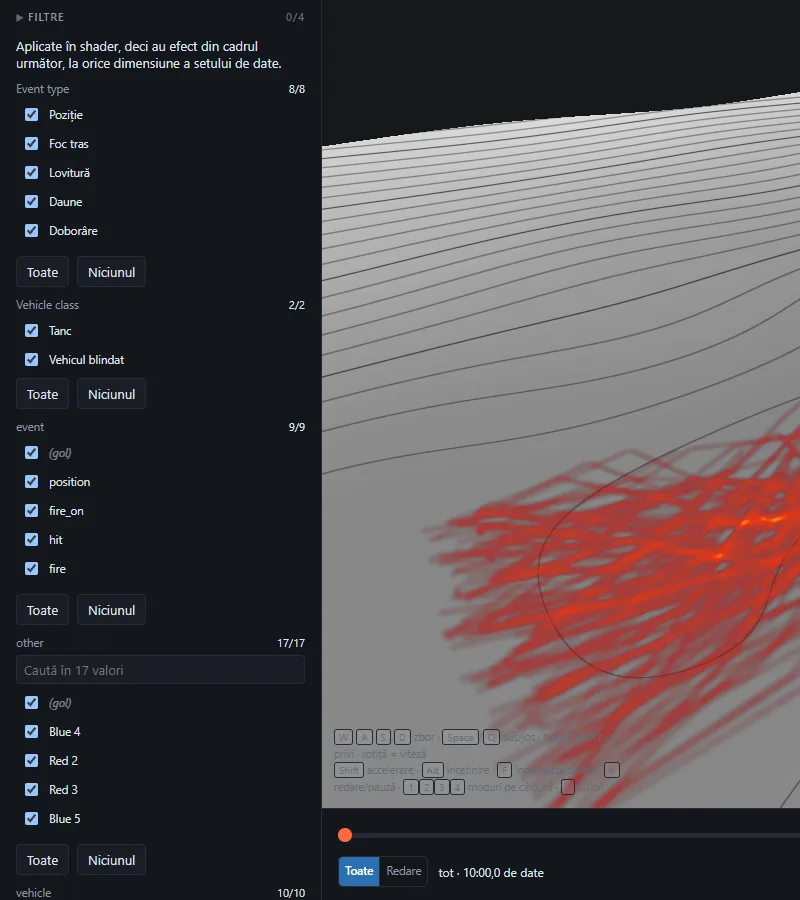
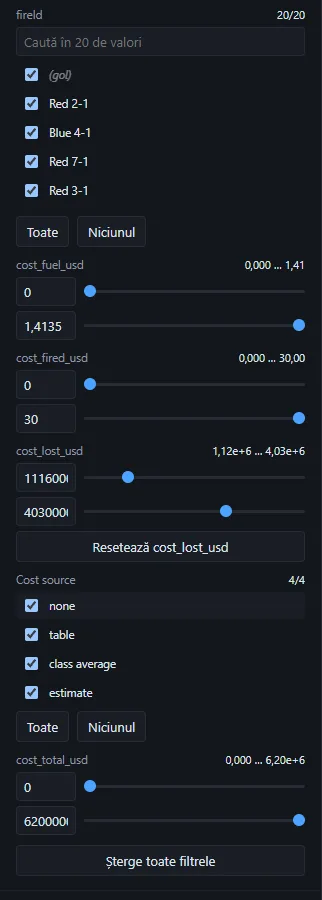

# Filtre

**Filtrele** ascund rândurile care nu te interesează, cum ar fi o clasă de vehicule sau un tip de eveniment, iar imaginea se actualizează imediat. Panoul listează coloanele păstrate la încărcare sub *Păstrează pentru filtrare* ([Maparea coloanelor](column-mapping.md)), plus *Fișier sursă* când au fost încărcate mai multe fișiere.

## Încearcă {#try-it}

1. Încarcă un set de date și deschide **Filtre** în bara laterală.
2. La **Clasa vehiculului**, debifează *Tank*. Imaginea se schimbă imediat.
3. Apasă **Șterge toate filtrele** ca să anulezi.

Primele rânduri sunt coloanele proprii ale vizualizatorului (mai jos). Rândurile de după ele vin din fișierul tău.

## Coloanele pe care le adaugă vizualizatorul {#columns-the-viewer-adds}

La încărcare vizualizatorul stabilește patru coloane proprii și le listează **primele**, cu nume și valori în limba ta, astfel că același filtru funcționează pentru fiecare joc și sursă de date:

| Coloană | Valori | Stabilită din |
|---|---|---|
| **Tip de eveniment** | 23 de tipuri: Poziție, Foc tras, Lansare (rachetă, rachetă ghidată, bombă), Lovitură, Ratare (arma s-a oprit lângă nicio țintă), Explozie, Avarie, Eliminare, Moarte, Distrus, Prăbușire, Ejectare / sărit cu parașuta, Apariție, Dispariție, Decolare, Aterizare, Contact cu solul, Oprire pe sol, Rearmare / realimentare, Captură / obiectiv, Momeală, Mesaj, Altele | o coloană numită `event`, `events`, `event_type` sau `event_name`; cuvintele proprii ale fiecărui joc (`shot`, `burst`, `fired`, `struck`, `flare`, `plant` ...) sunt mapate la aceste tipuri. Tabelul complet: [Tipuri și clase de evenimente](ref-event-types.md). |
| **Jucător sau IA** | Jucător, IA | o coloană `ai`, `is_ai`, `bot` sau `actor`; altfel `is_player` / `human`; altfel un identificator de cont (`user_id`, `steam_id`; gol sau 0 înseamnă IA); pentru înregistrările Tacview, dacă obiectul are un pilot |
| **Clasa vehiculului** | 17 clase: Avion de vânătoare, Avion de atac, Bombardier, Alte aeronave, Elicopter, Tanc, Vehicul blindat, Apărare aeriană, Artilerie, Camion / mașină, Navă, Submarin, Infanterie, Armă, Momeală, Construcție, Altele | numele vehiculului sau al unității (potrivit cu [catalogul de figuri](figures.md)) și coloanele de tip |
| **Clasa țintei** | aceleași clase | vehiculul celeilalte părți (`other_vehicle`, `target_vehicle`, `victim_type` ...) |

Sunt listate doar tipurile care apar. Coloanele de valoare (`cost_*`, `earn_*`, `net_*` și *Sursa costului*, vezi [Ponderarea valorilor](value-weighting.md)) se pot filtra ca orice coloană numerică: de exemplu, debifează *estimare* la *Sursa costului* ca să păstrezi doar rândurile cu preț.

O listă de categorii cu mai mult de 12 valori primește o casetă de căutare (*Caută n valori*) și un buton **Doar acestea**, care permite exact valorile care se potrivesc.

Ce coloane pot fi filtrate se decide la încărcare, pentru că trebuie citite atunci. Fără nicio coloană păstrată, panoul o spune și trimite la *Păstrează pentru filtrare*.

## Coloane numerice (interval) {#numeric-columns-range}

| Parte | Înseamnă |
|---|---|
| Nume și `min ... max` | Coloana și intervalul curent (întregul interval al coloanei cât timp nu este setat niciun filtru). |
| Primul rând: casetă numerică și glisor | Limita inferioară. Trăgând glisorul peste limita superioară, împingi și limita superioară. |
| Al doilea rând: casetă numerică și glisor | Limita superioară. Trăgând sub limita inferioară, o împingi și pe aceea. |
| **Resetează *coloana*** | Șterge acest filtru. |

Glisoarele acoperă minimul și maximul coloanei în 1.000 de trepte; casetele numerice acceptă orice valoare. Un rând trece când valoarea lui se află în interval, ambele capete incluse. Valorile mari se arată în formă exponențială (`1.23e6`).

## Coloane de categorie {#category-columns}

| Parte | Înseamnă |
|---|---|
| Nume și `permise/total` | Coloana și câte dintre valorile ei sunt permise. |
| Lista valorilor | O bifă pentru fiecare valoare; o valoare goală se arată ca *(gol)*. |
| **Toate** / **Niciunul** | Permite fiecare valoare / nicio valoare. |

Permiterea tuturor valorilor șterge filtrul.

## Reguli {#rules}

- **Patru filtre deodată.** Antetul arată `active/4`. Un al cincilea filtru nu se aplică, iar panoul o spune. O selecție din [Entități](entities.md) (sau concentrarea pe jucător din fila Meci) folosește și ea unul din cele patru. Un filtru care acoperă toată coloana nu folosește niciunul.
- **O coloană de categorie are cel mult 4.096 de valori**; una mai largă nu este păstrată la încărcare.
- **Filtrele se combină cu ȘI**, și cu vizibilitatea echipelor, împărțirea pentru diferență, fereastra de timp, eliminarea după distanță și [secțiunea](slice.md).
- **Schimbarea unui filtru repornește acumularea și remăsoară expunerea** câteva cadre mai târziu, pentru că filtrarea poate schimba mult densitatea ([Culoare și expunere](colour-and-exposure.md#auto-exposure)).
- **Șterge toate filtrele** elimină fiecare filtru de coloană. Vizibilitatea echipelor și selecțiile de jucători făcute în altă parte se păstrează.
- Filtrele de coloană schimbă modurile de căldură. Nu schimbă figurile [reluării pe figuri](box-replay.md), care urmează vizibilitatea echipelor și selecția din Entități. Selecția din Entități schimbă ambele.
- În [căldura pe linii](line-heat.md) un filtru este testat pe rândul în care se termină fiecare segment.
- La fiecare set de date nou, toate filtrele sunt șterse.

## Pentru dezvoltatori {#for-developers}

**Sloturi.** Fiecare filtru activ ocupă unul dintre cele patru sloturi GPU ([`MAX_FILTER_SLOTS`](https://github.com/Holdi601/3DHeat/blob/main/src/render/types.ts)), o textură de 4 octeți pe rând. Sloturile se dau filtrelor în ordinea în care au fost schimbate ultima dată ([`filterSlots`](https://github.com/Holdi601/3DHeat/blob/main/src/render/filterTables.ts), comun shader-ului și celor două panouri). Peste patru, apare o eroare: *Only the first 4 filters are applied. Clear one - the rest are being ignored, not silently combined*, iar numele filtrelor în plus se citesc *column (not applied)*. Filtrele rulează pe rând în shader-ul de vârfuri, deci schimbarea unui prag nu cere nicio reanaliză și nicio reîncărcare.

**Filtre pe care panoul nu le arată.** Mai există două tipuri în starea aplicației ([`FilterSpec`](https://github.com/Holdi601/3DHeat/blob/main/src/state/types.ts)):

- un filtru de **grupuri**, pus de fila Meci când se concentrează pe o parte. Ascunde celelalte grupuri în fiecare mod, inclusiv o împărțire a [diferenței](difference.md) după o coloană.
- un filtru de **persoane**, pus de panoul [Entități](entities.md) și de fila Meci când se concentrează pe un jucător. Restrânge reluarea pe figuri și modurile de căldură. În căldură este un filtru de categorie peste identificatorii persoanelor și ocupă unul din cele patru sloturi. Masca lui ține 65.536 de identificatori ([`FILTER_MASK_CAPACITY`](https://github.com/Holdi601/3DHeat/blob/main/src/render/types.ts)); o persoană peste această limită nu se desenează în căldură cât timp filtrul este activ, chiar dacă este selectată. Reluarea pe figuri le arată în continuare.
