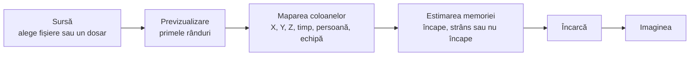

# Încărcarea datelor

Înainte ca 3DHeat să poată desena ceva, îi trebuie un tabel: fiecare rând spune unde a fost ceva și, dacă ai aceste date, când și cine. Această secțiune arată cum devine un fișier o imagine. Nu ai încă date? Încearcă [datele demonstrative](demo-data.md).

**Fă asta acum:**

1. În bara laterală Hartă termică deschide **Sursă** și apasă **Fișiere…** (sau trage un fișier ori un dosar în zona de lansare).
2. Uită-te la **Maparea coloanelor**: casetele sunt de obicei deja completate.
3. Verifică dacă **Estimarea memoriei** spune *încape*.
4. Apasă **Încarcă**.

Tot ce arată fila Hartă termică vine dintr-un singur **set de date**: un tabel de rânduri, fiecare cu o poziție și, opțional, un moment, o persoană, un grup, o sesiune, o direcție de privire și oricâte coloane extra păstrate pentru filtrare. Această secțiune explică cum se face un set de date.

## Drumul de la fișiere la imagine {#the-path-from-files-to-picture}

1. **Alege fișierele** în panoul **Sursă** - un fișier, mai multe, un arbore de dosare sau trăgându-le. Sunt acceptate Parquet, CSV, Tacview, trasee GPS și altele; lista completă este în [Formatele de date](data-formats.md#files). Vezi [Încărcarea fișierelor](loading-files.md).
2. **Previzualizare.** Se deschide primul fișier din selecție: numele coloanelor, primele 50 de rânduri, care coloane par numerice și (pentru Parquet) tipul logic al fiecărei coloane și instrucțiunile de citire ale fișierului, intrarea `heat3d` din subsol.
3. **Mapare automată.** Coloanele sunt atribuite unor roluri - X, Y, Z, timp, persoană, sesiune, grup, direcția privirii - iar câteva sunt păstrate pentru filtrare. Fiecare presupunere se arată în panoul **Maparea coloanelor** și poate fi schimbată. Vezi [Maparea coloanelor](column-mapping.md) și [Axe, unități și timp](axes-units-and-time.md).
4. **Numărare.** Numărul de rânduri al fiecărui fișier se citește (exact din subsolurile Parquet, estimat pentru CSV), astfel că panoul poate spune, înainte de orice încărcare, cât de multă memorie cere încărcarea și dacă încape. Dacă nu încape, propune încărcarea la fiecare *N*-lea rând. Vezi [Memorie și bugete](memory-and-budgets.md).
5. **Încarcă.** Un lucrător din fundal analizează doar coloanele mapate ale fiecărui fișier - mai multe fișiere deodată, până la bugetul [firelor de analiză](memory-and-budgets.md#parser-threads) - și le unește, în ordinea selecției, într-un singur set de date: un dicționar comun de persoane, grupuri și sesiuni pentru toate fișierele, o origine comună a timpului, toate rândurile sortate după timp. Vezi [Sesiuni, persoane și grupuri](sessions-persons-groups.md).
6. **Trimitere.** Firul principal anunță „Se trimit N rânduri către GPU” pentru un cadru, apoi împachetează rândurile în memoria GPU, în limitele bugetului GPU. Vezi [Ocuparea memoriei GPU](gpu-memory.md).
7. **Prima imagine.** Camera încadrează datele, raza sprite-ului și punctul de saturație se stabilesc din întinderea și numărul de rânduri ale datelor, iar după 8 cadre randate saturația se măsoară din chiar imaginea ([Culoare și expunere](colour-and-exposure.md)).

## Cerințe verificate înainte de o încărcare {#requirements-checked-before-a-load}

| Cerință | Ce se întâmplă fără ea |
|---|---|
| **Cel puțin două dintre X / Y / Z** | Încărcarea este refuzată. Cu exact două, a treia axă este 0, iar datele se desenează ca un plan plat în scena 3D - ceea ce își dorește o hartă termică de sus. |
| O coloană de timp | Opțională. Fără ea, cronologia este dezactivată, vizualizarea rămâne în modul **Toate**, iar bara laterală o spune. |
| O coloană de persoană | Opțională. Este necesară pentru [suprapunerea figurilor](box-replay.md) (o figură pentru fiecare persoană), [căldura pe linii](line-heat.md) (traseul fiecărei persoane), interpolare, urme și istoricul **Durată de viață**. |
| O coloană de grup | Opțională. Este necesară pentru [căldura pe echipe](team-heat.md) și pentru modul [diferență](difference.md) (cel puțin două grupuri). |

Un mod pe care datele încărcate nu-l pot susține apare estompat în bara de moduri; dacă treci cu cursorul peste el, apare motivul.

## Fără date proprii {#without-your-own-data}

Panoul **Set de date** (sub **Sursă**) are un [generator sintetic](synthetic-generator.md) care produce un set de date în forma unui battle royale, de orice mărime, util ca să încerci vizualizatorul și să testezi ce poate duce un calculator.

## Pagini din această secțiune {#pages-in-this-section}

- [Încărcarea fișierelor](loading-files.md) - alegătoare, dosare, trage și lasă, unirea mai multor fișiere, regula fișierului de mișcare, progresul și anularea
- [Maparea coloanelor](column-mapping.md) - fiecare câmp din panoul de mapare, cum ghicește maparea automată, indiciile `heat3d`
- [Axe, unități și timp](axes-units-and-time.md) - axa de sus, inversările, scara unităților, unitățile de timp, direcția privirii
- [Sesiuni, persoane și grupuri](sessions-persons-groups.md) - ce face fiecare, limitele, nume comune, mărimea entităților, panoul Set de date
- [Generatorul sintetic](synthetic-generator.md)
- [Memorie și bugete](memory-and-budgets.md) - modelul de amprentă, verificarea încăperii, decimarea, plafonul de sortare, bugetele de resurse
