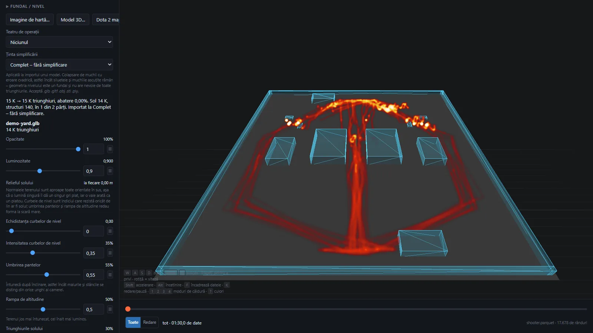

# Căldură

Căldura colorează locurile unde s-au întâmplat multe lucruri: roșu acolo unde s-a întâmplat puțin, alb-încins acolo unde s-a întâmplat mult. Răspunde la întrebarea „unde se întâmplă asta și cât de des”.

**Căldura** (tasta 1) este modul implicit. Fiecare [rând](glossary.md) vizibil contribuie cu un [sprite](glossary.md) rotund, orientat spre cameră; sprite-urile care se suprapun se adună într-un buffer cu virgulă mobilă; suma este mapată printr-o rampă de culori - implicit transparent → roșu → galben → alb - și desenată peste scenă.

Imaginea arată căldura unei runde de shooter pe un nivel cu clădiri: punctele fierbinți stau în camere și pe scări, nu doar pe sol.

## Cum se folosește {#how-to-use-it}

1. Încarcă datele și apasă `1` (sau alege **Căldură** în bara de moduri).
2. Dacă totul este alb sau gol, apasă **Expunere automată din câmp** din secțiunea **Forma căldurii**.
3. Schimbă **Raza sprite-ului** până când punctele vecine se unesc în benzi: mai mic arată puncte izolate, mai mare arată zone.
4. Deschide **Culorile căldurii** ca să schimbi culorile, sau **Adâncime** ca să lași dealurile și pereții să ascundă căldura din spatele lor.

Aceleași panouri modelează [Diferența](difference.md), [Căldura pe echipe](team-heat.md) și [Căldura pe linii](line-heat.md); se deosebesc prin ce se adună (cu semn, colorat sau de-a lungul liniilor), nu prin cum.

## Panourile și valorile lor implicite {#the-panels-and-their-defaults}

Fiecare comandă este explicată pe pagina ei; coloana Detalii trimite la ea. Cursoarele au lângă ele o casetă scrisă și un mâner de tragere (mânerul mic din dreapta: tragi în sus sau în jos, mai departe înseamnă mai repede, Shift pentru reglaj fin); acolo unde linia cursorului se termină înainte de o limită reală, mânerul poate trece peste ea până la *plafonul de cursor* dat aici. Valorile marcate *la încărcare* sunt recalculate pentru fiecare set de date nou.

### Forma căldurii (deschis) {#heat-shape-open}

| Comandă | Implicit | Interval (plafon cursor) | Detalii |
|---|---|---|---|
| **Raza sprite-ului** | 6 m; la încărcare extinderea / 120 | 0,05-2000 m, logaritmic (50.000) | [Forma sprite-ului](sprite-shape.md#sprite-radius) |
| **Intensitate în centru** | 1 | 0-10 (1000) | [Forma sprite-ului](sprite-shape.md#centre-and-edge-intensity) |
| **Intensitate la margine** | 0 | -2-10 (1000) | [Forma sprite-ului](sprite-shape.md#centre-and-edge-intensity) |
| **Forma rampei** | *Atenuare* | *Atenuare* / *Curbă* | [Forma sprite-ului](sprite-shape.md#ramp-shape-falloff-or-curve) |
| **Atenuare** (doar la Atenuare) | 1,6 | 0,1-8 (64) | [Forma sprite-ului](sprite-shape.md#falloff) |
| **Rampă lină** (doar la Atenuare) | pornit | | [Forma sprite-ului](sprite-shape.md#falloff) |
| Editorul de curbe (doar la Curbă) | prestabilitul *Netedă* | | [Forma sprite-ului](sprite-shape.md#the-curve-editor) |
| **Punctul de saturație** | 24; la încărcare o estimare, apoi măsurat | 0,1-4000, logaritmic (10.000.000) | [Culoare și expunere](colour-and-exposure.md#saturation-point) |
| **Căldura minimă** | oprit (0) | 0-100% | [Culoare și expunere](colour-and-exposure.md#minimum-heat) |
| **Răspunsul la densitate** | *Saturant* | *Saturant* / *Liniar* / *Log* | [Culoare și expunere](colour-and-exposure.md#density-response) |
| **Expunere automată din câmp** | | buton | [Culoare și expunere](colour-and-exposure.md#auto-exposure) |
| **Urmărește vederea** | pornit | | Măsoară din nou expunerea de fiecare dată când camera ajunge în repaus, astfel încât o regiune în care zbori folosește toată rampa de culori. Schimbările mici sunt ignorate, iar scara alunecă. Debifeaz-o, sau trage de **Punctul de saturație**, ca să blochezi scara și să compari locuri pe aceeași scară. [Culoare și expunere](colour-and-exposure.md#follow-the-view) |
| **Aceeași densitate la orice zoom** | pornit | | O culoare înseamnă același număr de rânduri pe unitatea de suprafață a terenului, oricât de aproape ești. Un sprite pe care limitele de pixeli îl măresc (departe) sau îl micșorează (aproape) păstrează căldura pe care ar adăuga-o mărimea sa reală, astfel încât o imagine expusă de departe nu se estompează când zbori înăuntru. Oprit, un sprite limitat adaugă greutatea sa întreagă la mărimea sa limitată. [Forma sprite-ului](sprite-shape.md#pixel-clamps) |
| **Aplatizare pe planul solului** | oprit | | [Forma sprite-ului](sprite-shape.md#flatten-onto-ground-plane) |

### Culorile căldurii (închis) {#heat-colours-closed}

| Comandă | Implicit | Detalii |
|---|---|---|
| Mostrele grupurilor și **Separarea culorilor** (doar Căldura pe echipe) | 1,4 | [Căldura pe echipe](team-heat.md) |
| Editorul **Rampa căldurii** (*Pozitiv (echipe aditive)* în Diferență, *Rampă de opacitate* în Căldura pe echipe) | transparent → roșu → galben → alb | [Culoare și expunere](colour-and-exposure.md#the-ramp-editor) |
| **Resetează la transparent → roșu → galben → alb** | | |
| Rampa **Negativ (echipe subtractive)** (doar Diferență) | transparent → verde → albastru → violet | [Diferență](difference.md#colours) |

### Limite de pixeli pentru sprite-uri (închis) {#sprite-pixel-clamps-closed}

| Comandă | Implicit | Interval (plafon cursor) | Detalii |
|---|---|---|---|
| **Raza minimă în pixeli** | 1 px | 0-16 (512) | [Forma sprite-ului](sprite-shape.md#pixel-clamps) |
| **Raza maximă în pixeli** | 96 px | 2-1024, logaritmic (8192) | [Forma sprite-ului](sprite-shape.md#pixel-clamps) |

### Adâncime (deschis) {#depth-open}

| Comandă | Implicit | Detalii |
|---|---|---|
| **Ascunde în spatele terenului** | pornit | [Adâncime și eliminarea fețelor](depth-and-culling.md#hide-behind-terrain) |
| **Ascuns în spatele geometriei** | 0,8 (*cu 80% mai slab*) | [Adâncime și eliminarea fețelor](depth-and-culling.md#hidden-behind-geometry) |

### Eliminarea după distanță (închis) {#distance-culling-closed}

| Comandă | Implicit | Interval (plafon cursor) | Detalii |
|---|---|---|---|
| **Aproape** | oprit (0) | 0,5-5000 m, logaritmic; capătul de jos al cursei = oprit (200.000) | [Adâncime și eliminarea fețelor](depth-and-culling.md#distance-culling) |
| **Departe** | oprit (0) | 1-200.000 m, logaritmic; jos = oprit (10.000.000) | [Adâncime și eliminarea fețelor](depth-and-culling.md#distance-culling) |
| **Tăiere după plan** | pornit | | [Adâncime și eliminarea fețelor](depth-and-culling.md#distance-culling) |
| **Taie și nivelul** | pornit | | [Adâncime și eliminarea fețelor](depth-and-culling.md#distance-culling) |

Taste: `[` și `]` împing limita îndepărtată înăuntru și în afară, `\` o comută ([Adâncime și eliminarea fețelor](depth-and-culling.md#keyboard)).

### Direcție și Valoare {#direction-and-value}

Două secțiuni în plus stau sub Forma căldurii. **Direcția** desenează fiecare rând ca un sector și adaugă săgeți: vezi [Căldură direcțională](directional-heat.md). **Valoarea** cântărește căldura după ce a costat sau a câștigat fiecare rând: vezi [Ponderea valorilor](value-weighting.md).

## Ce se salvează {#what-is-saved}

Setările de căldură de mai sus nu se păstrează între sesiuni: reîncărcarea paginii restabilește implicitele. Două lucruri sunt păstrate în browser: ultima viteză de redare (`heat3d.speed`, vezi [Cronologia](timeline.md)) și setările figurilor îndepărtate ale [suprapunerii de figuri](box-replay.md) (stilul simbolului, mărimea, marcajele de lovituri și altele). Tot așa, limba, [axele lumii inversate](camera.md#invert-world-axis), numele mașinilor reținute de fila cursei și [biblioteca de niveluri](level-library.md). Lista completă este în [Setările stocate](ref-settings-storage.md).
