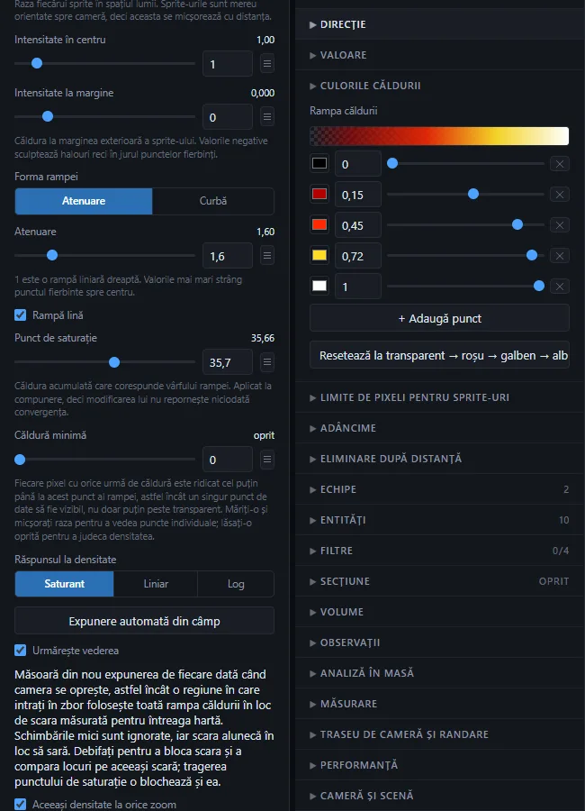

# Căldură

Căldura colorează locurile unde s-au petrecut multe lucruri: roșu acolo unde s-a întâmplat puțin, alb-incandescent acolo unde s-a întâmplat mult. Răspunde la întrebarea „unde se întâmplă asta și cât de des”.

**Căldură** (tasta 1) este modul implicit. Fiecare [rând](glossary.md) vizibil adaugă un [sprite](glossary.md) rotund orientat spre cameră; sprite-urile care se suprapun se adună într-un buffer cu virgulă mobilă; suma trece printr-o rampă de culori - implicit transparent → roșu → galben → alb - și se desenează peste scenă.

Imaginea arată căldura unei runde de tragător pe un nivel cu clădiri: zonele fierbinți stau în încăperi și pe scări, nu doar pe sol.

## Cum se folosește {#how-to-use-it}

1. Încarcă datele și apasă `1` (sau alege **Căldură** în bara de moduri).
2. Dacă totul este alb sau gol, apasă **Expunere automată din câmp** din secțiunea **Forma căldurii**.
3. Schimbă **Raza sprite-ului** până când punctele vecine se unesc în benzi: mai mic arată pete singulare, mai mare arată zone.
4. Deschide **Culorile căldurii** ca să schimbi culorile, sau **Adâncime** ca să lași dealurile și zidurile să ascundă căldura din spatele lor.

Aceleași panouri modelează [Diferența](difference.md), [Căldura pe echipe](team-heat.md) și [Căldura pe linii](line-heat.md); diferă ce se adaugă (cu semn, colorat sau de-a lungul liniilor), nu cum.

## Panourile și valorile lor implicite {#the-panels-and-their-defaults}

Fiecare comandă de mai jos corespunde unui parametru de shader, deci schimbarea ei nu costă nimic în afară de o redesenare. Glisoarele au lângă ele o casetă cu valoare scrisă și un mâner de tragere (mic buton în dreapta: trage în sus sau în jos, mai departe înseamnă mai repede, Shift pentru precizie); când șina glisorului se oprește înainte de o limită reală, mânerul poate trece peste ea până la *plafonul de tragere* indicat aici. Valorile marcate *la încărcare* se recalculează pentru fiecare set de date nou.

### Forma căldurii (deschis) {#heat-shape-open}

| Comandă | Implicit | Interval (plafon de tragere) | Detalii |
|---|---|---|---|
| **Raza sprite-ului** | 6 m; la încărcare întinderea / 120 | 0,05-2000 m, logaritmic (50.000) | [Forma sprite-ului](sprite-shape.md#sprite-radius) |
| **Intensitate în centru** | 1 | 0-10 (1000) | [Forma sprite-ului](sprite-shape.md#centre-and-edge-intensity) |
| **Intensitate la margine** | 0 | -2-10 (1000) | [Forma sprite-ului](sprite-shape.md#centre-and-edge-intensity) |
| **Forma rampei** | *Atenuare* | *Atenuare* / *Curbă* | [Forma sprite-ului](sprite-shape.md#ramp-shape-falloff-or-curve) |
| **Atenuare** (doar la Atenuare) | 1,6 | 0,1-8 (64) | [Forma sprite-ului](sprite-shape.md#falloff) |
| **Rampă lină** (doar la Atenuare) | pornit | | [Forma sprite-ului](sprite-shape.md#falloff) |
| Editorul de curbe (doar la Curbă) | presetarea *Netedă* | | [Forma sprite-ului](sprite-shape.md#the-curve-editor) |
| **Punct de saturație** | 24; la încărcare o estimare, apoi măsurată | 0,1-4000, logaritmic (10.000.000) | [Culoare și expunere](colour-and-exposure.md#saturation-point) |
| **Căldură minimă** | oprit (0) | 0-100% | [Culoare și expunere](colour-and-exposure.md#minimum-heat) |
| **Răspunsul la densitate** | *Saturant* | *Saturant* / *Liniar* / *Logaritmic* | [Culoare și expunere](colour-and-exposure.md#density-response) |
| **Expunere automată din câmp** | | buton | [Culoare și expunere](colour-and-exposure.md#auto-exposure) |
| **Urmărește vederea** | pornit | | Măsoară din nou expunerea de fiecare dată când camera se oprește, astfel încât o regiune în care zbori folosește întreaga rampă de culori. Modificările mici sunt ignorate, iar scara alunecă lin. Debifează-l, sau trage **Punctul de saturație**, ca să blochezi scara și să compari locuri pe aceeași scară. [Culoare și expunere](colour-and-exposure.md#follow-the-view) |
| **Aceeași densitate la orice zoom** | pornit | | O culoare înseamnă același număr de rânduri pe suprafața solului, oricât de aproape ești. Un sprite pe care limitele de pixeli îl măresc (de departe) sau îl micșorează (de aproape) păstrează căldura pe care ar adăuga-o la mărimea lui reală, astfel încât o imagine expusă de departe nu se estompează când zbori în ea. Oprit, un sprite limitat adaugă toată greutatea lui la mărimea limitată. [Forma sprite-ului](sprite-shape.md#pixel-clamps) |
| **Aplatizare pe planul solului** | oprit | | [Forma sprite-ului](sprite-shape.md#flatten-onto-ground-plane) |

### Culorile căldurii (închis) {#heat-colours-closed}

| Comandă | Implicit | Detalii |
|---|---|---|
| Mostrele grupurilor și **Separarea culorilor** (doar la Căldură pe echipe) | 1,4 | [Căldură pe echipe](team-heat.md) |
| Editorul de **Rampa căldurii** (*Pozitiv (echipe aditive)* la Diferență, *Rampă de opacitate* la Căldură pe echipe) | transparent → roșu → galben → alb | [Culoare și expunere](colour-and-exposure.md#the-ramp-editor) |
| **Resetează la transparent → roșu → galben → alb** | | |
| Rampa **Negativ (echipe subtractive)** (doar la Diferență) | transparent → verde → albastru → violet | [Diferență](difference.md#colours) |

### Limitele de pixeli ale sprite-ului (închis) {#sprite-pixel-clamps-closed}

| Comandă | Implicit | Interval (plafon de tragere) | Detalii |
|---|---|---|---|
| **Raza minimă în pixeli** | 1 px | 0-16 (512) | [Forma sprite-ului](sprite-shape.md#pixel-clamps) |
| **Raza maximă în pixeli** | 96 px | 2-1024, logaritmic (8192) | [Forma sprite-ului](sprite-shape.md#pixel-clamps) |

### Adâncime (deschis) {#depth-open}

| Comandă | Implicit | Detalii |
|---|---|---|
| **Ascunde în spatele terenului** | pornit | [Adâncime și eliminarea fețelor](depth-and-culling.md#hide-behind-terrain) |
| **Ascuns în spatele geometriei** | 0,8 (*cu 80% mai estompat*) | [Adâncime și eliminarea fețelor](depth-and-culling.md#hidden-behind-geometry) |

### Eliminare după distanță (închis) {#distance-culling-closed}

| Comandă | Implicit | Interval (plafon de tragere) | Detalii |
|---|---|---|---|
| **Aproape** | oprit (0) | 0,5-5000 m, logaritmic, capătul de jos al șinei = oprit (200.000) | [Adâncime și eliminarea fețelor](depth-and-culling.md#distance-culling) |
| **Departe** | oprit (0) | 1-200.000 m, logaritmic, capătul de jos = oprit (10.000.000) | [Adâncime și eliminarea fețelor](depth-and-culling.md#distance-culling) |
| **Tăiere după plan** | pornit | | [Adâncime și eliminarea fețelor](depth-and-culling.md#distance-culling) |
| **Taie și nivelul** | pornit | | [Adâncime și eliminarea fețelor](depth-and-culling.md#distance-culling) |

Tastele `[` și `]` împing limita îndepărtată spre interior și spre exterior, iar `\` o comută ([Adâncime și eliminarea fețelor](depth-and-culling.md#keyboard)).

### Direcție și Valoare {#direction-and-value}

Două secțiuni în plus sunt sub Forma căldurii. **Direcție** desenează fiecare rând ca un sector și adaugă săgeți: vezi [Căldură direcțională](directional-heat.md). **Valoare** ponderează căldura după ce a costat sau a câștigat fiecare rând: vezi [Ponderarea valorilor](value-weighting.md).

## Ce se salvează {#what-is-saved}

Setările de căldură de mai sus nu se păstrează între sesiuni: reîncărcarea paginii readuce valorile implicite. Două lucruri se păstrează în browser: ultima viteză de redare (`heat3d.speed`, vezi [Cronologie](timeline.md)) și setările figurilor îndepărtate ale [suprapunerii figurilor](box-replay.md) (stilul simbolurilor, mărimea, marcajele de lovituri și altele). Tot așa se păstrează limba, [axele lumii inversate](camera.md#invert-world-axis), numele mașinilor memorate ale filei de curse și [biblioteca de niveluri](level-library.md). Lista completă este în [Setările salvate](ref-settings-storage.md).
