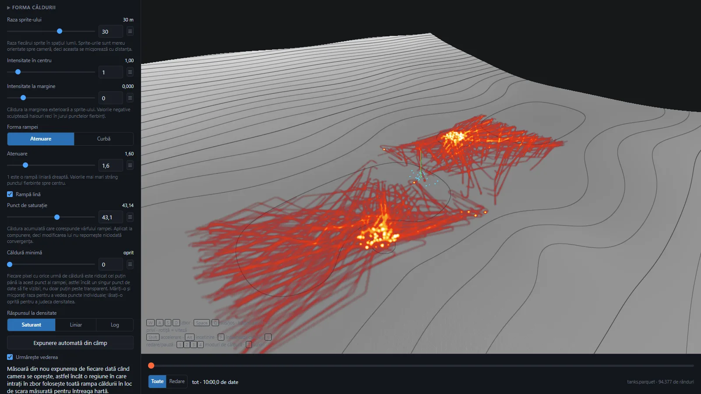
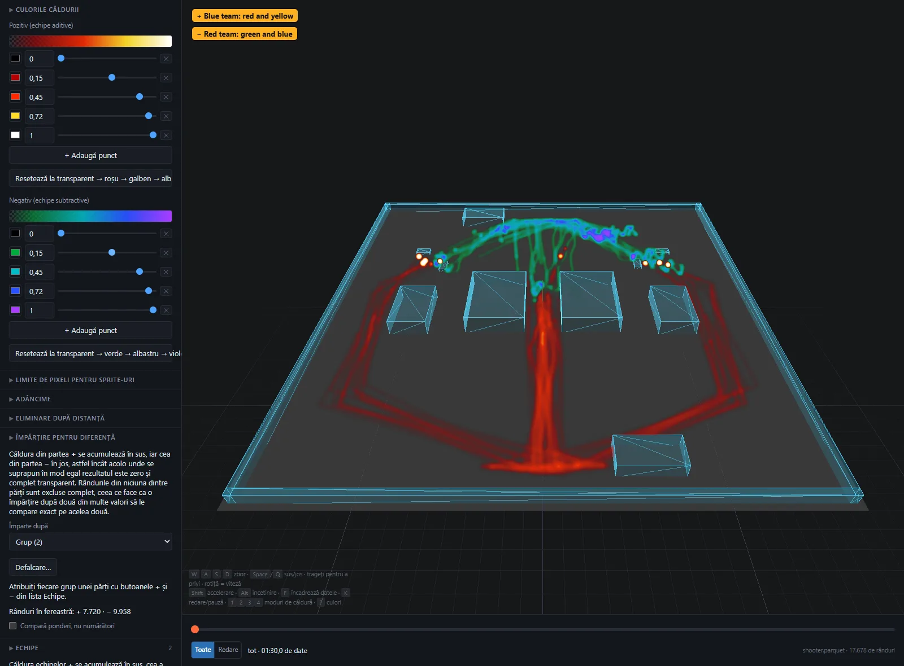
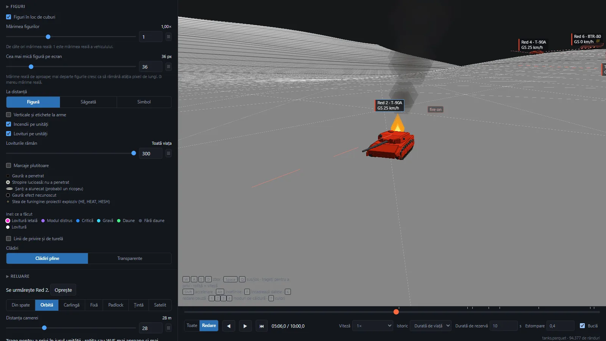
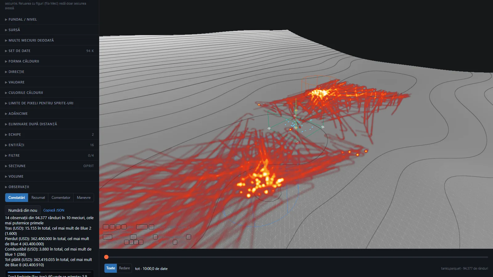
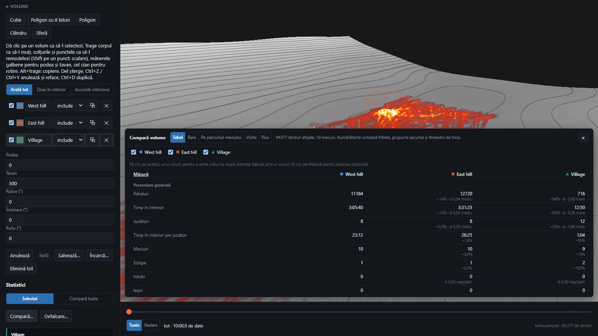
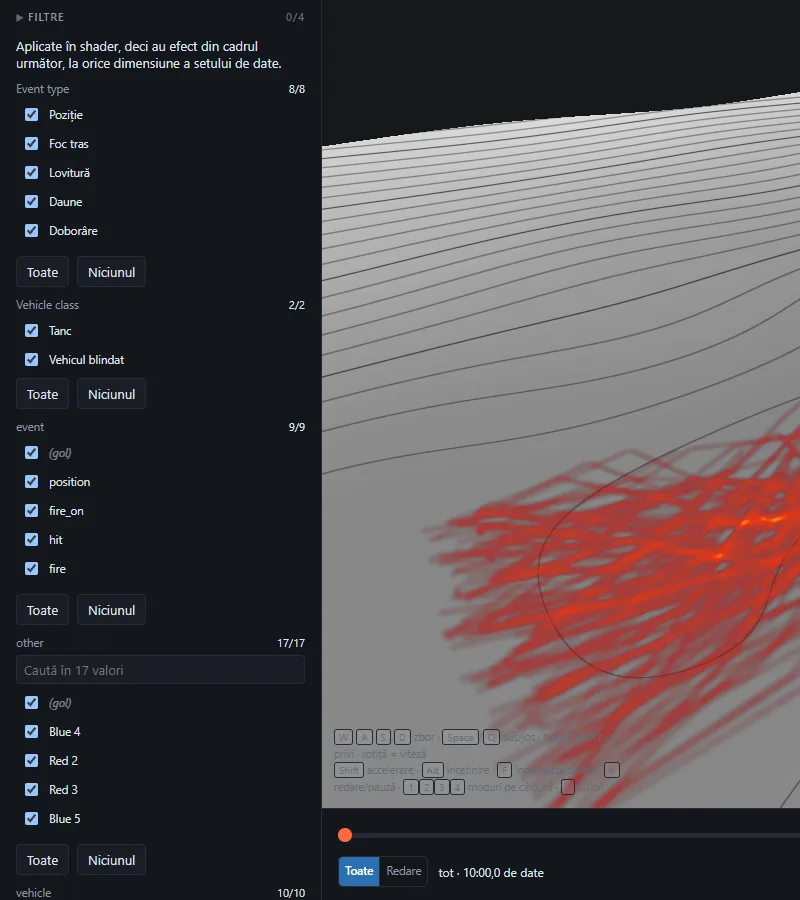
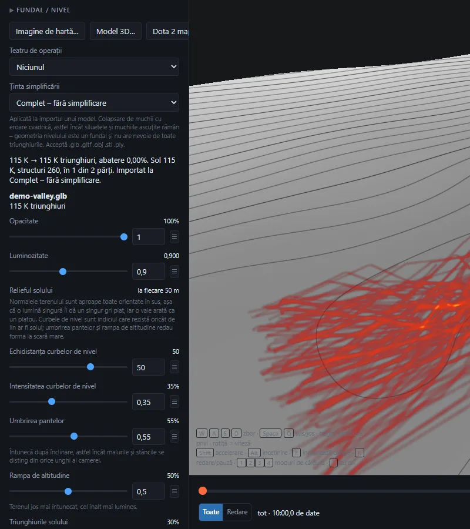

# 3DHeat

3DHeat arată unde s-au întâmplat lucrurile într-un joc - unde au mers jucătorii, unde s-au luptat și unde au căzut - ca culori strălucitoare prin care poți zbura sau ca mici figuri 3D care refac meciul.

Încarcă poziții - CSV, Parquet, înregistrări Tacview, reluări convertite, un singur fișier, un dosar sau mii de meciuri - și vezi-le ca o **hartă termică prin care poți zbura**, ca **figuri care refac meciul**, ca linii de-a lungul traseelor pe care le-au urmat oamenii sau ca o populație pusă lângă alta. El singur găsește ce iese în evidență și rulează complet în browserul tău: nimic nu este trimis nicăieri. 3DHeat și toate instrumentele lui sunt gratuite și cu cod deschis sub [licența MIT](https://github.com/Holdi601/3DHeat/blob/main/LICENSE).



**Ești nou aici?** Generează [datele demonstrative](demo-data.md) și urmează cei șapte pași. Fiecare imagine de pe acest site a fost făcută cu ele.

## Ce face {#what-it-does}

| | |
|---|---|
|  | **[Moduri de căldură](heat-modes.md)** - căldură, [diferență](difference.md) (roșu acolo unde o parte a fost mai mult, verde-albastru acolo unde a fost cealaltă), [căldură pe echipe](team-heat.md), [căldură pe linii](line-heat.md); [căldură direcțională](directional-heat.md) cu sectoare, câmpuri de săgeți și grafice polare; căldură [ponderată după valoare](value-weighting.md): cât costă armele, vehiculele și combustibilul. |
|  | **[Reluarea meciului](match-replay.md)** - fiecare unitate ca [figura](figures.md) a ceea ce este, simboluri NATO sau rusești de la distanță, rachete și trasoare, marcaje de lovituri, epave, incendii, turele, obiective, camere în stil Tacview și afișaj tactic; [multe meciuri deodată](many-matches.md). |
|  | **[Observații](insights.md)** - poziții puternice, zone mortale, capcane de apariție, strangulări și jucători care ies în evidență, găsite și ordonate împreună cu dovezile; un rezumat scris, opțional de o IA aleasă de tine; un comentator pentru un meci; [lentila cunoașterii](knowledge.md). |
|  | **[Volume](volumes.md)** - desenează cutii, prisme, cilindri și sfere, filtrează după ele, numără ce se întâmplă înăuntru, exportă și compară locurile una lângă alta; [defalcare](breakdown.md) a cine și ce se descurcă cel mai bine într-un loc. |
|  | **[Filtre](filters.md)** - după tipul evenimentului, jucător sau IA, clasa vehiculului, valoare, orice coloană, pe placa grafică, la orice mărime a datelor. |
|  | **[Niveluri](levels.md)** - imagini de hartă, niveluri 3D făcute cu [instrumentele de date](#related-repositories), simplificare, [fundalul lumii](world-backdrop.md) cu teren real pentru datele de zbor. |

Mai sunt: fila [Analiză de cursă](race-analysis.md) pentru turele jocurilor de curse, fila [Meci](match-analysis.md) pentru rezumatele Counter-Strike 2, [tabla de tactici](tactics-board.md) pentru planuri pe un nivel, [analiza lovirilor](hit-analysis.md) pe vehicul, [analiza de masă](mass-analysis.md) a mii de meciuri, [traseele camerei și videoclipurile](camera-path-and-video.md), [40 de limbi](languages.md), [unități metrice sau imperiale](settings.md).

## Filele {#the-tabs}

Filele se află în partea de sus a barei laterale, sub nume, unități și meniul de limbă.

| Filă | La ce folosește |
|---|---|
| **Hartă termică** | Orice tabel cu poziții: modurile de căldură, suprapunerea figurilor, filtrele, volumele, observațiile, nivelurile, măsurarea și videoclipul. |
| **Analiză de cursă** | Două sau mai multe ture ale aceluiași traseu: unde se pierde timp, de ce și ce trebuie schimbat. |
| **Meci** | Reluarea cu figuri a unui meci și rezumatele meciurilor Counter-Strike 2. |
| **Tactică** | Planuri pe un nivel: figuri, trasee, utilitare aruncate, zone și notițe, în pași care se redau. |
| **Vehicule** | Unde a fost lovită fiecare unitate, de către cine și cu ce. |

## Instalare și rulare {#install-and-run}

3DHeat poate fi folosit, modificat și distribuit gratuit (licența MIT), la fel ca fiecare instrument din [Depozite înrudite](#related-repositories).

### Windows, varianta simplă {#windows-the-easy-way}

Directorul rădăcină al depozitului conține trei fișiere batch.

| Fișier | Ce face |
|---|---|
| `start.bat` | Pornește vizualizatorul. Găsește Node.js chiar și când nu este în `PATH` (caută în `%ProgramFiles%\nodejs`, `%ProgramFiles(x86)%\nodejs` și `%LOCALAPPDATA%\Programs\nodejs`). Dacă Node.js lipsește, oferă să instaleze versiunea LTS cu `winget install -e --id OpenJS.NodeJS.LTS`. La prima rulare întreabă înainte de a descărca dependențele (circa 300 MB în `node_modules\` din dosar, nimic la nivel de sistem). Refuză să pornească dacă ceva ascultă deja pe portul 5273 și indică în schimb `restart.bat`. Când dosarul este o copie git fără modificări locale și există o versiune mai nouă, întreabă dacă vrei să actualizezi (Y/N; fără răspuns în 60 s rămâne această versiune; vezi [Actualizări](updates.md)). Apoi rulează serverul de dezvoltare pe `http://127.0.0.1:5273/` și deschide browserul. **Fereastra este serverul**: lasă-o deschisă, sau închide-o ori apasă Ctrl+C ca să oprești. |
| `restart.bat` | Rulează `stop.bat quiet`, apoi `start.bat`. Este necesar doar după ce modifici `vite.config.ts`, adaugi o dependență sau când serverul s-a blocat - modificările din cod se reîncarcă automat. |
| `stop.bat` | Oprește ce ascultă pe portul 5273, după identificatorul procesului găsit prin `netstat`, niciodată după numele imaginii, deci celelalte procese Node.js de pe calculator rămân neatinse. Așteaptă circa două secunde până când socket-ul este eliberat. Cu argumentul `quiet` nu se oprește la final. |

### Manual (orice sistem) {#by-hand-any-os}

```bash
git clone --recursive https://github.com/Holdi601/3DHeat.git
cd 3DHeat
npm install
npm run dev      # http://127.0.0.1:5273
```

Dosarul `exporters/` conține instrumentele separate de date, ca submodule git, fiecare cu propriul depozit; după un clone simplu rulează `git submodule update --init`. Vizualizatorul în sine nu are nevoie de ele ca să ruleze. `exporters/ext/` conține convertoarele opționale (reluări din War Thunder, World of Tanks, World of Warships și Squad; hărți DCS și IL-2), ținute separat, ca o problemă cu unul dintre ele să nu afecteze nimic altceva.

Nu vine nicio dată de joc odată cu ele: nivelurile, hărțile și înregistrările sunt făcute pe calculatorul tău, cu instrumentele, din jocuri pe care le deții.

### Scripturi npm {#npm-scripts}

| Script | Ce rulează |
|---|---|
| `npm run dev` | Serverul de dezvoltare Vite pe portul 5273, legat de `127.0.0.1`. |
| `npm run build` | Verificarea tipurilor (`tsc --noEmit`) și un pachet de producție în `dist/`. |
| `npm run preview` | Servește pachetul de producție. |
| `npm run typecheck` | Doar verificarea tipurilor. |
| `npm test` / `npm run test:watch` | Teste unitare și de integrare (vitest). |
| `npm run smoke` | Rulează aplicația reală în Chromium fără interfață și verifică dacă pânza are pixeli colorați de date; capturile ajung în `tools/.smoke/`. Presupune că serverul de dezvoltare rulează. |
| `npm run smoke:f16` | Același set, cu `?heat=f16`, care forțează calea de acumulare în semiprecizie (vezi [Acumulare în semiprecizie](half-float-accumulation.md)). |
| `npm run bench` | Test de performanță la încărcare; scrie `tools/.smoke/ingest-bench.json`. |
| `npm run test:heavy` | Teste care au nevoie de fișiere mari de date reale; se sar singure dacă fișierele lipsesc. |
| `npm run inspect -- <file.parquet>` | Afișează schema unui fișier Parquet și câteva rânduri (`tools/inspect-parquet.mjs`). |

### Ce adaugă serverul de dezvoltare {#what-the-dev-server-adds}

Vizualizatorul este o pagină web statică, dar serverul de dezvoltare (vezi `vite.config.ts`) adaugă două rute locale pe care nu le are o publicare statică a lui `dist/`:

- `/__host/memory` raportează memoria RAM instalată și liberă a calculatorului și, acolo unde o poate citi, memoria plăcii grafice (din `nvidia-smi` sau, pe Windows, din intrarea de registru a adaptorului de afișare). Astfel, [bugetele de memorie](memory-and-budgets.md) folosesc cifre reale, nu estimările limitate ale browserului.
- `/__heat3d/update` verifică dacă copia este în urmă și o poate actualiza rapid ([Actualizări](updates.md)).

Serverul se leagă doar de `127.0.0.1`, deci nicio rută nu este accesibilă din rețea. Deschide-l ca `http://127.0.0.1:5273`: `localhost` se poate rezolva la bucla IPv6 `::1`, unde nu ascultă nimic. Nu trimite anteturi de izolare între origini (COOP/COEP): nimic din vizualizator nu folosește `SharedArrayBuffer`, iar lucrătorii își transmit datele prin transfer, pentru care nu sunt necesare.

## Cerințele browserului și ale plăcii grafice {#browser-and-gpu-requirements}

- **Un browser cu WebGPU sau WebGL2.** Întâi se încearcă WebGPU (Chrome și Edge îl au); fără el se folosește backend-ul WebGL2. WebGL2 trebuie să ofere `EXT_color_buffer_float` (randare în texturi cu virgulă mobilă), altfel vizualizatorul afișează „Motorul de randare nu poate fi inițializat.” Vezi [Cele două backend-uri](backends.md). Vizualizatorul este dezvoltat și testat în Chromium; celelalte browsere nu sunt verificate.
- **Accelerarea hardware pornită.** Când browserul desenează pe procesor (SwiftShader, llvmpipe, Microsoft Basic Render Driver și altele asemenea), un banner roșu din partea de sus a barei laterale spune asta și cum se remediază. Vezi [Detectarea randării software](software-rendering.md).
- **O placă grafică dedicată ajută, dar nu este obligatorie.** Ambele backend-uri cer adaptorul de înaltă performanță. Cantitatea de date care poate fi ținută pe placa grafică este un buget pe care îl poți vedea și schimba ([Memorie și bugete](memory-and-budgets.md)).
- **Funcțiile opționale** folosesc alte API-uri ale browserului: randarea video are nevoie de `VideoEncoder` din WebCodecs cu VP9 sau VP8 ([Traseul camerei și videoclipul](camera-path-and-video.md)); simplificarea plaselor nivelurilor are nevoie de WebAssembly; trimiterea dosarelor prin glisare folosește API-ul File and Directory Entries; biblioteca de niveluri folosește IndexedDB; gamepad-urile folosesc API-ul Gamepad.

## Harta documentației {#documentation-map}

**Început**: [Date demonstrative](demo-data.md) · [Încărcarea datelor](getting-data-in.md) ([încărcarea fișierelor](loading-files.md), [maparea coloanelor](column-mapping.md), [axe, unități și timp](axes-units-and-time.md), [sesiuni, persoane și grupuri](sessions-persons-groups.md), [Tacview](tacview-acmi.md), [convertoare](converters.md), [.3dheat](container.md), [memorie și bugete](memory-and-budgets.md))

**Vezi**: [Moduri de căldură](heat-modes.md) ([căldură](heat.md), [forma sprite-ului](sprite-shape.md), [culoare și expunere](colour-and-exposure.md), [adâncime și eliminarea fețelor](depth-and-culling.md), [diferență](difference.md), [căldură pe echipe](team-heat.md), [căldură pe linii](line-heat.md), [reluarea în cutie](box-replay.md), [căldură direcțională](directional-heat.md), [ponderarea valorilor](value-weighting.md)) · [Cronologie](timeline.md) · [Niveluri](levels.md) ([imagini de hartă](map-images.md), [niveluri 3D](model-levels.md), [aspectul nivelului](level-appearance.md), [biblioteca](level-library.md), [fundalul lumii](world-backdrop.md), [sursele sale](world-backdrop-sources.md)) · [Camera](camera.md) ([gamepad](gamepad.md), [taste](keyboard-reference.md)) · [Traseul camerei și videoclipul](camera-path-and-video.md)

**Analiză**: [Filtre și instrumente](filters-and-tools.md) ([filtre](filters.md), [echipe](teams-list.md), [entități](entities.md), [secțiune](slice.md), [măsurare](measure.md), [volume](volumes.md), [defalcare](breakdown.md)) · [Observații](insights.md) ([lentila cunoașterii](knowledge.md)) · [Analiză de masă](mass-analysis.md)

**Reluare**: [Reluarea meciului](match-replay.md) · [Multe meciuri deodată](many-matches.md) · [Figuri](figures.md) ([în suprapunerea figurilor](figure-replay.md), [creditele](figure-credits.md)) · [Paritatea cu Tacview](tacview-parity.md) · [Analiza lovirilor](hit-analysis.md)

**Alte file**: [Analiză de cursă](race-analysis.md) ([metoda](race-analytics.md), [alte jocuri](other-games.md)) · [Analiza meciului](match-analysis.md) · [Tabla de tactici](tactics-board.md) ([viteze](tactics-speeds.md))

**Vizualizatorul**: [Glosar](glossary.md) · [Setări, unități și taste](settings.md) · [Limbi](languages.md) · [Actualizări](updates.md) · [Detalii interne ale randării](rendering-internals.md) ([backend-uri](backends.md), [acumulare](accumulation.md), [eșantionare și bugete](sampling-and-budgets.md), [semiprecizie](half-float-accumulation.md), [memoria GPU](gpu-memory.md), [randare software](software-rendering.md), [panoul de performanță](performance-and-stats.md)) · [Formatele de date](data-formats.md) · [Referință](reference.md) · [Întreținerea documentației](maintaining.md)

## Depozite înrudite {#related-repositories}

Vizualizatorul citește date; aceste instrumente le produc. Fiecare este un depozit public propriu (MIT), cu documentația lui. Niciunul nu livrează date de joc: nivelurile, hărțile și înregistrările sunt făcute pe calculatorul tău, din jocuri pe care le deții.

| Depozit | Ce face | Util pentru | Documentație |
|---|---|---|---|
| [3DHeat-GameFiles](https://github.com/Holdi601/3DHeat-GameFiles) | Citește traseele și nivelurile din arhivele pe care le livrează jocurile (Forza Horizon, BeamNG, Assetto Corsa Rally; cititoare pentru Unreal, Unity, Frostbite și Source 2) ca glTF | un nivel 3D sub căldura sau reluarea ta | [site](https://holdi601.github.io/3DHeat-GameFiles/) |
| [3DHeat-GameCapture](https://github.com/Holdi601/3DHeat-GameCapture) | Înregistrează telemetria turelor din interfețele pe care le publică jocurile de curse și reconstruiește niveluri din videoclipuri de joc | ture pentru Analiză de cursă; un nivel unde nu se pot citi fișiere | [site](https://holdi601.github.io/3DHeat-GameCapture/) |
| [3DHeat-UnrealExporter](https://github.com/Holdi601/3DHeat-UnrealExporter) | Plugin pentru Unreal Editor care exportă un nivel ca un singur fișier glTF | niveluri din proiectele tale Unreal | [site](https://holdi601.github.io/3DHeat-UnrealExporter/) |
| [3DHeat-CS2](https://github.com/Holdi601/3DHeat-CS2) | Demo-uri Counter-Strike 2 în tabele de căldură și rezumate de meci; hărți CS2 în geometrie | căldura CS2, reluările și fila Meci | [site](https://holdi601.github.io/3DHeat-CS2/) |
| [3DHeat-Watcher](https://github.com/Holdi601/3DHeat-Watcher) | Înregistrează jocul tău în fundal, din ce publică jocurile: telemetrie, integrări de stare a jocului, jurnale, reluări | statisticile tale, fără să faci nimic manual | [site](https://holdi601.github.io/3DHeat-Watcher/) |
| [3DHeat-Ext-WarThunder](https://github.com/Holdi601/3DHeat-Ext-WarThunder) | Reluări War Thunder (`.wrpl`) în tabele: trasee aeriene și terestre, trageri, lovituri, eliminări, turele, obiective | reluări War Thunder, marcaje de lovituri și observații | [site](https://holdi601.github.io/3DHeat-Ext-WarThunder/) |
| [3DHeat-Ext-WoT](https://github.com/Holdi601/3DHeat-Ext-WoT) | Reluări World of Tanks în tabele: poziția fiecărui vehicul, morți și eliminări | căldura și reluările World of Tanks | [site](https://holdi601.github.io/3DHeat-Ext-WoT/) |
| [3DHeat-Ext-WoWs](https://github.com/Holdi601/3DHeat-Ext-WoWs) | Reluări World of Warships în tabele: poziția fiecărei nave și scufundările | căldura și reluările World of Warships | [site](https://holdi601.github.io/3DHeat-Ext-WoWs/) |
| [3DHeat-Ext-Squad](https://github.com/Holdi601/3DHeat-Ext-Squad) | Demo-uri de server Squad în tabele: poziția fiecărui jucător, echipa și grupa | căldura și reluările Squad | [site](https://holdi601.github.io/3DHeat-Ext-Squad/) |
| [3DHeat-Ext-DCS](https://github.com/Holdi601/3DHeat-Ext-DCS) | Terenurile DCS World din instalarea ta în niveluri: sol, drumuri, orașe, aerodromuri, câmpuri, apă | înregistrările DCS și Tacview pe terenul lor real | [site](https://holdi601.github.io/3DHeat-Ext-DCS/) |
| [3DHeat-Ext-IL2](https://github.com/Holdi601/3DHeat-Ext-IL2) | Hărțile IL-2 Great Battles în niveluri | înregistrările IL-2 pe harta lor | [site](https://holdi601.github.io/3DHeat-Ext-IL2/) |

## Organizarea codului, pe scurt {#source-layout-briefly}

| Dosar | Conținut |
|---|---|
| [`src/data/`](https://github.com/Holdi601/3DHeat/tree/main/src/data) | Alegerea fișierelor, încărcarea CSV și Parquet, mapare automată, validare, modelul de memorie, constructorul de seturi de date, citirea modelelor, clasificare, simplificare, biblioteca de niveluri |
| [`src/render/`](https://github.com/Holdi601/3DHeat/tree/main/src/render) | Bucla de cadre (`engine.ts`), eșantionarea, ambele backend-uri, camera, gamepad-ul, măsurarea, traseul camerei, înregistrarea video |
| [`src/state/`](https://github.com/Holdi601/3DHeat/tree/main/src/state) | Starea aplicației (`store.ts`) cu toate valorile implicite, tipurile de domeniu (`types.ts`), curba sprite-ului |
| [`src/ui/`](https://github.com/Holdi601/3DHeat/tree/main/src/ui) | Panourile barei laterale, cronologia, suprapunerile |
| [`src/race/`](https://github.com/Holdi601/3DHeat/tree/main/src/race), [`src/match/`](https://github.com/Holdi601/3DHeat/tree/main/src/match) | Filele Analiză de cursă și Meci |
| [`src/i18n/`](https://github.com/Holdi601/3DHeat/tree/main/src/i18n) | Traduceri |
| [`src/insights/`](https://github.com/Holdi601/3DHeat/tree/main/src/insights) | Observații: detectori, rezumatul scris, comentatorul, furnizorii de IA, lentila cunoașterii |
| [`src/mass/`](https://github.com/Holdi601/3DHeat/tree/main/src/mass) | Analiza de masă pe mii de meciuri |
| [`src/volumes/`](https://github.com/Holdi601/3DHeat/tree/main/src/volumes) | Volume, statisticile lor, exportul și compararea |
| [`src/breakdown/`](https://github.com/Holdi601/3DHeat/tree/main/src/breakdown) | Defalcarea și factorii |
| [`src/overlay/`](https://github.com/Holdi601/3DHeat/tree/main/src/overlay) | Suprapunerea pentru multe meciuri |
| [`src/figures/`](https://github.com/Holdi601/3DHeat/tree/main/src/figures) | Catalogul de figuri și constructorul lui |
| [`src/vehicle/`](https://github.com/Holdi601/3DHeat/tree/main/src/vehicle) | Analiza lovirilor (fila Vehicule) |
| [`src/tactics/`](https://github.com/Holdi601/3DHeat/tree/main/src/tactics) | Tabla de tactici |
| [`src/world/`](https://github.com/Holdi601/3DHeat/tree/main/src/world) | Fundalul lumii |
| [`src/units/`](https://github.com/Holdi601/3DHeat/tree/main/src/units) | Unități de măsură |
