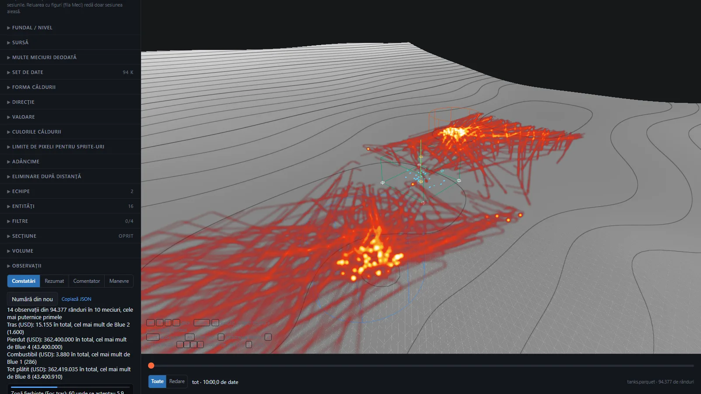
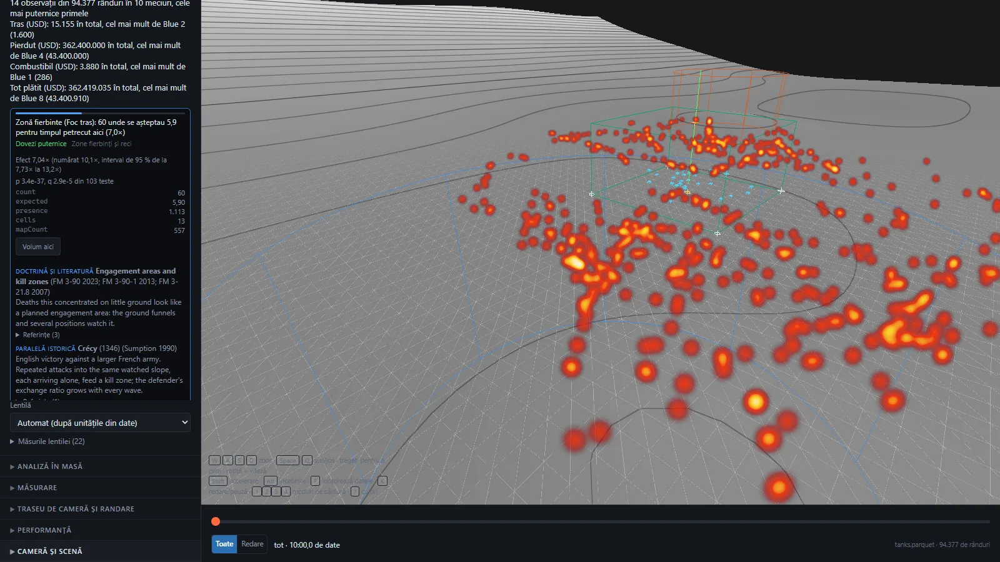
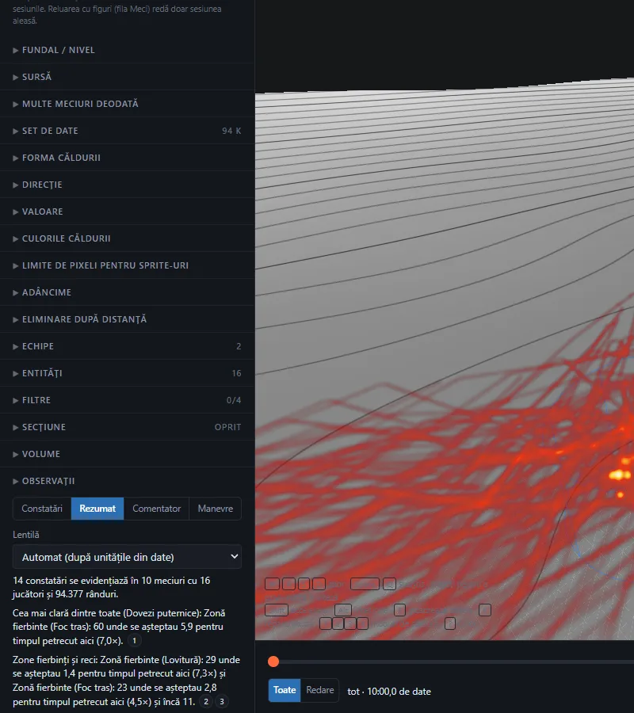
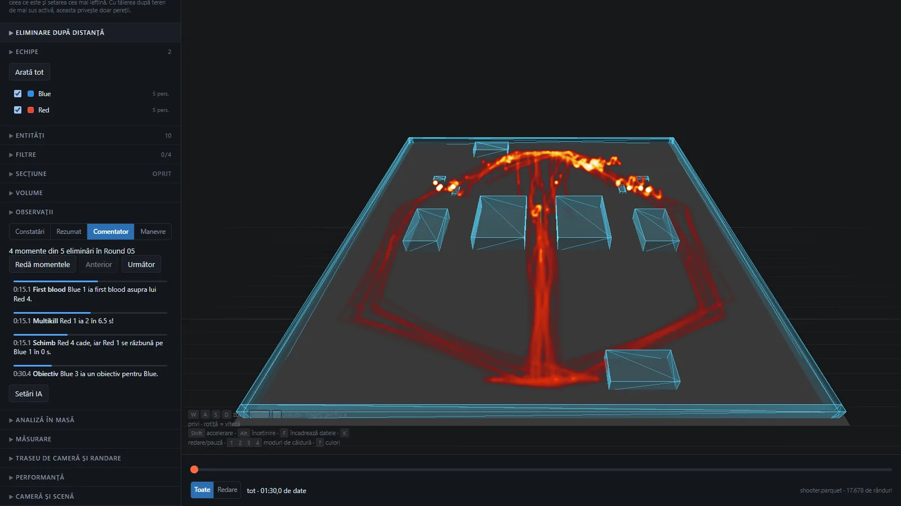

# Observații

**Observații** caută în datele încărcate ce iese în evidență - poziții puternice, teren letal, capcane de apariție, puncte de strangulare, jucători mult peste ceilalți - și îți spune, cele mai puternice primele, cu dovezile. Folosește-l ca să afli într-un minut unde a fost câștigat sau pierdut un meci. Apoi poate scrie un rezumat și, într-o singură reluare, poate funcționa ca un comentator care sare la momentele mari.

Totul se numără în browserul tău. Nimic nu părăsește calculatorul, decât dacă pornești o IA externă (vezi [IA externă](#external-ai)).

Secțiunea **Observații** se află în bara laterală a filelor Hartă termică și Meci. Are trei file: **Constatări**, **Rezumat** și **Comentator**.

## Constatări {#findings}

1. Încarcă date și deschide **Observații**. Apasă **Găsește observații** („Se numără… n%” arată progresul).
2. Citește lista. Fiecare observație are o bară de intensitate, o propoziție, cât de bune sunt dovezile (*Dovezi puternice*, *Dovezi bune* sau *Unele dovezi*), ce detector a găsit-o și clasa vehiculului, acolo unde contează.
3. **Dă clic pe o observație**: vizualizatorul aplică filtrele ei, zboară cu camera la loc și sare la moment, și deschide detaliile: efectul cu intervalul lui de 95%, valorile p și q, dovezile numărate și **Volum aici**, care desenează un [volum](volumes.md) în jurul locului.
4. **Restaurează filtrele** pune la loc filtrele tale. **Copiază JSON** copiază tot raportul.

Numărarea folosește filtrele curente, grupurile ascunse și meciul ales pe toată durata. Când schimbi ulterior filtrele, o notă o spune; apasă **Numără din nou**.

Rândurile de deasupra listei (de exemplu totalurile de bani) rezumă toate datele înainte de observații.

### Detectorii {#the-detectors}

| Detector | Ce găsește | Are nevoie în date de |
|---|---|---|
| **Poziții de forță** | Locuri cu șanse de eliminare-la-moarte mult mai bune decât restul hărții și *teren sigur*, unde mor puțini pentru timpul petrecut | evenimente de eliminare și de moarte |
| **Zone fierbinți și reci** | Locuri unde un tip de eveniment (focuri, lovituri, capturi ...) se întâmplă mult mai des sau mai rar decât prevede timpul petrecut acolo | o coloană de evenimente |
| **Teren deschis și adăpost** | Morți în câmp deschis față de geometria apropiată a nivelului și încet față de mișcare rapidă | morți; un nivel 3D pentru partea de geometrie |
| **Spawnuri** | Spawnuri puternice, capcane de spawn, spawnuri sigure, timpul până la primul contact | timp și persoane |
| **Clasă pe loc** | O clasă de vehicule, sau jucătorii față de IA, care se descurcă mult mai bine sau mai rău într-o zonă | eliminări plus o coloană de clasă de vehicule sau jucător/IA |
| **Jucători** | Jucători care elimină sau mor mult mai mult sau mai puțin decât alții din aceeași clasă | persoane și eliminări |
| **Strangulări și flancuri** | Puncte de strangulare (mult mai multe traversări decât terenul din jur) și rute de flancare (rar folosite, dar care duc la eliminări) | persoane |
| **Valoare** | *Teren costisitor* și *Teren care câștigă* | [coloane de valoare](value-weighting.md) |

Detectorii care nu pot rula pe date sunt listați jos, cu motivul.

### Cum sunt ordonate observațiile {#how-findings-are-ranked}

Fiecare loc sau grup este testat față de restul hărții (teste binomiale exacte sau de rată). Rata falselor descoperiri este ținută la 5% (Benjamini-Hochberg). Întâmplarea poate părea un tipar; asta ține alarmele false jos: dintre observațiile afișate, se așteaptă ca cel mult una din douăzeci să fie întâmplătoare. Efectele din puține evenimente sunt trase spre „niciun efect” înainte de ordonare. Sunt listate cel mult 60 de observații, iar fiecare detector primește câteva locuri în partea de sus.

## Rezumat {#debrief}

Fila **Rezumat** scrie observațiile ca un text scurt: o introducere, cea mai clară observație, una pentru tactică, una pentru echilibrare, restul grupate pe detector și câte se sprijină pe dovezi mai slabe. Fiecare paragraf are butoane numerotate care arată observațiile lui. **Copiază textul** îl copiază.

Naratorul integrat funcționează offline, în limba ta. Selectorul **Lentilă** de deasupra lui (vezi [Lentila cunoașterii](knowledge.md)) decide din ce literatură citează paragrafele.

### IA externă {#external-ai}

**Setări IA** lasă un model de IA ales de tine să scrie rezumatul:

| Setare | Înseamnă |
|---|---|
| **Furnizor** | Anthropic (Claude), OpenAI (ChatGPT), OpenRouter, Ollama (local), LM Studio (local), serverul llama.cpp (local) sau orice punct de acces compatibil cu OpenAI |
| **URL de bază**, **Model** | Completate de furnizor; **Listează modelele** întreabă serverul |
| **Cheie API** | Trimisă doar către adresa de bază. Nu se înregistrează niciodată, nu se salvează în vizualizări, exporturi sau fișiere `.3dheat`. Majoritatea serverelor locale nu au nevoie de ea. |
| **Ține minte cheia în acest browser** | Oprit implicit: cheia este uitată când se închide pagina |
| **Folosește o IA externă** | Oprit implicit |
| **Trimite numele jucătorilor** | Oprit implicit: jucătorii sunt trimiși ca P1, P2 ... |

Apoi scrie o întrebare opțională și apasă **Scrie cu IA**. Se trimit doar observațiile și cifrele lor - niciodată rândurile datelor tale. Răspunsul curge pe măsură ce vine; observațiile citate devin butoane.

## Comentator {#caster}

Pentru **un singur meci** (alege unul dacă sunt mai multe încărcate), **Comentatorul** găsește momentele care merită urmărite: primul sânge, multi-eliminările, schimburile, clutch-urile, schimbările de obiectiv, revenirile, jucătorii care ies în evidență, loviturile de la distanță.

- Dă clic pe un moment: vizualizarea trece la reluare, sare chiar înainte de el, zboară acolo și urmărește jucătorul.
- **Redă momentele** redă fiecare până la capăt și trece mai departe; **Anterior** / **Următor** parcurg lista.
- Cu o IA externă pornită, **Comentariu de la IA** scrie un comentariu din lista de momente (tipuri, ore, nume sau pseudonime, echipe, clase, distanțe).

Are nevoie de persoane și de evenimente de eliminare / moarte (sau de captură); o coloană `other` / `victim` face posibile schimburile și loviturile de la distanță.

## Lentila cunoașterii {#knowledge-lens}

O observație poate fi citită printr-o **lentilă** de cunoaștere stabilită: doctrină militară, lupta aeriană și navală, operațiuni urbane, design de jocuri și esports (sau *Auto*, aleasă de unitățile din date). O observație deschisă arată apoi cea mai apropiată intrare de **doctrină și literatură** și un **paralel istoric**, cu referințe, iar **Măsurile lentilei** calculează măsuri din acea literatură pe date (potriviri Lanchester, rapoarte de schimb, rapoarte de forțe, câmpuri de tragere, teren-cheie, schimburi, inițiativă). Rezumatul și promptul pentru IA le includ. Tot ce ține de asta: [Lentila cunoașterii](knowledge.md).

Metricile din lentilă măsoară și cum se comportă jucătorii ca mulțime și ca grup - aliniere și rătăcire, conducere pe rute, benzi și trasee, aglomerare, lideri și urmăritori, rămași în urmă, punctul de rupere sub pierderi, risc după o viață pierdută, serii, acordul la cumpărături și reacția la focul primit - fiecare față de propriul model nul: [Comportament colectiv](collective-behaviour.md).

## Datele care fac observațiile să funcționeze {#data-that-makes-insights-work}

- poziții cu o coloană de **timp**, una de **persoană** și una de **echipă**;
- o coloană de **eveniment** cu eliminări și morți (`kill`, `death`) și altele (`hit`, `fire`, `capture` ...);
- o coloană de **cealaltă parte** (`other`, `victim`) pentru schimburi și direcții;
- o coloană de **vehicul** sau **tip** pentru clase; o coloană `ai` pentru jucători față de IA;
- o coloană de **sesiune** / **meci** / **rundă** când sunt mai multe meciuri.

[Datele demonstrative](demo-data.md) le au pe toate.
