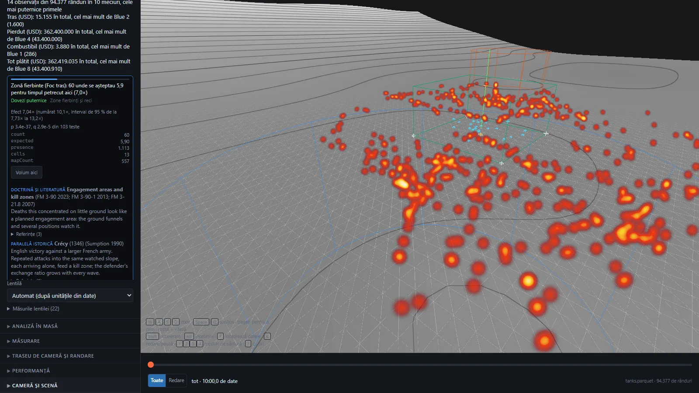

# Lentila cunoașterii

Când [Observații](insights.md) găsește ceva, această parte explică asta cu idei din istoria militară, din designul jocurilor și din analiza sportivă, și numește cartea sau lucrarea din care vin. Folosește-o ca să înveți *de ce* contează un tipar, nu doar că există.

## Încearcă {#try-it}

1. Încarcă date și deschide **Observații**, apoi apasă **Găsește observații**.
2. Dă clic pe o constatare ca s-o deschizi.
3. Citește **Doctrină și literatură** și **Paralelă istorică**; referințele complete sunt pliate dedesubt.
4. Schimbă **Lentilă** (de exemplu în *Doctrină militară*) ca să citești aceeași constatare prin alt corp de literatură.

## Cum funcționează {#how-it-works}

Panoul Observații își judecă constatările așa cum ar face-o un analist profesionist: prin doctrina militară și cercetarea operațiunilor, prin angajamentele istorice și prin literatura despre designul jocurilor, designul nivelurilor și analiza datelor. Face asta offline, dintr-o bază de cunoștințe selectată din vizualizator, și dă același material unui model extern atunci când unul scrie rezumatul.

## Ce arată panoul {#what-the-panel-shows}

- **Lentilă** alege corpul de literatură prin care sunt citite constatările: *Auto* (ales după tipurile de unități din date: aeronave, nave, vehicule terestre, infanterie), *Doctrină militară*, *Luptă aeriană*, *Navală*, *Urbană*, *Design și echilibru de joc*, *Esports*. Intrările din afara lentilei alese sunt lăsate deoparte.
- Fiecare constatare deschisă arată cea mai apropiată intrare din **doctrină și literatură** și cea mai apropiată **paralelă istorică**, cu referințele complete pliate dedesubt.
- **Măsurile lentilei** listează măsurătorile analizei operaționale calculate pe aceleași rânduri (mai jos), fiecare cu ce înseamnă și cu literatura lui.
- **Rezumatul** adaugă rânduri pentru constatările principale și măsurile lentilei: "Doctrină și literatură: ..." și "Paralelă istorică: ...", fiecare cu citări autor-an și referințele pliate sub ele.
- **Scrie cu IA** trimite cele mai relevante intrări (rezumat, lecție, constatările de care țin, referințele complete) odată cu raportul și cere modelului să le citeze după id - `{concept.lanchester-square}` - și să nu folosească alte surse.

Etichetele sunt traduse; cunoștințele în sine sunt în engleză.

## Măsurile lentilei {#lens-metrics}

Calculate în lucrătorul de observații, în aceeași trecere peste rânduri ca detectorii (`src/insights/lensMetrics.ts`). Fiecare este lăsată deoparte când datele nu o pot purta.

| Măsură | Ce măsoară | Are nevoie de |
|---|---|---|
| Potrivirea Lanchester | Pierderile fiecărei tabere pe 20 s, regresate pe puterile în viață ale ambelor tabere (Poisson, erori de cvasi-verosimilitate); exponenții pentru puterea inamicului și a proprie, testați față de legea pătratică (foc țintit) și legea liniară (foc de zonă) | timp, echipe, doborâri și morți |
| Raportul de schimb | Doborâri pe moarte, pe tabără și pe loc; partea morților de pe cel mai mortal teren, care ține 5% din timpul petrecut, față de partea pe care o dă doar șansa cu atâtea morți; Gini al morților față de timp; I-ul lui Moran al ratelor de moarte | doborâri și morți |
| Raportul local de forțe | Unitățile prietene și inamice în viață în raza de angajare a fiecărei doborâri (raza stabilită din date: de două ori distanța mediană până la cel mai apropiat inamic); partea doborârilor făcute de tabăra local superioară și surplusul ei față de ce prevăd numerele singure | timp, echipe, persoane |
| Câmpuri de tragere | Câmpurile vizuale ale celor mai aglomerate locuri de doborâre pe o suprafață 2,5D de obstrucție (geometria nivelului până la înălțimea zidului, sau solul parcurs) față de locul mediu, și corelația de rang între vedere și partea de doborâri | poziții; un nivel încărcat o face mai precisă; nu pentru aer |
| Starea energetică | Energia specifică (înălțimea plus înălțimea pe care o poate cumpăra viteza) a ucigașilor din aer și a victimelor din aer, comparată prin statistica Mann-Whitney | clase de aeronave, timp, altitudine |
| Terenul-cheie | Cât de des este fiecare loc printre cele trei locuri de doborâre cele mai aglomerate ale unui meci | mai multe meciuri |
| Sprijin reciproc (schimburi) | Morți răspunse de o doborâre a unui coechipier în raza de angajare și în 5 s | timp, echipe |
| Prima lovitură | Angajamente - doborâri grupate pe meci, pe 20 s de liniște și pe trei raze de angajare ca distanță - câștigate de tabăra care a marcat prima | timp, echipe |
| Modelul salvei | Ecuația salvei a lui Hughes, potrivită pe perioade de 20 s cu nave în contact: nave scoase din luptă per navă atacatoare, și salvate per navă apărătoare; o potrivire Lanchester doar pe nave | clase de nave, timp, echipe |
| Eficiența în luptă | Doborâri pe oră-unitate în acțiune pentru fiecare tabără și raportul celor două cele mai mari (o valoare a eficienței în luptă în sensul lui Dupuy) cu intervalul de 95%, și partea fiecărei tabere din doborâri la numere locale egale | timp, echipe |
| Raze de angajare | Distanța până la cel mai apropiat inamic la doborâri, la lansări și la prima lovitură a fiecărei vieți (de la detectare la angajare), pe fel de unitate | timp, echipe; lansări acolo unde datele le au |
| Lanțul doborârii | Secunde de la ultima lansare a ucigașului până la doborâre, și de la prima lui lovitură din luptă până la doborâre | timp; lansări sau evenimente de foc |
| Concentrare sau dispersie | Pe fiecare perioadă de 20 s, împrăștierea celor două cele mai mari tabere și partea doborârilor luate de cea mai strânsă | timp, echipe |
| Ieșiri | Pe tabără: ieșiri (decolări, sau apariții de aeronave), aterizări, aeronave pierdute și doborâri de aeronave; rata de pierdere și doborârile pe ieșire | clase de aeronave; decolări sau apariții |

Datele cu runde adaugă măsurile luptei apropiate și ale esports-ului - probabilitatea de a câștiga runda, valoarea acțiunilor, duelurile de deschidere, schimburile, cel care iese în față față de cel care ține, țintirea, focul încrucișat, utilitarele, avantajul de om, clutch-urile, pregătirile, situația după plantare, pâlniile fatale și impactul jucătorului: vezi [Luptă apropiată și runde](close-quarters.md).

Traseele și echipele adaugă măsurile comportamentului colectiv din știința mulțimilor, din mișcarea colectivă, din economia comportamentală și din psihologia militară - alinierea și rătăcirea, conducerea pe rută, benzile și urmele, aglomerarea, conducătorii și următorii, rămășițele în urmă, punctul de rupere, riscul după pierderi, serii, acordul de cumpărare și suprimarea, fiecare față de propriul lui model nul: vezi [Comportamentul colectiv](collective-behaviour.md).

Armele, momelile și clădirile nu sunt numărate ca unități. Unde rândurile armelor își numesc unitatea lansatoare (o coloană `Shooter` sau `Launcher`, cum au datele derivate din Tacview), lansarea este creditată acelei unități, potrivită după numele sau id-ul ei de obiect.

## Cum întâlnesc constatările literatura {#how-findings-meet-the-literature}

Intrările și constatările se întâlnesc printr-o **taxonomie de tipare** (`src/insights/knowledge/patterns.ts`): concentrare, superioritate locală, foc țintit și foc de zonă, puncte de strangulare, zone de ucidere, câmpuri de tragere, panta inversă, flancare, sprijin reciproc, avantaj energetic, presiune la apariție, echilibru și așa mai departe. Fiecare fel de detector și fiecare măsură a lentilei spune ce tipare arată numerele ei (`src/insights/lens.ts`); fiecare intrare de cunoștințe spune la ce tipare se referă, cu o pondere. Relevanța unei intrări pentru o constatare este suprapunerea ponderată, scalată după cât de bine se potrivește domeniul intrării (uscat, aer, mare, urban) cu datele și după puterea proprie a constatării. Motivul afișat este cifrele constatării într-o propoziție, urmate de lecția intrării.

## Catalogul {#catalogue}

Fiecare tipar, concept, metodă, caz istoric, principiu de design și studiu, cu bibliografia: vezi [Catalogul de cunoștințe](knowledge-catalogue.md).

## Pentru dezvoltatori {#for-developers}

### Adăugarea intrărilor {#adding-entries}

1. Alege fișierul după tip: `concepts.ts` și `concepts-more.ts`, `methods.ts`, `cases.ts`, `cases-land.ts`, `cases-air-sea.ts`, `cases-esports.ts`, `design.ts` (principii de design) sau `studies.ts` din `src/insights/knowledge/`.
2. Dă-i un id nou `<type>.<slug>` (niciodată unul refolosit), lentilele ei, domeniile și tiparele la care se referă, cu ponderi 0..1. Adaugă un tipar în `patterns.ts` doar când o constatare îl poate arăta, și mapează-l dintr-o constatare sau dintr-o măsură în `lens.ts`.
3. Scrie rezumatul și lecția **cu propriile cuvinte**. Citate doar din lucrări din domeniul public (`pd: true` în referință), și scurte.
4. Citează: adaugă orice lucrare nouă în `refs.ts`, cu autori, an, titlu și editură (revista cu volum și pagini); un URL sau un DOI acolo unde există o înregistrare publică.
5. Rulează `npx vitest run src/insights/lens.test.ts` (id-uri unice, tipare cunoscute, referințe care se rezolvă, citate din domeniul public, cazuri cu dată și rezultat) și `node tools/knowledge-doc.mjs` ca să reîmprospătezi [catalogul](knowledge-catalogue.md).
