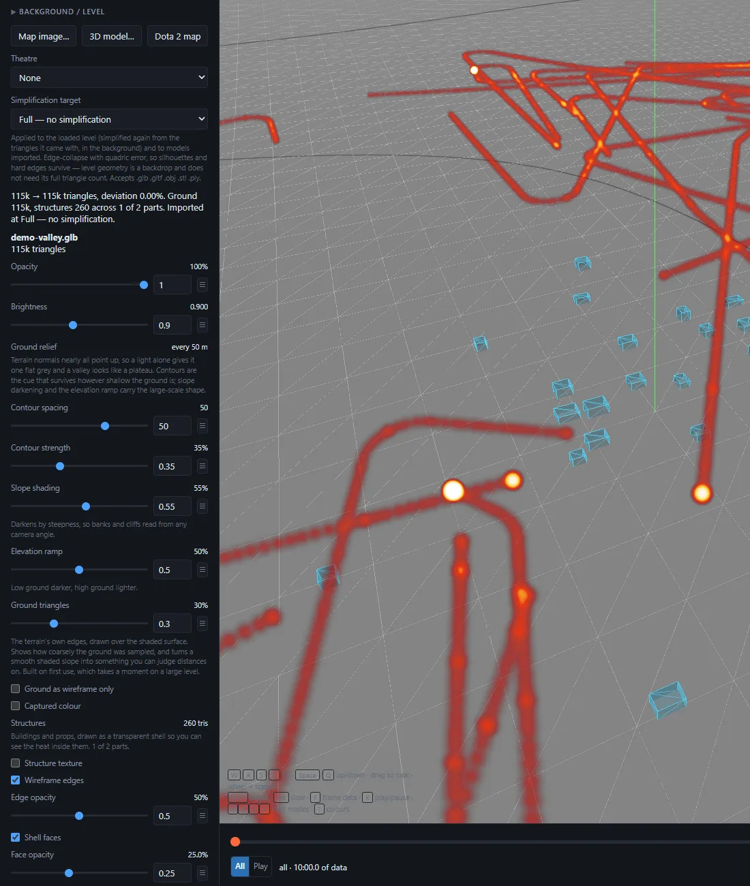

# Aspectul nivelului

Aceste comenzi schimbă cum arată un nivel 3D, ca căldura să iasă în evidență față de el și locul să rămână lizibil. Nimic de aici nu schimbă datele.

## Start rapid {#quick-start}

1. Încarcă un nivel 3D ([Niveluri 3D](model-levels.md)).
2. În **Fundal / nivel**, coboară **Luminozitate** până când căldura este cel mai luminos lucru de pe ecran.
3. Deschide **Relieful solului** și mărește **Umbrirea pantelor** sau **Intensitatea curbelor de nivel** până când poți deosebi un deal de o câmpie.
4. Deschide **Structuri**. Coboară **Opacitatea fețelor** ca să vezi în interiorul clădirilor, sau pornește **Textura structurilor** ca să le vezi pline.
5. Dacă solul are o imagine pictată pe el, încearcă **Textura solului** oprită și pornită.

Cu un [nivel 3D](model-levels.md) încărcat, panoul Fundal / nivel arată aceste comenzi. Valorile implicite sunt cele pe care le primește un nivel proaspăt importat ([`modelLevelFrom`](https://github.com/Holdi601/3DHeat/blob/main/src/ui/panels/LevelPanel.tsx), [`level.ts`](https://github.com/Holdi601/3DHeat/blob/main/src/render/level.ts)). Schimbarea lor doar redesenează scena; acumularea căldurii este păstrată.

## Tot nivelul {#the-whole-level}

| Comandă | Implicit | Interval | Înțeles |
|---|---|---|---|
| **Opacitate** | 100% | 0-100% | Sub 100%, nivelul este amestecat și nu scrie adâncime, deci nu mai [ocluzionează](depth-and-culling.md) căldura. |
| **Luminozitate** | 0,9 | 0-2 (cursor 64) | |

Nivelul este desenat desaturat - sol gri, o coajă colorată ușor - astfel încât căldura să fie singurul lucru saturat de pe ecran. Spre deosebire de o [imagine de hartă](map-images.md), un nivel 3D nu are cursor de Desaturare.

## Relieful solului {#ground-relief}

De departe, un deal și o câmpie arată la fel, gri, deci vizualizatorul adaugă trei indicii. Fiecare răspunde unei alte probleme:

| Comandă | Implicit | Înțeles |
|---|---|---|
| **Echidistanța curbelor de nivel** | din intervalul de înălțime al solului | Înălțimea dintre liniile curbelor de nivel, logaritmic de la 1/4000 la 1/2 din intervalul de înălțime al nivelului; capătul de jos al cursei este *oprit*. Implicitul este 1/40 din intervalul de înălțime al solului, rotunjit la un pas 1/2/5 - liniile de 10 m se potrivesc unei coaste și nu folosesc la fundul unei cariere. La fiecare a 5-a linie este desenată mai puternic. Curbele de nivel sunt desenate în spațiul ecranului, deci rămân de un pixel la orice zoom, și sunt singurul indiciu care supraviețuiește unui sol prea puțin înclinat ca să fie umbrit deloc. |
| **Intensitatea curbelor de nivel** | 35% | 0-100% |
| **Umbrirea pantelor** | 55% | Întunecă după înclinare, astfel încât malurile și stâncile se citesc din orice unghi al camerei - spre deosebire de o lumină, care aplatizează ori de câte ori te uiți spre ea. |
| **Rampa de altitudine** | 50% | Terenul jos mai întunecat, cel înalt mai luminos, de-a lungul intervalului de înălțime al solului: forma la scară mare. |

Antetul secțiunii arată starea curbelor de nivel: *la fiecare N m*, echidistanța curbelor, sau *fără curbe de nivel* când echidistanța este oprită.

## Suprafața solului {#ground-surface}

| Comandă | Implicit | Afișată când | Înțeles |
|---|---|---|---|
| **Apă** | pornit | nivelul are apă | Lacuri, râuri și mare, desenate plat, într-un gri-albăstrui palid: niciunul dintre indiciile de teren nu se aplică unei suprafețe care este plană prin definiție. |
| **Opacitatea apei** | 60% | Apa este pornită | Linia de coastă și solul de sub ape mici se văd prin apa translucidă. |
| **Triunghiurile solului** | 30% (0 pentru un nivel cu texturi) | mereu | Marginile proprii ale terenului, desenate peste suprafața umbrită, care se estompează între 6% și 25% din lățimea nivelului față de cameră. Arată cât de grosier a fost eșantionat solul și oferă unei pante ceva după care să judece distanța. Se construiește la prima utilizare, ceea ce durează puțin pe un nivel mare. |
| **Solul doar ca wireframe** | oprit | mereu | Înlocuiește suprafața terenului cu marginile sale. Este complet schematic - renunță și la umbrire, la curbele de nivel și la ocluzie, deci *Triunghiurile solului* este de obicei alegerea mai bună. |
| **Textura solului** | pornit | nivelul are texturi | Desenează solul în texturile pe care le poartă fișierul (asfalt, bordură, iarbă). Iluminarea mesei se aplică ușor deasupra, pentru că textura are deja propriul relief fin. **Luminozitatea** este modul de a o potoli sub căldură; Desaturarea aparține imaginilor de hartă. |
| **Culoare capturată** | oprit | nivelul are culori pe vârfuri | Umbrește solul cu culoarea pe care a capturat-o o scanare, în loc de gri - un drum reconstruit altfel nu s-ar deosebi de bordură. Exporturile din motoare nu au niciuna; când lipsește, panoul spune *Acest nivel nu are culoare.* |

## Structuri {#structures}

Antetul **Structuri** arată numărul de triunghiuri ale structurilor; indiciul de mai jos spune cum sunt desenate (*desenate pline, în propriile lor texturi* sau *desenate ca o coajă transparentă, ca să vezi căldura din interiorul lor*) și câte părți sunt structuri.

| Comandă | Implicit | Înțeles |
|---|---|---|
| **Textura structurilor** | pornit când structurile au texturi | Desenează structurile pline, în propriile lor texturi. Pornirea setează opacitatea fețelor la 100% și oprește muchiile; oprirea revine la coaja colorată, transparentă, la 25%. O structură cu textură este luminată din partea pe care o vede camera, pentru că un panou are două fețe spate în spate, iar care câștigă testul de adâncime depinde de rotunjire. |
| **Muchii wireframe** | pornit; oprit peste 300.000 de triunghiuri de structuri sau când au texturi | Muchiile structurilor fără duplicate, câte o linie pentru fiecare muchie. |
| **Opacitatea muchiilor** | 50% | |
| **Fețele cojii** | pornit | O suprafață slabă cu o margine Fresnel strălucitoare, astfel încât o clădire se citește ca un volum, nu ca o cușcă sau ca o ceață. |
| **Opacitatea fețelor** | 25% (35% peste 300.000 de triunghiuri de structuri, 100% cu texturi) | 0-60% pe cursă, până la 100% cu mânerul. Ține-o scăzută: structurile pline ascund datele din interiorul lor. |
| **Muchii ascuțite** | pornit (oprit când au texturi) | Umbrește fiecare triunghi după propria normală, calculată în shaderul de fragment din derivatele din spațiul ecranului. Nivelurile exportate sunt sudate și au normale medii, ceea ce rotunjește fiecare colț de cutie în „folie topită”; separarea fiecărui vârf ca să se repare ar înmulți bufferul de vârfuri. Oprește-o pentru un nivel la care suprafețele curbe contează mai mult decât colțurile. |
| **Nuanța structurilor** | Cyan | Un selector de culori și prestabilitele **Cyan**, **Chihlimbar**, **Violet**, **Alb**. |
| **Arată clasificarea părților (N)** | | Fiecare parte, clasa ei și motivul; vezi [Niveluri 3D](model-levels.md#ground-structures-and-water). |

## Tăierea nivelului {#cutting-the-level}

[Felia](slice.md) și, cu *Taie și nivelul*, [eliminarea după distanță](depth-and-culling.md#distance-culling) taie solul, structurile și apa în aceleași planuri ca și căldura.
