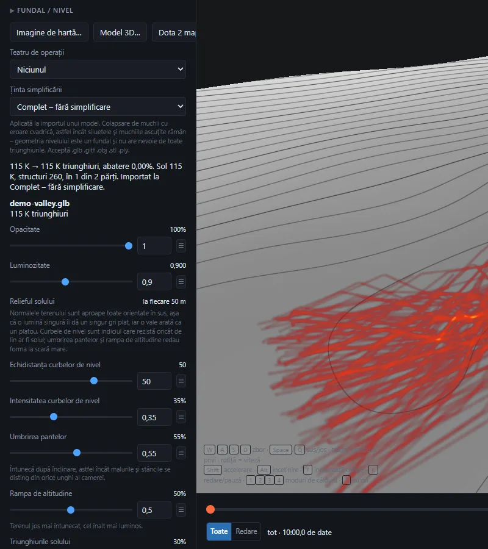

# Niveluri și geometria fundalului

Un nivel este locul 3D în care s-a petrecut jocul - o hartă, un oraș, o pistă. Pune unul în spatele datelor și poți vedea *unde* este căldura. Panoul **Fundal / nivel** (vezi [Glosarul](glossary.md) pentru „nivel”) îți oferă trei feluri de context:

- o **imagine de hartă**, georeferențiată prin două ancore - vezi [Imagini de hartă](map-images.md);
- un **nivel 3D** - `.glb`, `.gltf`, `.obj`, `.stl` sau `.ply` - împărțit în sol, structuri și apă și simplificat la import - vezi [Niveluri 3D](model-levels.md) și [Aspectul nivelului](level-appearance.md);
- un **fundal al lumii** - pentru o înregistrare care spune unde se află pe Pământ (un fișier Tacview ACMI), terenul real, drumurile, apa, aerodromurile și clădirile, descărcate din date deschise - vezi [Fundalul lumii](world-backdrop.md).

Fără nimic încărcat, scena este întunecată, cu o grilă și axe colorate (**Grilă** și **Axe** în [Cameră și scenă](camera.md)), iar panoul spune *Nimic încărcat - scena arată o grilă și axe. Adaugă o imagine de hartă sau o plasă de nivel ca să dai căldurii context.*

Nivelul este comun tuturor celor trei file: un traseu încărcat în fila Analiză de cursă este același nivel pe care îl arată harta termică.

## Pune un nivel în spatele datelor {#put-a-level-behind-your-data}

1. Încarcă întâi datele ([Încărcarea datelor](getting-data-in.md)), ca nivelul să fie potrivit cu ele.
2. Deschide **Fundal / nivel** în bara laterală.
3. Apasă **Imagine de hartă…** pentru o imagine sau **Model 3D…** pentru un nivel 3D, și alege fișierul. Pentru o înregistrare din lumea reală, folosește în schimb **Fundal din lumea reală** sau **Teatru de operații**.
4. Așteaptă ca linia de progres să se termine. Un model mare este întâi simplificat (vezi **Ținta simplificării** mai jos).
5. Apasă **F** în vedere ca să încadrezi tot. Folosește **Opacitate** și **Luminozitate** până când căldura iese în evidență față de nivel.
6. Apasă **Salvează în bibliotecă** dacă vei folosi nivelul din nou ([Biblioteca de niveluri](level-library.md)).

## Ce face un nivel pentru căldură {#what-a-level-does-for-the-heat}

- **Ascunde**: punctele de date din spatele lui sunt estompate pe suprafață, iar cele din spatele terenului sunt ascunse ([Adâncime și eliminarea fețelor](depth-and-culling.md)). Fără nivel, nu există ascundere.
- Este **tăiat** de [Secțiune](slice.md) și, cu *Taie și nivelul*, de [eliminarea după distanță](depth-and-culling.md#distance-culling), împreună cu căldura.
- Este singurul lucru pe care îl estompează [adâncimea de câmp](camera.md#depth-of-field), pe lângă grilă și cutii.
- Un nivel 3D **lărgește planul îndepărtat al camerei** atunci când este mai mare decât datele: planele apropiat și îndepărtat se calibrează după setul de date, iar o hartă exportată de câțiva kilometri lățime ar sta altfel în întregime în spatele planului îndepărtat și ar lăsa o vedere goală. Planul îndepărtat devine 3 × întinderea orizontală a nivelului, când aceasta este mai mare; planul apropiat se mută odată cu el (cel puțin îndepărtat / 100.000), ca să păstreze precizia adâncimii de care depinde ascunderea, iar viteza de zbor crește la cel puțin întindere / 12. Se lărgește doar, niciodată nu se îngustează.

## Panoul, de sus în jos {#the-panel-top-to-bottom}

| Parte | Detalii |
|---|---|
| **Imagine de hartă…**, **Model 3D…** | Încarcă unul; înlocuiește nivelul curent. |
| **Fundal din lumea reală**, **Uită dalele de hartă** | Doar pentru un set de date cu referință geografică: construiește locul real de sub el ca nivel, sau șterge plăcile descărcate. [Fundalul lumii](world-backdrop.md) |
| **Ținta simplificării** | Bugetul de triunghiuri pentru următorul import de model: *Completă - fără simplificare* (implicit), *Mare - 8M*, *Medie - 3M*, *Mică - 800k*, *Siluetă - 100k*. [Niveluri 3D](model-levels.md#simplification) |
| Progres și **Anulează** | Cât timp se decodează sau se importă. |
| Notă de import | Triunghiurile înainte și după, împărțirea în sol / structuri / apă, nivelul de detaliu folosit. |
| Nume și mărime | `lățime×înălțime px · x × z m/px` pentru o imagine, `N triunghiuri (din M)` pentru un model. |
| **Opacitate**, **Luminozitate** | Pentru ambele tipuri. |
| Comenzi de imagine | **Desaturare**, **Inversează nord/sud**, **Plasare** (două ancore), **Potrivește la limitele datelor**, **Altitudine**. [Imagini de hartă](map-images.md) |
| Comenzi de model | Relief al solului, apă, triunghiuri ale solului, sârmă, textură, culoare capturată, structuri, clasificarea părților. [Aspectul nivelului](level-appearance.md) |
| **Salvează în bibliotecă**, **Elimină** | [Biblioteca de niveluri](level-library.md); Elimină descarcă nivelul. |
| **Bibliotecă** | Niveluri stocate în acest browser. [Biblioteca de niveluri](level-library.md) |

## Pagini din această secțiune {#pages-in-this-section}

- [Imagini de hartă](map-images.md)
- [Niveluri 3D](model-levels.md) - formate, părți, clasificare, simplificare, texturi
- [Aspectul nivelului](level-appearance.md) - fiecare comandă pentru un nivel 3D
- [Biblioteca de niveluri](level-library.md)
- [Fundalul lumii](world-backdrop.md) - lumea reală sub o înregistrare, din date deschise

Cum se scot niveluri din jocuri și din motoare ține de instrumentele separate de export (vezi [README-ul](https://github.com/Holdi601/3DHeat/blob/main/README.md) depozitului); formatul în care scriu este rezumat în [Niveluri 3D](model-levels.md#the-exporter-contract).
