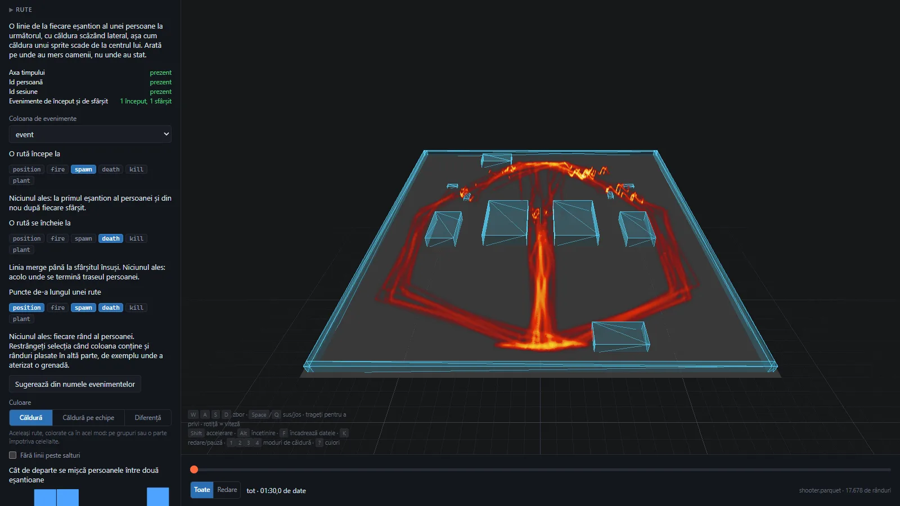

# Căldură pe linii

Căldura arată unde au stat oamenii. Liniile arată drumurile pe care le-au parcurs.

**Linii** (tasta 4) este căldura pe linii: o linie de la fiecare eșantion al unei [persoane](glossary.md) până la următorul, împrăștiată cu aceeași cădere de intensitate pe care o are un [sprite](glossary.md) - de-a latul liniei, în loc de în jurul unui punct. Arată pe unde *au trecut* oamenii, nu unde au stat: un coridor parcurs o singură dată se vede la fel de bine ca o cameră în care s-a stat mult, iar eșantioanele rare ale unui jucător rapid se unesc într-o rută continuă, în loc de o urmă punctată. Are nevoie de o coloană de persoană și de o coloană de timp.

## Cum se folosește {#how-to-use-it}

1. Apasă `4` (sau alege **Linii** în bara de moduri).
2. Deschide **Rute** și verifică lista verde: axa timpului și id-ul persoanei trebuie să fie prezente.
3. Apasă **Sugerează din numele evenimentelor** ca să completezi de unde încep și unde se termină rutele.
4. Citește rândul de statistici: "N rute, M dintre ele ajung la un sfârșit".
5. Dacă liniile sar peste hartă, ajustează **Cel mai lung pas** (vezi [Limita de salt](#the-jump-limit)).

O linie are sens doar între un început și un sfârșit, deci panoul **Rute** spune ce mărginește o rută. Tot ce vine de la [Regulile unei rute](#the-rules-of-a-route) încolo este detaliu pe care îl poți sări.

## Panoul Rute {#the-routes-panel}

Apare deasupra panourilor de căldură, în modul Linii.

### Ce conțin datele {#what-the-data-has}

O listă de verificare, verde când există, chihlimbarie când lipsește:

| Rând | Stări |
|---|---|
| **Axa timpului** | *prezentă* / *lipsește - necesară* |
| **Id persoană** | *prezent* / *lipsește - necesar* |
| **Id sesiune** | *prezent* / *niciunul - toate rândurile sunt o singură sesiune* |
| **Evenimente de început și de sfârșit** | *N începuturi, M sfârșituri* / *niciunul ales - urme întregi* (verde doar cu o coloană de evenimente și cel puțin un început și un sfârșit) |

### Comenzi {#controls}

| Comandă | Înseamnă |
|---|---|
| **Coloana de evenimente** | O coloană de categorie ale cărei valori sunt evenimente (apariție, moarte, poziție, ...). *Niciuna - urme întregi*: urma fiecărei persoane din fiecare sesiune este o rută, întreruptă acolo unde urma are un gol. Sunt oferite doar coloanele păstrate pentru filtrare la încărcare. |
| **O rută începe la** | Valorile de eveniment care încep o rută (apariție, reapariție, lansare). Niciuna aleasă: o rută începe la primul eșantion al unei persoane și din nou după fiecare sfârșit. |
| **O rută se încheie la** | Valorile de eveniment care încheie o rută (moarte, extragere, teleportare). Linia merge până la rândul de sfârșit în sine. Niciuna aleasă: o rută se încheie acolo unde se termină urma persoanei. |
| **Puncte de-a lungul unei rute** | Valorile de eveniment ale căror rânduri se află de-a lungul rutei. Niciuna aleasă: fiecare rând al persoanei. Restrânge-o când coloana conține și rânduri plasate în alt loc, cum ar fi unde a aterizat o grenadă. |
| **Sugerează din numele evenimentelor** | Completează cele trei liste după numele valorilor (mai jos). |
| **Culoare** | *Căldură*, *Căldură pe echipe* sau *Diferență*. Aceleași rute în colorarea acelui mod: fiecare grup în nuanța lui, sau o tabără contra alteia, cu lista de grupuri, împărțirea și scările funcționând ca în acele moduri. Implicit *Căldură*. Căldura pe echipe și diferența au nevoie de o coloană de grup. |
| **Fără linii peste salturi** / **Cel mai lung pas** | Eșantionul următor al unei persoane mai departe decât atât este o reapariție, o teleportare sau o cădere, nu un loc unde a mers, deci nicio linie nu unește cele două. Completat la încărcare când datele arată un gol clar (mai jos), și oprit când nu arată. Funcționează cu sau fără o coloană de evenimente. |
| Rândul de statistici | `N rute, M dintre ele ajung la un sfârșit, K segmente`, actualizat de câteva ori pe secundă. |

Fiecare listă este un rând de cipuri-comutatoare, unul pentru fiecare valoare, cele mai frecvente primele; trecând cu mouse-ul peste un cip se arată numărul lui de rânduri. Sunt oferite cel mult 120 de valori (*încă N valori nearătate*).

Alegerea altei coloane de evenimente aplică sugestia când sugestia alege aceeași coloană, și începe cu liste goale în caz contrar.

### Sugestia {#the-suggestion}

La fiecare încărcare, și la **Sugerează din numele evenimentelor** ([`suggestLineSettings`](https://github.com/Holdi601/3DHeat/blob/main/src/data/lines.ts)):

- **Coloana de evenimente:** prima coloană de categorie păstrată numită `event`, `eventname` sau `eventtype`; altfel `kind`, `type` sau `action`; altfel orice care conține *event*, *kind*, *action* sau *type*.
- **Începuturi:** valorile care conțin *spawn, deploy, join, enter, start, begin, respawn, revive, land/landed/landing, drop* - cu excepția cazului în care se potrivesc și cu un cuvânt de sfârșit.
- **Sfârșituri:** valorile care conțin *death, died, dead, kill/killed, eliminat…, extract, evac, teleport, leave, left, disconnect, quit, exit, end, finish, downed* - cu excepția valorilor `kill` și `kills` (o doborâre este ceva ce face ucigașul, nu sfârșitul rutei lui).
- **Puncte:** valorile care sunt exact *position, location, player location, move, movement, tick, sample* sau *pos*; când se găsește vreuna, începuturile și sfârșiturile sunt adăugate și la puncte. Când nu se găsește niciuna, punctele rămân goale (fiecare rând).

### Limita de salt {#the-jump-limit}

Acolo unde oamenii sar, lungimile pașilor cad în două grupuri cu aproape nimic între ele: ce acoperă o persoană între două eșantioane și lățimea hărții. La încărcare ([`suggestMaxJump`](https://github.com/Holdi601/3DHeat/blob/main/src/data/lines.ts)), pașii sunt numărați pe dublare a pătratului lungimii lor, până la 16 milioane, iar limita intră în mijlocul primului interval de deasupra medianei care are cel puțin o dublare de lungime, care are sub 0,02% din pași pe interval și care are pași peste el. Fără un astfel de interval nu se taie nimic, deoarece nu s-ar putea deosebi un salt de o mașină rapidă; activarea limitei manual începe atunci de la o zecime din diagonala datelor.

Graficul de deasupra limitei arată cât de lungi sunt de fapt pașii, cu o linie la limită: barele din dreapta ei nu sunt desenate. Ambele axe sunt logaritmice, pentru că sariturile pot fi o sutime din pași și de o mie de ori mai lungi. Treci cu mouse-ul peste o bară ca să-i vezi intervalul și partea; apasă pe grafic ca să pui limita acolo. Sub el, partea pașilor peste limită.

## Regulile unei rute {#the-rules-of-a-route}

Rândurile sunt parcurse în ordinea timpului, pe persoană ([`buildLines`](https://github.com/Holdi601/3DHeat/blob/main/src/data/lines.ts)):

1. Rândurile unui [nume comun](sessions-persons-groups.md#names-worn-by-several-things-at-once) sunt sărite complet.
2. Cu puncte alese, un rând care nu este nici început, nici sfârșit, nici punct, este sărit.
3. Rândurile sunt urmărite pe persoană și pe sesiune, deci o persoană ale cărei sesiuni se intercalează în ordinea timpului are câte o rută în fiecare. O rută se închide când rândul anterior nu avea succesor (durata lui de viață, [viața](sessions-persons-groups.md#person), este "niciuna") - o rută nu trece niciodată peste o limită de sesiune sau peste un gol pe care încărcarea a decis că nu are un eșantion următor. Pe ce rută este un rând se calculează o singură dată și se păstrează, 4 octeți pe rând, deci schimbarea celui mai lung pas nu repetă acea parte.
4. Un rând de **început** închide orice rută deschisă și deschide una nouă acolo.
5. Cu începuturi alese, un rând din afara unei rute este ignorat. Fără începuturi, orice rând care nu este sfârșit din afara unei rute deschide una.
6. Orice alt rând dintr-o rută adaugă un **segment** de la rândul anterior al rutei până la acesta.
7. Un rând de **sfârșit** care prelungește o rută o închide după segmentul ei; acea rută contează ca *ajungând la un sfârșit*.
8. Un pas mai lung decât **Cel mai lung pas** închide ruta acolo unde era, iar o rută nouă începe la celălalt capăt, cu excepția cazului în care acel rând este un sfârșit. Nicio linie nu este desenată peste el, iar rândul de statistici îl numără.

Fiecare segment este stocat pe rândul său de *sfârșit*, deci segmentele rămân în ordinea timpului, iar [cronologia](timeline.md), selectorul, [filtrele](filters.md), vizibilitatea grupurilor și semnul diferenței funcționează cu ele ca și cu punctele. Un filtru se aplică deci rândului în care se termină un segment.

## Redare {#playback}

În modul **Toate** fiecare rută este desenată întreagă. În modul **Redare** fiecare persoană este un punct care se mișcă între eșantioanele ei, desenând ruta în urma ei:

- un segment care începe după capul de redare nu este desenat;
- segmentul în care se află persoana la mijloc este desenat până la poziția ei interpolată, cu un capăt rotund la vârf;
- căldura se estompează pe **coadă**: cu istoricul *Cumulativ* coada este nelimitată și tot drumul de până acum rămâne; cu *Fereastră* se estompează până la nimic pe *Intervalul* (implicit 30 s). Cu *Durata de viață* coada este tot *Intervalul*, iar în modul Linii cronologia arată caseta *Intervalul* și pentru acest istoric (în locul *Durata de rezervă* și *Estompare*, pe care căldura pe linii nu le folosește).

În timp ce redă, fiecare cadru este desenat întreg, în loc să se acumuleze, pentru că vârfurile se mișcă la fiecare cadru, iar o medie mobilă ar întinde fiecare într-o dâră.

## Pentru dezvoltatori {#for-developers}

### Memorie {#memory}

Rutele sunt construite pe firul principal când se intră în modul Linii (sau când se schimbă setările rutei) și eliberate când se iese din el: 5 octeți pe rând în memorie și 8 octeți pe rând pe GPU (poziția de start a fiecărui segment, cuantizată pe 16 biți pe axă în interiorul cutiei de încadrare a datelor, și indicatorii lui).

### Cum se desenează o linie {#how-a-line-is-drawn}

Ambele backend-uri desenează fiecare segment din rândul lui de sfârșit ca **18 vârfuri** ([`lineHeatVs`](https://github.com/Holdi601/3DHeat/blob/main/src/render/webgl2/shaders.ts) și gemenul lui WGSL):

- Semilățimea la fiecare capăt este [raza sprite-ului](sprite-shape.md#sprite-radius) la distanța acelui capăt, cu limitele de pixeli aplicate. O linie mai îngustă de 2,5 px este desenată de 2,5 px lățime, cu căldura ei scalată în jos ca să se potrivească, așa că liniile subțiri nu dispar și nu se luminează.
- Căderea de intensitate **de-a latul** liniei urmează aceeași scară ca un sprite - căderea sau curba, intensitatea din centru și de la margine.
- Capetele rotunde sunt desenate **doar** acolo unde o rută începe sau se termină, ca îmbinările dintre segmentele consecutive să nu se transforme într-un șir de mărgele.
- Geometria este construită în spațiul ecranului și interpolată liniar acolo, astfel că decăderea rămâne centrată pe linie oricum ar intra ea în adâncime. Un segment care traversează planul apropiat este tăiat acolo, nu aruncat.

Căldura pe puncte și căldura pe linii depun cantități foarte diferite de căldură pe rând, așa că saturația este măsurată din nou când treci de la una la alta ([Culoare și expunere](colour-and-exposure.md#auto-exposure)).
