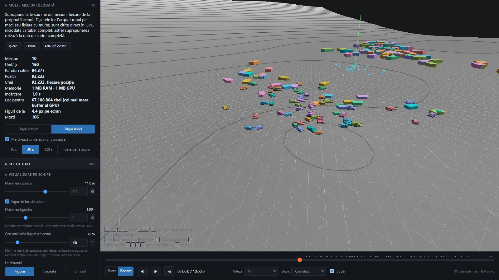

# Multe meciuri deodată

**Multe meciuri deodată** redă multe meciuri una peste alta, astfel încât vezi unde merg de obicei jucătorii din fiecare meci. Folosește-l ca să compari sute sau mii de meciuri într-o singură imagine.

Fiecare meci pornește de la propriul început, iar unitățile lui se mișcă ca figuri. Fișierele merg direct în placa grafică și nu se construiește niciun tabel complet, deci redarea merge fluent acolo unde o încărcare normală ar rămâne fără memorie.

## Cum se folosește {#how-to-use-it}

1. Deschide **Multe meciuri deodată** în bara laterală a Căldurii.
2. Apasă **Fișiere…** (alege multe fișiere), **Dosar…** (un dosar și subdosarele lui) sau **Adaugă dosar…** (adaugă la ce este deja încărcat).
3. Vizualizatorul trece la suprapunerea de figuri și pornește de la început. Apasă **Redare**.

Fiecare fișier este un meci (sau conține mai multe). Fișierele Parquet și containerele [`.3dheat`](container.md) funcționează. Un fișier are nevoie de o coloană de poziție, una de timp și una de unitate; coloanele de nume, tip și parte sunt păstrate. Celelalte fișiere și fișierele auxiliare ale convertoarelor (zbor, mesaje, evenimente, chat, obiective) sunt sărite. Pentru un tabel obișnuit, vezi [Cum aduci date](getting-data-in.md).

## Setări {#settings}

| Setare | Ce face |
|---|---|
| **După echipă** / **După meci** | Colorează după parte, sau o culoare pentru fiecare meci. |
| **Marchează unde au murit unitățile** | Un semn acolo unde a murit fiecare unitate, timp de 10 s, 30 s, 120 s sau toate până acum. |

Panoul arată câte meciuri, unități, rânduri și poziții au fost citite, memoria folosită și timpul de încărcare. *Loc pentru* este câte poziții în plus ar mai putea primi placa grafică. *Figuri de la* este mărimea de pe ecran sub care o unitate este desenată ca o săgeată mică în loc de figura ei.

Aspectul figurilor folosește aceleași comenzi ca [redarea meciului](match-replay.md#figures): **Mărimea figurilor**, **Cea mai mică figură pe ecran** și **La distanță**.

## Sfaturi {#tips}

- Când totul nu ar încăpea în memorie, pozițiile sunt rărite (se păstrează doar o poziție la câțiva metri) iar panoul spune asta.
- Modurile de căldură funcționează și pe datele suprapunerii.
- Pentru statistici pe mii de meciuri fără a le desena, vezi [Analiza de masă](mass-analysis.md).
