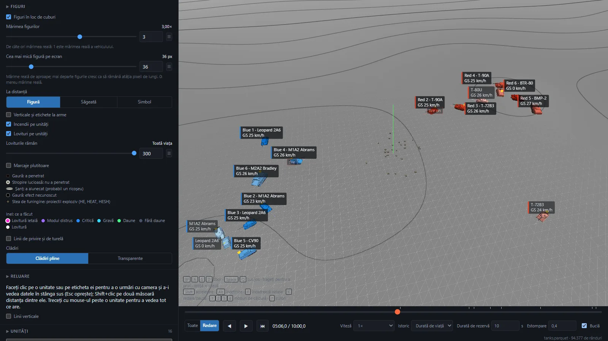
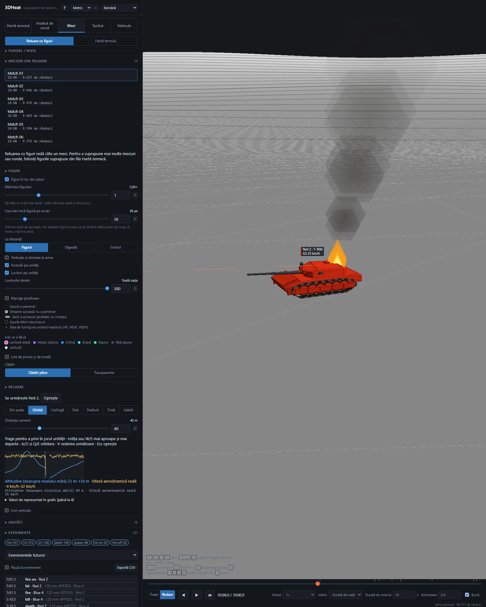
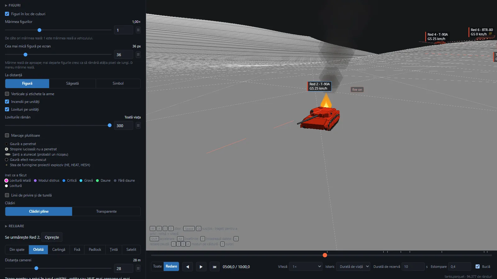
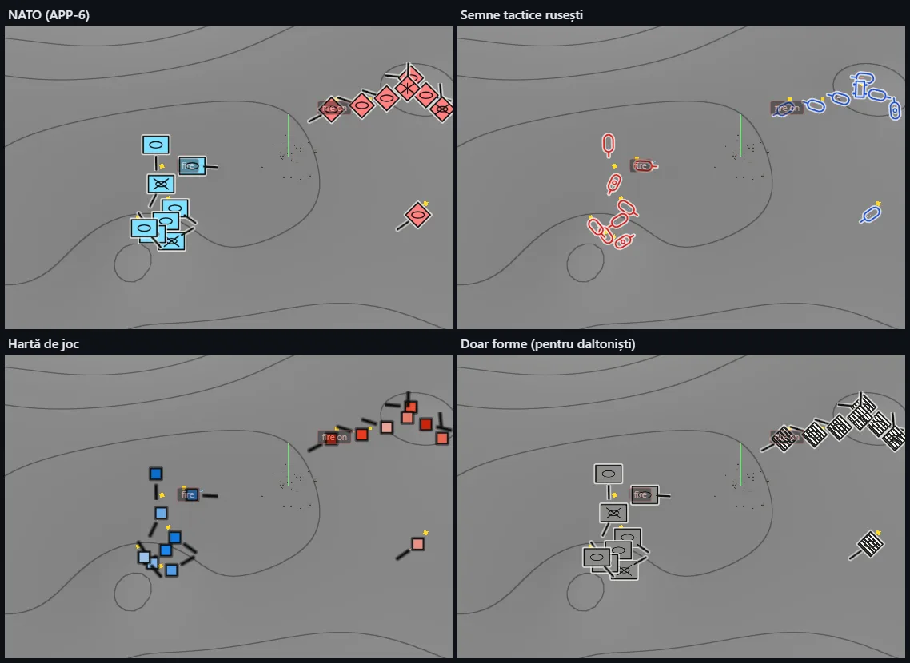
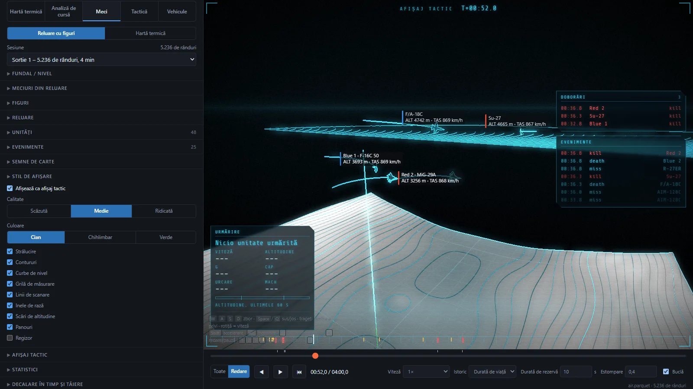
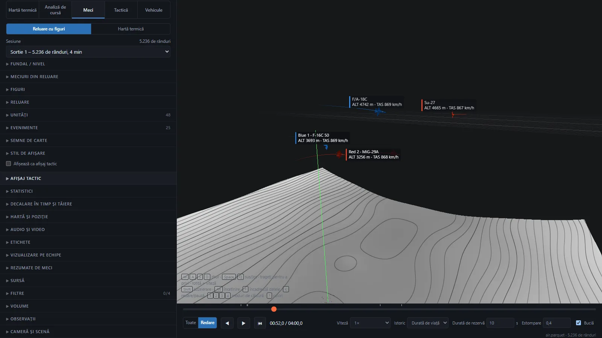

# Reluarea meciului

Reluarea este un film al meciului în care fiecare jucător este desenat ca lucrul pe care l-a condus. Folosește-o ca să urmărești din nou o luptă, să urmezi o unitate și să vezi cine l-a lovit pe cine.

Trageri, lovituri, incendii și epave sunt desenate pe unități și pe obiectivele din nivel. Camerele, etichetele și un afișaj tactic te ajută să citești lupta. Cunoști Tacview? [Paritatea cu Tacview](tacview-parity.md) arată unde se află fiecare dintre instrumentele lui.

## Pornește o reluare {#start-a-replay}

1. Încarcă o înregistrare cu **Sursă → Fișiere…** sau trăgând-o în panoul Sursă (orice tabel cu o coloană **persoană** și o coloană **timp**, un fișier Tacview, o reluare convertită, un meci [`.3dheat`](container.md)). Vezi [Încărcarea datelor](getting-data-in.md).
2. Deschide fila **Meci** și alege **Reluare cu figuri**, sau alege **Figuri suprapuse** din bara de moduri a filei Căldură.
3. Sub **Meciuri din reluare**, alege un meci, toate deodată sau mai multe.
4. Apasă **Redare** pe cronologie (sau `K`). Trage cronologia ca să sari într-un alt moment.

Figurile înlocuiesc cuburile pentru fiecare unitate al cărei nume sau tip este cunoscut (vezi [Figuri](figures.md)). Datele fără coloană de nume sau de tip sunt desenate ca soldați.

## Figuri {#figures}

| Setare (secțiunea **Figuri**) | Implicit | Ce face |
|---|---|---|
| **Figuri în loc de cuburi** | pornit | Oprit desenează cuburi simple. |
| **Mărimea figurilor** (de câte ori mărimea reală) | 1 | 1 este mărimea reală; de la 0,25 la 20 de ori (scară logaritmică). Mai mare ajută de la distanță. |
| **Cea mai mică figură pe ecran** | 36 px | Figurile aflate departe cresc ca să rămână atât de lungi, de la 0 la 200 px; 0 păstrează mărimea reală. |
| **La distanță**: Figură, Săgeată, Simbol | Figură | Ce devine o unitate îndepărtată. |
| **Simboluri** | NATO (APP-6) | NATO (APP-6), semne tactice rusești, pictograme **Hartă de joc**, sau **Doar forme (pentru daltoniști)**. |
| **Mărimea simbolului**, **Partea mea**, **Ostil / Neutru**, **Liniuțe de direcție** | 28 px (12 până la 64), automat, ostil, pornit | Cum arată simbolurile și care parte este prietenă. |
| **Linii verticale** | pornit | O linie de la fiecare unitate direct în jos, până la sol, ca înălțimile să se citească în 3D. |
| **Verticale și etichete la arme** | oprit | Linii până la sol și etichete pentru rachete și bombe. |
| **Incendii pe unități** | pornit | Flăcări din momentul în care o unitate ia foc până când este stinsă. |
| **Lovituri pe unități** | pornit | Marcaje unde au lovit gloanțele (mai jos). **Loviturile rămân**: de la 1 la 300 de secunde, sau **Toată viața**. **Marcaje plutitoare**: marcaje desenate deasupra suprafeței. |
| **Linii de privire și de turelă** | oprit | Punctate: unde se uită jucătorul; pline: unde este îndreptat tunul. |
| **Clădiri** | pline | Clădiri pline sau transparente, când nivelul le desenează. |

### Simboluri de la distanță {#symbols-at-a-distance}

Când o unitate ar fi mai mică decât **Cea mai mică figură pe ecran**, ea poate deveni un simbol care rămâne lizibil. Forma spune tipul (de exemplu o cutie rotunjită cu o urmă de șenile pentru blindate); culoarea spune partea. Deschide meniul **Simboluri** ca să schimbi stilul.

### Marcaje de lovituri, epave și incendii {#hit-marks-wrecks-and-fires}

- **Marcajele de lovituri** stau pe suprafața pe care a lovit proiectilul, la scara figurii. Aspectul lor arată ce s-a întâmplat: o gaură (a trecut), o stropire strălucitoare (nu a trecut), o zgârietură (a ricoșat), o stea de funingine (proiectil exploziv). Un inel colorat spune ce a făcut: lovitură fatală, modul distrus, critic, grav, daune, fără daune, lovitură. Treci cu mouse-ul peste un marcaj ca să vezi numele proiectilului.
- O unitate distrusă este desenată **carbonizată**, ca o epavă, din momentul morții până când reapare sau este scoasă; simbolul ei este tăiat.
- **Incendiile** ard pe o unitate din momentul în care ia foc până când este stinsă.
- **Turelele** se întorc spre locul unde datele spun că este îndreptat tunul (sau, fără aceste date, spre locul unde se uită jucătorul).

### Arme, momeli și trasoare {#weapons-decoys-and-tracers}

Cu **Arme, trageri și lovituri** pornit (secțiunea Vizualizatorul echipei): rachetele, bombele și torpilele zboară ca figuri proprii, cu o urmă de fum; gloanțele și obuzele sunt trasoare; impacturile și exploziile clipesc. Un trasor desenat **punctat** a fost dedus dintr-o lovitură, pentru că datele nu aveau tragerea. Fleri și chaff sunt desenați ca momeli; sunt ascunse din lista de unități, dacă nu este bifat *Momeli și obuze*.

## Camere {#cameras}

Dă clic pe o unitate sau pe eticheta ei ca s-o **urmărești**; secțiunea **Reluare** oferă **Din spate**, **Orbită**, **Carlingă** (cu afișaj cu proiecție frontală, `H`), **Fixă**, **Padlock**, **Țintă** și **Satelit**. `V` le parcurge, iar **Distanța camerei** stabilește cât de departe este. Esc oprește.

- **Vedere cu două unități**: alege o **Țintă** (sau dă Ctrl/Alt-clic pe o unitate) ca să te uiți la ea din cea urmărită; **Schimbă** le inversează.
- **Măsură**: dă Shift-clic pe două unități ca să vezi direcția, distanța și diferența de înălțime dintre ele.
- **Hartă 2D** (`M`): vedere de colț sau întreagă, cu urme și nume.
- **Semne de carte** (`B`): salvează momentul și camera; uciderile, morțile și semnele proprii ale înregistrării apar și ele în listă.
- **Evenimente**: fiecare eveniment, în ordinea timpului; un clic sare acolo. `Page Up` / `Page Down` sar între evenimente; **Pauză la eveniment** se oprește la fiecare.

## Afișaj tactic {#tactical-display}

Secțiunea **Afișaj tactic** desenează, pentru nicio unitate, pentru cele selectate, pentru toate sau pentru un singur tip (aeronave, terestre, nave, arme): vectori de viteză și traiectoria înainte, liniile nasului și ale portanței, conurile radarului, blocările, legăturile de date, zonele și liniile de angajare, liniile de vizibilitate, locul unde se uită jucătorii (conuri de vedere), direcția turelei și camera înregistrată.

### Stilul afișajului {#display-style}

`T` (sau comutatorul **Afișează ca afișaj tactic**) schimbă aspectul într-un stil de ecran radar: strălucire, contururi, curbe de nivel, o grilă de măsurare, linii de scanare, inele de distanță, scări de altitudine, panouri cu doborâri și evenimente și un **Regizor** care mută singur camera la evenimente.

## Obiective {#objectives}

Când un meci vine cu obiectivele sale, secțiunea **Obiective** le desenează pe nivel: zone de capturare (cu proprietarul și progresul capturării), locuri de apariție, aerodromuri, zone și ținte de bombardament, fiecare strat putând fi comutat, cu etichete. Ele se văd prin teren. Când sunt încărcate mai multe moduri de joc, **Mod** filtrează meciurile după mod. Obiectivele vin din fișierul de meci al unui convertor, alături de înregistrare sau în interiorul unui container [`.3dheat`](container.md).

## Etichete și statistici {#labels-and-statistics}

- **Etichete**: reguli pe tip (**Selectate**, **Aeronave**, **Terestre**, **Nave**, **Arme**, **IA**): afișate sau nu, ce valori, și o **Prioritate** pentru cine primește spațiul când etichetele se suprapun. **Ține etichetele separate** mută o etichetă lângă unitatea ei când ar acoperi alta și o lasă afară acolo unde nu este loc. **Mărimea etichetelor** este de la 60 la 250 %. **Înapoi la nume, vehicul, altitudine și viteză** resetează regulile.
  - Unitățile terestre pornesc cu nume, vehicul și viteză.
  - Aeronavele pornesc cu nume, vehicul, altitudine și viteză.
  - Navele pornesc cu nume, vehicul, viteză și direcție.
  - Treci cu mouse-ul peste o unitate ca să vezi toate valorile pe care le are.
- **Statistici**: pe echipă și pe unitate: uciderile, morțile, tragerile, loviturile, raportul de lovituri, decolările, aterizările, timpul în aer, viteza maximă, înălțimea și G, distanța. Export CSV.
- **Grafice**: valorile unei unități în timp, două unități comparate sau o valoare față de alta.

## Multe meciuri deodată {#many-matches-at-once}

Pentru a suprapune sute sau mii de meciuri, vezi [Multe meciuri deodată](many-matches.md). Detalii despre figuri (fum, incendiu, alte efecte cu durată): [Figuri în suprapunerea de figuri](figure-replay.md). Lista de funcții Tacview: [Paritatea cu Tacview](tacview-parity.md), o pagină copil a acesteia.
