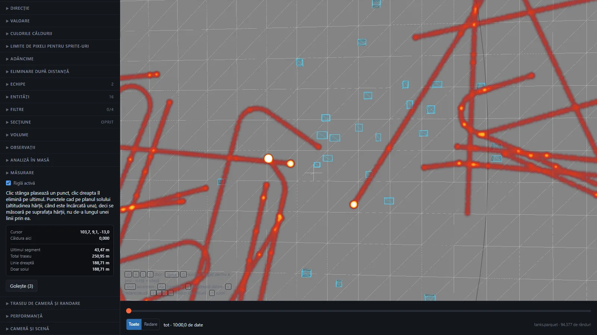

# Măsură

**Măsura** transformă mouse-ul într-o riglă și îți spune cât de aglomerat este locul de sub cursor. Folosește-o ca să afli cât de departe sunt două locuri sau cât trafic are un loc.

## Încearcă {#try-it}

1. Deschide **Măsură** în bara laterală și bifează **Riglă activă**.
2. Dă clic stânga pe trei locuri de pe hartă. Fiecare clic lasă un punct.
3. Citește **Total traseu** (lungimea întregului traseu) și **Ultimul segment** (ultima porțiune).
4. Dă clic dreapta ca să scoți ultimul punct, sau apasă **Golește (3)** ca să le scoți pe toate.

| Acțiune | Efect |
|---|---|
| Clic stânga | Lasă un punct acolo unde cursorul întâlnește planul solului. Un clic care s-a mutat cu mai mult de 4 pixeli între apăsare și eliberare este o tragere a camerei, nu un punct. |
| Clic dreapta | Scoate ultimul punct. |
| Mișcare | Poziția cursorului și căldura de sub el se actualizează în timp real. |

Camera continuă să funcționeze cât timp rigla este pornită: tragerea încă privește în jur, tastele încă zboară. Cât timp rigla este pornită, ea primește fiecare clic, deci [alegerea prin clic](camera.md#click-to-pick) așteaptă până se oprește.

**Planul solului** este altitudinea [imaginii hărții](map-images.md) când o imagine de hartă este încărcată, altfel cel mai mic Y al setului de date (0 fără una). Punctele cad pe el, deci rigla măsoară peste hartă, nu de-a lungul unei linii prin ea. Cu un nivel 3D, planul este tot cel mai mic Y al setului de date, nu suprafața nivelului - pentru un punct pe suprafața reală, oprește rigla și dă clic pe el ([alegerea prin clic](camera.md#click-to-pick)), care citește coordonatele direct din triunghiurile nivelului.

## Valori {#readouts}

| Rând | Înseamnă |
|---|---|
| **Cursor** | X, Y, Z ale lumii pentru punctul de sub cursor, pe plan. |
| **Căldura aici** | Cât de multă căldură este la pixelul cursorului. Un număr mai mare înseamnă mai mult trafic în acel loc. Este valoarea cu care este hrănită rampa de culori înainte ca punctul de saturație să o împartă, deci o poți compara cu [Punctul de saturație](colour-and-exposure.md#saturation-point). |
| **Ultimul segment** | Distanța de la ultimul punct până la cursor (sau între ultimele două puncte). |
| **Total traseu** | Lungimea liniei poligonale prin fiecare punct și cursor. |
| **Linie dreaptă** | Distanța 3D de la primul punct până la cursor (sau ultimul punct). |
| **Doar solul** | Același lucru, doar pe X și Z. |
| **Golește (N)** | Scoate toate punctele. |

Distanțele se arată în centimetri sub 1 unitate, în metri sub 1.000, în kilometri peste - presupunând că o unitate a lumii este un metru ([Axe, unități și timp](axes-units-and-time.md#unit-scale)). Coordonatele sunt coordonate ale lumii, inclusiv când o axă este [inversată pentru afișare](camera.md#invert-world-axis).

Punctele și linia dintre ele sunt desenate ca un strat peste vizualizare, cu dimensiunea luată din distanța dintre linii ale grilei. Punctele riglei nu se salvează în vederi; rămân când încarci alte date.

## Pentru dezvoltatori {#for-developers}

**Căldura aici** este citită de pe GPU cel mult la fiecare 120 ms, pentru că o citire de un singur pixel blochează conducta. Folosește aceeași cale ca `engine.readHeatProbe()`: împărțită la câștigul cu care a fost scris cadrul, deci pe calea de acumulare în jumătate de float (`?heat=f16`) este în aceleași unități ca pe o țintă de 32 de biți ([Acumulare în jumătate de float](half-float-accumulation.md)).
