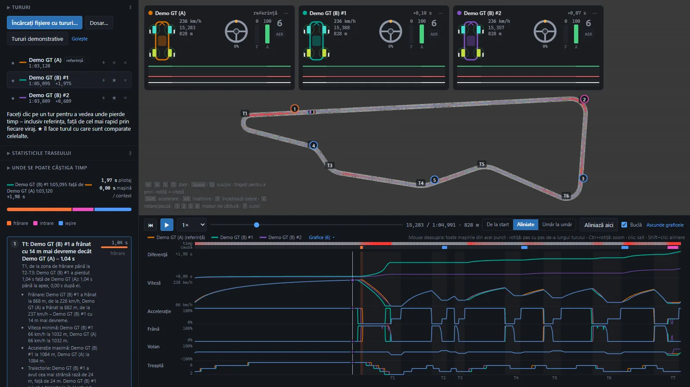

# Analiză de cursă

Ai condus același traseu de două ori. Tabul **Analiză de cursă** redă ambele curse împreună în 3D, arată unde o tură a fost mai lentă și îți spune de ce. Nu ai ture încă? Apasă **Tururi demonstrative**.

Tabul compară două sau mai multe ture ale unui singur traseu. Împarte pânza, camera și modelul traseului încărcat (**Fundal / nivel**) cu harta termică; restul este propriu: propria bară laterală și propria bară sub vedere. Cuvinte ca *tură*, *referință* și *apex* sunt în [glosar](glossary.md).

Această pagină este harta tabului. Fiecare parte are pagina ei:

| Pagină | Ce acoperă |
|---|---|
| [Încărcarea turelor](race-loading-laps.md) | fiecare format de fișier, dosare și trasee, nume de mașini, tururi demonstrative, lista turelor, referința și focusul |
| [Redarea și scena 3D](race-replay-and-scene.md) | bara de transport, cele trei moduri de redare, alinierea mașinilor, camera de urmărire, liniile, hărțile, mașinile, etichetele, lumile în oglindă |
| [Grafice și HUD](race-charts-and-hud.md) | graficele pe distanță, selectorul de grafice, mouse-ul și mărirea, cardurile mașinilor, tabelul canalelor |
| [Evenimente de control al mașinii](race-control-events.md) | blocările, patinarea roților, supravirajul, rotirile, subvirajul, loviturile, accidentele, ABS/TC, frâna de mână, aerul - cum este detectat fiecare, cu fiecare prag |
| [Analiza curbă cu curbă](race-corner-analysis.md) | alinierea după distanță, viraje și segmente, contul de timp al unui viraj, fiecare cauză și ordinea în care sunt încercate, forma liniei și sfatul |
| [Profilurile mașinilor și compararea](race-car-profiles.md) | ce poate face fiecare mașină, măsurat din turele ei; *Mașini comparate*; ce decide mașina în fiecare viraj |
| [Statisticile traseului](race-course-statistics.md) | multe ture ale unui traseu: greșeli pe viraj și pe fel, harta greșelilor, exportul hărții termice, limitele de performanță |
| [Analiza cursei: metoda](race-analytics.md) | cercetarea din spatele regulilor, cu surse |
| [Alte jocuri de curse](other-games.md) | ce face vizualizatorul cu ture din fiecare joc: derapajul și alunecarea calculate acolo unde un joc nu le trimite, lumile în oglindă, canalele suplimentare |

## Ecranul {#the-screen}

**Bara laterală**, de sus în jos (secțiunile pot fi pliate):

1. **Tururi** - încărcare, listă, arătare/ascundere, referință, focus, urmărire.
   Vezi [Încărcarea turelor](race-loading-laps.md).
2. **Statisticile traseului** - doar de la trei ture încărcate în sus.
   Vezi [Statisticile traseului](race-course-statistics.md).
3. **Unde se poate câștiga timp** - constatările turei în focus, viraj cu viraj.
   Vezi [Analiza curbă cu curbă](race-corner-analysis.md).
4. **Viraj cu viraj** (sau *Viraj cu viraj - clasa X* cu mai multe clase) - cea mai rapidă tură prin fiecare viraj și linia ei. Apare cu două sau mai multe ture.
5. **Controlul mașinii** - blocările, derapajele, împingerile și loviturile turei în focus.
   Vezi [Evenimente de control al mașinii](race-control-events.md).
6. **Mașini comparate** (sau **Mașina** cu o singură mașină) - vezi
   [Profilurile mașinilor și compararea](race-car-profiles.md).
7. **Vedere** - ce hartă este pictată pe traseu și ce este desenat.
   Vezi [Redarea și scena 3D](race-replay-and-scene.md).
8. Panourile comune **Nivel** și **Cameră și scenă** (modelul traseului, inversarea axelor, camera) - documentate împreună cu harta termică și [Camera](camera.md).

**Vederea** arată traseul, liniile parcurse, harta, mașinile, etichetele fixate de traseu și până la șase carduri de mașini sus în stânga (vezi [Grafice și HUD](race-charts-and-hud.md)). Fără nicio tură încărcată spune: "Nicio tură încărcată - trage aici unul sau mai multe fișiere cu ture, sau încarcă turele demonstrative din bara laterală."

**Bara de sub vedere** ține transportul redării și, dacă nu este ascunsă, graficele pe distanță.

## Pornire rapidă {#quick-start}

1. Deschide tabul **Analiză de cursă** (lângă **Hartă termică**, în partea de sus a barei laterale).
2. Adu ture. Apasă **Tururi demonstrative** ca să vezi ce face tabul cu trei ture inventate. Pentru turele tale, înregistrează-le mai întâi ([formate de fișiere și înregistratoare](race-loading-laps.md#file-formats)), apoi apasă **Încarcă fișiere cu tururi…** sau **Dosar…**, sau trage fișiere sau dosare pe vedere.
3. Cea mai rapidă tură completă devine referința; cea mai lentă altă tură devine focusul. Dă clic pe orice tură din listă ca s-o focalizezi; ★ face din ea referința.
4. Citește **Unde se poate câștiga timp**. Dă clic pe o constatare: mașinile sunt aliniate cu 40 m înainte de ea, camera o încadrează, redarea trece prin ea și măsurătorile se deschid.
5. Treci cu mouse-ul peste grafice ca să muți fiecare mașină la acel metru; Shift+clic ca să le aliniezi acolo.

## Tastatura {#keyboard}

Cât timp tabul Cursă este deschis:

| Tastă | Face |
|---|---|
| **K** | pornește / pune pe pauză redarea |
| **Home** | înapoi la începutul redării |
| tastele cu cifre | nimic (în harta termică schimbă modurile) |

Tastele scrise într-un câmp de text sau într-o listă derulantă sunt ignorate. Tastele camerei funcționează ca în harta termică (**W A S D**, **Spațiu** în sus, **Q** în jos, **Shift** mai repede, **Alt** mai încet, mouse-ul ca să privești; toate în [Cameră](camera.md)); **F** încadrează turele încărcate (la fel ca încărcarea turelor).

## Multe ture {#many-laps}

- Toate turele încărcate sunt analizate și numărate; zeci durează o secundă sau două.
- Peste **8** ture (`SHOW_ALL_UP_TO`), turele adăugate sunt desenate doar când sunt referința, tura în focus sau cea mai bună tură din clasa turei în focus. *Arată tot* / *Doar cele analizate* comută.
- Peste **10** mașini vizibile (`PLAIN_PAST`), turele neanalizate (altele decât focusul, mașina urmărită sau referința) sunt desenate cu linii subțiate la un punct la fiecare 6 m în loc de 1,5 m, și cu mașini simple.
- Graficele desenează cel mult **8** ture; HUD-ul arată cel mult **6** carduri.
- Statisticile traseului apar de la **3** ture.

Detalii: [Statisticile traseului](race-course-statistics.md#performance-with-many-laps).

## Setările implicite ale vederii {#default-view-settings}

| Setare | Implicit |
|---|---|
| Hartă | Harta timpului |
| Liniile parcurse, Mașini, Pneuri și suspensie, Etichete, Traseul din ture | pornit |
| Valorile de pe carduri | oprit |
| Mărimea mașinii | 1× |
| Grafice | arătate |
| Mod de redare | De la linie |
| Viteza redării | 1× |
| Buclă | pornit |

Niciuna dintre acestea nu este salvată; o reîncărcare pornește de la valorile implicite. Ce ține minte browserul: limba și numele mașinilor învățate din fișierele de ture (vezi [Încărcarea turelor](race-loading-laps.md#car-names)).

## Pentru dezvoltatori {#for-developers}

### Ce se întâmplă când sunt încărcate turele {#what-happens-when-laps-are-loaded}

De fiecare dată când se schimbă setul de ture, referința sau limba, întreaga analiză se face din nou (`analyse` în
[`src/race/analysis.ts`](https://github.com/Holdi601/3DHeat/blob/main/src/race/analysis.ts)):

1. Canalele derivate sunt adăugate fiecărei ture acolo unde jocul nu le trimite: unghiul de derapaj, alunecarea roților din vitezele roților, în aer, teren alunecos, viteza de girație ([`derive.ts`](https://github.com/Holdi601/3DHeat/blob/main/src/race/derive.ts)).
2. Referința este aleasă, iar fiecare tură este proiectată pe traseul ei și reeșantionată la fiecare 2 m ([`align.ts`](https://github.com/Holdi601/3DHeat/blob/main/src/race/align.ts)).
3. Se stabilește dacă lumea jocului este în oglindă, din ture ([`handedness.ts`](https://github.com/Holdi601/3DHeat/blob/main/src/race/handedness.ts)).
4. Virajele sunt găsite pe referință și grupate în segmente, de la o zonă de frânare la următoarea ([`segments.ts`](https://github.com/Holdi601/3DHeat/blob/main/src/race/segments.ts)).
5. Pe mașină: anvelopa ei (aderența, frânarea, tracțiunea pe viteză), profilul ei, curbele pneurilor ([`envelope.ts`](https://github.com/Holdi601/3DHeat/blob/main/src/race/envelope.ts),
   [`profile.ts`](https://github.com/Holdi601/3DHeat/blob/main/src/race/profile.ts),
   [`control.ts`](https://github.com/Holdi601/3DHeat/blob/main/src/race/control.ts)).
6. Pe tură și segment: ce a făcut (punctul de frânare, cel mai lent punct, accelerația plină, ...) și linia pe care a parcurs-o ([`line.ts`](https://github.com/Holdi601/3DHeat/blob/main/src/race/line.ts)).
7. Pe tură: evenimentele ei de control al mașinii, fiecare așezat față de tura cu care este comparată acolo.
8. Pe tură și segment: contul de timp față de tura de comparație și constatarea în cuvinte.
9. Harta timpului și harta cauzelor pentru fiecare tură.

Textele sunt produse în limba curentă; schimbarea limbii rulează din nou analiza (și redenumește turele demonstrative). O eroare în analiză este arătată sub butoanele **Tururi** ca o eroare, iar turele rămân încărcate.

### Fișiere sursă {#source-files}

| Fișier | Rol |
|---|---|
| `src/race/adapters.ts`, `ibt.ts` | citirea fișierelor de ture |
| `src/race/lap.ts`, `carNames.ts`, `synthetic.ts` | tipul turei, denumirea, turele demonstrative |
| `src/race/derive.ts`, `handedness.ts` | canale derivate, lumi în oglindă |
| `src/race/align.ts`, `segments.ts`, `line.ts` | axa distanței, viraje, linii |
| `src/race/analysis.ts` | viraje comparate, cauze, constatări |
| `src/race/envelope.ts`, `profile.ts` | ce poate face o mașină |
| `src/race/control.ts`, `impacts.ts` | controlul mașinii, lovituri și accidente |
| `src/race/stats.ts` | multe ture |
| `src/race/replay.ts`, `scene.ts`, `glyph.ts`, `geometry.ts` | redare și desen |
| `src/race/schema.ts`, `graphs.ts` | tabelul canalelor, rândurile graficelor |
| `src/ui/race/*` | bara laterală, graficele, HUD-ul, etichetele |
| `src/state/raceStore.ts` | starea tabului și ceasul redării |
