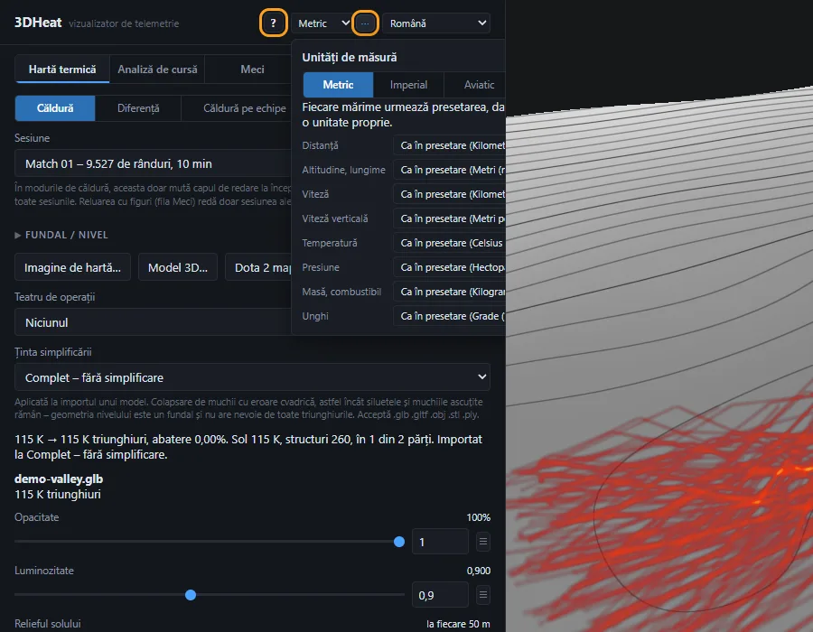
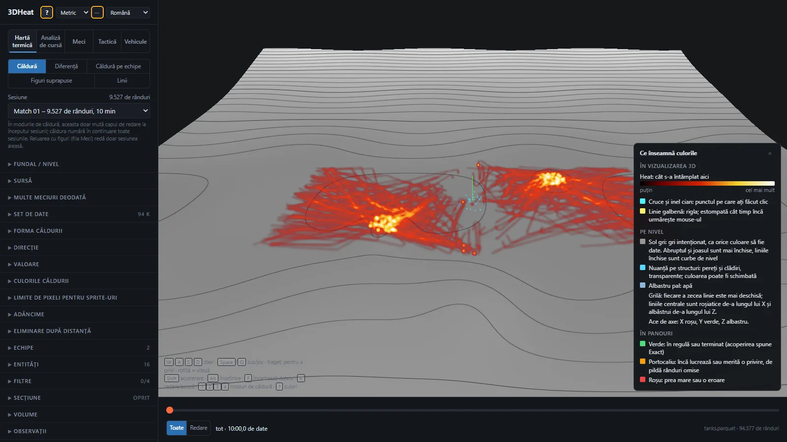
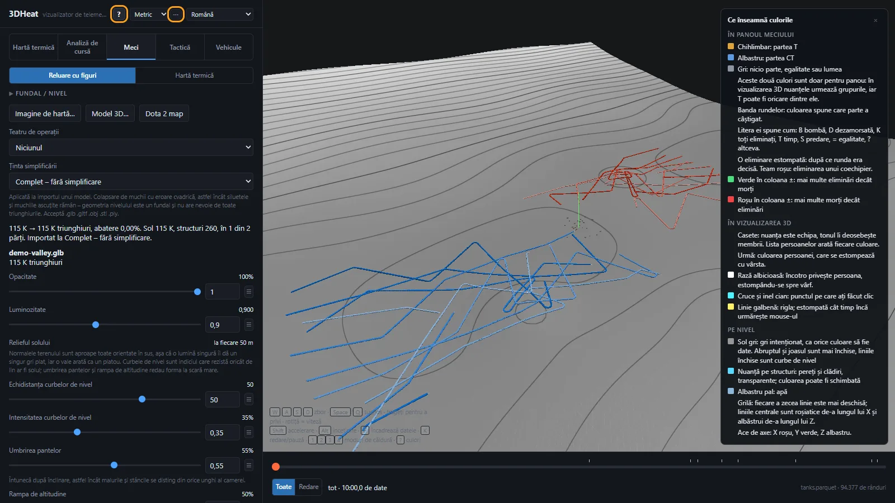

# Setări, unități și taste

Comenzile mici din partea de sus a barei laterale schimbă felul în care vizualizatorul vorbește cu tine: limba, unitățile (metri sau picioare, km/h sau noduri) și un mod de ajutor care explică culorile. Alegerile tale sunt reținute în browserul tău.

## Antetul {#the-header}

În partea de sus a barei laterale:

| Control | Ce face |
|---|---|
| **?** | Mod de ajutor: ce înseamnă fiecare culoare (sau `?` ori `F1`) |
| Meniul **Unități** | Metric, Imperial, Aviație sau Nautic |
| Butonul **...** de lângă **Unități** | Deschide „Alege o unitate pentru fiecare mărime": câte o listă derulantă pentru fiecare mărime |
| Meniul **Limbă** | Limba vizualizatorului: [40 de limbi](languages.md), sau cea a browserului |

Numerele pe care le scrii într-o casetă pot folosi fie punct, fie virgulă (`0.35` sau `0,35`). Vizualizatorul citește amândouă și arată numerele așa cum le scrie limba vizualizatorului.

## Unități {#units}

1. Alege un preset din meniul **Unități**. Toate mărimile trec împreună.
2. Ca să schimbi o singură mărime, dă clic pe butonul **...** de lângă ea și alege o unitate pentru ea. Meniul pune apoi un `*` după preset.
3. O mărime pe care nu ai setat-o urmează presetul. Alege „Ca în preset" ca să revii.

| Mărime | Metric (implicit) | Imperial | Aviație | Nautic |
|---|---|---|---|---|
| Distanță | km | mi | NM | NM |
| Altitudine, lungime | m | ft | ft | m |
| Viteză | km/h | mph | kt | kt |
| Viteză verticală | m/s | ft/min | ft/min | m/s |
| Temperatură | °C | °F | °C | °C |
| Presiune | hPa | inHg | hPa | hPa |
| Masă, combustibil | kg, l | lb, gal | lb, gal | t, m³ |
| Unghi | grade | grade | grade | grade |

Alte unități pe care le poți alege pentru o singură mărime: distanță km, mi, NM; viteză km/h, m/s, kt, mph; viteză verticală m/s, ft/min, m/min; temperatură °C, °F, K; presiune hPa, inHg, mmHg, psi; masă kg, lb, t; unghi grade sau milere NATO (6.400 pe cerc). Unitățile sunt aceleași peste tot în vizualizator: etichete, carduri, grafice, statistici.

## Modul de ajutor {#help-mode}

Apasă `?` sau `F1`, sau dă clic pe butonul **?**. Arată *Ce înseamnă culorile*: legendele pentru vederea 3D, rampele de căldură, culorile echipelor, culorile nivelului, culorile de stare ale panourilor, panoul de meciuri și vederea de cursă. Rămâne activ până îl oprești. În fila Meciuri explică și culorile panoului de meciuri.

## Ce ține minte browserul {#what-the-browser-remembers}

Aceste setări sunt păstrate în browserul tău între vizite (nu se trimite nimic nicăieri):

- limba, unitățile și modul de ajutor;
- setările redării pentru figură, simbol, etichetă, cameră și afișarea tactică;
- viteza de redare și oglindirea;
- semnele de carte pentru fiecare înregistrare, volumele pentru fiecare set de date, straturile de obiective;
- setările AI externe (cheia doar dacă bifezi *Reține*).

Setările de căldură, filtrele și modul pornesc de la zero la fiecare încărcare. Lista completă, generată: [Setări salvate](ref-settings-storage.md).

## Tastele pe care le păstrează vizualizatorul față de browser {#keys-the-viewer-keeps-from-the-browser}

O sesiune cu date mari durează să se încarce, deci vizualizatorul oprește browserul să o arunce din greșeală:

- `Ctrl`/`Cmd` + litere care ar tipări, salva, deschide, reîncărca, închide sau deschide ferestre noi nu fac nimic în afara casetelor de text; `F1`, `F3`, `F5`, `F6` și `F7` nu fac nimic.
- Închiderea sau reîncărcarea filei cu date sau cu un nivel încărcat cere confirmare întâi.
- În ecran complet vizualizatorul blochează tastele pe care le folosește (W, T, N, S, R, P, Q, Esc), ca browserul să nu le preia.

Lista exactă: [Taste ale browserului](ref-browser-keys.md). Toate tastele proprii ale vizualizatorului: [Referința tastaturii și a mouse-ului](keyboard-reference.md).
