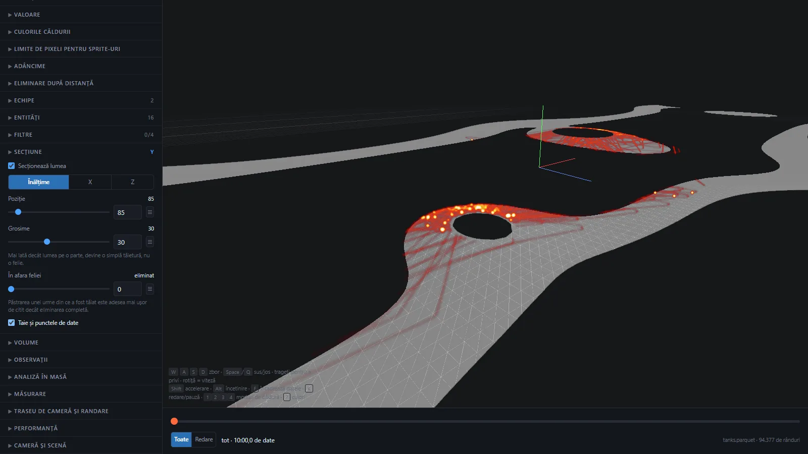

# Secțiune

**Secțiunea** taie lumea ca pe o felie de tort, ca să te poți uita în interiorul clădirilor. Folosește-o când pereții ascund căldura interesantă, de exemplu ca să vezi un singur etaj al unei clădiri.

## Încearcă {#try-it}

1. Încarcă un nivel și niște date, apoi deschide **Secțiune**.
2. Bifează **Secționează lumea**. Axa este **Înălțime**.
3. Trage de **Poziție** în sus și în jos: felia se mută prin nivel.
4. Fă **Grosimea** subțire pentru un plan de etaj, sau largă pentru „tot ce este sub aici".
5. Lasă **În afara feliei** la 0 ca să scoți restul, sau ridic-o ca să păstrezi o urmă slabă.



Felia taie **geometria nivelului și punctele de date împreună** - dacă ai tăia doar nivelul, căldura ar pluti acolo unde era clădirea. Este contrapartea [ocluziei în adâncime](depth-and-culling.md): odată ce nivelul ascunde corect ce este în spatele lui, interiorul unei clădiri este ascuns și el. Panoul apare când există ceva de tăiat (un set de date sau un nivel 3D); antetul lui arată axa când este pornit, *oprit* altfel.

```
vedere laterală   Poziție = unde este felia
 ----------       Grosime = cât de înaltă este felia
 | etaj 3 |
 |=========|  <--- felia (păstrată)
 | etaj 2 |  <--- în afară: scos (sau slab)
 | etaj 1 |
 ----------
```

## Controale {#controls}

| Control | Implicit | Înseamnă |
|---|---|---|
| **Secționează lumea** | oprit | Pornește felia. Cât timp poziția este încă la valoarea inițială 0 și grosimea la cea inițială 500, pornirea le mută la mijlocul axei și la 15% din întinderea ei. |
| Axa | **Înălțime** | *Înălțime* (Y), *X* sau *Z*. Schimbarea axei mută felia la mijlocul noii axe. |
| **Poziție** | mijlocul | Centrul feliei, în unități ale lumii, pe întinderea axei (500 de pași). |
| **Grosime** | 15% din întindere | De la 1/500 din întindere până la de două ori întinderea, în pași logaritmici. Afișează *dincolo de lume* când este la fel de lată ca întinderea: o latură ajunge atunci dincolo de lume și este o simplă tăietură, nu o felie. |
| **În afara feliei** | 0, *scos* | Cât din ce se află în afară rămâne vizibil, 0-100%. O urmă slabă a celor tăiate este adesea mai ușor de citit decât scoaterea completă. |
| **Taie și punctele de date** | pornit | Oprit lasă căldura întreagă, deci se vede prin tăietură - util ca să vezi ce este deasupra și dedesubtul feliei. |

Întinderea unei axe este cea a nivelului 3D când este încărcat unul, altfel cea a setului de date.

Secțiunea este independentă de [tăierea după distanță](depth-and-culling.md#distance-culling), care taie de-a lungul direcției de privire, nu al unei axe a lumii; cele două se combină. O schimbare a oricărei setări a secțiunii repornește acumularea căldurii.

## Pentru dezvoltatori {#for-developers}

Felia este testată pentru poziția lumii fiecărui rând în vertex shader: un rând din afara ei are contribuția înmulțită cu valoarea *În afară*, deci la 0 este respins înainte ca vreun fragment să fie desenat. Shaderele nivelului aplică același test fiecărui fragment al terenului, structurilor și apei.
