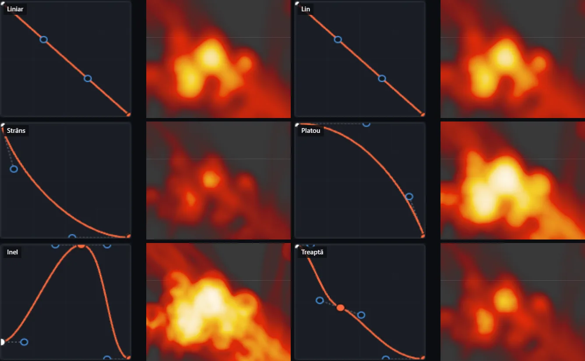

# Forma sprite-ului

Fiecare rând este desenat ca un sprite rotund, care se orientează mereu spre cameră. Mărimea lui și profilul de la centru până la margine - **rampa** - decid dacă un punct fierbinte se citește ca un punct strâns, un nor moale, un disc sau un inel. Aceste comenzi se află în secțiunile **Forma căldurii** și **Limite de pixeli pentru sprite-uri** din bara laterală și se aplică la [Căldură](heat.md), [Diferență](difference.md), [Căldura pe echipe](team-heat.md) și, ca semilățime a unei linii, la [Căldura pe linii](line-heat.md).

Schimbarea oricăreia dintre ele repornește acumularea (câmpul trebuie redesenat cu noua formă).

Gândește-te la fiecare punct ca la o pată moale de lumină. O pată mică arată puncte izolate; o pată mare unește vecinii într-un nor. Forma decide cât de moale este marginea.



## Raza sprite-ului {#sprite-radius}

Raza sprite-ului în **unități ale lumii** (etichetate metri). Implicit 6, iar la fiecare încărcare întinderea orizontală a datelor / 120 - suficient de mare încât eșantioanele vecine de-a lungul unui traseu să se unească într-o bandă, în loc să se citească ca un fir de păr. Cursor logaritmic 0,05-2000, mâner până la 50.000.


Lucrurile îndepărtate apar mai mici, deci un sprite se micșorează pe ecran odată cu distanța. Sub proiecția paralelă are aceeași mărime peste tot, ceea ce face parte din motivul pentru care vederea paralelă este cea potrivită pentru compararea punctelor fierbinți ([Camera](camera.md#projection)).

## Limite de pixeli {#pixel-clamps}

**Limite de pixeli pentru sprite-uri** (implicit închise) mărginesc raza de pe ecran după conversia de mai sus.

| Comandă | Implicit | Interval (cursor) | De ce |
|---|---|---|---|
| **Raza minimă în pixeli** | 1 px | 0-16 (512) | Împiedică datele îndepărtate să dispară sub un pixel. |
| **Raza maximă în pixeli** | 96 px | 2-1024, logaritmic (8192) | Protecția împotriva supradesenării. Un sprite care acoperă N pixeli costă N operații de amestecare, deci o rază nelimitată aflată aproape de cameră este ceea ce transformă un cadru rapid într-unul lent. Peste înălțimea zonei de vizualizare nu mai limitează nimic. |

**Aceeași densitate la orice zoom** (în secțiunea Forma căldurii, implicit pornit) funcționează împreună cu limitele. Un sprite pe care o limită îl face mai mare (departe) sau mai mic (aproape) păstrează căldura pe care ar adăuga-o mărimea sa reală, astfel încât o culoare înseamnă același număr de rânduri pe unitatea de suprafață a terenului, la orice zoom. Dezactivat, un sprite limitat adaugă greutatea sa întreagă la mărimea sa limitată, iar imaginea se schimbă pe măsură ce zbori înăuntru.

## Intensitatea din centru și de la margine {#centre-and-edge-intensity}

Căldura pe care o adaugă un sprite în centrul său exact (**Intensitate în centru**, implicit 1, 0-10, cursor 1000) și la marginea sa (**Intensitate la margine**, implicit 0, -2-10, cursor 1000). Valoarea rampei *t* (1 în centru, 0 la margine, modelată de atenuare sau de curba de mai jos) face interpolarea între ele (formula este sub [Pentru dezvoltatori](#for-developers)).

O **intensitate negativă la margine** face ca marginea să scadă, ceea ce sapă un halou rece în jurul fiecărui punct fierbinte și ascute clusterele unul față de altul. Vizibilitatea include [ocluzia](depth-and-culling.md) și [felia](slice.md); estomparea este estomparea de [Durata de viață](timeline.md#history); semnul este ±1 în [Diferență](difference.md).

## Forma rampei: Atenuare sau Curbă {#ramp-shape-falloff-or-curve}

**Forma rampei** comută între două moduri de a modela *t* pe sprite. Cu *d* distanța de la centru (0) până la margine (1):

### Atenuare {#falloff}

Apare când este selectată *Atenuare* (implicit).

- **Atenuare** (implicit 1,6, 0,1-8, cursor 64): `t = (1 - d) ^ falloff`. 1 este o rampă liniară dreaptă; valorile mai mari trag căldura spre centru și strâng punctul fierbinte; sub 1 o aplatizează într-un disc.
- **Rampă netedă** (implicit pornit): aplică o curbă S de tip smoothstep lui *t*, astfel încât sprite-ul se estompează la margine, în loc să se termine cu o muchie vizibilă.

### Editorul de curbe {#the-curve-editor}

Apare când este selectată *Curbă*. O secțiune transversală literală a unui sprite: distanța de la centru pe lățime (*centru* în stânga, *margine* în dreapta), căldura în sus. Curba este o Bézier cubică pe porțiuni, prin puncte de control, fiecare cu două mânere.

| Acțiune | Efect |
|---|---|
| Dublu clic pe grafic | Adaugă un punct la acea distanță (păstrat între 0,02 și 0,98), pe curbă și cu panta curbei acolo, astfel încât adăugarea lui nu schimbă nimic până nu-l tragi. |
| Trage un punct | Îl mută. Înălțimile sunt păstrate între 0 și 1. |
| Trage un cerc mic | Îndoaie segmentul de lângă el (mută acel mâner). |
| Alt-clic sau clic dreapta pe un punct | Îl șterge. Cele două capete nu pot fi șterse. |
| Un buton prestabilit | Înlocuiește curba cu prestabilitul. |

Capetele sunt fixe în centru și la margine; înălțimea lor rămâne a ta.

**Prestabilite** ([`curve.ts`](https://github.com/Holdi601/3DHeat/blob/main/src/state/curve.ts)):

| Prestabilit | Formă | Folosire |
|---|---|---|
| **Liniară** | Dreaptă de la 1 la 0 | Identică cu *Atenuare* 1 cu *Rampă netedă* oprită. |
| **Netedă** | Curbă S | Curba implicită; ce dă *Rampă netedă* la atenuarea 1. |
| **Strânsă** | Un miez abrupt, o fustă lungă și slabă | Date rare. |
| **Platou** | Plat, apoi o scădere rapidă | Se citește ca un disc, nu ca o pată. |
| **Inel** | 0,15 în centru, 1 la 62% din rază, 0 la margine | Un sprite gol: arată unde trec traseele, nu unde se opresc. |
| **Prag** | Atenuare în două trepte, 0,45 la 35% | Separă un miez dens de împrejurimi. |

## Aplatizare pe planul solului {#flatten-onto-ground-plane}

**Aplatizare pe planul solului** (implicit oprit) ignoră înălțimea fiecărui rând și desenează toată căldura la o singură înălțime - cea mai mică Y a setului de date - harta termică 2D clasică. Pornită, ocluzia după adâncime și *Ascunde în spatele terenului* sunt oprite (fiecare punct ar sta exact pe suprafața față de care este testat), iar secțiunea Adâncime o spune.

## Pentru dezvoltatori {#for-developers}

### Formule {#formulas}

Raza pe ecran în pixeli: `radius × P[1][1] / w × înălțimea zonei de vizualizare / 2`, unde `P` este matricea de proiecție, iar `w` este adâncimea de vizualizare a punctului.

Căldura pe care o adaugă un sprite:

```
heat added = mix(edge, centre, t) × sample weight × sign × fade × visibility
```

### Curba {#the-curve}

Mânerele sunt limitate orizontal la propriul segment, deci curba este mereu o funcție de distanță: tragerea unui mâner mult dincolo de punctul următor îl aplatizează în el, în loc să plieze curba înapoi, ceea ce ar face rezultatul să depindă de rădăcina pe care o găsea întâmplător un solver.

### Cum este desenată curba {#how-the-curve-is-drawn}

Curba este copta într-un tabel de 256 de intrări ori de câte ori se schimbă, încărcată ca textură cu virgulă mobilă pe 16 biți și eșantionată per fragment, cu filtrare liniară și o retragere de jumătate de texel, astfel încât ambele capete să rămână exacte. Rezolvarea unei Bézier pentru x necesită iterație, ceea ce nu are ce căuta în cel mai fierbinte shader al programului, iar o citire din tabel este și mai ieftină decât `pow()` pe care îl folosește atenuarea. 16 biți și nu 8, pentru că 8 biți apar ca benzi odată ce mii de sprite-uri s-au însumat; semi-floatul de 16 biți este filtrabil în WebGL2 de bază, unde cel de 32 de biți cere o extensie.
