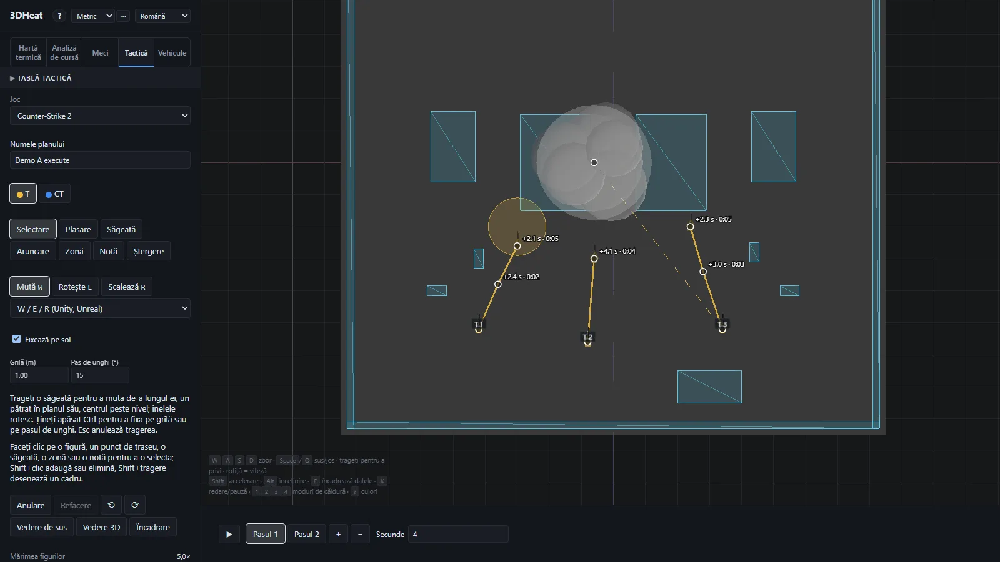

# Tabla de tactici

Fila **Tactică** este o tablă de desen pentru un plan de echipă: pui figurine mici pe o hartă, desenezi săgeți pentru drumul lor și apeși redare ca să vezi cum se întâmplă. Folosește-o ca să planifici o rundă sau un atac înainte de joc. Împarte pânza, camera și [nivelul](levels.md) cu celelalte file și nimic altceva; un plan nu este date și nu desenează căldură.

## Primul tău plan {#your-first-plan}

1. Deschide fila **Tactică**. Alege **Jocul** (de exemplu Counter-Strike 2) și, pentru Valorant, apasă **Încarcă hărțile Valorant** și alege o **Hartă**. Sau încarcă întâi un [nivel](levels.md).
2. Alege o **Tabără** (stabilește culoarea) și apasă **Vedere de sus**.
3. Alege **Plasare**, alege o figurină din **Figuri** (folosește **Căutare figuri** ca s-o găsești) și dă clic pe hartă. Plasează două sau trei.
4. Alege **Săgeată**, dă clic pe o figurină, dă clic de-a lungul drumului pe care ar trebui să-l urmeze și apasă **Enter** ca să încheii săgeata.
5. Apasă **+** sub vedere ca să adaugi pasul 2. Fiecare figurină începe acolo unde s-a încheiat săgeata ei. Desenează acolo mai multe săgeți.
6. Apasă **▶** (sau `K`) ca să redai planul de la pasul arătat până la capăt.
7. Dă un nume planului în **Numele planului** și apasă **Salvează**.

## Începerea unui plan {#starting-a-plan}

| Comandă | Ce face |
|---|---|
| **Joc** | Alege părțile și figurinele pe care le oferă paleta: Counter-Strike 2 (T, CT; jucători și utilitare), Valorant (Atac, Apărare; jucători și abilități generice), Battlefield, Squad, Arma (infanterie, vehicule terestre, aeronave, bărci), DCS / War Thunder / IL-2 (avioane cu reacție, avioane cu elice, elicoptere, apărare aeriană, sol, nave, arme) și Altele. Un plan care are deja figurine își păstrează părțile când se schimbă jocul. |
| **Numele planului** | Numele sub care este salvat planul. |
| **Hartă**, **Încarcă hărțile Valorant** | Cu Valorant ales: **Încarcă hărțile Valorant** ia lista de hărți de la [valorant-api.com](https://valorant-api.com); **Hartă** pune apoi harta minimă a hărții alese ca nivel, încadrată de sus. Imaginea se descarcă la alegere și nu este livrată niciodată. Anunțul Riot se arată cât timp este pe ecran (vezi mai jos). |
| **Tabără** | Partea căreia îi aparține următoarea figurină, săgeată sau zonă; primește culoarea părții. |

Fără un nivel, tabla este planul plat al solului. Încarcă un nivel la **Nivel** ca să planifici pe o hartă reală: o hartă CS2 exportată cu instrumentul CS2, un nivel din bibliotecă sau o imagine de hartă.

## Instrumente {#tools}

| Instrument | Clic | Note |
|---|---|---|
| **Selectare** | O figurină, un punct de traseu, o săgeată, o zonă sau o notă o selectează. | Shift+clic adaugă sau scoate; Shift+trage desenează o cutie în jurul a ceea ce se adaugă. Selecția primește un gizmo de transformare (vezi mai jos); `Delete` sau `Backspace` o șterge. `M` mută figurina selectată la următorul clic. |
| **Plasare** | Pune jos figurina aleasă. | O figurină se alege din paleta **Figuri** (cu **Căutare figuri**). Fără nimic selectat, `R` rotește următoarea figurină cu 15° înainte de a fi plasată (`Shift+R` în sens invers). |
| **Săgeată** | Fiecare clic adaugă un punct; Enter, dublu clic sau clic dreapta o încheie, Esc o anulează. | **Deplasare**, **Atac** (vârf mai lat) sau **Supraveghere** (o linie subțire la înălțimea ochilor). O săgeată începută pe o figurină este traseul acelei figurine în acest pas: redată, figurina îl parcurge, iar pasul următor începe unde s-a terminat. |
| **Aruncare** | Cel care aruncă, apoi unde cade. | Un arc punctat de la unul la altul, iar utilitarul ales (fum, bliț, molotov ...) apare unde cade și rămâne din acest pas încolo. |
| **Zonă** | Centrul, apoi marginea. | Un disc în culoarea părții. |
| **Notă** | Unde se pune nota; cere textul ei. | Arătată ca un ac, iar textul ei deasupra. |
| **Ștergere** | O figurină, o săgeată, o zonă sau o notă. | O scoate din acest pas încolo; în primul ei pas, o scoate complet. |

**Anulare** și **Refacere** (`Ctrl+Z`; `Ctrl+Y` sau `Ctrl+Shift+Z`) parcurg fiecare schimbare. O linie sub plan arată câte figurine, săgeți și pași are. **Vedere de sus** privește drept în jos (ortografic), **Vedere 3D** revine la perspectivă, **Încadrare** potrivește planul, sau nivelul când planul este gol.

**Mărimea figurilor** scalează fiecare figurină de pe tablă; 1× este mărimea reală, care de sus înseamnă câțiva pixeli pentru o persoană.

## Mutare, rotire și scalare {#moving-turning-and-scaling}

Totul de pe tablă poate fi mutat ca într-un editor 3D: figurine, utilitare, marcaje, puncte de traseu individuale și săgeți întregi, zone și notițe. Ce este selectat primește un gizmo la mijloc:

| Mod | Taste | Mânere |
|---|---|---|
| **Mută** | W (sau G) | O săgeată pe fiecare axă (X roșu, Y verde și în sus, Z albastru) mută de-a lungul ei; un pătrat mută în planul lui; centrul mută peste nivelul de sub cursor. |
| **Rotește** | E (sau R) | Un inel pe fiecare axă se rotește în jurul ei. Inelele unei figurine singure sunt propriul ei cap, tangaj și ruliu; un grup se rotește în jurul axelor lumii în jurul mijlocului său. |
| **Scalează** | R (sau S) | Împrăștie sau adună selecția din mijloc de-a lungul unei axe sau în toate direcțiile; raza unei zone crește odată cu ea. |

**Taste** comută între W / E / R (Unity, Unreal) și G / R / S (Blender); tastele aleg modul doar cât timp ceva este selectat, iar altfel zboară cu camera. Deci `R` înseamnă **Scalează** cu tastele W / E / R și **Rotește** cu tastele G / R / S, cât timp ceva este selectat, și rotește următoarea figurină de plasat când nimic nu este selectat. Toate tastele tablei sunt în [referința de taste](keyboard-reference.md#tactics-board). Ține **Ctrl** apăsat în timp ce tragi ca să prinzi o mutare de **Grilă** (metri) sau o rotire de **Pas de unghi**. **Fixează pe sol** (pornit implicit) pune oamenii, vehiculele, marcajele, punctele de traseu și zonele mutate pe suprafața nivelului; aeronavele și elicopterele își păstrează înălțimea, iar o tragere pe săgeata Y nu se prinde niciodată. Tragerea unui mâner nu mută niciodată camera. **Esc** anulează o tragere, iar fiecare schimbare este un pas de Anulare.

Punctele de traseu apar ca puncte pe săgețile pasului arătat: dă clic pe unul ca să-l selectezi, trage-l ca să-l muți, Delete ca să-l scoți. Secțiunea **Selectat** arată locul selecției în metri, capul, tangajul și ruliul unei figurine în grade și raza unei zone, fiecare de scris.

## Cronometrare {#timing}

Traseul unei figurine are timp: fiecare segment durează lungimea lui peste nivel - eșantionată pe suprafață la fiecare câțiva metri, deci un deal sau o scară între două puncte contează - cu viteza **modului** de mișcare al acelei figurine în acel joc, plus orice **așteptare** la un punct de traseu. Infanteria se târăște, se ghemuiește, merge (silențios), aleargă sau sprintează; vehiculele și bărcile se târăsc, merg precaute, normal sau se grăbesc; aeronavele și elicopterele zboară lent, de croazieră, la viteza de luptă sau la maximum. Un mod pe care jocul nu-l are (CS2 nu are sprint) ia cel mai apropiat pe care îl are. Cum încetinește o pantă depinde de joc: în CS2 și Valorant contează doar distanța orizontală, ca în jocuri; simulatoarele militare încetinesc infanteria la urcare (funcția de drumeție Tobler) și vehiculele după înclinare.

Vitezele vin din tabele pe joc, cu sursele lor (vezi [Vitezele de mișcare](tactics-speeds.md)): CS2 după arma ținută, din definițiile armelor jocului; Valorant după armă; Battlefield, Squad, Arma și jocurile aeriene după tipul și clasa vehiculului. **Se mișcă ca** alege profilul unei figurine (o armă, un tip de vehicul); **Propriu (m/s)** înlocuiește orice mod pentru acea figurină. Modurile sunt numite cum le arată tabla: *Târâre*, *Ghemuit*, *Mers (silențios)*, *Alergare*, *Sprint*; *Precaut*, *Normal*, *Grăbit*; *Lent*, *Croazieră*, *Luptă*, *Maxim*.

Fiecare punct de traseu arată timpul de la ultimul și timpul de la începutul planului („+3,9 s · 0:12”). Traseul figurinei selectate listează fiecare segment cu modul, lungimea și timpul lui, așteptarea și sosirea. **Sosiri** sub **Cronometrare** pune fiecare figurină cu traseu pe o linie de timp, primul sosit sus. Cu **Redă în timp real** (pornit implicit) un pas durează până sosește cel mai lent traseu, iar fiecare figurină se mișcă la propria viteză; **Secunde** este atunci lungimea cea mai mică a pasului. **Unități de nivel pe metru** spune în ce unitate este nivelul: 39,37 pentru hărțile CS2 (unități ale jocului), 1 pentru hărțile în metri.

## Comparație cu datele de meci {#compare-with-match-data}

**Încarcă fișiere de meci…** citește tabelele de meci CS2 ale hărții (fișierele Parquet ale instrumentului CS2, câte vrei; doar coloanele necesare, în fundal); **Folosește datele încărcate** ia datele încărcate în vizualizator. Apoi:

- **Cea mai timpurie sosire pe hartă** colorează harta după timpul de la începutul rundei la care un jucător a ajuns întâi în fiecare loc - butonul **Cel mai rapid** arată cel mai rapid peste toate rundele, **Tipic (mediană)** runda din mijloc - verde devreme până la roșu târziu, pentru o parte sau pentru amândouă. Arată ce este posibil și când.
- Traseul selectat se compară cu ce au realizat jucătorii de la începutul lui (sau de la începutul rundei) până la sfârșit, fiecare capăt fiind un disc de raza stabilită: „Cel mai rapid observat 14,2 s, p10 15,0 s, mediana 18,3 s din 41 de încercări; planul tău 15,1 s”.
- Vitezele cu care s-au mișcat efectiv jucătorii - alergând, mergând, ghemuiți, din coloanele de mers și de ghemuit ale tabelelor - în m/s.

## Pași {#steps}

Bara de sub vedere ține pașii. Un plan începe cu unul; **+** adaugă unul, iar fiecare figurină începe în el acolo unde s-a terminat traseul ei din ultimul pas; **−** îl scoate pe cel arătat. **Secunde** este cât durează pasul arătat când este redat. **▶** (K) redă din pasul arătat până la capăt: figurinele cu traseu îl parcurg, figurinele mutate într-un loc nou în pasul următor alunecă acolo, restul stau. Cât timp un pas este arătat, locul fiecărei figurine în pasul următor este desenat ca un fantom șters, iar săgețile ultimului pas se văd slab sub cele ale acestuia.

## Salvare {#saving}

Secțiunea **Fișier** conține **Salvează**, **Deschidere** și **Golește**. **Salvează** scrie planul ca `<nume>.h3dplan.json` (JSON simplu: părți, pași, figurine cu un loc pe pas, săgeți, zone, note); **Deschidere** îl citește înapoi. Un fișier de altă versiune sau care nu este un plan este refuzat, cu motivul. **Golește** golește planul; Anulează îl aduce înapoi.

## Figuri {#figures}

Fiecare figurină este construită de vizualizator însuși: forme simple până la mărimea publicată a unui tip, cu trăsăturile care o deosebesc de vecinele ei - roțile și turela unui tanc, tunurile, rachetele și radarele unui vehicul de apărare aeriană, planul aripii, coada și motoarele unei aeronave, rotoarele și aripioarele scurte ale unui elicopter. Nimic nu este luat dintr-un joc. Un design inventat de un joc este arătat ca figura generică a clasei lui. Vezi [Figuri](figures.md#which-figure-a-unit-gets) pentru cum găsesc datele figura lor.

## Anunțul Riot {#riots-notice}

Hărțile Valorant sunt arătate sub politica „Legal Jibber Jabber” a Riot Games, care permite proiectelor comunitare gratuite să le folosească și cere acest anunț oriunde apar: *3DHeat was created under Riot Games' "Legal Jibber Jabber" policy using assets owned by Riot Games. Riot Games does not endorse or sponsor this project.* Abilitățile de pe tablă sunt forme generice, nu arta Riot.
