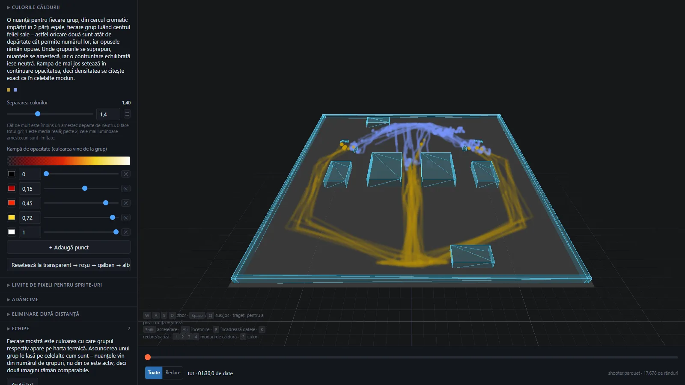

# Căldură pe echipe

Căldura pe echipe arată unde a fost fiecare echipă, fiecare echipă în culoarea ei. Acolo unde echipele se suprapun, culorile se amestecă.

**Căldură pe echipe** (tasta 3) este câmpul de densitate din [Căldură](heat.md) cu fiecare [grup](glossary.md) primind propria nuanță. Acolo unde grupurile se suprapun, nuanțele lor se amestecă; o luptă echilibrată iese neutră. Opacitatea poartă în continuare densitatea exact ca în celelalte moduri, astfel că imaginea răspunde în același timp la *cât* și la *a cui*. Are nevoie de o coloană de grup.

Nu este [suprapunerea figurilor](box-replay.md): aceasta desenează o figură pentru fiecare persoană; aceasta este un câmp de căldură colorat după aceeași coloană.

## Cum se folosește {#how-to-use-it}

1. Apasă `3` (sau alege **Căldură pe echipe** în bara de moduri).
2. Deschide **Culorile căldurii**. Mostrele arată culoarea fiecărui grup; treci cu cursorul peste o mostră ca să vezi numele echipei.
3. Dacă totul pare gri, mărește **Separarea culorilor**.
4. Debifează un grup din [Lista echipelor](teams-list.md) ca să-l scoți; celelalte culori rămân unde erau.

## Comenzi {#controls}

În secțiunea **Culorile căldurii**:

| Control | Implicit | Înseamnă |
|---|---|---|
| Mostrele | | Culoarea fiecărui grup, pentru primele 12 grupuri, apoi *+N în plus*. Treci cu cursorul peste ele pentru numele grupului și culoare. |
| **Separarea culorilor** | 1.4 | Cât de departe este împinsă un amestec de la neutru, 0-4. 0 face totul gri; 1 este media reală; peste aproximativ 2 cele mai luminoase amestecuri ies din intervalul afișabil și sunt limitate pe fiecare canal, ceea ce le schimbă nuanța. |
| **Rampă de opacitate (culoarea vine de la grup)** | rampa implicită de căldură | Aici se folosește doar **alfa** rampei: transparentă acolo unde nu este nimic, opacă în vârf. Culorile ei sunt ignorate. |

Un grup a cărui etichetă înseamnă „niciun grup" (`0`, gol, `none`, `unknown`, `null` sau `-1`) este desenat gri.

Toate celelalte comenzi de căldură - forma, saturația, răspunsul, căldura minimă, adâncimea, tăierea - funcționează ca la [Căldură](heat.md).

[Lista echipelor](teams-list.md) arată culoarea căldurii pe echipe a fiecărui grup ca mostră în acest mod. Ascunderea unui grup lasă culoarea fiecărui alt grup unde era: nuanțele vin din numărul total de grupuri, nu din ce este pornit, astfel că două imagini rămân comparabile.

## Pentru dezvoltatori {#for-developers}

### Paleta {#the-palette}

Din [`colors.ts`](https://github.com/Holdi601/3DHeat/blob/main/src/render/colors.ts):

- Culorile trăiesc pe planul de culoare **Oklab** la o luminozitate fixă (0,7) și cromă fixă (0,115), deci fiecare grup este la fel de luminos și un grup roșu nu pare mai fierbinte decât unul albastru.
- Cu *n* grupuri, cercul de nuanțe este împărțit în *n* părți egale, iar grupul *i* ia **centrul** părții lui, `(i + 0,5) / n` dintr-o rotație. Oricare două grupuri sunt cât de departe permite numărul, iar cele opuse rămân opuse indiferent de număr.
- Sunt folosite cel mult **16** nuanțe distincte. Cu mai multe grupuri, id-urile sunt plasate prin înjumătățiri repetate (id-uri cu biții inversați: 0, ½, ¼, ¾, ⅛, …) ca id-urile vecine să nu aibă aceeași nuanță; grupurile peste 16 împart neapărat.
- Un grup a cărui etichetă înseamnă „niciun grup" - `0`, gol, `none`, `unknown`, `null` sau `-1`, fără a ține cont de majuscule - este desenat **gri neutru** în loc să ia o felie din cerc. Doar prima asemenea etichetă din lista de grupuri este tratată așa.

Separarea implicită este 1,4 și nu 1, pentru că, la 1, un amestec de cinci nuanțe distribuite uniform *este* gri: corect și nelizibil. Un pic peste 1 păstrează egalitățile oneste, făcând în același timp vizibilă o împărțire de 60/40.

### Cum funcționează {#how-it-works}

Ținta căldurii are patru canale în acest mod. Fiecare sprite adaugă densitatea lui *v* la primul canal și *v* × coordonatele Oklab *a* și *b* ale grupului la al doilea și al treilea. La compozit, amestecul pixelului este media ponderată cu densitatea: *a* = G / R, *b* = B / R, scalată cu separarea culorilor și convertită în sRGB la luminozitatea paletei. Împărțirea la densitatea acumulată face ca nuanța să fie independentă de cât de multe date există, și de aceea fiecare control al densității continuă să acționeze doar asupra opacității.

Ținta cu patru canale costă de patru ori mai multă memorie GPU decât ținta de căldură cu un singur canal, la aceeași rezoluție.
