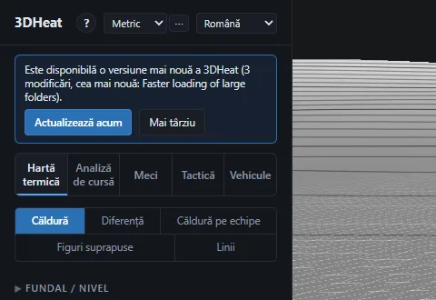

# Actualizări

Vizualizatorul îți spune când există o versiune mai nouă și se actualizează singur doar când spui da. Nimic nu se schimbă pe calculatorul tău fără răspunsul tău.

## Actualizarea vizualizatorului {#update-the-viewer}

1. **În pagină.** Când există o versiune mai nouă, apare o casetă sub numele din partea de sus a barei laterale: "E disponibilă o versiune mai nouă a 3DHeat". Dă clic pe **Actualizează acum**. Pagina se reîncarcă singură când termină. **Mai târziu** ascunde caseta până reîncarci pagina.
2. **Dacă spune să rulezi restart.bat**, închide fereastra serverului (fereastra neagră pe care a deschis-o `start.bat`) și fă dublu clic pe `restart.bat`.
3. **Când pornești vizualizatorul.** `start.bat` verifică și el. Dacă există o versiune mai nouă, te întreabă **Actualizez acum? [Y/N]**. Apasă `Y` ca să actualizezi. Apasă `N`, sau așteaptă 60 de secunde fără răspuns, ca să pornești versiunea pe care o ai.



O copie cu modificări proprii nu este niciodată actualizată pentru tine; caseta doar îți spune că o actualizare așteaptă și îți cere să salvezi modificările (commit sau stash) și să rulezi `git pull`. O copie care nu a fost instalată cu git (un fișier zip, de exemplu) nu arată nimic.

Cum funcționează verificarea, pas cu pas:

```
pagina ---(după 4 s, apoi la fiecare 6 h)---> serverul de dezvoltare ---> git fetch
   în urmă?  nu  -> nu se arată nimic
             da  -> modificări sau commit-uri proprii?  da -> doar te anunță
                                                       nu  -> [Actualizează acum] -> git pull
                                                              -> reîncarcă, sau "rulează restart.bat"
```

## Regulile de siguranță {#the-safety-rules}

- **Doar avans rapid** (`git pull --ff-only`): o actualizare nu îmbină, nu rebazează și nu rescrie nimic.
- **Fără modificări locale**: o copie cu modificări nesalvate la fișierele urmărite (`git status --porcelain --untracked-files=no` nu este goală) nu este actualizată automat - munca cuiva nu este de suprascris de o actualizare. Doar i se spune că o actualizare așteaptă. Fișierele neurmărite (date, exporturi) nu contează ca modificări.
- **Fără commit-uri locale**: o copie cu commit-uri pe care nu le are upstream-ul ("divergentă") nu este actualizată - un avans rapid nu o poate aduce la zi, iar îmbinarea este pentru `git pull` făcut de mână. Pagina și `start.bat` spun asta în aceleași cuvinte, iar `start.bat` pornește versiunea care există acolo.
- **Doar din pagina însăși**: cererea de actualizare a serverului de dezvoltare trebuie să aibă un antet personalizat și, când browserul trimite un `Origin`, să vină de la gazda serverului (mai jos).
- Doar o copie git cu o ramură upstream este vreodată actualizată; orice altceva (o copie fără `.git`, fără git instalat, o construcție statică) este lăsat în pace și nu spune nimic.

## Ce face start.bat {#what-startbat-does}

`start.bat` (fă dublu clic pe el; fereastra este serverul) face, în ordine:

1. Găsește Node.js - în `PATH`, altfel în `%ProgramFiles%\nodejs`, `%ProgramFiles(x86)%\nodejs` sau `%LOCALAPPDATA%\Programs\nodejs` - și oferă să-l instaleze cu `winget install -e --id OpenJS.NodeJS.LTS` când lipsește (întrebat, Y/N; după aceea fereastra trebuie deschisă din nou ca Windows să preia noul `PATH`).
2. **Actualizări**, când git este instalat și dosarul are `.git`:
   - `git fetch --quiet` (fără rețea sau fără upstream: sărit fără niciun mesaj);
   - numără `git rev-list --count HEAD..@{u}`; nimic în urmă: nu spune nimic;
   - modificări locale: "E disponibilă o versiune mai nouă a 3DHeat (N modificări), dar această copie are modificări locale, deci nu este actualizată. Salvează-le (commit sau stash), apoi rulează git pull." - și pornește versiunea care există;
   - commit-uri proprii (`git rev-list --count @{u}..HEAD` nu este 0): "E disponibilă o versiune mai nouă a 3DHeat (N modificări), dar această copie are commit-uri proprii pe care cea mai nouă versiune nu le are, deci nu este actualizată. Actualizeaz-o cu git pull." - și pornește versiunea care există;
   - altfel "E disponibilă o versiune mai nouă a 3DHeat (N modificări)." și întrebarea **Actualizez acum? [Y/N]**. `N`, sau fără răspuns timp de 60 de secunde, afișează "Nu s-a actualizat; pornesc versiunea pe care o ai." și pornește versiunea care există. La `Y`: "Se actualizează...", notează dacă se schimbă `package.json` sau `package-lock.json`, rulează `git pull --ff-only` (dacă tot eșuează - rețeaua, de exemplu: "Actualizarea nu a reușit; pornesc versiunea pe care o ai."), apoi `git submodule update --init` (uneltele fixate, vezi [Întreținerea documentației](maintaining.md#the-tools-under-exporters)), apoi `npm install` când s-au schimbat fișierele pachetului și există `node_modules`, și "Actualizat."
3. Refuză să pornească un al doilea server: când ceva ascultă deja pe portul **5273**, spune asta și indică `restart.bat` / `stop.bat`.
4. La prima rulare (fără `node_modules`), întreabă înainte să descarce dependențele (cam 300 MB în `node_modules\`, nimic la nivel de sistem).
5. Pornește serverul de dezvoltare pe `127.0.0.1:5273` (`--strictPort`) și deschide browserul când este gata.

`restart.bat` oprește serverul (după port) și rulează din nou `start.bat`, deci pune aceeași întrebare. `stop.bat` doar oprește.


## Pentru dezvoltatori {#for-developers}

### Cât timp rulează: ruta de actualizare {#while-it-runs-the-update-route}

Serverul de dezvoltare (plugin-ul Vite `heat3d-self-update` din `vite.config.ts`) servește `/__heat3d/update`. Există doar pe serverul de dezvoltare - nu într-o construcție statică și nu în `vite preview`.

**`GET /__heat3d/update`** răspunde dacă copia este în urmă:

```json
{ "checkout": true, "upstream": "origin/main", "behind": 3, "ahead": 0, "dirty": false, "latest": "the newest commit's subject" }
```

- `checkout: false` când dosarul nu este o copie git;
- rulează `git fetch --quiet` **cel mult o dată la 30 de minute** (cererile între timp răspund din ce a fost adus ultima dată);
- `behind` / `ahead` din `git rev-list --count HEAD..@{u}` / `@{u}..HEAD`, `dirty` din `git status --porcelain --untracked-files=no`, `latest` subiectul celui mai nou commit al upstream-ului;
- fără ramură upstream, `upstream: null` și `behind: 0`.

**`POST /__heat3d/update/apply`** aduce copia la zi:

1. Refuzat cu `403 { ok: false, reason: "forbidden" }` decât dacă cererea are antetul `X-Heat3d-Update: 1` și, când poartă un `Origin`, gazda acelui origin este `Host`-ul cererii. Un formular de pe alt site nu poate trimite un antet personalizat fără o verificare CORS prealabilă, pe care acest server nu o acordă niciodată.
2. Nimic de făcut (nu este o copie, fără upstream, nu este în urmă): `{ ok: true, updated: false }`.
3. Modificări locale: `{ ok: false, reason: "dirty" }`; commit-uri locale: `{ ok: false, reason: "diverged" }`.
4. Altfel: notează fișierele care se schimbă (`git diff --name-only HEAD @{u}`), `git pull --ff-only` (timeout de 2 min), `git submodule update --init` (eșecul este ignorat), `npm install` când s-au schimbat `package.json` sau `package-lock.json` (timeout de 15 min), și răspunde `{ ok: true, updated: true, restart }` - `restart` spune de ce serverul care rulează nu poate prelua actualizarea: `"dependencies"` când au fost reinstalate, `"config"` când s-a schimbat doar un fișier `vite.config`, `false` când nu este nevoie de repornire.
5. O comandă git sau npm care eșuează răspunde `{ ok: false, reason: "<eroarea, până la 300 de caractere>" }`.

Răspunsurile sunt JSON cu `Cache-Control: no-store`. Serverul ascultă doar pe `127.0.0.1`, deci ruta nu este accesibilă din rețea.

### Anunțul din pagină {#the-notice-in-the-page}

`UpdateBanner`, sub numele din partea de sus a barei laterale:

- Întreabă ruta la **4 secunde** după încărcarea paginii (nu în primele secunde: pagina are un set de date de încărcat și un GPU de pornit) și din nou **la fiecare 6 ore** cât timp pagina rămâne deschisă.
- Nu arată **nimic** când nu există o astfel de rută (o construcție statică), dosarul nu este o copie git, sau nimic nu este mai nou - un anunț la fiecare pornire este unul pe care oamenii învață să-l ignore.
- În urmă, fără modificări locale: "E disponibilă o versiune mai nouă a 3DHeat (N modificări, cea mai nouă: <subiect>)." cu **Actualizează acum** și **Mai târziu** (*Mai târziu* ascunde caseta până la reîncărcarea paginii).
- În urmă, cu modificări locale: aceeași propoziție și "Această copie are modificări locale, deci nu este actualizată automat; salvează-le (commit sau stash), apoi rulează git pull." - fără buton.
- **Actualizează acum** trimite la `/apply` ("Se actualizează..."). Apoi:
  - "Actualizat. Pagina se reîncarcă." - și se reîncarcă după 1,5 s (serverul servește deja fișierele noi);
  - când dependențele au fost reinstalate: "Actualizat. Dependențele lui s-au schimbat: închide fereastra serverului și rulează **restart.bat** ca să termini.";
  - când s-au schimbat doar setările serverului: "Actualizat. Setările serverului lui s-au schimbat: închide fereastra serverului și rulează **restart.bat** ca să termini.";
  - nimic de adus până la urmă (`updated: false` - copia a fost adusă la zi între timp, de `start.bat` de exemplu): "Nimic de actualizat: această copie este deja cea mai nouă versiune." - și nicio reîncărcare;
  - refuzat: propoziția despre *modificări locale*, sau "Această copie are commit-uri proprii pe care cea mai nouă versiune nu le are; actualizeaz-o cu git pull.", sau "Actualizarea nu a reușit: <motiv>".
