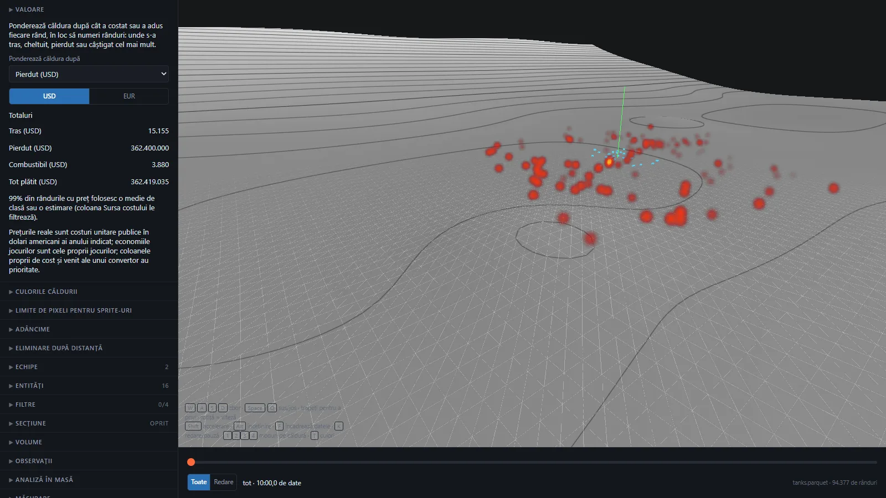

# Ponderarea valorii

Fiecare lovitură, fiecare muniție, fiecare vehicul pierdut și fiecare litru de combustibil are un preț. Vizualizatorul calculează cât a costat sau a adus fiecare rând și poate ponderea căldura după el, astfel încât harta arată **unde s-au dus banii**, nu unde sunt rândurile.

## Cum se folosește {#how-to-use-it}

1. Încarcă date cu evenimente (lovituri, eliminări, morți) și nume de vehicule sau arme.
2. Deschide **Valoare** în bara laterală a Căldurii.
3. Alege **Ponderează căldura după**, de exemplu *Pierdut (USD)*. Căldura adună acum prețul fiecărui rând în loc de 1.
4. Citește **Totaluri**: suma fiecărei coloane de valoare pentru ce se arată (filtrele și fereastra de timp se aplică).
5. Acolo unde prețurile sunt bani reali, apare un comutator **USD / EUR**.

Alege prima intrare goală din meniu ca să numeri din nou rândurile.

## Ce poate fi ponderat {#what-can-be-weighed}

Coloanele de valoare se adaugă la încărcare, câte una pentru fiecare tip și monedă:

| Tip | Rândurile pe care cade | Cum este prețuit |
|---|---|---|
| **Tras** | lovituri și lansări | arma, altfel o medie pentru tipul de muniție |
| **Cheltuit** | cumpărare, apariție | coloanele de bani ale jocului (de exemplu meniul de cumpărare al unui shooter) |
| **Pierdut** | morți, distrugeri | vehiculul propriu, altfel media clasei lui |
| **Distrus** | eliminări | vehiculul țintă |
| **Daune provocate** | lovituri reușite | o parte din valoarea țintei |
| **Combustibil** | poziții | combustibilul consumat, dintr-o coloană de combustibil sau estimat din clasă și timp |
| **Tot plătit** | | tras + cheltuit + pierdut + combustibil |
| **Câștigat** | recompense | coloanele de recompensă ale jocului (`earn_…`) |
| **Net** | | câștigat minus plătit; desenat ca o căldură cu semn (rampă pozitivă unde s-a câștigat mai mult, negativă unde s-a plătit mai mult) |

Numele coloanelor sunt `cost_<tip>_<monedă>`, `earn_<monedă>` și `net_<monedă>`. Un convertor care cunoaște moneda proprie a jocului (de exemplu un convertor de redări care scrie în creditele din joc) câștigă față de tabelele de prețuri încorporate.

## Tabelele de prețuri {#the-price-tables}

| Tabel | Monedă |
|---|---|
| Militar real: rachete, bombe, runde, contramăsuri, aeronave, elicoptere, vehicule terestre, nave, combustibil | USD (EUR = USD × 0,92, valoarea fixă `EUR_PER_USD` din [`cost.ts`](https://github.com/Holdi601/3DHeat/blob/main/src/data/cost.ts); nu este un curs live) |
| Meniurile de cumpărare ale shooterelor și recompensele pentru eliminări | creditele jocului |
| Jocuri cu tancuri și nave | creditele jocului |
| Jocuri de strategie (mai multe resurse) | o coloană pentru fiecare resursă, plus una combinată |
| Jocuri de război | puncte |

Jocul este recunoscut după nume din date. Prețurile reale vin din surse publice (documente bugetare, enciclopedii) sau sunt marcate ca estimări; nu sunt ajustate cu inflația. Lista generată a tabelelor este la [Tabele de valori](ref-value-tables.md).

## Estimări {#estimates}

Coloana suplimentară de categorie **Sursa costului** spune cum a fost prețuit fiecare rând: `table`, `class average`, `estimate` sau `none`. Secțiunea Valoare arată ce parte din rândurile prețuite sunt medii sau estimări. Ca să păstrezi doar rândurile prețuite exact, debifează *estimate* și *class average* la **Sursa costului** din [Filtre](filters.md).

## Unde mai apare valoarea {#where-else-value-shows}

- [Observații](insights.md): constatările *Teren costisitor* și *Teren câștigător*.
- [Defalcare](breakdown.md): bani câștigați, pierduți și net pe echipă, jucător sau armă.
- [Volume](volumes.md): coloanele de valoare în statistici și în comparație.
