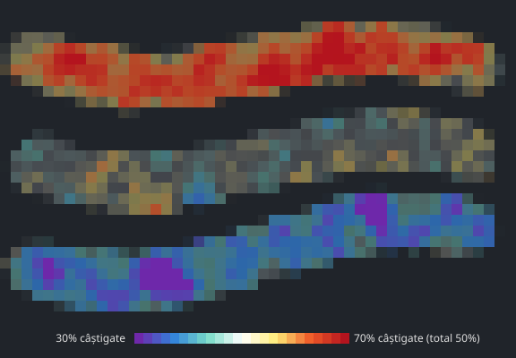

# Rata de victorie: cât de des câștigă un loc, un traseu sau o acțiune

Unde stă un jucător, încotro merge, de unde își aruncă grenadele - și cât de des câștigă apoi partea lui runda. **Harta ratei de victorie** colorează fiecare loc după proporția rândurilor de acolo care aparțin rundelor câștigate de partea rândului, față de proporția pe tot ce se arată: cald unde e mai mare, rece unde e mai mică, nimic unde e la fel.

*Imaginea are date inventate: trei trasee pe un nivel gol, cu 68 %, 50 % și 33 % din rândurile lor în runde câștigate.*

Are nevoie de date care spun cine a câștigat: [coloanele de rezultat](data-formats.md#outcome-columns) (`won`, `matchWon`, `roundEndReason`). Convertoarele CS2 și War Thunder le scriu, iar convertorul Tacview pentru campaniile unui server DCS ([Servere DCS](tacview-acmi.md#dcs-servers-who-won-and-how-each-sortie-ended)); orice fișier le poate avea.

## Încercați {#try-it}

1. Încărcați meciuri cu o coloană de rezultat și apăsați `2` (**Diferență**).
2. În **Împărțire pentru diferență**, apăsați **Rata de victorie pe rundă** (sau **Rata de victorie pe meci**). Pune rundele câștigate pe **+** și pe cele pierdute pe **−** și trece panoul pe **Proporția +**.
3. Citiți culorile. Panoul spune proporția totală: *În total, 52,0 % din 1.200.000 rânduri sunt pe +.*
4. Restrângeți cu [filtrele](filters.md): o parte (T sau CT), un tip de eveniment (*Poziție* pentru unde au stat oamenii, *Foc tras* sau *Lansare (rachetă, proiectil, bombă)* pentru de unde au tras sau au aruncat), o achiziție, o hartă.

Un loc cald cu rânduri *Poziție* este un loc ai cărui ocupanți au câștigat mai des runda. Cu rânduri *Doborâre* este un loc unde doborârile făcute au dus la runde câștigate.

## Setările {#the-settings}

| Setare | Ce face | Implicit |
|---|---|---|
| **Diferență** / **Proporția +** | diferența însăși, sau proporția părții + din rândurile ambelor părți | Diferență |
| **Culoare plină la** | cât de mult peste sau sub proporția totală este arătat un loc în culoare plină, în puncte | ± 20 de puncte |
| **Cele mai puține rânduri pentru a colora un loc** | un loc cu mai puține rânduri nu este colorat; culoarea apare treptat de la jumătate din acest număr | 12 |
| **Atracție spre proporția totală (rânduri)** | fiecare loc pornește de la atâtea rânduri la proporția totală, așa că un loc cu 3 rânduri, toate câștigate, nu este arătat ca 100 % | 12 |

Toate trei acționează asupra imaginii finale: dacă le trageți, acumularea nu repornește niciodată.

Proporția poate fi a oricărei împărțiri, nu doar a victoriilor: *Proporția +* cu o împărțire pe părți arată unde T au fost partea mai mare a prezenței, iar cu o împărțire pe fișierele a două hărți, unde rândurile unui fișier le întrec pe ale celuilalt.

## Rânduri, nu runde {#rows-not-rounds}

Harta numără rânduri. Un jucător care stă într-un loc douăzeci de secunde adaugă un rând la fiecare eșantion, toate din aceeași rundă. Așa că dovada dintr-un loc sunt rândurile din apropiere, nu rundele. De aceea minimul și atracția sunt în rânduri, și de aceea sunt mai mari decât o singură rundă.

Pentru rundele înseși:

- **[Defalcare](breakdown.md)** pe un punct, pe vedere sau pe un volum: *Victorii %* numără runda fiecărui jucător o singură dată, atrasă spre rata totală a locului în același fel (4 runde).
- Statisticile **[Volume](volumes.md)**: *Rata de victorie* - rundele cu un jucător în volum, fiecare o dată, atrase spre rata pe tot ce se arată, cu numerele.

## Filtre de rezultat {#outcome-filters}

Panoul [Filtre](filters.md) arată coloanele de rezultat imediat după coloanele proprii ale vizualizatorului: **Rezultatul rundei** și **Rezultatul meciului** (*Oricare*, *Câștigat*, *Pierdut*) și **Cum s-a încheiat runda** (eliminare, bomba a explodat, bomba dezamorsată, timpul a expirat, capitulare, egal, obiectiv, zone menținute, tichete pierdute, toate vehiculele pierdute), în limba vizualizatorului.

## Pentru dezvoltatori {#for-developers}

Trecerea de căldură scrie trei sume în ținta cu patru canale pe care o folosește căldura pe echipe: căldura `R = Σ|v|`, căldura părții + `P` și `S = Σ v²/w`, cu `w` ponderea trecerii (ponderea de eșantionare înmulțită cu câștigul cadrului). Compoziția citește proporția `P/R` (o medie ponderată cu nucleul) și rândurile pe care se sprijină, `n = R²/S` (mărimea efectivă a eșantionului după Kish), atrage proporția spre cea totală, `p = (n·P/R + m·r0)/(n + m)`, și colorează `p - r0` pe interval cu rampele de diferență.

`n` elimină orice factor comun rândurilor dintr-un pixel - câștigul cadrului, ponderea de eșantionare, ponderea de arie a unui sprite limitat - așa că imaginea este aceeași la orice zoom și densitate de eșantionare, iar cadrele cu fiecare al k-lea rând se unesc în întreg fără salturi de culoare. Proporția totală vine din numărătorile părților pe CPU, la o zecime de procent; nimic nu este citit înapoi de pe GPU. Aritmetica și verificările ei: [`render/rateMap.ts`](https://github.com/Holdi601/3DHeat/blob/main/src/render/rateMap.ts) și testul lui.

Costă cât căldura pe echipe: ținta cu patru canale împătrește lățimea de bandă de amestecare a trecerii de căldură, doar cât timp *Proporția +* este pornită.
