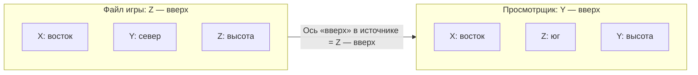

# Оси, единицы и время

Игры и карты не согласны в том, где верх, какой длины юнит и как записано время. На этой странице три настройки, которые ставят ваши данные ровно, в правильном масштабе и в правильном порядке.

Если ваша карта стоит вертикально, как стена, а не лежит, как пол, переключите **Ось «вверх» в источнике**.

С неверной **Осью «вверх» в источнике** карта стоит, как стена; с верной она лежит, как пол.

## Мир, который рисует просмотрщик {#the-world-the-viewer-draws-in}

Мир просмотрщика — **Y вверх**: X и Z образуют плоскость земли, Y — высота. Большинство игровых движков — **Z вверх**: для них X и Y — это земля, а Z — высота. Некоторые движки ещё и зеркальны (левосторонняя система координат). Сопоставление говорит, как перевести оси файла в оси просмотрщика. (Строго говоря, просмотрщик использует правостороннюю систему, как принято в three.js.)

### Ось «вверх» {#up-axis}

**Ось «вверх» в источнике** в [Сопоставлении столбцов](column-mapping.md):

| Настройка | Файл (x, y, z) становится миром (X, Y, Z) |
|---|---|
| *Z — вверх (большинство игровых движков)* — по умолчанию | (x, **z**, **y**): Z файла становится высотой, а Y файла становится Z мира |
| *Y — вверх (графическая конвенция)* | (x, y, z) без изменений |

Для данных с Z вверх три массива переименовываются, а не копируются ([`remapAxesInPlace`](https://github.com/Holdi601/3DHeat/blob/main/src/data/ingest.ts)). Это экономит сотни мегабайт при больших загрузках. Определение делается по выборке: вверх та из колонок Y и Z, у которой меньше разброс.

### Отражения {#flips}

**Отразить X**, **Отразить Y**, **Отразить Z** меняют знак *оси файла* с этим именем, до переименования. Поэтому при Z вверх **Отразить Y** меняет знак того, что становится Z мира. Отражение меняет загруженные данные: координаты, которые показывают [линейка](measure.md), срез и положение камеры, уже отражённые.

Чтобы нарисовать зеркальный мир правильно, **не** меняя данные, используйте **Камера и сцена → Инвертировать ось мира** ([Камера](camera.md#invert-world-axis)). Это лучший выбор для игр, мир которых левосторонний, потому что каждая координата, которую показывают инструменты, остаётся родной координатой игры.

### Масштаб единиц {#unit-scale}

**Масштаб единиц** умножает каждую позицию. *1 (м)* ставит 1, *0,01 (см→м)* ставит 0,01 (единицы Unreal Engine — сантиметры, поэтому берите 0,01; единицы движка Source — дюймы, поэтому берите 0,0254; ни то ни другое не метры). Поле принимает любое значение. Введённый 0 или значение, которое не является числом, заменяется на 1.

Просмотрщик подписывает расстояния в метрах (радиус спрайта, границы отсечения, линейка, скорость полёта). Это верно только тогда, когда мировая единица после масштабирования — метр. Если это не так, ничего не ломается: подписи просто показывают «м» для любой единицы.

## Время {#time}

### Единицы времени {#time-units}

Правило большого пальца: значения вроде 17000000000 (десять цифр и больше) — это Unix-метка времени; значения вроде 0, 0,25, 0,5 — это секунды от начала.

| Единица времени (подпись в меню) | Как читается | Показывается настенное время |
|---|---|---|
| *Секунды (относительные)* | значение × 1 с | нет |
| *Миллисекунды (относительные)* | значение × 0,001 с | нет |
| *Микросекунды (относительные)* | значение × 10^-6 с | нет |
| *Наносекунды (относительные)* | значение × 10^-9 с | нет |
| *Unix-метка времени (с)* | секунды с 1970-01-01 UTC | да |
| *Unix-метка времени (мс)* | миллисекунды с 1970-01-01 UTC | да |
| *Строка даты ISO-8601* | текст вида `2026-03-14T18:02:11.250Z`, разбирается `Date.parse` браузера | да |

При абсолютной единице (последние три) набор данных сохраняет момент по настенным часам для самой ранней строки, а временная шкала рядом с ползунком воспроизведения показывает текущее время суток UTC (`HH:MM:SSZ`).

**Столбцы `TIMESTAMP` и `DATE` в Parquet** декодируются в настоящие моменты, поэтому их настройка единицы игнорируется, и панель об этом сообщает. Столбец `DATE` — это целый день: все строки дня делят один момент, и воспроизведение прыгает по дню. Панель предупреждает об этом.

**Строки ISO-8601 работают одинаково в CSV и Parquet.** Текстовый столбец времени с единицей ISO разбирается один раз для каждой различной строки. Если ни одна не разбирается, загрузка завершается ошибкой *В сопоставленном столбце времени нет разбираемых меток ISO-8601.* Сопоставление и так отказывается запускаться, когда ни одно значение из выборки не разбирается. Столбец `TIMESTAMP` в Parquet читается как метка времени, какая бы единица ни была задана, а числовой столбец Parquet с единицей ISO читается как Unix-миллисекунды. Текстовый столбец времени с числовой единицей отклоняется до загрузки: каждое значение прочиталось бы как NaN.

### Как хранится время {#how-time-is-stored}

Пока файлы объединяются, времена хранятся как 64-битные секунды, поэтому абсолютная эпоха сохраняет доли секунды. Когда все файлы загружены, самое раннее время всей выборки становится 0, и каждая строка хранит 32-битные секунды от него. В 32-битном float 24 бита мантиссы: промежутки до примерно полутора суток различаются лучше 1/100 с, промежутки до полугода — примерно до секунды. Строка, у которой время отсутствует или не является числом, ставится в 0, то есть в начало.

Затем строки сортируются по времени. Именно это делает временную шкалу дешёвой: окно времени находится двумя бинарными поисками (см. [Выборка и бюджеты](sampling-and-budgets.md)).

### Время от начала и настенное время {#elapsed-time-versus-wall-clock}

Столбец времени, такой как `match_time` или `round_time`, считает от начала каждого матча. Если его выбрать, все матчи встанут на одну общую ось. Это удобно, чтобы сравнивать, что происходит на третьей минуте каждого матча, и панель на это указывает. Столбец настенного времени показывает матчи в том порядке, в котором они реально происходили, а там, где они шли одновременно, матчи перекрываются.

## Направление взгляда {#look-direction}

Направление взгляда используется только в [наложении фигур](box-replay.md) (лучи от каждой фигуры). Оно хранится как два угла, рыскание (yaw) и тангаж (pitch), в радианах.

- **Столбцы рыскания / тангажа** читаются как есть, а при выборе *Градусы* переводятся из градусов. Для оси «вверх» и отражений они не корректируются.
- **Столбцы вектора направления** проходят то же переименование и отражения, что и позиции. Затем получают yaw = atan2(x, -z) и pitch = atan2(y, √(x² + z²)) в осях мира. Так луч указывает туда, куда смотрит фигура, и в зеркальном мире источника тоже.

Если столбцы рыскания и тангажа показывают не туда после отражения, вектора направления или скорректированных углов, нужно исправить именно их.
