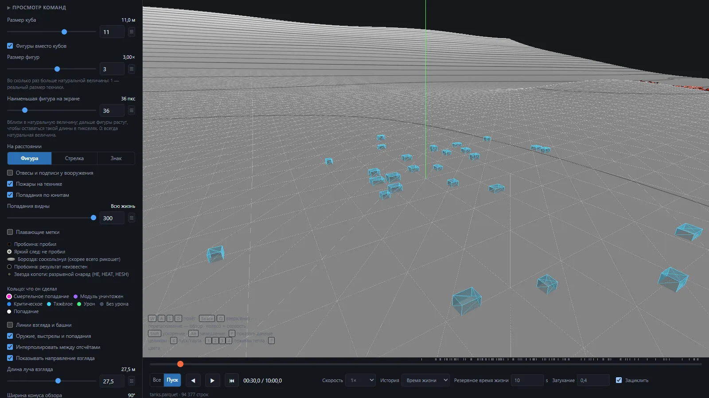

# Наложение фигур (повтор с кубами)

Небольшой фильм: одна фигура на каждого человека. Она движется, пока идёт время, и тянет за собой след.

Режим называется **Наложение фигур** в панели режимов. Раньше эта страница называлась «повтор кубов», потому что до появления фигур каждый человек был кубом. «Повтор фигур» и «повтор кубов» означают одно и то же. У **Наложения фигур** нет клавиши с цифрой: выберите его в панели режимов. Оно рисует одну фигуру (или куб) на каждого [человека](glossary.md), которая движется по [временной шкале](timeline.md). Есть необязательные лучи взгляда и следы. Это воспроизведение, а не плотность: *кто где был и когда*. Нужен столбец с человеком; без столбца времени каждый отсчёт рисуется сразу.

## Как пользоваться {#how-to-use-it}

1. Загрузите данные со столбцом человека и столбцом времени.
2. Выберите **Наложение фигур** в панели режимов.
3. Переключите временную шкалу на **Пуск** и нажмите воспроизведение (`K`).
4. Откройте **Просмотр команд**, чтобы изменить **Длину следа**, размер фигур или лучи взгляда.

В этом режиме тепло не рисуется, а адаптивный бюджет спрайтов не работает.

По умолчанию каждый человек рисуется как фигура того, кем он является, а не как куб. Какую фигуру получает юнит, см. [Фигуры](figures.md). Подписи, слежение камерой, измерение между двумя юнитами и список событий описаны в [Повторе матча](match-replay.md).

## Панель «Просмотр команд» {#the-team-viewer-panel}

Показывается вместо панелей тепла в этом режиме.

| Элемент | По умолчанию | Диапазон (прокрутка) | Значение |
|---|---|---|---|
| **Фигуры вместо кубов** | включено | | Каждый человек как фигура того, кем он является: солдат на ногах, танк или самолёт, которые называют данные. Всё, о чём данные ничего не говорят, остаётся кубом. |
| **Размер фигур** | 1× | | 1× — истинный размер. |
| **Наименьшая фигура на экране** | 36 px | 0 = всегда истинный размер | Вблизи — истинный размер; дальше фигуры растут, чтобы оставаться такой длины в пикселях. |
| **Оружие, выстрелы и попадания** | включено | | Оружие в полёте с дымом, трассеры, попадания, поражения и убийства. Трассеры, выведенные из попадания, пунктирные. |
| **Размер куба** | размер объекта или протяжённость / 500 при загрузке | 0,05–200 м, логарифмически (5000) | Длина ребра каждого куба. См. [размер объекта](sessions-persons-groups.md#entity-size). |
| **Интерполировать между отсчётами** | включено | | Между двумя отсчётами одного человека в одной сессии куб ставится пропорционально между ними. Никогда не переходит через границу сессии. |
| **Показывать направление взгляда** | включено | | Луч от каждого куба по направлению взгляда человека (нужны [столбцы взгляда](axes-units-and-time.md#look-direction)). |
| **Длина луча взгляда** | размер объекта × 4 или протяжённость / 200 при загрузке | 0,5–500 м, логарифмически (20 000) | Показывается, пока включено направление взгляда. |
| **Длина следа** | 8 с | 0–300 с (86 400); 0 = выключено | Секунды истории, которые рисуются позади каждого человека. |
| **Рисовать каждый исходный отсчёт** | выключено | | Куб на каждый сохранённый отсчёт в окне, а не один интерполированный куб на человека. Прореживается, чтобы оставаться интерактивным. |

Подсказки в панели объясняют, что интерполяция и следы соединяют отсчёты только внутри одной сессии. Если в загрузке есть [общие имена](sessions-persons-groups.md#names-worn-by-several-things-at-once), там также написано, сколько имён рисуется как одиночные отсчёты.

## Воспроизводимая сессия {#the-session-being-played}

Если есть столбец сессии, выбор **Сессии** вверху боковой панели ([Сессии](sessions-persons-groups.md#the-session-picker)) решает, какой матч воспроизводится. При загрузке выбирается самый загруженный. В кубы и следы превращаются только строки этой сессии, а временная шкала идёт по промежутку этой сессии, а не по всему набору данных. *Все сессии* воспроизводит все сессии сразу и по-прежнему не соединяет отсчёты между сессиями.

## Что и когда рисуется {#what-is-drawn-when}

Из [`TrackCursor`](https://github.com/Holdi601/3DHeat/blob/main/src/data/tracks.ts):

**Живые кубы** (режим «Пуск», исходные отсчёты выключены). Для каждого видимого человека берётся его последний отсчёт в момент ползунка или раньше:

- Если у человека есть следующий отсчёт, он в той же сессии и имя не общее, куб ставится между двумя отсчётами пропорционально времени. Угол рыскания интерполируется по короткой дуге, тангаж — линейно (если включено *Интерполировать*).
- Иначе куб остаётся на последнем отсчёте в течение **резервного времени жизни** временной шкалы (по умолчанию 10 с), а потом пропадает, чтобы выбывшие игроки не задерживались.

**Режим «Все»** игнорирует ползунок и рисует каждый отсчёт в диапазоне как куб.

**Исходные отсчёты** рисуют куб на каждый сохранённый отсчёт в окне: *промежуток* при истории *Окно*, иначе всё до ползунка. Не больше 65 536 кубов; если отсчётов больше, рисуется каждый *k*-й.

**Следы** (когда длина следа больше 0 и исходные отсчёты не рисуются): линия между каждой парой соседних отсчётов человека за последние *длину следа* секунд до ползунка. Непрозрачность падает от 80% до прозрачной с возрастом. След обрывается на смене сессии и не рисуется для общих имён. Не больше 131 072 вершин; если их больше, строки равномерно пропускаются.

**Кто виден:** человек скрыт, если его группа снята в [списке команд](teams-list.md) (группа определяется по первой его строке), если фильтр группы её исключает или если в панели [Объекты](entities.md) выбрано то, что его не включает. [Фильтры](filters.md) столбцов к кубам не применяются.

## Цвета {#colours}

Одно семейство оттенков на группу и один тон на каждого участника, поэтому по одному взгляду видно, на чьей стороне человек ([`teamMemberColor`](https://github.com/Holdi601/3DHeat/blob/main/src/render/colors.ts)). Оттенки групп идут по фиксированному списку из десяти: синий, красный, зелёный, янтарный, фиолетовый, голубой, пурпурный, лаймовый, оранжевый, индиго. Участники группы распределены по светлоте от 42 до 76% и по насыщенности от 90 до 65%.

## Заметки {#notes}

- Наложение фигур перестраивает свои фигуры, только когда что-то меняется. Неподвижный кадр перерисовывает последние.
- Строка *Кубы* в [наложении статистики](performance-and-stats.md) считает кубы на экране.
- Наложение фигур рисуется в той же сцене, что и уровень, поэтому [глубина резкости](camera.md#depth-of-field) размывает кубы, но никогда не размывает тепло.
